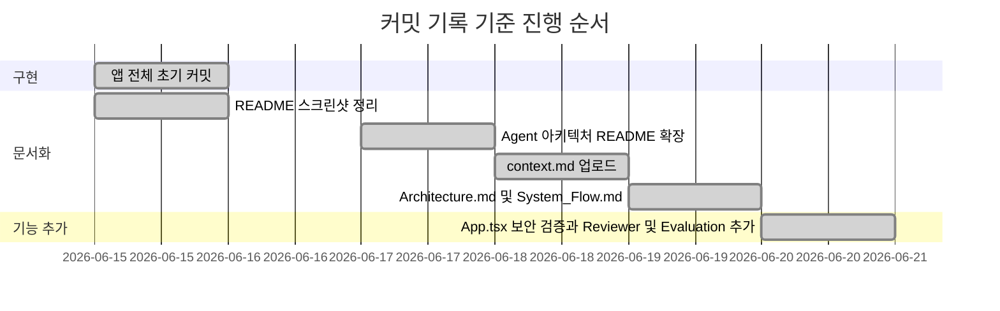
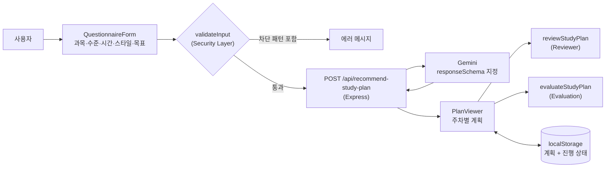

## 들어가며 (Situation)

**AI Study Plan Recommender**는 과목, 현재 수준, 주당 공부 시간, 학습 기간, 학습 스타일, 목표를 입력하면 Gemini가 주차별 공부 계획을 만들어 주는 웹 앱입니다. 만들어진 계획 안에서 주제별 체크, 주차별 과제 완료 표시, 퀴즈 풀이, 메모까지 할 수 있어요.

이 프로젝트는 Google의 **5-Day AI Agents Intensive Course**를 들으면서 만든 것입니다. README를 보면 코스의 각 날짜 주제(Agent Workflow, MCP, Agent Skills, Security & Evaluation, Spec-Driven Development)를 이 프로젝트에 하나씩 대입해 보는 형식으로 정리되어 있습니다.

## 문제 상황 (Task)

README가 짚는 문제는 한 줄로 요약됩니다.

> Most study planners are static.

대부분의 공부 계획표는 한 번 만들면 끝이라, 사람마다 다른 수준·시간·학습 방식을 반영하기 어렵습니다. 이 프로젝트가 풀고 싶었던 과제를 정리하면 다음과 같습니다.

| 과제 | 구체적인 내용 |
|------|---------------|
| 개인화 | 수준(beginner/intermediate/advanced), 주당 시간, 학습 스타일(visual/practical/reading/auditory)에 맞춘 계획 |
| 구조화 | LLM 응답을 화면에 바로 그릴 수 있는 정해진 형태(주차 → 주제 → 자료 → 과제 → 퀴즈)로 받기 |
| 진행 추적 | 계획을 보는 데서 끝나지 않고, 완료 여부와 퀴즈 점수를 기록 |
| 안전성 | 사용자 입력을 그대로 프롬프트에 넣기 전에 기본적인 검증 |

이 중 기술적으로 가장 중요한 부분은 두 번째, **LLM의 자유로운 텍스트 응답을 UI가 믿고 쓸 수 있는 데이터로 바꾸는 것**입니다.

## 해결 과정 (Action)

### 1. 개발 흐름 — 커밋 기록으로 본 진행 순서

커밋 기록을 보면 이 프로젝트는 2026년 6월 15일부터 20일까지 다음 순서로 진행되었습니다.



전체 커밋 25개를 시간순으로 정리하면 다음과 같습니다.

| 일시 | 커밋 메시지 | 변경된 파일 |
|------|-------------|-------------|
| 06-15 18:05 | Initial commit - AI Study Plan Recommender | `server.ts`, `src/App.tsx`, `src/components/QuestionnaireForm.tsx`, `src/components/PlanViewer.tsx`, `src/types.ts` 등 앱 전체 |
| 06-15 19:07 | Update README.md | `README.md` |
| 06-15 19:09 | add screenshots | `public/screenshots/` (home, result, progress, complete) |
| 06-15 19:19 | Update README.md | `README.md` |
| 06-17 15:39 | Expand README with AI Agent Architecture details | `README.md` |
| 06-17 15:44 | Update README.md | `README.md` |
| 06-17 15:47 | Update README.md | `README.md` |
| 06-18 14:37 | Add files via upload | `context.md` 추가 |
| 06-18 14:40 | Update README.md | `README.md` |
| 06-19 13:08 | Update README.md | `README.md` |
| 06-19 13:09 | Update README.md | `README.md` |
| 06-19 13:15 | Update context.md | `context.md` |
| 06-19 13:16 | Create Architecture.md | `Architecture.md` |
| 06-19 13:16 | Create System_Flow.md | `System_Flow.md` |
| 06-19 13:25 | Add project structure image to README | `README.md` |
| 06-19 13:26 | Update README.md | `README.md` |
| 06-19 13:26 | Add files via upload | `public/screenshots/project_structure.png` |
| 06-20 11:16 | Update App.tsx | `src/App.tsx` (Security, Reviewer, Evaluation 단계 추가) |
| 06-20 11:20 | Update README.md | `README.md` |
| 06-20 11:24 | Add note about real-time recommendation schedules | `README.md` |
| 06-20 11:57 | Update README.md | `README.md` |
| 06-20 12:02 | Add files via upload | `project_structure.png` 교체 |
| 06-20 12:02 | Delete public/screenshots/project_structure.png | `project_structure.png` 삭제 |
| 06-20 12:03 | Add files via upload | `project_structure.png` 다시 추가 |
| 06-20 12:06 | Update README.md | `README.md` (마지막 커밋) |

정리하면 앱 코드는 첫 커밋에 한 번에 들어왔고, 이후 커밋의 대부분은 문서화(README, `context.md`, `Architecture.md`, `System_Flow.md`)였으며, 코드 변경은 6월 20일의 `App.tsx` 수정 한 번입니다.

`metadata.json`과 `.env.example`의 주석("AI Studio automatically injects this at runtime")을 보면, 첫 버전은 Google AI Studio의 앱 구조(Express + Vite + `@google/genai`)를 기반으로 만들어진 것으로 보입니다.

### 2. 전체 구조



Express 서버 하나가 API(`/api/recommend-study-plan`)와 Vite 개발 서버 미들웨어를 함께 띄우는 구조입니다. API 키는 서버의 환경 변수에서만 읽기 때문에 브라우저로 노출되지 않습니다.

파일별 역할은 다음과 같습니다.

| 파일 | 역할 |
|------|------|
| `server.ts` | Express 서버, Gemini 클라이언트, `studyPlanSchema`, `/api/recommend-study-plan` 엔드포인트 |
| `src/App.tsx` | 화면 전환(폼 ↔ 계획), `validateInput`, `reviewStudyPlan`, `evaluateStudyPlan`, 계획 캐시 |
| `src/components/QuestionnaireForm.tsx` | 질문지 입력 폼, 추천 과목 버튼, 학습 스타일 카드 |
| `src/components/PlanViewer.tsx` | 주차별 계획 표시, 주제 체크, 과제 완료, 퀴즈, 메모, 진행률 |
| `src/types.ts` | `StudyQuestionnaire`, `StudyPlan`, `WeekPlan`, `UserProgress` 등 공유 타입 |

### 3. 입력 단계 — QuestionnaireForm

`QuestionnaireForm`은 과목, 수준, 주당 시간, 기간(2/4/6/8주), 학습 스타일, 목표를 받습니다. 추천 과목 버튼(`POPULAR_SUBJECTS`)을 누르면 과목 성격에 맞는 기본 목표 문장을 채워 주고, 목표를 비워 두면 제출 시 기본 문장으로 대신합니다.

```tsx
// 프로젝트 코드: src/components/QuestionnaireForm.tsx (일부)
const handleSuggestClick = (sub: string) => {
  setSubject(sub);
  if (sub.includes("React") || sub.includes("Python")) {
    setGoal("Build a production-quality project to add to my coding resume.");
  } else if (sub.includes("AP") || sub.includes("Chemistry")) {
    setGoal("Achieve a high grade (5/5 score) in my upcoming standardized exam.");
  } else {
    setGoal("Learn the fundamental concepts thoroughly for future workplace application.");
  }
};

const handleFormSubmit = (e: React.FormEvent) => {
  e.preventDefault();
  if (!subject.trim()) return;
  onSubmit({
    subject: subject.trim(),
    currentLevel, hoursPerWeek, durationWeeks, learningStyle,
    goal: goal.trim() || `Master the fundamentals of ${subject} through a structured approach.`
  });
};
```

기간을 `2 | 4 | 6 | 8` 유니언 타입으로 제한해 두었기 때문에, 서버 프롬프트의 "Design exactly ${durationWeeks} weeks" 지시도 이 네 값 중 하나로만 들어갑니다.

### 4. 핵심 구현 ① — responseSchema로 응답 모양 고정하기

LLM에게 "JSON으로 답해줘"라고 프롬프트로만 부탁하면 필드가 빠지거나 이름이 바뀌는 경우를 UI가 모두 방어해야 합니다. 이 프로젝트는 Gemini의 **구조화 출력(Structured Output)** 기능을 사용해서, 응답 스키마를 서버 코드에 직접 선언했습니다.

```ts
// 프로젝트 코드: server.ts (일부 생략)
const studyPlanSchema = {
  type: Type.OBJECT,
  properties: {
    title: { type: Type.STRING },
    summary: { type: Type.OBJECT, /* totalWeeks, hoursPerWeek ... */ },
    weeks: {
      type: Type.ARRAY,
      items: {
        type: Type.OBJECT,
        properties: {
          weekNumber: { type: Type.INTEGER },
          theme: { type: Type.STRING },
          topics: { /* name, description, difficulty */ },
          resources: { /* title, type, suggestedSearch, description */ },
          deliverable: { /* title, description */ },
          quiz: {
            type: Type.ARRAY,
            description: "Exactly 3 review quiz questions testing knowledge of this week's topics"
            /* question, options, correctAnswer, explanation */
          }
        },
        required: ["weekNumber", "theme", "weeklyObjective", "estimatedHours",
                   "topics", "resources", "deliverable", "quiz"]
      }
    }
  },
  required: ["title", "description", "summary", "estimatedCompletionTime",
             "tips", "milestones", "weeks"]
};
```

그리고 이 스키마를 `generateContent` 호출의 `config`에 넘깁니다.

```ts
// 프로젝트 코드: server.ts
const response = await aiClient.models.generateContent({
  model: "gemini-3.5-flash",
  contents: promptText,
  config: {
    systemInstruction: "You are an elite educational AI curriculum advisor who always formats responses strictly adhering to the JSON schema provided.",
    responseMimeType: "application/json",
    responseSchema: studyPlanSchema,
    temperature: 0.2
  }
});

const studyPlan = JSON.parse(response.text.trim());
return res.json(studyPlan);
```

눈여겨볼 점은 세 가지입니다.

| 설정 | 값 | 역할 |
|------|----|------|
| `responseMimeType` | `application/json` | 응답을 JSON으로 받도록 지정 |
| `responseSchema` | `studyPlanSchema` | 필드 이름·타입·필수 여부를 스키마로 강제 |
| `temperature` | `0.2` | 낮은 값으로 설정해 응답 형식과 내용의 변동을 줄임 |

스키마의 `description`도 단순 주석이 아니라 모델에게 주는 지시 역할을 합니다. 예를 들어 `quiz`에는 "Exactly 3 review quiz questions", `correctAnswer`에는 "Must exactly match one of the string choices in the options list"라고 적혀 있어요. 뒤에서 볼 퀴즈 채점 코드가 `q.options[selectedIndex] === q.correctAnswer`처럼 **문자열 일치**로 정답을 판단하기 때문에, 이 제약이 스키마 안에 들어가 있는 것이 중요합니다.

프론트엔드 쪽 `src/types.ts`에도 같은 모양의 TypeScript 인터페이스(`StudyPlan`, `WeekPlan`, `PracticeQuizQuestion` 등)가 정의되어 있어서, 서버 스키마와 클라이언트 타입이 같은 구조를 공유합니다.

### 5. 핵심 구현 ② — 학습 스타일을 프롬프트에 녹이기

개인화는 프롬프트에서 이루어집니다. 사용자가 고른 학습 스타일별로 어떤 자료를 추천해야 하는지를 프롬프트 안에 명시했습니다.

```ts
// 프로젝트 코드: server.ts (프롬프트 일부)
const promptText = `
  Subject/Topic: ${subject}
  Current Level: ${currentLevel}
  Available Weekly Time: ${hoursPerWeek} hours/week
  Desired Commitment Duration: ${durationWeeks} weeks
  Primary Learning Style: ${learningStyle}
  Core Learning Goal: ${goal}

  Guidelines:
  - Design exactly ${durationWeeks} weeks of content.
  - Make the study plan highly tailored to their primary learning style:
    * If visual: suggest visual layout tasks, graphic summaries, video courses.
    * If practical: include building apps, ... hands-on drills.
    ...
  - Formulate realistic expectations based on studying ${hoursPerWeek} hours per week.
`;
```

추천 자료는 실제 URL이 아니라 `suggestedSearch`(검색어)로 받습니다. 화면에서는 이 검색어를 Google 검색·YouTube 검색 링크로 바꿔서 보여줍니다. LLM이 존재하지 않는 URL을 만들어낼 위험을 피하는 방식이에요.

```ts
// 프로젝트 코드: src/components/PlanViewer.tsx
const getSearchUrl = (query: string) =>
  `https://www.google.com/search?q=${encodeURIComponent(query)}`;
const getYoutubeUrl = (query: string) =>
  `https://www.youtube.com/results?search_query=${encodeURIComponent(query)}`;
```

### 6. 핵심 구현 ③ — 진행 상태를 localStorage에 저장하기

로그인이나 DB 없이, 진행 상태는 브라우저의 `localStorage`에 계획 제목 기반 키로 저장합니다.

```ts
// 프로젝트 코드: src/components/PlanViewer.tsx (일부)
const storageKey = `study_progress_${plan.title.replace(/\s+/g, "_")}`;

const saveProgress = (newProgress: UserProgress) => {
  setProgress(newProgress);
  localStorage.setItem(storageKey, JSON.stringify(newProgress));
};

const overallProgressPercentage = Math.round(
  ((completedTopicsCount + completedDeliverablesCount) /
   (totalTopics + totalDeliverables)) * 100
);
```

진행률은 "완료한 주제 수 + 완료한 주차 과제 수"를 전체 개수로 나눈 값입니다. 저장되는 상태(`UserProgress`)는 완료한 주제 키, 완료한 과제 주차, 주차별 퀴즈 점수, 주제별 메모 네 가지입니다.

### 7. 핵심 구현 ④ — Security, Reviewer, Evaluation 단계 추가

6월 20일 커밋에서 README의 Multi-Agent 설계를 코드로 옮기는 작업이 들어갔습니다. 계획 생성 전후로 세 단계가 추가되었어요.

```ts
// 프로젝트 코드: src/App.tsx (일부)
const validateInput = (questionnaire: StudyQuestionnaire) => {
  const blockedPatterns = [
    "ignore previous instructions",
    "system prompt",
    "reveal hidden instructions",
    "act as",
    "developer mode"
  ];
  const text = JSON.stringify(questionnaire).toLowerCase();
  return !blockedPatterns.some(pattern => text.includes(pattern));
};

const reviewStudyPlan = (plan: StudyPlan) => {
  const feedback = [];
  if (plan.weeks?.length < 4)
    feedback.push("Consider increasing the study duration.");
  feedback.push("Weekly workload appears balanced.");
  feedback.push("Include regular revision sessions.");
  return feedback.join(" ");
};

const evaluateStudyPlan = () => {
  return { realism: 8, coverage: 9, balance: 8 };
};
```

코드를 그대로 읽어 보면, 현재 단계는 이렇게 정리됩니다.

| 단계 | README의 설계 | 현재 코드의 동작 |
|------|---------------|------------------|
| Security Layer | 입력 검증, 프롬프트 인젝션 탐지 | 클라이언트에서 5개 문구를 문자열 포함 여부로 차단 |
| Planner Agent | Gemini로 계획 생성 | `/api/recommend-study-plan`에서 Gemini 호출 (구현됨) |
| Reviewer Agent | 누락 주제, 분량 불균형 탐지 | 주차 수가 4 미만인지만 확인하고 나머지는 고정 문구 |
| Evaluation Agent | 현실성·범위·균형 점수화 | 고정값(8, 9, 8)을 반환 |
| MCP 연동 | GitHub MCP, Developer Knowledge MCP | 코드에는 없음 (README의 개념 정리 단계) |

즉 현재 버전에서 실제 LLM 추론이 일어나는 곳은 Planner 한 곳이고, Reviewer와 Evaluation은 **화면 흐름과 자리를 먼저 잡아 둔 규칙 기반 스텁**에 가깝습니다. README의 "Future Evaluation Enhancements" 항목에 LLM-as-a-Judge가 들어 있는 것도 이 자리를 나중에 실제 평가 로직으로 채우겠다는 방향으로 읽을 수 있어요.

보안 검증도 마찬가지로 한계가 분명합니다. 블랙리스트 문자열 비교는 표현만 바꾸면 우회되고, 브라우저에서만 검사하므로 API를 직접 호출하면 건너뛸 수 있습니다. 반대로 "act as" 같은 짧은 문구는 정상적인 학습 목표 문장에도 들어갈 수 있어요. 이 부분은 다음 단계에서 서버 측 검증으로 옮기는 것이 자연스러운 개선 방향입니다.

### 8. 기술 선택 정리

| 영역 | 선택 | 이 프로젝트에서의 이유 |
|------|------|------------------------|
| LLM | Gemini (`@google/genai`) | `responseSchema`로 구조화된 JSON 응답을 받을 수 있음 |
| 서버 | Express + Vite 미들웨어 | API 키를 서버에만 두고, 개발 시 한 프로세스로 프론트와 API를 함께 실행 |
| 프론트 | React 19 + TypeScript | 서버 스키마와 같은 모양의 타입을 `types.ts`에 정의해 공유 |
| 스타일/애니메이션 | Tailwind CSS 4, motion | 폼 ↔ 계획 화면 전환 애니메이션(`AnimatePresence`) |
| 상태 저장 | localStorage | 로그인·DB 없이 진행 상태 유지 |

## 결과 (Result)

저장소 기준으로 확인할 수 있는 결과는 다음과 같습니다.

- 질문지 입력 → Gemini 계획 생성 → 주차별 주제·자료·과제·퀴즈 표시 → 진행 상태 저장까지 하나의 흐름이 동작하는 웹 앱 (README에 입력, 결과, 진행 추적, 완료 화면 스크린샷과 [데모 영상](https://youtu.be/gRbmd0upRsk)이 첨부되어 있습니다)
- 응답 형식을 `responseSchema`로 고정해, 프론트엔드가 별도의 파싱 보정 로직 없이 `JSON.parse` 결과를 바로 렌더링하는 구조
- `context.md`, `Architecture.md`, `System_Flow.md`로 설계 원칙·레이어·워크플로를 문서화
- Security / Reviewer / Evaluation 단계를 화면 흐름에 연결 (현재는 규칙 기반 및 고정값 단계)

저장소에 성능이나 품질에 대한 측정 수치는 남아 있지 않습니다. 정리하면, 이 프로젝트는 **구조화 출력으로 Planner 단계를 실제로 동작시키고**, 코스에서 배운 Agent 개념(Reviewer, Evaluation, MCP)은 문서와 스텁으로 먼저 자리를 잡아 둔 상태입니다. 다음 단계로는 Reviewer를 LLM 호출로 바꾸고, 생성된 계획을 다시 평가해 점수를 매기는 LLM-as-a-Judge를 붙이는 것이 README에 적힌 방향과 가장 가깝습니다.

## 더 학습하면 좋은 개념

- **JSON Schema** — Gemini의 `responseSchema`는 OpenAPI/JSON Schema의 부분집합을 따릅니다. `required`, `enum`, 배열 길이 제약 같은 문법을 정확히 알면 "Must be Easy, Medium, or Hard"처럼 설명으로만 적은 제약을 스키마 수준으로 올릴 수 있습니다.
- **런타임 검증 (Zod 등)** — 구조화 출력을 써도 서버에서 한 번 더 검증하면 모델 변경이나 예외 상황에 안전합니다. TypeScript 타입은 컴파일 시점에만 존재한다는 점을 함께 이해하면 좋습니다.
- **프롬프트 인젝션 방어** — 블랙리스트 문자열 비교의 한계를 알고, 입력과 지시를 분리하는 설계, 서버 측 검증, 출력 검증 같은 다층 방어를 공부하면 Security Layer를 실제로 강화할 수 있습니다.
- **LLM-as-a-Judge** — 현재 고정값인 Evaluation 단계를 다른 LLM 호출로 채우는 방법입니다. 평가 기준(rubric) 설계와 평가 결과의 신뢰도 문제를 함께 다룹니다.
- **Model Context Protocol (MCP)** — README에서 다룬 개념으로, LLM 앱이 외부 도구와 데이터에 표준화된 방식으로 연결되는 프로토콜입니다. 실제 도구 연동을 붙일 때 출발점이 됩니다.

## 참고 자료

- [Gemini API - Structured output](https://ai.google.dev/gemini-api/docs/structured-output)
- [Gemini API - Text generation](https://ai.google.dev/gemini-api/docs/text-generation)
- [Google Gen AI SDK for JavaScript (@google/genai)](https://github.com/googleapis/js-genai)
- [Vite - Server Options (middlewareMode)](https://vite.dev/config/server-options)
- [Express 공식 문서](https://expressjs.com/)
- [MDN - Window.localStorage](https://developer.mozilla.org/en-US/docs/Web/API/Window/localStorage)
- [OWASP - LLM01 Prompt Injection](https://genai.owasp.org/llmrisk/llm01-prompt-injection/)
- [Model Context Protocol 공식 문서](https://modelcontextprotocol.io/)
- [프로젝트 저장소 - ai-study-plan-recommender](https://github.com/Lezo-Jong/ai-study-plan-recommender)
