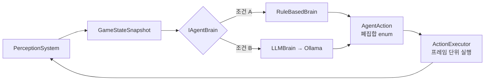

## 들어가며 (Situation)

전에 만든 Unity 1대1 프로젝트가 하나 있습니다.
플레이어의 행동을 로그로 모아 PyTorch로 학습시키고, ONNX로 변환해
Barracuda로 Unity 안에서 추론하는 파이프라인이었습니다.
README에 **테스트 정확도 93.47%**라고 적어 두었습니다.

이번에 새 프로토타입을 시작하기 전에 그 코드를 다시 읽었습니다.
그리고 세 가지를 발견했습니다.

> **비전공자를 위한 용어 세 개**
>
> - **LLM(대규모 언어 모델)** — ChatGPT처럼 글을 읽고 글로 답하는 AI.
> - **절제 실험(ablation)** — 시스템에서 부품을 하나만 빼 보고, 결과가 얼마나 달라지는지 재는 방법. 의학에서 온 말입니다.
> - **p값** — "우연히 이 정도 차이가 나올 확률". 작을수록 우연으로 보기 어렵다는 뜻입니다.

**첫째, NPC의 행동을 정하는 것은 난수였습니다.**

```csharp
private IEnumerator DoRandomAction()
{
    int action = Random.Range(0, 6);
    switch (action) { /* Slash / Block / Jump / Crouch ... */ }
}
```

거리 조건(추격 범위, 공격 범위) 외에는 균등 난수입니다.
의사결정이라고 부를 만한 절차가 없습니다.

**둘째, 학습한 모델의 출력이 행동에 도달하는 경로가 없었습니다.**

```csharp
private float[] inputFeatures = new float[] { 0f, 0f, /* ... 19개 */ };

void Update()
{
    float[] output = Predict(inputFeatures);
    Debug.Log("Predicted output: " + string.Join(",", output));
}
```

입력 배열은 선언된 자리의 `0f`에서 **한 번도 갱신되지 않습니다.**
출력은 `Debug.Log`로 나가고 끝납니다.
그리고 행동을 결정하는 `EnemyAI` 클래스는 이 추론 클래스를 참조조차 하지 않습니다.
추론 파이프라인과 게임이 각자 따로 돌고 있었던 겁니다.

**셋째, 그래서 93.47%는 게임 안에서 아무것도 의미하지 않았습니다.**

그 숫자는 "플레이어의 다음 행동을 맞히는 오프라인 분류 정확도"입니다.
정확도가 99%가 되어도 NPC는 여전히 `Random.Range(0, 6)`으로 움직입니다.

뼈아팠던 건 이게 코딩 실수라기보다 **질문을 잘못 세운 것**이었다는 점입니다.
"플레이어의 다음 행동을 얼마나 잘 맞히는가"는 답하기 쉽고 숫자도 예쁘게 나옵니다.
하지만 그건 "그래서 NPC가 더 잘 싸우는가"와 다른 질문입니다.
저는 답하기 쉬운 쪽을 풀고 있었습니다.

---

## 문제 상황 (Task)

새 프로토타입의 목표를 이렇게 잡았습니다.

> **LLM이 매 순간 상황을 읽고 전략과 행동을 고르되,
> 그 선택이 실제로 게임을 바꾸는지를 숫자로 말할 수 있어야 한다.**

여기서 나온 제약이 네 개였습니다.

| 제약 | 내용 | 왜 필요했나 |
|---|---|---|
| **금지 1** | `Player Log → Dataset → Model Training → Behavior Prediction` 경로를 만들지 않는다 | 전작에서 이 경로가 게임과 끊겨 있었다. 로그는 분석용으로만 쓴다 |
| **금지 2** | LLM이 프레임 단위 물리 제어를 하지 않는다 | 지연 때문에 불가능하고, "LLM 덕분에 좋아진 것"과 "코드가 좋아진 것"을 구분할 수 없게 된다 |
| **요구 1** | 인과를 말할 수 있어야 한다 | 사람이 플레이한 로그로는 안 된다. 플레이어가 AI에 반응하므로 무엇이 원인인지 알 수 없다 |
| **요구 2** | API가 느리거나 죽어도 게임이 멈추면 안 된다 | 로컬 LLM 응답이 0.8~1.7초다. 60FPS 게임의 프레임은 0.016초다 |

---

## 해결 과정 (Action)

### 1. 구조: 세 개의 시간 축을 분리한다

LLM을 실시간 게임에 넣을 때 대부분의 실패는 하나의 LLM에게 모든 주기를 맡겨서 생깁니다.
그래서 의사결정을 주기가 다른 층으로 쪼갰습니다.

| 계층 | 주기 | 담당 | 구현 |
|---|---|---|---|
| **L0 반사** | 프레임 (~60Hz) | 눈앞의 위협에 즉각 반응 | C# (실험 시 OFF — 교란변수라서) |
| **L1 전술** | 0.3~1.0초 | 지금 무슨 행동을 할 것인가 | `IAgentBrain` (규칙 또는 LLM) |
| **L2 전략** | 5~10초 | 상대는 어떤 사람인가 | 미구현 (이음새만) |



핵심은 **`IAgentBrain` 인터페이스 하나가 실험의 유일한 조작점**이라는 것입니다.
규칙 AI와 LLM AI가 같은 Perception, 같은 행동 공간, 같은 실행기를 씁니다.
파일 하나만 갈아끼우면 조건이 바뀝니다. 그래야 차이를 뇌 탓으로 돌릴 수 있습니다.

### 2. 인과를 만들기 위해 상대를 대본으로 바꿨다

사람이 플레이하면 플레이어가 AI의 행동에 반응합니다. 그러면 인과 방향을 말할 수 없습니다.
그래서 `ScriptedOpponent`를 만들었습니다.

- `AttackSpam / Circle / Passive / GuardAdvance` 블록을 20초씩 수행
- 라운드마다 고정 시드로 블록 순서를 셔플
- **AI의 상태를 한 번도 참조하지 않습니다** — 외생 자극입니다

이제 "자극이 바뀌었을 때 에이전트의 행동이 바뀌었다"를 인과적으로 말할 수 있습니다.

### 3. 환각: 프롬프트로 부탁하다가 세 번 틀렸다

처음엔 프롬프트로 부탁했습니다. "가능한 행동만 고르세요." 안 먹혔습니다.

```
[LLMBrain] 검증 실패 [UnavailableAction] CHASE
```

사거리 안에 있는데 CHASE(접근)를 골랐습니다. 접근할 거리가 없으니 제자리걸음입니다.
그래서 **사거리 안일 때 가용 행동 목록에서 CHASE를 뺐습니다.**

그랬더니 똑같은 오류가 또 나왔습니다.
행동은 좁혔는데 **전략**은 안 좁혔던 겁니다.
모델은 계속 `aggressive_chase`를 고르고 있었고, 전략 이름이 행동을 끌어당기고 있었습니다.
그래서 전략 목록도 가용 행동에서 파생시켰습니다.

또 나왔습니다. 이번엔 `ATTACK`이었습니다.
전략은 살아남았지만(그 전략 안에 가능한 행동이 하나는 있었으니까),
모델이 **그 전략 안에서 다른, 불가능한 행동**을 골랐습니다.

결국 전략 이름의 목록이 아니라 **전략 → 지금 가능한 그 전략의 행동들** 맵을 보냈습니다.

```json
"available_strategies": {"pressure": ["CHASE"], "reposition": ["STRAFE_LEFT"]}
```

이제 "전략은 가능한데 그 안에서 고른 행동은 불가능한" 조합이
**입력에 표현조차 되지 않습니다.**

| 시도 | 조치 | 결과 |
|---|---|---|
| 1차 | 프롬프트에 "가능한 행동만" 명시 | 계속 실패 |
| 2차 | 가용 **행동** 목록을 상황별로 좁힘 | 전략이 여전히 불가능한 행동을 끌어옴 |
| 3차 | 가용 **전략** 목록도 파생시킴 | 전략 내부에서 불가능한 행동 선택 |
| 4차 | 전략 → 가용 행동 **맵**으로 전달 | 형식 오류 0/1,496, 목록 밖 전략 0/4,241 |

> **프롬프트로 부탁하지 말고, 선택지에서 제거한다.**

세 번 같은 방식으로 틀리고 나서야 배운 원리입니다.
이건 게임 AI만의 이야기가 아니라 도구 호출·함수 인자 등 LLM 에이전트 전반에 적용됩니다.

### 4. 지연: 모델을 키우는 대신 프롬프트를 줄였다

결정 지연이 1,697ms였습니다. 처음엔 모델 크기 탓이라 생각했지만 원인은 제 프롬프트였습니다
(3B 모델에 1,850토큰을 밀어넣고 있었습니다).

| | Before | After |
|---|---|---|
| 프롬프트 토큰 | 약 1,850 | 약 700 |
| p50 지연 | 1,697ms | **833ms** |
| LLM 통제 비율 | 51% | **77%** |

여기에 프리페치(다음 결정을 미리 요청), 지연 EMA에 맞춘 행동 지속시간 조절,
브리지 행동, 서킷 브레이커, 폴백 뇌를 붙였습니다. 게임은 멈추지 않습니다.

### 5. "적응했다"를 증명하려다 네 번 실패했다

여기가 이 프로젝트에서 가장 오래 붙잡은 부분입니다.

| 시도 | 방법 | 왜 실패했나 |
|---|---|---|
| 1 | 조건부 전환율 (공격 반복 구간에서 전략 전환이 느는가) | 유의했지만(p=0.0055) **천장 효과**. 기저 전환율이 이미 0.907이라 올라갈 자리가 0.093뿐 |
| 2 | 자극과 전략 사이 상호정보량 | 유의했지만 "현재 상태에 대한 반응"과 구분 불가 |
| 3 | 현재 상태를 통제한 조건부 MI | 통제 자체가 성립하지 않음 (아래) |
| 4 | 블록 사이 중립 탐침 구간만 분석 | 탐침 구간의 상태가 이미 직전 블록에 오염됨 |

3번에서 진짜 문제가 드러났습니다.
스냅샷의 '현재 상태' 변수들(`seconds_since_last_hit`, `player_passive_seconds`, 체력, 스태미나)이
**그 자체로 history에 포화되어 있습니다.**
탐침 구간의 상태 평균이 직전 블록에 따라 갈렸습니다 — `since_hit_s`가 1.89 / 15.00 / 1.25초.

> 상태 표현이 history로 포화되어 있으면, 관찰 로그만으로는
> '현재 상태에 대한 반응'과 '누적 패턴에 대한 적응'을 분리할 수 없다.

관찰을 정교하게 하는 걸 포기하고, **정보 채널을 직접 자르기로** 했습니다.

### 6. 절제 실험 — 정보를 빼니까 좋아졌다

프롬프트에서 `recent_player_actions`(상대의 최근 행동 6개 배열) **한 항목만** 제거했습니다.
모델·온도(0.4)·자극·행동공간·게이팅은 전부 그대로입니다.

결정은 자기상관이 심하므로 카이제곱은 쓸 수 없습니다(p를 심하게 과소평가합니다).
대신 **라운드를 교환 가능 단위로 한 순열검정**을 썼습니다.

| | B (정보 있음) | B⁻ (제거) |
|---|---|---|
| 최빈 전략 비율 | 54.6% | **37.4%** |
| CHASE 비율 | 19.6% | **36.8%** |
| 직전 전략 유지율 | 0.506 | **0.576** |

전략 분포가 유의하게 달라졌습니다(TVD=0.218, p<0.0001).
방향이 예상과 반대였습니다.

**모델은 그 정보를 무시하고 있던 게 아니었습니다. 강하게 쓰고 있었고, 방향이 해로웠습니다.**
가장 큰 차이는 상대가 가만히 서 있는 `Passive` 블록에서 나왔습니다.
무방비한 상대 앞에서 B는 47%가 방어였고, B⁻는 15%였습니다.

### 7. 형태를 바꿔봤다 — 제 가설이 반증됐다

가설을 세웠습니다. 원시 배열은 이렇게 생겼습니다.

```json
["Attack", "AttackRecovery", "Attack", "AttackWindup", "Attack", "Idle"]
```

`Attack` 문자열이 다섯 번 반복됩니다.
소형 모델이 **이 반복 자체를 위협 강도로 읽은** 게 아닐까?
그렇다면 같은 사실을 반복 없이 전달하면 편향이 줄어야 합니다.

```
"last 6: 5 attacking, 1 neutral"
```

("위험하다" 같은 평가어는 쓰지 않았습니다. 그건 프롬프트가 판단을 대신하는 것이고,
측정하려는 게 바로 모델의 판단이니까요.)

**틀렸습니다. 편향이 줄기는커녕 심해졌습니다.**
상대가 방어할 수 없는 순간(후딜)에 공격하지 않고 거절한 비율:

| 정보의 형태 | 거절률 |
|---|---|
| 없음 | 48% |
| 배열에 암묵적 (읽고 세어야 앎) | 60% |
| **개수로 명시** | **77%** |

명시성에 따라 단조 증가했습니다(p=0.0001).
요약은 반복을 없앴지만 대신 사실을 **더 또렷하게** 만들었습니다.
`["Attack", ...]`는 모델이 읽고 세어야 알지만, `"5 attacking"`은 **이미 세어진 결론**입니다.

> 압축은 신호를 약화시키지 않는다. 증폭시킨다.

LLM 에이전트 설계에서 흔히 권장되는 "원시 로그 대신 요약을 주라"는 지침이,
적어도 이 과제와 이 크기의 모델에서는 판단을 개선하지 않고 편향을 강화했습니다.

### 8. 그럼 이름만 바꿔보자 — 완전한 귀무

여기서 걸리는 게 있었습니다.
기본 요약은 후딜(`AttackRecovery`)을 `attacking`으로 세고 있었습니다.
그런데 후딜은 전투 규칙상 **위협이 아니라 기회**입니다.
상대가 방어할 수 없는 유일한 순간이고, 시스템 프롬프트도 그렇게 명시하고 있습니다.

즉 `"5 attacking"`은 **기회를 위협으로 이름 붙여** 보고하고 있었습니다.
그래서 마지막 조건을 만들었습니다 — **같은 관측, 라벨만 다르게.**

```
B⁺   "last 6: 5 attacking, 1 neutral"
B⁺ᵒ  "last 6: 3 attacking, 2 openings, 1 neutral"
```

개수도 순서도 총합도 그대로입니다(단위 테스트로 확인).
조작이 실제로 걸렸는지도 확인했습니다 — 로그의 원시 행동열을 두 규칙으로 다시 요약해 비교하니
전체 결정의 **67.8%에서 실제로 다른 문장**이 들어갔습니다.

결과: 기회 거절률 **76.9% → 76.3%. p = 0.94.**
네 번의 독립 실행이 76, 76, 77, 77%에 붙어 있었습니다.
잡음으로 인한 귀무가 아니라 **재현성 있는 귀무**입니다.

> 편향을 만든 것은 항목의 *이름*이 아니라 **집계된 형태 그 자체**였다.

"프롬프트 항목이 곧 행동 유인"이라는, 제가 더 좋아했던 쪽의 예측은 기각됐습니다.

---

## 결과 (Result)

### 정량 비교

전작과 이번 프로토타입을 같은 축에 놓으면 이렇습니다.

| 항목 | 전작 | 이번 |
|---|---|---|
| NPC 행동 결정 | `Random.Range(0, 6)` | LLM이 전략+행동+지속시간 생성 |
| 추론 → 행동 연결 | 없음 (`Debug.Log`에서 끝) | `ActionExecutor`로 실행, 무효 결정은 차단·계측 |
| 평가 지표 | 오프라인 정확도 1개 (93.47%) | 행동 지표 5종 + 성과 지표(분당 피해량) |
| 상대 | 사람 (AI에 반응 → 인과 불가) | 대본 상대 (외생 자극, 고정 시드) |
| 실험 조건 | 없음 | 5개 조건 × 독립 반복 2회 = 4,816결정 / 80라운드 |
| 지연 대응 | 매 프레임 동기 추론 | 프리페치 + 서킷 브레이커 + 폴백 (p50 833ms) |
| 환각 | 해당 없음 | 형식 오류 0%, 목록 밖 행동 0건 |

### 그런데 정말 좋아진 건가 — 마지막 반전

위 표는 전부 "무엇을 골랐는가"입니다.
대본 상대는 AI 상태를 참조하지 않으니 **실제로 가한 피해**도 조건 간에 비교할 수 있습니다.


| 조건 | 빈틈 거절률 (낮을수록 좋음) | 가한 피해 (높을수록 좋음) |
|---|---|---|
| B⁻ (기억 제거) | **48%** | **40.8/분** |
| B (원시 배열) | 60% | **64.9/분** |
| B⁺ (요약) | 77% | 58.3/분 |
| B⁺ᵒ (라벨 변경) | 76% | 56.8/분 |

행동 지표에서 가장 좋아 보였던 B⁻가 **가한 피해는 유의하게 가장 적었습니다**
(−24.1/분 vs B, p=0.001).

이유를 찾다가 조건과 무관하게 재현되는 사실을 발견했습니다.
**사거리 밖에서 빈틈을 봤을 때 접근으로 좁힌 비율이 네 조건 모두 0~2%였습니다.**
B⁻는 더 자주 접근했지만(CHASE 37%), 접근한 다음에 때리지 않았습니다.

> **행동 지표에서의 개선을 성과로 읽으면 안 된다.**

이 실험에서 프롬프트 조작으로 실제 성과가 개선된 조건은 하나도 없습니다.
93.47%를 성과라고 적었던 전작과 저는 여전히 같은 함정 근처에 있었던 셈입니다.
다만 이번엔 그 함정이 **보이는 지표를 같이 만들어 뒀다**는 점이 다릅니다.

### 남은 한계

- **모델 1종·크기 1종.** qwen2.5:3b 단일. 방어 편향이 이 모델의 특성인지 3B급의 특성인지 모릅니다.
- **온도 1값 고정.** 0.4만 썼습니다. 행동 다양성 지표의 직접 교란변수입니다.
- **성과 지표의 검정력이 낮습니다.** 유의했던 건 '가한 피해'뿐이고, 순피해·승수는
  실행 간 분산이 조건 간 분산보다 커서 분리되지 않았습니다(조건당 독립 실행 2회).
- **핵심 지표에 노출 교란이 있습니다.** '빈틈 거절률'은 순수한 선택 지표가 아닙니다.
  빈틈이 생긴 순간 사거리 안이었던 비율이 조건별로 14~38%로 다릅니다.
  일부는 "기회를 거절했다"가 아니라 "애초에 멀리 있었다"입니다.
- **주관 평가가 없습니다.** '지능적으로 보이는가'는 측정하지 않았습니다.
  행동 지표에서는 규칙 AI가 우세했지만 **사람이 느끼는 인상은 다를 수 있습니다.**
  방어적인 에이전트가 오히려 '신중하다'로 읽힐 가능성도 있습니다.
  저는 이 격차가 다음 질문이라고 생각합니다.

### 배운 점

솔직히 말하면 **AI가 더 잘 싸우게 되지는 않았습니다.**
규칙 기반 베이스라인이 전략 다양성에서도(엔트로피 1.845 vs 1.528),
기회 포착에서도(거절률 24% vs 60%) 여전히 앞섭니다.

나아진 건 다른 것입니다.

1. 전작에서는 "학습이 잘 됐다"고 말할 수 있었지만 **그게 게임에 무슨 영향을 줬는지 말할 수 없었습니다.**
   이번엔 프롬프트 항목 하나를 빼면 무엇이 얼마나 달라지는지 p값과 함께 말할 수 있습니다.
2. 전작의 93.47%는 반증 가능한 주장이 아니었습니다.
   이번엔 제가 세운 가설 중 **두 개가 데이터에 의해 기각됐습니다.** 그게 진전이라고 생각합니다.
3. 무엇보다 "무엇을 측정할 수 없는가"를 알게 됐습니다.
   실패한 네 개의 검정을 지우지 않고 결과 문서에 그대로 남겨 뒀습니다.

정확도 숫자 하나보다, **틀렸다는 걸 알 수 있는 구조**가 더 오래갑니다.

---

## 더 학습하면 좋은 개념

- **교환가능성(exchangeability)과 순열검정** — 이 글의 모든 p값이 여기 기대고 있습니다.
  게임 로그처럼 자기상관이 강한 데이터에서는 표본을 독립으로 가정하는 검정(카이제곱, t검정)이
  p를 심하게 과소평가합니다. "무엇을 섞어도 되는 단위로 볼 것인가"를 정하는 것이
  검정 방법을 고르는 것보다 먼저입니다.
- **매개변수 vs 교란변수 (mediator vs confounder)** — 이 글의 '빈틈 거절률' 한계가 정확히 이 문제입니다.
  거리는 조건의 결과이면서 동시에 지표에 영향을 줍니다. 어느 쪽으로 보느냐에 따라
  통제해야 할지 통제하면 안 될지가 정반대가 됩니다.
- **대리 지표(proxy metric)의 함정** — 정확도 93.47%도, 빈틈 거절률도 둘 다 대리 지표였습니다.
  실제로 원하는 것(재미있는 상대, 이기는 AI)을 직접 재기 어려울 때 무엇을 대신 재는가,
  그리고 그 대리 지표가 언제 실제 목표와 어긋나는가는 ML 시스템 설계의 핵심 주제입니다.
- **구조적 출력(Structured Outputs)과 제약 디코딩** — 이 글에서는 선택지를 좁혀 환각을 막았지만,
  모델 쪽에서 문법적으로 불가능하게 만드는 방법도 있습니다.
  JSON Schema 강제, 문법 기반 디코딩(GBNF 등)을 알아 두면 검증 계층을 훨씬 얇게 만들 수 있습니다.
- **HCI 평가 척도 (Godspeed, PXI, GEQ)** — 이 프로젝트의 다음 단계입니다.
  행동 지표에서 규칙 AI가 이겼다고 해서 사람이 그쪽을 더 좋아한다는 보장이 없습니다.
  '지능적으로 보이는가'를 재려면 행동 로그가 아니라 사람에게 물어야 합니다.

---

## 참고 자료

- [Ollama — OpenAI compatibility](https://docs.ollama.com/api/openai-compatibility) — 로컬 모델을 `/v1/chat/completions`로 호출하는 방식
- [Ollama — Structured outputs](https://ollama.com/blog/structured-outputs) — `format` / `response_format`으로 JSON 출력을 강제하는 방법
- [OpenAI — Structured Outputs](https://platform.openai.com/docs/guides/structured-outputs) — JSON Schema 강제의 설계 근거
- [SciPy — `scipy.stats.permutation_test`](https://docs.scipy.org/doc/scipy/reference/generated/scipy.stats.permutation_test.html) — 순열검정의 귀무가설과 교환가능성 가정
- [Unity — `Application.persistentDataPath`](https://docs.unity3d.com/ScriptReference/Application-persistentDataPath.html) — 플랫폼 독립적인 로그 저장 경로
- [Unity — `UnityWebRequest`](https://docs.unity3d.com/ScriptReference/Networking.UnityWebRequest.html) — 코루틴 기반 비동기 HTTP 호출

전체 코드·원본 로그·분석 스크립트는
[Unity-LLM-Combat-Agent](https://github.com/Lezo-Jong/Unity-LLM-Combat-Agent)에 있습니다.
`Tools/compare_conditions.py`가 이 글의 모든 수치를 그대로 출력합니다.
