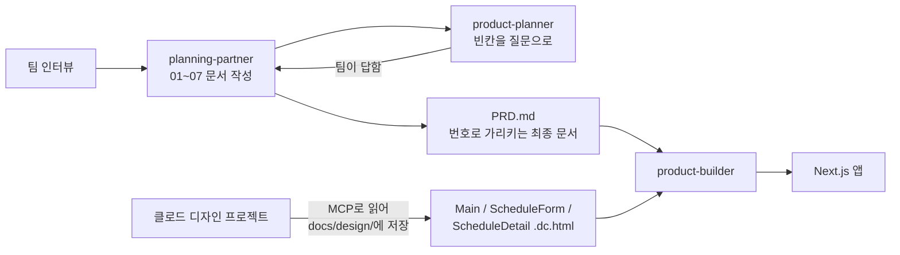
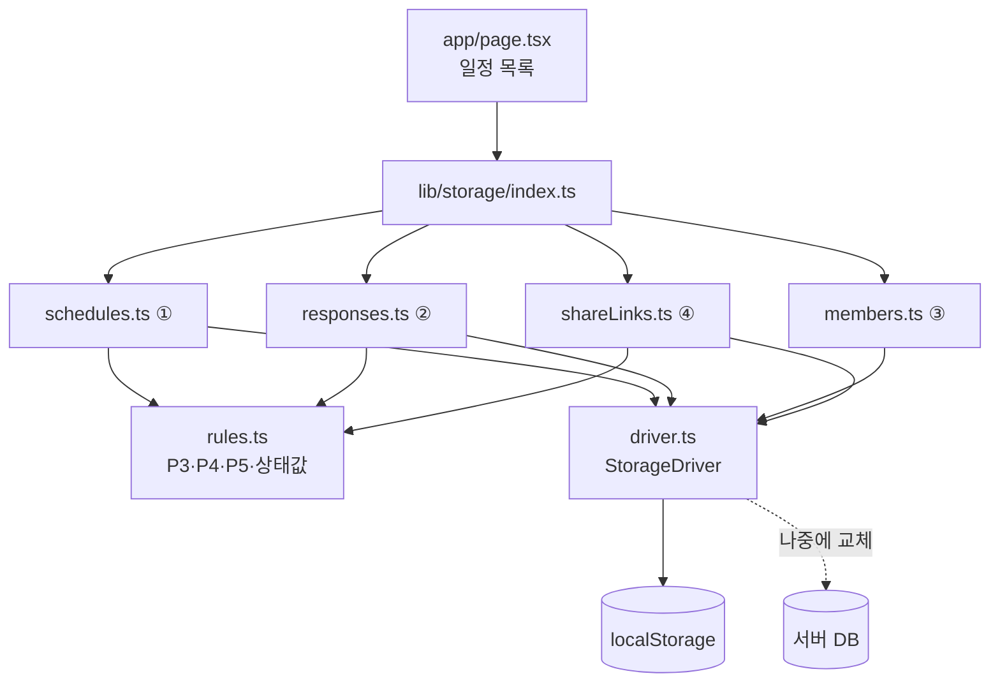

## 들어가며 (Situation)

바이브 코딩 수업에서 **팀 일정 관리** 앱을 만드는 실습을 했습니다. 동아리 총무가 일정을 올리고, 구성원은 공유 주소로 들어와 참석·불참을 남기는 작은 웹 앱입니다.

이 실습의 핵심은 코드를 직접 짜는 것이 아니라, **기획 문서를 먼저 쓰고 그 문서를 에이전트에게 읽혀서 화면을 만들게 하는 것**이었습니다. 저장소에는 그 흔적이 그대로 남아 있습니다.

| 저장소 | 커밋 | 시간 (2026-09-11) | 내용 |
|---|---|---|---|
| [vibecoding](https://github.com/Lezo-Jong/vibecoding) | 4개 | 09:22 → 10:43 | Next.js 생성 → 규칙 추가 → 저장 계층·부품 → 일정 목록 화면 |
| [VIBE2](https://github.com/Lezo-Jong/VIBE2) | 1개 | 11:44 | "vibecoding 새롭게 새폴더 만들어서 재생성" — 화면 3개 + 테스트 |

두 저장소의 `docs/` 폴더(01~07 기획 문서, PRD, 디자인 파일)는 **완전히 같습니다**. `.claude/agents/`의 에이전트 정의도 같습니다. 다시 말해 같은 입력으로 앱을 두 번 만든 셈이고, 그래서 두 결과물을 나란히 놓으면 "에이전트에게 문서를 줬을 때 무엇이 고정되고 무엇이 흔들리는지"를 볼 수 있습니다.

이 글은 그 비교를 정리한 글입니다. 기획 문서 자체에는 "⚠️ 강사 예시입니다"라는 표시가 있어서, 문서의 내용(F1~F5, P1~P5)은 수업에서 주어진 예시이고 제가 한 일은 그 문서로 에이전트를 움직인 쪽이라는 점을 먼저 밝혀 둡니다.

## 문제 상황 (Task)

에이전트에게 코드를 맡길 때 가장 곤란한 순간은 **문서가 답을 주지 않는 지점**입니다. 이 프로젝트의 PRD에도 그런 빈칸이 명시적으로 남아 있었습니다.

| 문서에 남은 빈칸 | 어디에 | 왜 곤란한가 |
|---|---|---|
| "총무"를 어떻게 판별하나 | 05-policy: "누가"는 로그인 없이 이름 직접 적기 · 로그인은 모듈2 | P1(총무만 일정 추가)을 지키려면 판별 값이 필요하다 |
| 일정을 가리키는 식별자 | 06-data: 항목 사이에 관계를 긋지 말고 "어느 일정" 칸 하나로 | id 칸이 없으니 제목이 곧 키가 된다 |
| 종료 시각 | 05-policy 상태값: [?] · "시작 + 2시간으로 가정" | "진행 중 → 지난 일정" 전환 시점 |
| 저장 위치 | PRD 5절: "서버 데이터베이스" / 이번 단계: 브라우저 localStorage | 07의 "다른 기기에서도 같게 보인다" 조건과 충돌 |
| 구성원 명단의 출처 | 06-data: [?] 누가·어디서 만드나 | F4 "미응답" 명단을 셀 수 없다 |

그리고 이 빈칸을 다루라고 준 규칙이 `CLAUDE.md`의 두 줄이었습니다.

```markdown
## 절대 규칙
작업 전에 docs/PRD.md를 읽는다.
PRD.md에 없는 요청은 작업하기 전 되묻는다.
```

`product-builder` 에이전트 정의에는 여기에 더해 "첨부에 없는 화면·요소를 지어내지 않는다", "서버·새 폴더가 필요하면 만들지 말고 되묻는다"가 들어 있습니다. 과제는 결국 **이 규칙 아래에서 에이전트가 빈칸을 어떻게 메우는가**였습니다.

## 해결 과정 (Action)

### 1. 문서를 먼저 쓰고, 역할이 다른 에이전트 셋에게 나눠 맡겼다

`.claude/agents/`에는 성격이 다른 서브에이전트 세 개가 정의되어 있습니다.

| 에이전트 | 도구 | 하는 일 | 하지 않는 일 |
|---|---|---|---|
| `planning-partner` | Read · Write · Edit | 인터뷰 질문을 하나씩 던져 01~07 문서에 받아 적고, 팀이 못 떠올린 후보는 `[제안]`으로 보탠다 | 팀 대신 정하지 않는다 |
| `product-planner` | Read | 문서를 읽고 빈칸·모호한 문장을 **질문으로** 돌려준다 | 문서를 대신 쓰지 않는다 |
| `product-builder` | Read · Write · Edit · Bash | PRD와 `docs/design/`의 화면 파일로 앱을 만든다 | 첨부 밖의 화면·요소, 서버, 새 폴더 |

흐름으로 그리면 이렇습니다.



여기서 눈여겨볼 점은 디자인 파일의 경로입니다. `07-screens.md`에는 "`product-builder`는 `tools: Read, Write, Edit, Bash` 뿐이라 클로드 디자인에 직접 연결하지 못한다"는 메모와 함께, **MCP로 읽은 파일을 반드시 `docs/design/`에 저장하라**는 단계가 적혀 있습니다. 에이전트의 도구 목록이 곧 그 에이전트가 볼 수 있는 세계의 경계라서, 디자인을 파일로 내려 두지 않으면 개발 에이전트는 디자인을 볼 수 없습니다.

PRD도 같은 원칙으로 쓰여 있습니다. 문장을 반복하지 않고 `F1 · P1 · R1`처럼 **번호로 02~07 문서를 가리키며**, "여기 없는 것은 지어내지 말고 질문으로 돌려라"를 문서 맨 위에 적어 둡니다.

### 2. 첫 번째 빌드(vibecoding): 저장 계층부터 두껍게

커밋 기록을 보면 첫 빌드는 화면보다 **저장 계층**을 먼저 만들었습니다. `0ec18bd` 커밋 하나에 `lib/storage/` 아래 8개 파일(약 810줄)과 공용 부품 13개가 한꺼번에 들어왔고, 일정 목록 화면은 그다음 커밋에서 붙었습니다.



#### 저장소 경계를 한 파일로 좁혔다

PRD는 저장 위치가 나중에 서버 데이터베이스가 된다고 했고, 이번 단계는 localStorage였습니다. 그래서 localStorage를 아는 곳을 `driver.ts` 하나로 묶고, 갈아끼울 자리를 남겼습니다.

```ts
// 프로젝트 코드 — vibecoding/lib/storage/driver.ts (요약)
export type StorageDriver = {
  read<T>(key: string, fallback: T): T;
  write(key: string, value: unknown): boolean;
  remove(key: string): boolean;
  isAvailable(): boolean;
};

function getLocalStorage(): Storage | null {
  if (typeof window === "undefined") return null; // 서버 렌더
  try {
    const storage = window.localStorage;
    const probe = "team-schedule:probe";
    storage.setItem(probe, "1");   // 차단된 환경에서는 여기서 예외
    storage.removeItem(probe);
    return storage;
  } catch {
    return null;
  }
}

let driver: StorageDriver = localStorageDriver;

/** 나중에 저장 방식을 갈아끼우는 자리 */
export function setStorageDriver(next: StorageDriver): void {
  driver = next;
}
```

`window`가 있는지만 보지 않고 실제로 한 번 써 보는(probe) 이유는 주석에 적혀 있습니다. 사생활 보호 모드나 저장소 차단 설정에서는 **접근만으로 예외가 나기** 때문입니다.

#### 규칙 위반을 예외가 아니라 "코드"로 돌려준다

정책 문서(05)에는 규칙마다 "위반 시 앱이 보이는 것" 칸이 있습니다. 예를 들어 P3은 "비면 등록 버튼이 눌리지 않는다 · 지난 날짜면 '지난 날짜입니다'"입니다. 첫 빌드는 이 칸과 1:1로 짝을 이루는 위반 코드를 만들었습니다.

```ts
// 프로젝트 코드 — vibecoding/lib/storage/types.ts (요약)
export type ViolationCode =
  | "EMPTY_FIELD"        // P3 — 안내 문구 없이 버튼이 눌리지 않는다
  | "TITLE_TOO_LONG"     // P3 — 31자째부터 입력이 막힌다
  | "PAST_DATE"          // P3 — "지난 날짜입니다"
  | "NOT_UPCOMING"       // P4 — 시작된 일정에는 수정 버튼이 없다
  | "ALREADY_STARTED"    // P2 — "이미 시작된 일정입니다"
  | "DUPLICATE_TITLE"    // 06에 id 칸이 없어서 생기는 제약
  | "STORAGE_UNAVAILABLE";
  // ...

export type StorageResult<T> =
  | { ok: true; value: T }
  | { ok: false; code: ViolationCode; message: string };
```

`message`가 빈 문자열이면 "문구 없이 버튼만 막힌다"는 뜻이라, 화면 쪽은 코드만 보고 정책 문서대로 반응을 고를 수 있습니다.

#### 문서의 빈칸은 코드 주석에 "왜 이렇게 했는지"로 남겼다

가장 인상적인 부분은 빈칸 처리 방식입니다. "어느 일정" 칸이 제목이라는 06의 결정 때문에, 제목을 바꾸면 참석 응답과 공유 주소가 엉뚱한 일정을 가리키게 됩니다. 첫 빌드는 id 칸을 **만들지 않고**(표에 없으니까), 대신 연쇄 갱신으로 풀었습니다.

```ts
// 프로젝트 코드 — vibecoding/lib/storage/schedules.ts (요약)
export function updateSchedule(currentTitle: string, input: ScheduleInput, now = new Date()) {
  // ...
  if (!isUpcoming(current, now)) return fail("NOT_UPCOMING");      // P4
  const checked = validateScheduleInput(input, now);                 // P3
  if (!checked.ok) return checked;
  if (nextTitle !== current.title && list.some((s) => s.title === nextTitle)) {
    return fail("DUPLICATE_TITLE");
  }
  // ... 저장 후
  // 제목이 바뀌면 "어느 일정" 칸을 쓰는 두 항목도 같이 옮긴다
  renameResponsesSchedule(current.title, nextTitle);
  renameShareLinkSchedule(current.title, nextTitle);
  return ok(updated);
}
```

상태값도 저장된 값을 믿지 않고 **읽을 때마다 지금 시각으로 다시 계산**합니다. 05의 "[?] 종료 시각 — 시작 + 2시간으로 가정"은 상수 하나로 드러나 있습니다.

```ts
// 프로젝트 코드 — vibecoding/lib/storage/rules.ts (요약)
export const ASSUMED_DURATION_MINUTES = 120; // 05 상태값의 가정

export function computeStatus(schedule, now = new Date()): ScheduleStatus {
  const start = startAt(schedule);
  if (Number.isNaN(start.getTime())) return "예정";
  if (now < start) return "예정";
  if (now < endAt(schedule)) return "진행 중";
  return "지난 일정";
}
```

그리고 가장 큰 빈칸인 **총무 판별**은 끝까지 정하지 않았습니다.

```tsx
// 프로젝트 코드 — vibecoding/app/page.tsx (요약)
/**
 * [?] 이 값이 어디서 오는지는 문서에 없다 ...
 * 그래서 정하지 않고 상태로만 둔다 — 이름을 적어 비교하는 식의 판정은 지어내지 않았다.
 * 모듈2 로그인이 생기면 그 값을 여기에 이어 붙인다.
 */
const [isOrganizer] = useState(true);
```

#### SSR과 localStorage 사이의 hydration 문제

Next.js App Router에서는 `"use client"` 컴포넌트도 서버에서 한 번 렌더됩니다. 서버에는 localStorage가 없으니, 렌더 중에 저장소를 읽으면 서버가 그린 HTML과 브라우저가 그린 결과가 달라집니다. 첫 빌드의 `page.tsx` 상단 주석은 이 문제를 Next.js 문서를 근거로 설명하고, `useEffect` + `setState` 대신 `useSyncExternalStore`를 고른 이유(프로젝트 eslint가 effect 안의 setState를 막는다)까지 적어 두었습니다.

```tsx
// 프로젝트 코드 — vibecoding/app/page.tsx (요약)
function getCardsServerSnapshot(): ScheduleCardItem[] | null {
  return null; // 서버 렌더 · hydration 시점 = 아직 모름
}

function subscribeToStorage(onStoreChange: () => void) {
  window.addEventListener("storage", onStoreChange); // 다른 탭의 저장도 따라온다
  return () => window.removeEventListener("storage", onStoreChange);
}

const cards = useSyncExternalStore(subscribeToStorage, getCardsSnapshot, getCardsServerSnapshot);
const isEmpty = cards !== null && cards.length === 0; // null일 땐 빈 상태 문구도 그리지 않는다
```

`null`과 빈 배열을 구분한 이유도 정책에서 나옵니다. 아직 읽기 전인데 "예정된 일정이 없습니다"(F2 예외 문구)를 보여 주면 거짓말이 되기 때문입니다. `getSnapshot`이 같은 값이면 같은 참조를 돌려줘야 해서, 카드 목록을 JSON 문자열로 비교해 캐시하는 처리도 들어 있습니다.

다만 첫 빌드는 **여기서 멈췄습니다.** 마지막 커밋 메시지에 따르면 "일정 추가 → `/schedules/new`, 카드 → `/schedules/{제목}` 이동만 걸어 두었고 도착 라우트는 만들지 않았다(경로는 제안 — 팀 확정 필요)"입니다. 07 문서에 "주소(URL)는 만드는 쪽이 제안하고 팀이 확정한다"고 되어 있어서, 확정 전에는 만들지 않은 것입니다.

### 3. 두 번째 빌드(VIBE2): 화면 셋을 끝까지, 대신 더 얇게

약 한 시간 뒤의 VIBE2 커밋은 46개 파일을 한 번에 올렸습니다. `src/` 아래로 구조가 바뀌었고, 화면 3개(목록·입력·상세)가 모두 있으며, 저장 계층은 `src/lib/storage.ts` 한 파일(231줄)입니다.

#### 빈칸을 "정해 버린" 곳: 총무 부트스트랩

첫 빌드가 비워 둔 총무 판별을, 두 번째 빌드는 05의 "이름 직접 적기"를 근거로 **"처음 이름을 밝힌 사람이 총무"**로 정했습니다.

```ts
// 프로젝트 코드 — VIBE2/src/lib/storage.ts (요약)
/* 05 정책 머리말: "'누가'는 로그인 없이 이름을 직접 적는 것으로 처리한다"
 * 부트스트랩: 총무 이름이 아직 없으면 최초로 이름을 밝힌 사람이 총무가 된다 */
export function claimAdmin(name: string): void {
  if (!globalThis.localStorage) return;
  if (getAdminName()) return;          // 이미 있으면 덮어쓰지 않는다
  globalThis.localStorage.setItem(KEY.adminName, name);
}

export function isCurrentUserAdmin(): boolean {
  const myName = getMyName();
  return !!myName && myName === getAdminName();
}
```

주석에 "저장 항목(06 표)의 칸이 아니라 그 판정을 위한 기술적 보조 키"라고 스스로 밝혀 두었지만, 엄밀히 보면 이것은 문서에 없는 결정입니다. 같은 규칙(`PRD에 없는 요청은 되묻는다`) 아래에서도, 한 번은 비워 두고 한 번은 채웠다는 점이 이번 비교에서 가장 눈에 띄는 차이였습니다.

#### 테스트를 프레임워크 없이 붙였다

두 번째 빌드에는 첫 빌드에 없던 테스트가 있습니다. Jest 같은 도구 없이 `node:assert`와 가짜 localStorage(Map)로 정책 규칙을 확인합니다.

```ts
// 프로젝트 코드 — VIBE2/src/lib/storage.test.ts (요약)
// 실행: node src/lib/storage.test.ts   (Node 22.18+ · 24 — .ts 를 그대로 읽는다)
const store = new Map<string, string>();
globalThis.localStorage = { getItem: (k) => store.get(k) ?? null, setItem: (k, v) => void store.set(k, String(v)), /* ... */ };

throws(() => saveSchedule({ ...일정, title: "가".repeat(31) }), "제목은 30자까지입니다");
throws(() => saveSchedule({ ...일정, date: 어제 }), "지난 날짜입니다");
assert.equal(validateSchedule({ ...일정, date: 오늘 }), null, "오늘은 된다");

saveAttendance({ ...응답, answer: "불참" });
assert.equal(getAttendances("9월 정기 모임")[0].answer, "불참", "칸만 옮겨 간다"); // P5
```

테스트 문장 자체가 정책 문서의 "위반 시 앱이 보이는 것" 칸을 그대로 옮긴 형태라서, 문서 → 테스트의 추적이 쉽습니다.

### 4. 두 빌드를 나란히 놓으면

| 항목 | vibecoding (1차) | VIBE2 (2차) |
|---|---|---|
| 구현 화면 | 일정 목록 1개 (이동 경로만 제안) | 목록 · 입력 · 상세 3개 |
| 저장 계층 | 7개 파일, `StorageDriver`로 localStorage 격리 | `storage.ts` 1개, `globalThis.localStorage` 직접 |
| 규칙 위반 표현 | `StorageResult` + `ViolationCode` (예외 없음) | `throw new Error("문구")` |
| 상태값 | 읽을 때마다 `computeStatus`로 재계산 | 저장 시 `"예정"`으로 기록, 화면은 저장값 사용 |
| 제목(=키) 변경 | 응답·공유 주소까지 연쇄 갱신, 중복 제목 거부 | 같은 제목이면 덮어쓰기(upsert) |
| 총무 판별 | 정하지 않음 (`useState(true)` + [?] 주석) | 최초 등록자 = 총무 (`claimAdmin`) |
| SSR 대응 | `useSyncExternalStore` + 서버 스냅샷 `null` | `useState` 초기화 함수에서 저장소 읽기 |
| 테스트 | 없음 | `storage.test.ts` (node:assert) |

코드만 읽어서 보이는 두 번째 빌드의 확인 지점도 적어 둡니다. 실행해서 확인한 것은 아니므로, 다음에 이어서 작업할 때 확인할 항목입니다.

- **상태값이 시간에 따라 바뀌지 않을 수 있습니다.** 입력 화면은 `status: "예정"`으로 저장하고, 목록·상세 화면은 `schedule.status`를 그대로 읽습니다. 시작 시각이 지나도 다시 계산하는 코드가 보이지 않아, P2("시작 뒤에는 바꿀 수 없다")가 의도대로 동작하는지 확인이 필요합니다.
- **수정 중 제목을 바꾸면** `saveSchedule`이 새 제목으로 upsert하므로 기존 일정이 남아 있을 가능성이 있습니다.
- **상세 화면이 미응답 명단을 위해 `localStorage.getItem("team-schedule:members")`를 직접 읽습니다.** 저장 접근을 `storage.ts`로 모은다는 원칙에서 한 군데 벗어나 있습니다.
- **hydration 불일치 가능성.** `useState(() => getSchedules())`는 서버에서 빈 배열, 브라우저에서 실제 목록을 초기값으로 갖게 되어, 1차 빌드가 주석으로 경고한 바로 그 상황에 해당할 수 있습니다.
- 공유 주소(`saveShareLink`)는 저장 함수만 있고 화면에서 쓰는 곳이 없습니다.

## 결과 (Result)

저장소에 남은 숫자로 정리하면 이렇습니다.

| 지표 | vibecoding | VIBE2 |
|---|---|---|
| 커밋 / 작업 시간대 | 4개 / 09:22–10:43 | 1개 / 11:44 |
| 앱 코드 (`lib` + `app` + `components`) | 저장 계층 약 810줄 + 부품 13개 + 목록 화면 | 1,277줄 (테스트 165줄 포함) |
| 정책 위반 코드 | 9종 | 문구 기반 예외 |
| 기획 문서 / 에이전트 정의 | 동일 | 동일 |

비교해 보고 확인한 것은 세 가지입니다.

1. **"되묻는다"는 규칙만으로는 빈칸 처리가 고정되지 않았습니다.** 같은 문서·같은 규칙에서도 한 빌드는 총무 판별을 [?]로 남겼고, 다른 빌드는 근거 문장을 찾아 스스로 정했습니다. 빈칸을 정말 막고 싶다면 "[?] 항목은 상수/주석으로 남기고 구현하지 않는다"처럼 **빈칸을 다루는 방법 자체**를 규칙으로 적어야 할 것 같습니다.
2. **문서의 번호 체계가 코드까지 이어졌습니다.** 두 빌드 모두 주석에 `P3`, `F4`, `06-data.md`처럼 문서 번호를 남겼고, 1차 빌드는 위반 코드 하나하나가 정책 표의 한 칸과 짝을 이룹니다. 나중에 정책이 바뀌면 어디를 고쳐야 할지 검색으로 찾을 수 있습니다.
3. **범위를 넓히면 깊이가 줄었습니다.** 화면 하나에 집중한 1차는 SSR·저장소 차단·제목 변경 연쇄까지 다뤘고, 화면 셋을 끝낸 2차는 테스트가 생긴 대신 상태값 재계산이나 저장 경계 같은 부분이 얇아졌습니다. 다음에는 1차의 저장 계층 위에 2차의 화면과 테스트를 얹는 방향이 자연스러워 보입니다.

## 더 학습하면 좋은 개념

- **Hydration과 Server/Client Component 경계** — `"use client"`여도 서버 렌더가 일어난다는 점이 이번 비교의 핵심 차이였습니다. 어떤 값이 서버에 없고 브라우저에만 있는지 구분하는 감각이 필요합니다.
- **`useSyncExternalStore`** — React 바깥의 저장소(localStorage, 브라우저 API)를 구독하는 공식 방법입니다. `getServerSnapshot`과 스냅샷 참조 안정성 규칙을 알아 두면 같은 문제를 반복하지 않습니다.
- **Repository / Adapter 패턴** — `StorageDriver`가 바로 이 패턴입니다. 저장 방식을 localStorage에서 서버 DB로 바꿀 때 화면 코드를 건드리지 않으려면 이 경계가 필요합니다.
- **Result 타입(에러를 값으로 다루기)** — 예외 대신 `{ ok, code }`를 돌려주는 방식은 TypeScript의 판별 유니온(discriminated union)과 잘 맞습니다. 정책 위반처럼 "예상된 실패"를 다룰 때 특히 유용합니다.
- **서브에이전트와 도구 권한 설계** — 에이전트마다 도구를 다르게 주면 역할이 강제됩니다. `product-planner`에 Read만 준 것처럼, 권한 자체가 "하지 않는 일"을 보장하는 장치가 됩니다.

## 참고 자료

- [Next.js 공식 문서 - Server and Client Components](https://nextjs.org/docs/app/getting-started/server-and-client-components)
- [React 공식 문서 - useSyncExternalStore](https://react.dev/reference/react/useSyncExternalStore)
- [React 공식 문서 - hydrateRoot (hydration 불일치)](https://react.dev/reference/react-dom/client/hydrateRoot)
- [MDN - Window: localStorage property](https://developer.mozilla.org/en-US/docs/Web/API/Window/localStorage)
- [MDN - Window: storage event](https://developer.mozilla.org/en-US/docs/Web/API/Window/storage_event)
- [TypeScript Handbook - Narrowing (Discriminated unions)](https://www.typescriptlang.org/docs/handbook/2/narrowing.html)
- [Node.js 공식 문서 - Assert](https://nodejs.org/api/assert.html)
- [Claude Code 공식 문서 - Subagents](https://docs.claude.com/en/docs/claude-code/sub-agents)
- [GitHub - Lezo-Jong/vibecoding](https://github.com/Lezo-Jong/vibecoding)
- [GitHub - Lezo-Jong/VIBE2](https://github.com/Lezo-Jong/VIBE2)
