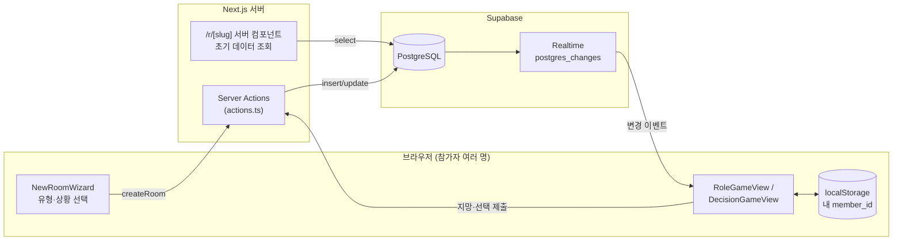
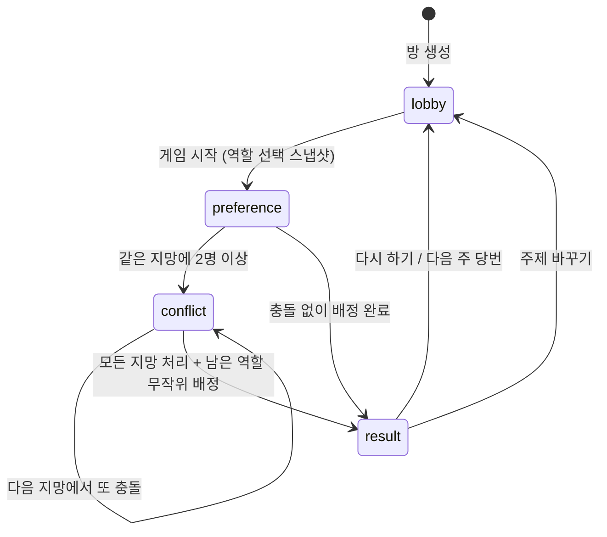
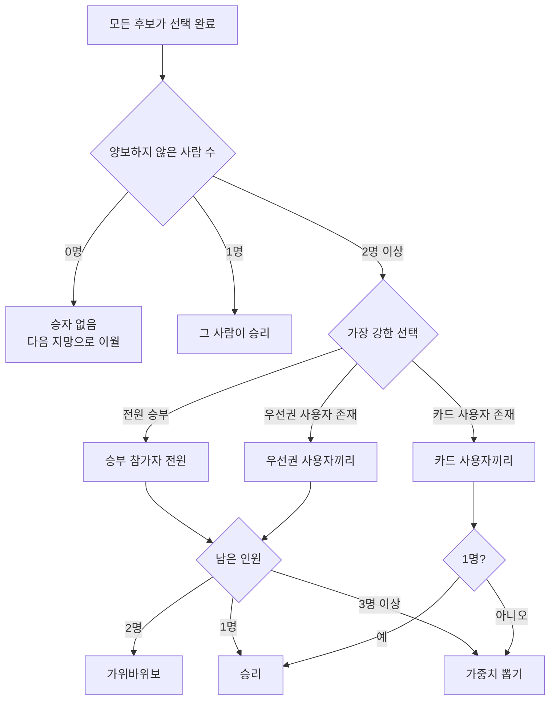
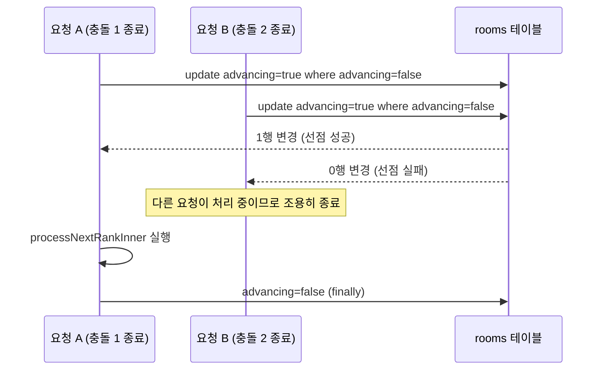

## 들어가며 (Situation)

팀플 역할 나누기, 집안일 당번, 오늘 메뉴 정하기처럼 "누가 무엇을 할지" 정하는 일은 자주 생기는데, 사다리 타기 같은 완전 무작위 방식은 각자의 선호를 전혀 반영하지 못합니다.

**돌아가면요**(저장소 이름 `dolagam`)는 이 문제를 다루는 웹 앱입니다. 앱의 소개 문구는 "누가 할지, 공평하게 뽑아요. 로그인 없이 링크로 바로 참여하는 순번 뽑기."예요. 방을 만들고 링크를 공유하면 참가자들이 같은 화면을 실시간으로 보면서 지망을 고르고, 지망이 겹치면 우선권, 양보, 승부(가위바위보) 같은 선택으로 충돌을 해결합니다.

커밋 기록을 보면 2026년 9월 23일 하루 동안 Next.js 초기 프로젝트에서 시작해 12개의 커밋으로 기능을 쌓아 올렸습니다. 스키마 파일의 주석에도 "로그인이 없는 하루짜리 프로젝트"라고 적혀 있습니다.

## 문제 상황 (Task)

이 프로젝트가 풀어야 했던 과제를 정리하면 다음과 같습니다.

| 과제 | 구체적인 내용 |
|------|---------------|
| 선택이 반영되는 배정 | 결과가 전부 랜덤이 아니라, 각자의 1~3지망이 반영되어야 함 |
| 공정성 | 오래 안 뽑힌 사람이 다음에 유리해지는 가중치 |
| 로그인 없는 다인원 참여 | 링크만 있으면 들어오고, 여러 기기가 같은 상태를 실시간으로 공유 |
| 동시성 | 여러 사람이 거의 동시에 선택을 제출해도 결과가 중복되거나 꼬이지 않아야 함 |
| 확장성 | 역할 나누기 외에 메뉴, 우선순위, 장보기, 약속 시간 정하기로 넓힐 수 있어야 함 |

## 해결 과정 (Action)

### 1. 개발 흐름 — 커밋 기록으로 본 진행 순서

커밋 메시지에는 변경 이유와 테스트 중 발견한 버그까지 자세히 적혀 있어서, 기능이 어떤 순서로 자라났는지 따라가기 좋습니다.

| 시각 | 커밋 | 추가된 것 |
|------|------|-----------|
| 09:20 | Initial commit from Create Next App | Next.js 프로젝트 생성 |
| 09:43 | Add Supabase-backed room drawing app | 방 생성, `/r/[slug]` 방 화면, 실시간 동기화, 가중치 뽑기 |
| 10:32 | Add problem-type/situation selection | 문제 유형 → 상황 선택 위저드, 데이터 카탈로그화 |
| 10:59 | Add preference-driven role-assignment game loop | 로비 → 지망 → 결과로 이어지는 역할 게임 |
| 11:26 | Add ranked (1-3) preferences | 1~3지망 연쇄 매칭, 한 기기로 시연하는 데모 모드 |
| 11:58 | Add priority/concede/duel conflict resolution | 우선권/양보/승부 + 가위바위보, 경쟁 상태(race condition) 수정 |
| 12:31 | Add final result screen, session replay, recurring-duty mode | 결과 카드, 다시 하기, 반복 당번 모드 |
| 14:11 | Add recommended/custom role management and a game history view | 커스텀 역할, 기록 화면, Realtime DELETE 버그 수정 |
| 14:36 | Add player skill/preference ratings | 능력/선호 자기평가(표시용 정보) |
| 14:56 | Add card conflict action and post-result role swap | 카드 선택지, 결과 후 역할 교환 제안 |
| 15:20 | Activate food, priority, shopping, and schedule games | 충돌 엔진을 재사용해 4개 게임 추가 |
| 15:47 | Add topic switching, separate from restart | 같은 방에서 주제 바꾸기 |

커밋에 `Co-Authored-By: Claude` 트레일러가 붙어 있어, AI 코딩 도구와 함께 작업한 것으로 보입니다.

### 2. 전체 구조



핵심은 **쓰기는 서버 액션, 읽기 갱신은 Realtime 구독**으로 나눈 것입니다. 클라이언트는 "이 역할을 1지망으로 할게요" 같은 요청만 보내고, 배정이나 승패 판정은 모두 `"use server"` 파일인 `actions.ts`에서 계산됩니다. 파일 상단 주석에도 이 의도가 적혀 있어요.

```ts
// 프로젝트 코드: src/app/actions.ts (상단 주석)
"use server";
// 이 파일의 함수들은 서버에서만 실행된다(클라이언트 번들에 코드가
// 포함되지 않는다). ... 클라이언트는 "뽑아줘" 요청만 보내고 서버가
// 계산한 결과를 그대로 받는다.
```

주요 파일의 역할은 다음과 같습니다.

| 파일 | 역할 |
|------|------|
| `src/app/actions.ts` | 모든 서버 액션: `createRoom`, `startGame`, `submitPreference`, `submitConflictChoice`, `submitRpsMove`, `restartRound`, `changeTopic`, `proposeSwap` 등과 배정·판정 로직 |
| `src/app/r/[slug]/page.tsx` | 방 화면 서버 컴포넌트. 방의 상황에 따라 `RoomView` / `RoleGameView` / `DecisionGameView` 중 하나를 고름 |
| `src/components/NewRoomWizard.tsx` | 홈 화면의 문제 유형 → 상황 선택 위저드 |
| `src/components/RoleGameView.tsx` | 역할 게임(로비, 지망, 충돌 카드, 결과, 기록) 화면과 Realtime 구독 |
| `src/components/DecisionGameView.tsx` | 뭘 먹을까, 뭐부터 할까, 언제 만날까 화면 |
| `src/components/RoomView.tsx` | 첫 버전의 단순 가중치 뽑기 화면 (하위 호환용으로 유지) |
| `src/lib/problemTypes.ts`, `situations.ts`, `decisionPresets.ts` | 문제 유형, 상황, 역할 풀, 능력 카테고리 데이터 카탈로그 |
| `src/lib/identity.ts`, `slug.ts`, `supabase.ts` | 브라우저 신원 기억, 방 주소 생성, Supabase 클라이언트 |
| `supabase/schema.sql` | 테이블, RLS 정책, Realtime publication, `draw_winner` 함수 |

방 화면은 서버 컴포넌트가 필요한 테이블을 `Promise.all`로 한 번에 조회해 초기 상태를 만들고, 이후 변경은 클라이언트 구독으로 받습니다.

```tsx
// 프로젝트 코드: src/app/r/[slug]/page.tsx (일부)
const [
  { data: preferences },
  { data: assignments },
  { data: conflicts },
  { data: conflictChoices },
  /* customRoles, playerSkills, swapProposals */
] = await Promise.all([
  supabase.from("role_preferences").select("*").eq("room_id", room.id),
  supabase.from("role_assignments").select("*").eq("room_id", room.id),
  supabase.from("role_conflicts").select("*").eq("room_id", room.id),
  supabase.from("role_conflict_choices").select("*").eq("room_id", room.id),
  /* ... */
]);
```

```tsx
// 프로젝트 코드: src/components/RoleGameView.tsx (구독 일부)
const channel = supabase
  .channel(`role-game-${room.id}`)
  .on(
    "postgres_changes",
    { event: "*", schema: "public", table: "rooms", filter: `id=eq.${room.id}` },
    (payload) => {
      if (payload.eventType === "DELETE") return;
      const next = payload.new as Room;
      // 주제 바꾸기로 problem_type/situation이 바뀌면 서버 컴포넌트가
      // 새 주제에 맞는 화면을 다시 고르도록 새로고침한다.
      if (
        next.problem_type !== roomRef.current.problem_type ||
        next.situation !== roomRef.current.situation
      ) {
        router.refresh();
        return;
      }
      setRoom(next);
    }
  )
  /* members, role_preferences, role_conflicts ... 테이블별 구독이 이어짐 */
```

### 3. 로그인 없이 접근을 통제하는 방법 — 추측하기 어려운 링크

로그인이 없기 때문에 RLS 정책은 의도적으로 모두 열어 두고, 대신 방 주소를 추측하기 어렵게 만들었습니다. 스키마 주석은 이를 "Google Docs의 '링크가 있는 사람' 공유와 같은 모델"이라고 설명합니다.

```ts
// 프로젝트 코드: src/lib/slug.ts
// 0/O, 1/l처럼 헷갈리는 문자는 빼서 직접 타이핑도 가능하게 했다.
const ALPHABET = "23456789abcdefghjkmnpqrstuvwxyzABCDEFGHJKMNPQRSTUVWXYZ";

export function generateSlug(length = 8): string {
  let out = "";
  const bytes = new Uint8Array(length);
  crypto.getRandomValues(bytes);
  for (let i = 0; i < length; i++) {
    out += ALPHABET[bytes[i] % ALPHABET.length];
  }
  return out;
}
```

`Math.random()`이 아니라 `crypto.getRandomValues()`를 쓴 점, 그리고 `createRoom`에서 unique 위반(`23505`)이 나면 다른 slug로 최대 5번까지 다시 시도하는 점이 함께 들어가 있습니다.

"이 브라우저가 방 안의 누구인지"는 `localStorage`에 `member_id`로 기억합니다. `identity.ts` 주석에 따르면 서버는 이 값을 신뢰하지 않고 편의 기능으로만 씁니다.

| 항목 | 이 프로젝트의 선택 | 대가 |
|------|-------------------|------|
| 인증 | 없음 (링크 기반 접근) | 링크가 유출되면 누구나 참여 가능 |
| RLS | 전 테이블 `using (true)` | 권한 검사는 서버 액션에서 직접 해야 함 (예: 커스텀 역할은 만든 사람만 수정) |
| 신원 | localStorage의 member_id | 다른 기기에서는 이름을 다시 입력해야 함 |

### 4. 공정성 가중치 — 오래 안 뽑힌 사람이 유리하게

첫 버전의 뽑기는 PostgreSQL 함수 `draw_winner`로 구현되었습니다. 가중치는 `1 + (현재 라운드 - 마지막으로 뽑힌 라운드)`이고, 방 행을 `for update`로 잠가서 동시에 뽑기를 눌러도 라운드가 꼬이지 않게 했습니다.

```sql
-- 프로젝트 코드: supabase/schema.sql (draw_winner 일부)
select round, task into v_round, v_task from rooms where id = p_room_id for update;

select m.id, m.name
  into v_winner_id, v_winner_name
  from members m
  where m.room_id = p_room_id
  order by power(random(), 1.0 / (1 + v_round - m.last_picked_round)) desc
  limit 1;
```

`random()^(1/w)`가 가장 큰 행을 고르는 방식은 가중치 `w`에 비례하는 확률로 한 명을 뽑는 기법입니다(Efraimidis–Spirakis 가중 샘플링). 정렬 한 번으로 가중 추첨을 SQL 안에서 끝낼 수 있어요.

같은 공식은 TypeScript 쪽 `weightOf`에도 그대로 있고, 주석에는 "서버와 클라이언트(확률 막대 미리보기)가 반드시 같은 공식을 써야 화면에 보이는 확률과 실제 결과가 일치한다"고 적혀 있습니다. 이후 역할 게임에서 충돌을 가중치 뽑기로 정할 때도 이 `weightOf`를 재사용합니다.

### 5. 역할 게임 — 1지망부터 차례로 내려가는 연쇄 매칭

10시 59분 커밋부터는 단순 뽑기가 아니라 **지망 기반 배정 게임**으로 바뀝니다. 방은 `game_phase` 컬럼으로 단계를 관리합니다.



배정 로직(`processNextRankInner`)은 지망 순서대로 돌면서 다음 규칙을 적용합니다.

1. 이번 지망 단계에서 역할 하나에 후보가 1명이면 바로 배정 (`resolved_by = 'preference'`)
2. 2명 이상 몰리면 바로 뽑지 않고 `role_conflicts` 행을 만들어 참가자의 선택을 기다림
3. 충돌에서 진 사람은 다음 지망 단계에서 자기 다음 지망으로 다시 시도
4. 3지망까지 다 써도 남은 사람과 역할은 무작위로 짝지음 (`assigned_rank = null`)

마지막 무작위 짝짓기에는 반복 당번 상황을 위한 장치가 있습니다. 직전 라운드에 같은 역할을 맡았던 사람이면, 조건이 맞는 다른 사람과 역할을 맞바꿔 봅니다.

```ts
// 프로젝트 코드: src/app/actions.ts (assignLeftoversAvoidingRepeat 일부)
for (let i = 0; i < pairs.length; i++) {
  if (previousRoleByMember.get(pairs[i].member.id) !== pairs[i].role) continue;
  const swapWith = pairs.findIndex(
    (p, j) =>
      j !== i &&
      previousRoleByMember.get(p.member.id) !== pairs[i].role &&
      previousRoleByMember.get(pairs[i].member.id) !== p.role
  );
  if (swapWith !== -1) {
    const tmp = pairs[i].role;
    pairs[i].role = pairs[swapWith].role;
    pairs[swapWith].role = tmp;
  }
}
```

코드 주석은 이것이 완벽한 알고리즘이 아니라 "직전에 하던 걸 그대로 또 하는 것만 최대한 피하는 수준"이라고 밝히고 있습니다. 커밋 메시지에는 시뮬레이션으로 4000번 중 0번 반복되는 것을 확인했고, 브라우저에서도 두 라운드에 걸쳐 실제로 당번이 바뀌는 것을 확인했다고 기록되어 있습니다.

### 6. 충돌 해결 규칙을 순수 함수로 분리하기

충돌 카드에서 각 참가자는 **우선권**(라운드당 1회), **카드**(라운드당 1회), **승부**, **양보** 중 하나를 고릅니다. 세기는 우선권 > 카드 > 승부 순입니다.



이 판정은 DB 접근이 전혀 없는 순수 함수 `decideChoosingTier`와 `decideRpsWinner`로 분리되어 있습니다.

```ts
// 프로젝트 코드: src/app/actions.ts
function decideChoosingTier(
  candidateIds: string[],
  choiceByMember: Map<string, { choice: ConflictChoice | null }>
): ChoosingDecision {
  const contenders = candidateIds.filter((id) => choiceByMember.get(id)?.choice !== "concede");
  if (contenders.length === 0) return { type: "no-contenders" };

  if (contenders.length === 1) {
    const choice = choiceByMember.get(contenders[0])?.choice;
    const reason = choice === "priority" ? "priority" : choice === "card" ? "card" : "duel";
    return { type: "winner", winnerId: contenders[0], reason };
  }

  const priorityUsers = contenders.filter((id) => choiceByMember.get(id)?.choice === "priority");
  const cardUsers = contenders.filter((id) => choiceByMember.get(id)?.choice === "card");
  const tier = priorityUsers.length > 0 ? "priority" : cardUsers.length > 0 ? "card" : "duel";
  const finalists = tier === "priority" ? priorityUsers : tier === "card" ? cardUsers : contenders;

  if (finalists.length === 1) return { type: "winner", winnerId: finalists[0], reason: tier };
  if (tier === "card") return { type: "draw", finalists, reason: "card" };
  if (finalists.length === 2) return { type: "rps", finalists: [finalists[0], finalists[1]] };
  return { type: "draw", finalists, reason: "draw" };
}

function decideRpsWinner(aId: string, bId: string, aMove: RpsMove, bMove: RpsMove): string | null {
  if (aMove === bMove) return null;
  const beats: Record<RpsMove, RpsMove> = { rock: "scissors", scissors: "paper", paper: "rock" };
  return beats[aMove] === bMove ? aId : bId;
}
```

이 분리가 15시 20분 커밋에서 효과를 냅니다. "뭘 먹을까", "뭐부터 할까", "뭘 살까", "언제 만날까" 네 게임을 별도 게임으로 새로 만들지 않고, 이 두 함수를 공유해서 추가했습니다. 커밋 메시지는 결과 형태를 세 가지로 정리합니다.

| 결과 형태 | 해당 게임 | 재사용 방식 |
|-----------|-----------|-------------|
| 배정(assignment) | 역할 나누기, 뭘 살까 | 물건을 사 오는 것은 역할을 맡는 것과 구조가 같아 엔진을 그대로 사용 |
| 단일 선택(single-choice) | 뭘 먹을까, 언제 만날까 | 그룹 전체가 하나의 답으로 수렴 |
| 순서(ordering) | 뭐부터 할까 | 순서 칸을 하나씩 채우며 칸마다 같은 충돌 규칙 적용 |

커밋 메시지에 따르면 이 확장에는 스키마 변경이 필요하지 않았고, 기존 테이블의 컬럼 의미를 조금 다르게 해석해서 재사용했습니다.

### 7. 시행착오 ① — 두 충돌이 동시에 끝나면 배정이 두 번 생긴다

11시 58분 커밋 메시지에는 테스트 중 발견한 경쟁 상태(race condition)가 기록되어 있습니다. 서로 다른 두 충돌이 거의 동시에 끝나면, 두 요청이 각자 "이제 다음 지망으로 넘어가자"고 판단해서 `role_assignments`에 같은 배정이 중복으로 들어갈 수 있었습니다.



해결 방법은 **조건부 UPDATE로 원자적으로 선점(claim)하는 것**입니다. `where advancing = false` 조건이 붙은 UPDATE는 동시에 들어와도 한 요청만 행을 바꿀 수 있고, 바뀐 행이 있는지로 선점 성공 여부를 판단합니다.

```ts
// 프로젝트 코드: src/app/actions.ts
async function claimAdvance(supabase: ReturnType<typeof getSupabase>, roomId: string): Promise<boolean> {
  const { data } = await supabase
    .from("rooms")
    .update({ advancing: true })
    .eq("id", roomId)
    .eq("advancing", false)
    .select("id");
  return (data?.length ?? 0) > 0;
}

async function processNextRank(supabase: ReturnType<typeof getSupabase>, roomId: string): Promise<void> {
  const claimed = await claimAdvance(supabase, roomId);
  if (!claimed) return; // 다른 요청이 이미 다음 단계로 넘어가는 중
  try {
    await processNextRankInner(supabase, roomId);
  } finally {
    await supabase.from("rooms").update({ advancing: false }).eq("id", roomId);
  }
}
```

같은 패턴이 충돌 하나를 확정할 때도 쓰입니다. `claimConflict`는 `status`를 `choosing → resolved`처럼 바꾸는 데 성공한 요청만 판정을 진행하게 해서, 같은 역할이 두 번 배정되는 것을 막습니다. 반대로 가위바위보 단계로 넘기는 UPDATE처럼 두 번 실행돼도 같은 값을 덮어쓸 뿐인 작업은 선점 없이 그대로 두었다는 주석도 있어요. 어떤 작업이 멱등(idempotent)하고 어떤 작업이 아닌지를 구분해서 잠금 범위를 정한 셈입니다.

또 하나 눈여겨볼 점은, 충돌이 하나도 없는 지망 단계에서는 `processNextRank`가 아니라 `processNextRankInner`를 재귀 호출한다는 것입니다. 주석에 따르면 이미 락을 쥔 상태에서 바깥 함수를 다시 부르면 스스로 락에 걸려 멈추기 때문입니다.

### 8. 시행착오 ② — DELETE 이벤트가 실시간으로 오지 않는다

14시 11분 커밋에서는 두 가지 버그가 기록되어 있습니다. 그중 하나가 Supabase Realtime과 관련된 것입니다.

이 앱의 구독은 모두 `room_id=eq.<방 id>` 필터를 겁니다. 그런데 "나가기"로 참가자가 빠지거나 커스텀 역할을 지워도, 다른 사람 화면에는 반영되지 않았습니다. 원인은 PostgreSQL의 기본 **REPLICA IDENTITY**가 삭제된 행에 대해 기본키만 실어 보내기 때문이었습니다. 삭제 이벤트에 `room_id`가 없으니 필터가 매치될 대상이 없었던 거죠.

```sql
-- 프로젝트 코드: supabase/schema.sql
-- 기본 REPLICA IDENTITY(기본키만)로는 DELETE된 행의 room_id를 알 수 없어서,
-- room_id로 거는 postgres_changes 필터가 DELETE 이벤트에 대해 아예 매치되지 않고
-- 조용히 씹힌다.
alter table members replica identity full;
alter table role_preferences replica identity full;
alter table role_conflicts replica identity full;
alter table role_conflict_choices replica identity full;
alter table custom_roles replica identity full;
```

커밋 메시지에 따르면 이 문제는 새로 만든 커스텀 역할 삭제뿐 아니라 기존 "나가기" 기능에도 조용히 영향을 주고 있었고, 수정 후 두 브라우저에서 실제 이벤트와 화면을 모두 확인했다고 합니다.

같은 커밋의 다른 버그는 커스텀 역할 이름을 바꾸면 "이번 게임에 쓸 역할" 체크 상태가 풀리는 문제였습니다. 선택 상태를 역할 이름으로 추적하고 있었기 때문이고, 바뀌지 않는 역할 id로 추적하도록 고쳤습니다.

### 9. 스냅샷 — 나중에 바뀌어도 지난 기록은 그대로

이 프로젝트의 스키마에서 반복해서 보이는 설계 원칙은 **결정된 시점의 값을 복사해 두는 스냅샷**입니다.

| 스냅샷 컬럼 | 지키려는 것 |
|-------------|-------------|
| `rooms.active_roles` | 게임 시작 후 커스텀 역할이 수정/삭제돼도 이번 게임의 역할 풀은 유지 |
| `role_assignments.role_label` (문자열) | 역할을 지워도 지난 기록의 역할 이름이 깨지지 않음 |
| `role_conflicts.candidate_skills` | 충돌 카드에 보여준 능력/선호 값이 판정 중 바뀌지 않음 |
| `role_assignments.skill_level`, `preference_level` | 프로필을 고쳐도 지난 결과에 영향 없음 |
| `role_assignments.game_type` | 주제를 바꾼 방에서도 지난 라운드가 원래 주제로 표시됨 |

덕분에 "기록" 화면은 새 테이블 없이 `role_assignments`를 라운드별로 묶는 것만으로 만들 수 있었다고 커밋 메시지에 적혀 있습니다.

능력/선호 점수에 대해서도 설계 의도가 분명합니다. 14시 36분 커밋은 이 점수가 **표시용 정보이지 판정 기준이 아니라고** 명시합니다. 능력이 높은 사람이 자동으로 이기지 않고, 판정은 여전히 우선권/양보/승부 흐름이 결정합니다.

### 10. 기술 선택 정리

| 영역 | 선택 | 이 프로젝트에서의 이유 |
|------|------|------------------------|
| 프레임워크 | Next.js 16 (App Router) | 서버 컴포넌트로 초기 데이터를 조회하고, Server Actions로 판정 로직을 서버에만 둠 |
| DB | Supabase (PostgreSQL) | `for update` 잠금, PL/pgSQL 함수, 조건부 UPDATE로 동시성 제어 |
| 실시간 동기화 | Supabase Realtime (`postgres_changes`) | 별도 WebSocket 서버 없이 테이블 변경을 구독 |
| 신원 | localStorage | 로그인 없는 앱에서 재입장 편의 제공 |
| 확장 구조 | `problemTypes.ts`, `situations.ts` 데이터 카탈로그 | 상황·역할·능력 추가를 페이지 수정 없이 데이터 추가로 처리 |
| 스타일 | Tailwind CSS 4 | create-next-app 기본 구성 |

## 결과 (Result)

저장소 기준으로 확인할 수 있는 결과는 다음과 같습니다.

- 링크 공유만으로 여러 명이 참여하는 실시간 배정 앱 (5개 주제: 팀 역할, 뭘 먹을까, 뭐부터 할까, 뭘 살까, 언제 만날까)
- 1~3지망 연쇄 매칭과 우선권, 카드, 승부, 양보, 가위바위보로 이루어진 충돌 해결 규칙
- 결과 이후 역할 교환 제안, 반복 당번 모드, 주제 바꾸기, 라운드별 기록 화면
- 커밋 메시지에 기록된 검증: 반복 배정 회피 시뮬레이션 4000회 중 반복 0회, 두 브라우저에서 Realtime DELETE 반영 확인
- 테스트 중 발견해 고친 버그 3건: 동시 진행 시 중복 배정, Realtime DELETE 누락, 역할 이름 변경 시 선택 상태 유실

이 프로젝트에서 가장 재사용 가치가 큰 부분은 두 가지로 보입니다. 하나는 **판정 규칙을 순수 함수로 떼어 내서** 새 게임 네 개를 엔진 재작성 없이 추가한 구조이고, 다른 하나는 **조건부 UPDATE로 상태 전이를 선점하는 패턴**으로 서버리스 환경의 동시 요청 문제를 막은 것입니다.

한편 RLS를 전부 열어 둔 구조는 스키마 주석이 밝히듯 하루짜리 프로젝트를 위한 의도적인 선택입니다. anon key로 누구나 테이블에 쓸 수 있으므로, 실제 서비스로 키운다면 인증 도입과 RLS 정책 재설계가 먼저 필요합니다.

## 더 학습하면 좋은 개념

- **낙관적 동시성 제어와 Compare-and-Swap** — `where advancing = false` 조건부 UPDATE는 DB 수준의 CAS입니다. 비관적 잠금(`SELECT ... FOR UPDATE`)과 비교해 언제 무엇을 쓰는지 알면 동시성 설계 선택지가 넓어집니다.
- **PostgreSQL 트랜잭션 격리 수준** — 여러 쿼리를 한 트랜잭션으로 묶지 않은 서버 액션에서 어떤 이상 현상이 생길 수 있는지 이해하면, 어디까지를 RPC(DB 함수)로 옮겨야 할지 판단할 수 있습니다.
- **PostgreSQL 논리 복제와 REPLICA IDENTITY** — Supabase Realtime의 `postgres_changes`가 WAL 기반으로 동작하기 때문에 생긴 DELETE 이벤트 문제를 근본적으로 이해할 수 있습니다.
- **Row Level Security (RLS)** — 지금은 전부 열어 둔 정책을 인증과 함께 제대로 설계하는 방법입니다. 서버 액션에서 하던 권한 검사를 DB로 옮길 수 있습니다.
- **가중 무작위 샘플링 (Efraimidis–Spirakis)** — `random()^(1/w)` 정렬이 왜 가중치에 비례하는 추첨이 되는지 이해하면, 여러 명을 한 번에 뽑는 확장도 쉽게 할 수 있습니다.

## 참고 자료

- [Next.js 공식 문서 - Server Actions and Mutations](https://nextjs.org/docs/app/building-your-application/data-fetching/server-actions-and-mutations)
- [Next.js 공식 문서 - Dynamic Routes](https://nextjs.org/docs/app/building-your-application/routing/dynamic-routes)
- [Supabase 공식 문서 - Postgres Changes (Realtime)](https://supabase.com/docs/guides/realtime/postgres-changes)
- [Supabase 공식 문서 - Row Level Security](https://supabase.com/docs/guides/database/postgres/row-level-security)
- [PostgreSQL 공식 문서 - ALTER TABLE (REPLICA IDENTITY)](https://www.postgresql.org/docs/current/sql-altertable.html)
- [PostgreSQL 공식 문서 - Explicit Locking](https://www.postgresql.org/docs/current/explicit-locking.html)
- [MDN - Crypto.getRandomValues()](https://developer.mozilla.org/en-US/docs/Web/API/Crypto/getRandomValues)
- [프로젝트 저장소 - dolagam](https://github.com/Lezo-Jong/dolagam)
