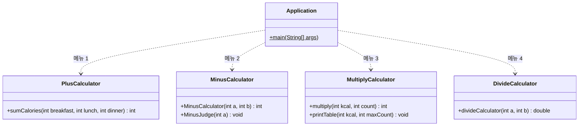
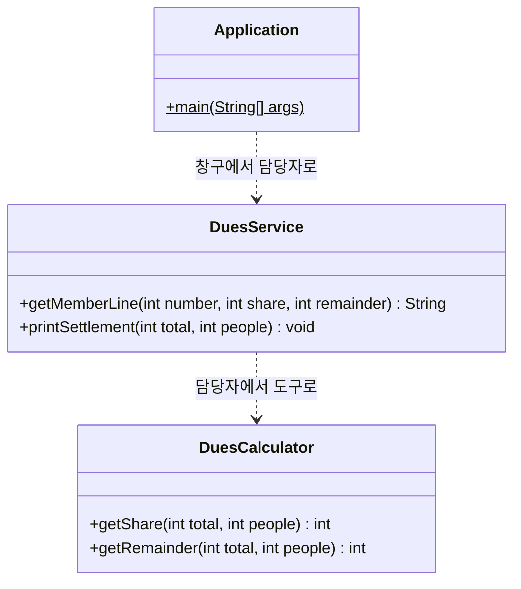
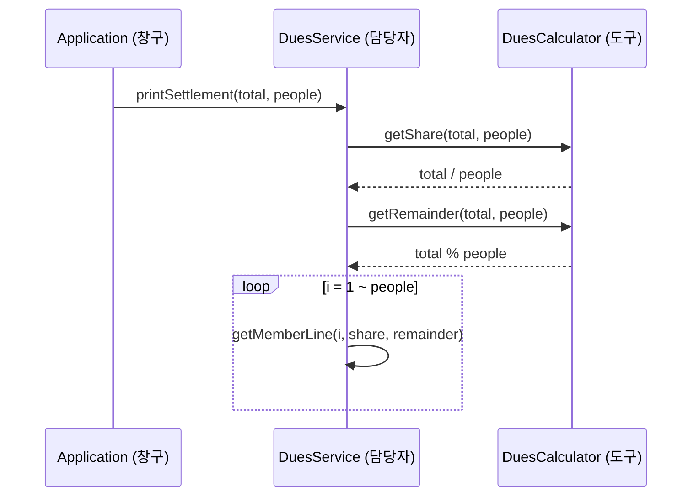
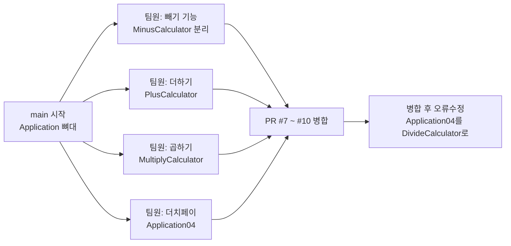

## 들어가며

자바 수업에서 팀 단위로 작은 콘솔 프로그램 두 개를 만들었습니다. 하나는 **식단 계산기**(`com.team1.food`), 다른 하나는 **대학생활 계산기**(`com.team1.campus`)입니다. 둘 다 메뉴를 고르면 계산 결과를 보여주는 단순한 프로그램이지만, 여러 사람이 한 저장소에서 각자 맡은 메뉴를 만들어 합치는 방식으로 진행했습니다.

이 글에서는 두 프로그램이 무엇을 하는지, 클래스를 어떻게 나눴는지, 그 과정에서 어떤 자바 개념을 썼는지를 실제 코드와 git 기록을 바탕으로 정리해 보겠습니다.

## 문제 상황: 모두가 main 하나를 고치면 생기는 일

두 프로젝트 모두 `Application.java`의 `main` 안에서 `do-while` + `switch`로 메뉴를 돌리는 구조로 시작했습니다. 템플릿에는 이런 주석이 남아 있었습니다.

```java
// 프로젝트 코드 (Application.java 템플릿 주석)
// (1) 각자 자기 메뉴 한 줄 추가
// (2) 각자 자기 case 블록 추가
```

즉 팀원 모두가 **같은 파일의 같은 `switch` 문**에 자기 `case`를 추가해야 했습니다. 여기서 두 가지 과제가 생깁니다.

| 과제 | 내용 |
|------|------|
| 코드 구조 | 계산 로직까지 전부 `case` 안에 쓰면 `main`이 계속 길어집니다 |
| 협업 | 여럿이 같은 파일을 동시에 고치면 병합할 때 충돌이 나기 쉽습니다 |

## 해결 과정 1: 식단 계산기 (calculator)

### 무엇을 하는 프로그램인가요?

메뉴는 4개입니다.

| 메뉴 | 기능 | 담당 클래스 / 메소드 |
|------|------|----------------------|
| 1 | 아침·점심·저녁 칼로리 합계 | `PlusCalculator.sumCalories()` |
| 2 | 목표 칼로리 대비 남은/초과 칼로리 | `MinusCalculator.MinusCalculator()`, `MinusJudge()` |
| 3 | 1인분부터 n인분까지 칼로리 표 | `MultiplyCalculator.multiply()`, `printTable()` |
| 4 | 더치페이 (1인당 금액) | `DivideCalculator.divideCalculator()` |

사칙연산 하나를 메뉴 하나에 대응시키고, 각 연산을 **별도 클래스**로 분리한 구조입니다.

### 클래스 설계



`Application`은 입력을 받고, `case`마다 해당 계산기 객체를 `new`로 만들어 메소드를 호출합니다.

### 핵심 코드

```java
// 프로젝트 코드 (Application.java, 일부 생략)
switch (menu) {
    case 1:
        // 아침/점심/저녁 입력 생략
        PlusCalculator calculator = new PlusCalculator();
        int total = calculator.sumCalories(breakfast, lunch, dinner);
        System.out.println("오늘 먹은 칼로리는 " + total + " kcal 입니다.");
        break;
    case 3:
        // 1인분 칼로리, 인분 수 입력 생략
        MultiplyCalculator multiplyCalculator = new MultiplyCalculator();
        multiplyCalculator.printTable(kcal, people);
        break;
    // ...
}
```

메소드 안에서 다른 메소드를 재사용하는 모습은 `MultiplyCalculator`에서 볼 수 있습니다.

```java
// 프로젝트 코드 (MultiplyCalculator.java)
public int multiply(int kcal, int count) {
    return (kcal * count);
}

public void printTable(int kcal, int maxCount) {
    for (int i = 1; i <= maxCount; i++) {
        System.out.println(i + "인분 : " + multiply(kcal, i) + "kcal");
    }
}
```

`MinusCalculator`는 계산(값 반환)과 판정(출력)을 두 메소드로 나눴습니다.

```java
// 프로젝트 코드 (MinusCalculator.java)
public int MinusCalculator (int a, int b) {
    return (a - b);
}

public void MinusJudge (int a) {
    if (a > 0) {
        System.out.println(a + " kcal 더 먹을 수 있습니다.");
    } else if (a == 0) {
        System.out.println("목표를 정확히 채웠습니다.");
    } else {
        System.out.println(Math.abs(a) + " kcal 초과했습니다.");
    }
}
```

### 다시 보니 보이는 부분

코드를 다시 읽으면서 확인한 점들도 기록해 둡니다.

- **정수 나눗셈**: `DivideCalculator`는 반환 타입이 `double`이지만 `return a / b;`에서 `a`, `b`가 모두 `int`라서 나눗셈이 정수로 먼저 계산됩니다. 예를 들어 10000원을 3명이 나누면 `3333.0`이 되고 소수점 아래는 버려집니다. 소수까지 원한다면 `(double) a / b`처럼 한쪽을 먼저 형변환해야 합니다.
- **클래스와 같은 이름의 메소드**: `MinusCalculator` 클래스 안에 반환 타입이 있는 `MinusCalculator(int, int)` 메소드가 있습니다. 반환 타입(`int`)이 있으므로 생성자가 아니라 일반 메소드로 컴파일되지만, 생성자와 헷갈리기 쉽고 자바 관례상 메소드 이름은 소문자 동사로 시작합니다(`subtract`, `judge` 등).

## 해결 과정 2: 대학생활 계산기 (un-c)

### 팀 규칙을 README로 먼저 정하기

두 번째 프로젝트는 시작하자마자 README에 작업 규칙을 적었습니다. 핵심만 옮기면 이렇습니다.

1. 이슈를 만들고 시작한다
2. `Application`은 **입출력만** 담당한다
3. 각자 담당 `case`의 도구(Calculator)·담당자(Service) 클래스를 만든다
4. 이슈 템플릿에 클래스·메소드 선언부, 규칙, 호출 흐름도(mermaid)를 적는다
5. 제목은 `feat: 한글로 짧은 설명(#이슈번호)` 형식, 본문에 `closes #번호`

첫 번째 프로젝트에서는 연산 클래스 하나가 계산과 출력을 함께 했다면, 여기서는 역할을 **창구(Application) → 담당자(Service) → 도구(Calculator)** 세 단계로 나눴습니다.

### 무엇을 하는 프로그램인가요?

git 기록상 이 저장소에 구현된 메뉴는 **4번 동아리 회비 정산** 하나입니다. 행사 총비용과 참석 인원을 입력하면 1인당 금액을 계산하고, 나누어떨어지지 않는 나머지는 1번(총무)이 더 내도록 안내합니다.

### 클래스 설계와 호출 흐름





### 핵심 코드

계산은 `DuesCalculator`가, 입력 검증과 출력은 `DuesService`가 맡습니다.

```java
// 프로젝트 코드 (DuesCalculator.java)
public int getShare(int total, int people) {
    return total / people;
}

public int getRemainder(int total, int people) {
    return total % people;
}
```

```java
// 프로젝트 코드 (DuesService.java, 일부 생략)
public void printSettlement(int total, int people) {
    if (people <= 0 || total <= 0) {
        System.out.println("총 비용과 인원은 1 이상이어야 합니다.");
        return;
    }
    DuesCalculator dc = new DuesCalculator();
    int share = dc.getShare(total, people);
    int remainder = dc.getRemainder(total, people);
    // 나머지 유무에 따라 안내 문구 출력 (생략)
    for (int i = 1; i <= people; i++) {
        System.out.println(getMemberLine(i, share, remainder));
    }
}
```

`printSettlement` 맨 앞에서 0 이하 입력을 걸러내고 `return`하기 때문에, 뒤에서 `getShare()`가 `total / people`을 계산할 때 0으로 나누는 상황이 생기지 않습니다. 정수 나눗셈의 몫(`/`)과 나머지(`%`)를 각각의 메소드로 나눈 것이 이 프로젝트 계산의 핵심입니다.

### 다시 보니 보이는 부분

`getMemberLine()`은 `String`을 **반환**하는 메소드인데, `number == 1`일 때는 메소드 안에서 총무 줄을 직접 **출력**도 합니다.

```java
// 프로젝트 코드 (DuesService.java)
public String getMemberLine(int number, int share, int remainder) {
    if (number == 1) {
        System.out.println("1번 (총무) : " + (share + remainder) + "원");
    }
    return number + "번 : " + share + "원";
}
```

그래서 반복문에서 `i == 1`일 때는 "1번 (총무) : …"와 "1번 : …"이 연달아 출력됩니다. 또 실제 코드에서는 반복문 전에 `getMemberLine(number, ...)`을 한 번 호출하고 반환값을 쓰지 않는데(위 코드에서는 생략), 인원이 1명이면 이 호출에서도 총무 줄이 출력됩니다. "값을 돌려주는 메소드는 출력하지 않는다"는 원칙에 맞춰 `number == 1`일 때 총무 문자열을 **반환**하도록 바꾸면 정리할 수 있는 부분입니다.

## 적용한 자바 개념 정리

| 개념 | 어디에 쓰였나 | 비고 |
|------|---------------|------|
| 클래스와 객체 | 연산마다 `XxxCalculator`, `DuesService` 클래스를 만들고 `new`로 객체 생성 | 두 프로젝트 공통 |
| 메소드 (매개변수·반환값) | `sumCalories(int, int, int)`가 `int` 반환, `getShare()` / `getRemainder()` | 값 반환 메소드와 `void` 출력 메소드를 구분 |
| 메소드 안에서 메소드 호출 | `printTable()`이 `multiply()` 호출, `printSettlement()`가 `getMemberLine()` 호출 | 작은 메소드 재사용 |
| 역할 분리 | Application(입출력) / Service(흐름) / Calculator(계산) | un-c README에 규칙으로 명시 |
| 캡슐화 | 계산 방법을 메소드 안에 숨기고 호출하는 쪽은 메소드 이름만 사용 | 두 프로젝트 모두 필드가 없어서 `private` 필드 + getter 형태의 캡슐화는 아직 쓰지 않았습니다 |
| 패키지 | `com.team1.food`, `com.team1.campus` | 같은 패키지라 `import` 없이 서로 사용 |
| 제어문 | `do-while` 메뉴 반복, `switch`, `if-else`, `for` | `default`로 없는 메뉴 처리 |
| 산술 연산자 | `+`, `-`, `*`, `/`, `%` | `int / int`는 정수 나눗셈 |
| 표준 라이브러리 | `java.util.Scanner`, `Math.abs()` | 키보드 입력과 절댓값 |
| 입력 검증 | `if (b > 0)`, `if (people <= 0 or total <= 0)` | 0으로 나누기 방지 |

## 팀 작업 방식 (git 기록 기준)

### 식단 계산기: 기능별 브랜치와 PR

git 기록을 보면 2026-09-29 16:32에 첫 커밋(`main 시작`)이 올라오고, 2026-09-30 12:39의 `오류수정 버전 2`까지 이어집니다. 커밋 작성자 아이디는 다섯 개가 기록되어 있습니다.



| 커밋 메시지 (기록 그대로) | 의미 |
|---------------------------|------|
| `빼기 기능추가` → `메소드 따로 안만든 기능 완성` → `마이너스 계산기 클래스 따로 설정` | 처음에는 `case` 안에 직접 쓰고, 나중에 `MinusCalculator`로 분리 |
| `더하기` | `PlusCalculator` 추가 |
| `곱 수정 완` → `곱하기 수정완료` → `Application.java 파일 int kcal 변수 한줄로 통합` | `MultiplyCalculator` 작성과 정리 |
| `더치페이 계산 기능 추가` | `Application04.java`로 추가 |
| `Merge pull request #7` ~ `#10` | 기능 브랜치 4개를 PR로 병합 |
| `병합`, `오류수정`, `오류수정 버전 2` | 병합 후 `Application04.java`가 `DivideCalculator.java`로 이름이 바뀌고 `Application.java`, `MultiplyCalculator.java` 정리 |

특히 빼기 기능의 커밋 흐름은 **"일단 `main` 안에서 동작하게 만들고, 그다음 클래스로 떼어낸다"**는 순서를 그대로 보여줍니다. 또 PR #7~#10이 모두 `Application.java`를 건드렸기 때문에, 중간에 `Merge branch 'main' into ...` 커밋으로 main의 변경을 브랜치에 먼저 반영한 뒤 PR을 병합한 기록이 남아 있습니다. 앞에서 걱정한 "같은 파일 동시 수정" 문제가 실제 기록에서도 병합 커밋 형태로 드러나는 셈입니다.

### 대학생활 계산기: README 규칙, 그다음 기능 구현

| 시각 (2026-09-30) | 커밋 메시지 | 내용 |
|-------------------|-------------|------|
| 14:50 | `start` | `Application.java` 뼈대 |
| 15:12 | `Add initial project guidelines and issue template` | README에 작업 규칙과 이슈 템플릿 작성 |
| 17:37 | `feat :동아리 회비 정산 기능` | 팀원이 `DuesCalculator`, `DuesService` 추가 |

README에서 정한 `feat: ...` 형식을 실제 커밋 메시지가 따르고 있습니다. 다만 현재 기록에는 메뉴 4번 외의 기능 커밋은 없습니다.

## 결과

| 항목 | 식단 계산기 | 대학생활 계산기 |
|------|-------------|-----------------|
| 구현된 메뉴 | 4개 (1~4번) | 1개 (4번) |
| 클래스 수 | 5개 (`Application` + 계산기 4개) | 3개 (`Application`, `DuesService`, `DuesCalculator`) |
| 역할 구분 | Application / Calculator (2단계) | Application / Service / Calculator (3단계) |
| 커밋 수 (merge 포함) | 22개 | 3개 |
| 병합된 PR | #7 ~ #10 | 기록 없음 |

두 프로젝트를 나란히 놓고 보면, 첫 번째는 "연산 하나 = 클래스 하나"로 나누는 데서 출발했고, 두 번째는 README로 "Application은 입출력만"이라는 규칙을 먼저 정한 뒤 계산(도구)과 흐름(담당자)을 한 번 더 나눴습니다. 같은 `switch` 메뉴 구조라도 클래스를 어떻게 나누느냐에 따라 `main`이 맡는 일의 양이 달라진다는 점을 코드로 확인할 수 있습니다.

## 더 학습하면 좋은 개념

- **`private` 필드와 생성자** — 지금 클래스들은 필드 없이 메소드만 있습니다. 상태(예: 목표 칼로리, 총무 번호)를 필드로 갖고 `private`으로 감추는 것이 캡슐화의 본래 모습이라, 다음 단계로 익혀두면 좋습니다.
- **형변환(Casting)과 정수 나눗셈** — `DivideCalculator`의 `a / b`처럼 반환 타입이 `double`이어도 계산은 `int`로 먼저 일어납니다. 숫자 타입 변환 규칙을 알면 이런 계산 오류를 미리 피할 수 있습니다.
- **인터페이스(Interface)와 다형성** — 계산기 클래스들이 모두 "값을 받아 결과를 낸다"는 비슷한 모양이라, 공통 인터페이스로 묶으면 메뉴 처리 구조를 더 유연하게 발전시킬 수 있습니다.
- **단일 책임 원칙(SRP)** — `getMemberLine()`처럼 값 반환과 출력을 한 메소드가 함께 하면 출력이 중복되기 쉽습니다. "한 메소드는 한 가지 일"이라는 원칙을 알면 README의 역할 분리 규칙이 왜 필요한지 더 잘 보입니다.
- **예외 처리(`try-catch`)** — 지금은 `sc.nextInt()`에 숫자가 아닌 값을 넣으면 `InputMismatchException`으로 프로그램이 멈춥니다. 예외 처리를 익히면 잘못된 입력에도 버티는 메뉴를 만들 수 있습니다.

## 참고 자료

- [Oracle Java Tutorials - Classes and Objects](https://docs.oracle.com/javase/tutorial/java/javaOO/index.html)
- [Oracle Java Tutorials - Defining Methods](https://docs.oracle.com/javase/tutorial/java/javaOO/methods.html)
- [Oracle Java Tutorials - Controlling Access to Members of a Class](https://docs.oracle.com/javase/tutorial/java/javaOO/accesscontrol.html)
- [Oracle Java Tutorials - The switch Statement](https://docs.oracle.com/javase/tutorial/java/nutsandbolts/switch.html)
- [Oracle Java Tutorials - Assignment, Arithmetic, and Unary Operators](https://docs.oracle.com/javase/tutorial/java/nutsandbolts/op1.html)
- [Oracle Java Tutorials - Defining an Interface](https://docs.oracle.com/javase/tutorial/java/IandI/createinterface.html)
- [Oracle Java Tutorials - Exceptions](https://docs.oracle.com/javase/tutorial/essential/exceptions/index.html)
- [Java SE 21 API - java.util.Scanner](https://docs.oracle.com/en/java/javase/21/docs/api/java.base/java/util/Scanner.html)
