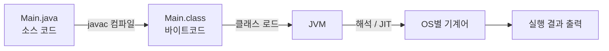
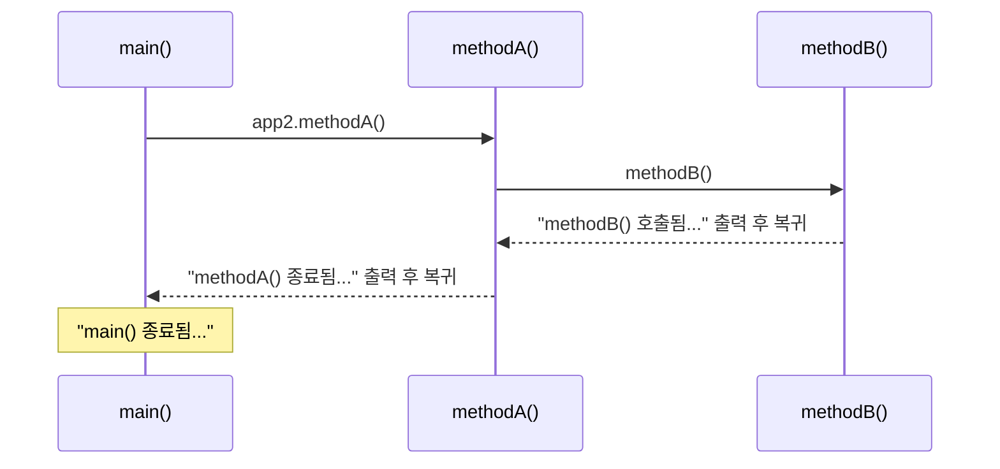
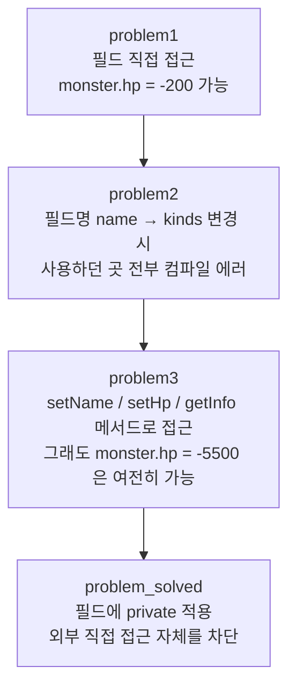
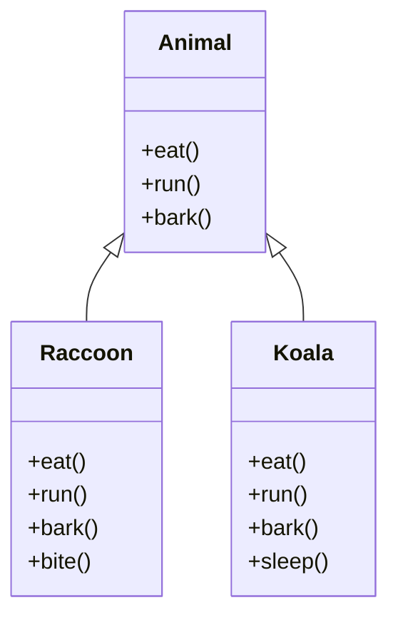
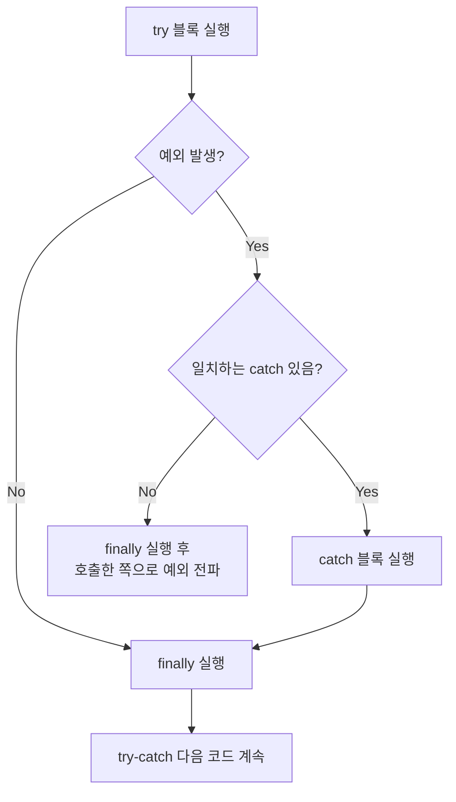

## 들어가며

Java 수업은 "Hello World" 한 줄에서 시작해서 객체지향, 제네릭, 컬렉션, 예외 처리와 파일 입출력까지 이어졌습니다. 이 글은 수업 저장소의 5개 챕터를 **진도 순서대로** 정리한 노트입니다.

| 챕터 | 주제 | 핵심 키워드 |
|------|------|-------------|
| chap01 | Java 기초 | 실행 과정, 리터럴, 자료형, 형변환, 연산자 |
| chap02 | 제어문과 메서드 | if, switch, for/while/do-while, 단축 평가, 메서드 호출 |
| chap03 | 객체지향 프로그래밍 | String, 배열, 클래스, 생성자, 캡슐화, 추상화, 오버로딩, static, 싱글톤, final, 상속, 다형성, 인터페이스 |
| chap04 | 제네릭과 컬렉션 | `<T>`, Wrapper, 타입 제한, 와일드카드, List/Set/Map, Properties |
| chap05 | 예외와 파일 IO | try-catch-finally, throw/throws, 사용자 정의 예외, FileWriter/FileReader |

비유 하나를 먼저 두고 가겠습니다. Java 프로그램을 **레고 공장**이라고 생각하면, 자료형은 블록의 모양, 메서드는 조립 설명서 한 장, 클래스는 블록 세트의 설계도, 객체는 그 설계도로 실제로 찍어낸 세트입니다. 글 전체에서 이 비유를 가끔 꺼내 쓰겠습니다.

> 수업 환경은 JDK 21, IntelliJ 모듈 프로젝트(Maven/Gradle 없이 `src/`만 사용)였습니다.

## chap01. Java 기초 — 프로그램이 실행되기까지

### Java 코드는 어떻게 실행될까?

수업 첫 코드는 `main()` 메서드가 있는 클래스였습니다. Java의 모든 코드는 **클래스 안에서** 동작하고, `main()`이 프로그램의 시작점입니다.

수업 예제 코드:

```java
public class Main {
    public static void main(String[] args) {
        /* Java 의 실행 과정
         *   1. Java 코드를 작성한다. (.java)
         *   2. javac(컴파일러)가 .java 파일을 .class 파일로 번역한다.
         *   3. JVM 이 .class 파일을 로드하고 실행한다.
         *   4. JVM 은 바이트코드를 해석하여 각 OS 에서 실행 가능한 기계어로 변환한다.
         *   5. 변환된 기계어를 실행한다. */
        System.out.println("Hello World!!!!~");
    }
}
```

이 과정을 그림으로 보면 이렇습니다.



**왜 굳이 .class라는 중간 단계를 거칠까요?** 바이트코드는 특정 OS에 묶이지 않은 "공용어"이기 때문입니다. Windows든 macOS든 JVM만 있으면 같은 `.class` 파일을 실행할 수 있습니다. 통역사(JVM)가 나라마다 있어서, 원고(.class)는 하나만 써도 되는 구조라고 보면 됩니다.

주석도 첫 시간에 다뤘습니다. `//` 한 줄 주석, `/* */` 여러 줄 주석이 있고, 수업에서는 IntelliJ의 TODO 패턴에 `comment.`를 등록해서 필기 주석만 색으로 구분하는 방법을 썼습니다.

### 리터럴과 자료형

**리터럴**은 코드에 직접 쓴 "값" 자체(정수, 실수, 문자, 문자열, 논리)입니다. 이 값을 담는 그릇이 변수이고, 그릇의 모양이 자료형입니다.

수업 예제 코드:

```java
byte b = 10;      // 1 byte
short s = 10;     // 2 byte
int i = 10;       // 4 byte
long l = 10;      // 8 byte

float f = 3.14f;  // 4 byte (f 접미사 필수)
double d = 3.14;  // 8 byte

char ch = 'ㅎ';            // 문자 1개, 작은따옴표
String str = "안녕하세요!"; // 문자열, 큰따옴표
boolean bl = true;

int num;      // 선언
num = 30;     // 초기화
int num2 = 10; // 선언과 동시에 초기화
```

| 분류 | 자료형 | 크기 | 비고 |
|------|--------|------|------|
| 정수 | byte / short / **int** / long | 1 / 2 / 4 / 8 byte | 기본은 int |
| 실수 | float / **double** | 4 / 8 byte | 기본은 double, float는 `f` 필요 |
| 문자 | char | 2 byte | `'a'` |
| 논리 | boolean | - | true / false |
| 문자열 | String | 참조형 | 기본형이 아니라 클래스 |

같은 중괄호 `{}` 영역 안에서는 **같은 이름의 변수를 두 번 선언할 수 없다**는 점도 함께 짚었습니다.

키보드 입력은 `Scanner`로 받았습니다. `sc.nextLine()`은 한 줄 문자열, `sc.nextInt()`는 정수를 읽습니다.

### 형변환 — 큰 컵, 작은 컵

수업 예제 코드:

```java
double dnum = 99.99;
int inum = (int) dnum;   // 명시적 형변환 → 99 (소수점 손실)

int num2 = 100;
double dnum2 = num2;     // 암시적 형변환 → 100.0

char a = 'a';
int num3 = 1;
System.out.println(a + num3); // 98 (문자 'a'의 코드값 97 + 1)
```

작은 컵(int)의 물을 큰 컵(double)에 붓는 건 넘칠 일이 없으니 Java가 알아서 해 줍니다(**암시적**). 반대로 큰 컵의 물을 작은 컵에 부으면 넘칠 수 있으니, 개발자가 "손실을 감수하겠다"고 `(int)`처럼 **명시적으로** 써야만 컴파일이 됩니다. 마지막 줄처럼 `char`와 `int`를 더하면 문자가 숫자(문자 코드)로 바뀌어 계산된다는 점도 확인했습니다.

### 연산자

| 종류 | 연산자 | 수업 포인트 |
|------|--------|-------------|
| 산술 | `+ - * / %` | `%`는 나머지(모드 연산). 정수끼리 `/`는 몫만 남음 (10 / 3 = 3) |
| 문자열 결합 | `+` | 문자열이 끼면 피연산자를 문자열로 바꿈. 그래서 `"덧셈 : " + (a + b)`처럼 괄호 필요 |
| 비교 | `== != < > <= >=` | 결과는 boolean |
| 논리 | `&&`(AND), OR, `!`(NOT) | 조건 결합. OR 연산자는 세로 막대 두 개로 씀 |
| 증감 | `++ --` | 전위는 먼저 증가 후 사용, 후위는 사용 후 증가 |

수업 예제 코드:

```java
int age = 20;
System.out.println("++age : " + (++age)); // 21 (먼저 증가)
System.out.println("age++ : " + (age++)); // 21 출력 후 22로 증가
System.out.println("age : " + (age));     // 22
```

`A && B`에서 A와 B 중 무엇을 앞에 둘지가 면접 질문으로 나온다는 이야기가 있었는데, 답은 chap02의 단축 평가에서 이어집니다.

## chap02. 제어문과 메서드 — 흐름을 나누고, 반복하고, 묶기

### if 조건문과 switch

`if`는 조건식 결과에 따라 실행 흐름을 **분기**합니다. 수업에서는 점수 등급과 나이별 할인율 프로그램을 만들었습니다.

수업 예제 코드:

```java
Scanner sc = new Scanner(System.in);
System.out.print("나이를 입력해주세요 : ");
int age = sc.nextInt();
double discountRate;

if (age < 13) {
    discountRate = 0.5;       // 청소년 50%
} else if (age >= 65) {
    discountRate = 0.3;       // 노약자 30%
} else {
    discountRate = 0.0;
}
System.out.println("나이 : " + age + ", 할인율 : " + (discountRate * 100) + "%");
```

`switch`는 값이 여러 개로 갈리는 상황에서 긴 `if-else` 사슬을 대신합니다. `break`를 빼먹으면 다음 `case`로 흘러내려가므로 주의해야 하고, `default`는 `else` 역할입니다.

수업 예제 코드:

```java
switch (month) {
    case 1 : System.out.println("1월~"); break;
    case 2 : System.out.println("2월~"); break;
    default: System.out.println("그 외의 월입니다!");
}
```

### 단축 평가 (short-circuit evaluation)

chap01에서 남겨둔 면접 질문의 답입니다. `&&`는 **왼쪽이 false면 오른쪽을 아예 실행하지 않고**, `||`는 **왼쪽이 true면 오른쪽을 실행하지 않습니다.**

수업에서 든 회원가입 예시가 와닿았습니다.

| 조건 | 내용 | 소요 시간 |
|------|------|-----------|
| A | 아이디 중복 검사 | 1분 |
| B | 비밀번호 8글자 미만 검사 | 0.5초 |

`if (A && B)`에서 사용자가 비밀번호를 잘못 입력했다면, A를 앞에 두면 1분 뒤에야 실패를 알고, B를 앞에 두면 0.5초 만에 압니다. 그래서 정리하면 다음과 같습니다.

- `&&` → **false가 될 확률이 높은(그리고 가벼운) 조건을 왼쪽**에
- `||` → **true가 될 확률이 높은 조건을 왼쪽**에

수업에서는 `System.nanoTime()`으로 조건 순서에 따른 실행 시간을 직접 찍어 보기도 했습니다.

### 반복문: for, while, do-while

| 반복문 | 형식 | 언제 쓰나 |
|--------|------|-----------|
| for | `for(초기식; 조건식; 증감식) {}` | 반복 횟수가 정해져 있을 때 |
| while | `while(조건식) {}` | 횟수가 불확실하고 조건으로 끝낼 때 |
| do-while | `do {} while(조건식);` | **최소 1회는 실행**해야 할 때 |

수업 예제 코드 (벤치프레스 5회, 짝수 회차엔 트레이너가 침묵):

```java
for (int i = 1; i <= 5; i++) {
    if (i % 2 == 0) {
        System.out.println("침묵함...");
    } else {
        System.out.println("성원님 " + i + "번 했습니다~");
    }
}
```

`do-while` 예제는 `num = 5`, 조건 `num < 3`이라 조건이 처음부터 거짓인데도 **한 번은 출력**됩니다. 이게 `while`과의 결정적인 차이입니다.

### 메서드 — 반복되는 코드를 설명서 한 장으로

두 수를 더할 때마다 변수 2줄 + 출력 1줄을 계속 복붙하는 문제에서 출발했습니다. 같은 일을 하는 코드를 **이름 붙인 블록**으로 묶으면 재사용성과 가독성이 올라갑니다.

수업 예제 코드:

```java
public class Application01 {
    public static void main(String[] args) {
        Application01 app = new Application01();     // 호출 준비
        System.out.println(app.sumTwoNumber(5, 6));  // 호출
        System.out.println(app.sumTwoNumber(7, 8));
    }

    // [접근제어자] [반환 타입] 메소드명([매개변수]) { [return 반환값;] }
    public int sumTwoNumber(int a, int b) {
        return a + b;
    }
}
```

- `new 클래스명()`으로 객체를 만든 뒤 `변수명.메서드명()`으로 호출합니다. `.`은 참조 연산자, `()`는 "호출한다"는 뜻입니다.
- 반환값이 없으면 `void`, 있으면 그 타입을 쓰고 `return`은 생략할 수 없습니다.
- **전달인자(argument)** 는 호출할 때 넘기는 값, **매개변수(parameter)** 는 메서드가 받는 변수입니다.

메서드 호출 흐름도 단계별로 따라가 봤습니다. `main()`이 `methodA()`를 부르고, `methodA()` 안에서 `methodB()`를 불러야만 B가 실행됩니다. "부르지 않았는데 어떻게 나와요"라는 주석이 핵심입니다.



접근제어자도 이때 처음 정리했습니다.

| 접근제어자 | 접근 가능 범위 |
|-----------|----------------|
| public | 모든 클래스 |
| protected | 같은 패키지 + 자식 클래스 |
| (default, 생략) | 같은 패키지 |
| private | 같은 클래스 내부만 |

다른 클래스의 메서드를 쓰는 예제로 `Calculator` 클래스를 만들고, **삼항 연산자**로 최솟값·최댓값을 구했습니다.

수업 예제 코드:

```java
public int minNumberOf(int a, int b) {
    return (a > b) ? b : a;   // 조건 ? 참일 때 값 : 거짓일 때 값
}
```

## chap03. 객체지향 프로그래밍

### 자료형의 세 갈래

chap03은 "자료형에는 기본 자료형(int, char, double), 참조 자료형, 사용자 정의 자료형이 있다"는 정리로 시작했습니다. 참조 자료형의 대표가 `String`과 배열입니다.

### String — `==`와 `equals()`의 차이

자주 쓰는 메서드로 `length()`, `charAt(index)`, `trim()`을 실습했습니다. 인덱스는 **0부터** 시작합니다(`"abc"` → a:0, b:1, c:2).

핵심은 문자열 비교였습니다.

수업 예제 코드:

```java
String str1 = "java";              // 리터럴 방식
String str2 = new String("java");  // 객체 생성 방식
String str3 = "java";
String str4 = new String("java");

System.out.println(str1 == str2);      // false
System.out.println(str1 == str3);      // true
System.out.println(str2 == str4);      // false
System.out.println(str1.equals(str2)); // true
```

`==`는 **주소(같은 객체인가)** 를 비교하고, `equals()`는 **내용(같은 글자인가)** 을 비교합니다. `new`를 만나면 항상 새 공간이 생기므로 `str2`와 `str4`는 내용이 같아도 다른 객체입니다. 반면 리터럴로 만든 `str1`, `str3`는 JVM이 같은 문자열 객체를 재사용하기 때문에(String Pool) `==`도 true가 나옵니다. 그래서 **문자열 내용 비교는 항상 `equals()`** 를 쓰는 게 안전합니다.

수업 중 공부법 코멘트도 남겨 둡니다. 메서드를 다 외우고 쓰는 게 아니라, **써 보고 → 출력해 보고 → 이해한다**.

### 배열 — 같은 자료형의 묶음

변수 하나에는 값 하나만 들어가니, 값 5개를 더하려면 변수 5개가 필요했습니다. 배열은 **동일한 자료형**을 한 이름으로 묶고, 인덱스로 접근하므로 반복문과 궁합이 좋습니다.

수업 예제 코드:

```java
int[] scores = new int[5];   // 선언 + 할당

for (int i = 0; i < scores.length; i++) {
    System.out.print((i + 1) + "번 째 학생의 java 점수를 입력해주세요 : ");
    scores[i] = sc.nextInt();
}

double sum = 0;
for (int i = 0; i < scores.length; i++) {
    sum += scores[i];
}
double avg = sum / scores.length;
```

값을 넣지 않았는데 `iarr[0]`이 `0`으로 나오는 이유도 다뤘습니다. 배열은 **heap 메모리**에 만들어지고, heap에는 빈 값이 있을 수 없어서 JVM이 기본값으로 채웁니다.

| 타입 | 기본값 |
|------|--------|
| 정수 | 0 |
| 실수 | 0.0 |
| 논리 | false |
| 참조 | null |

### 사용자 정의 자료형 — 클래스

회원 정보(아이디, 비밀번호, 이름, 나이, 성별, 취미)는 타입이 제각각이라 배열 하나로 묶을 수 없습니다. 변수 이름을 다 관리해야 하고, 메서드에 넘길 매개변수가 비대해지고, `return`은 하나만 되니 묶어서 돌려줄 수도 없습니다. 이걸 해결하는 게 **클래스**입니다.

수업 예제 코드:

```java
public class Member {
    // 클래스 바로 아래 선언한 변수 = 필드 (인스턴스 변수, 속성)
    String id;
    String pwd;
    String name;
    int age;
    char gender;
    String[] hobby;
}

Member member = new Member();
member.id = "user02";
member.hobby = new String[]{"야구시청", "배드민턴"};
```

### 생성자 — 객체가 태어나는 순간

`new Member()`의 `Member()`는 사실 **생성자**라는 메서드 호출입니다. 생성자는 `new`를 만나는 순간 가장 먼저 실행되며, 주로 필드 초기화에 씁니다.

수업 예제 코드:

```java
public Member(String id, String pwd, String name, int age, char gender, String[] hobby) {
    System.out.println("매개변수 있는 생성자 동작함...");
    this.id = id;
    this.pwd = pwd;
    // ... 나머지 필드도 동일
}

@Override
public String toString() {
    return "Member{" + "id='" + id + '\'' + ", name='" + name + '\'' + '}';
}
```

- 생성자를 하나도 안 쓰면 컴파일러가 **기본 생성자**를 자동으로 넣어 줍니다.
- 하지만 **매개변수 있는 생성자를 직접 쓰면 기본 생성자는 자동 생성되지 않습니다.** 이후 `new Member()`가 필요하면 직접 써야 합니다.
- `toString()`을 재정의하면 객체를 출력할 때 주소값 대신 실제 값이 보입니다.

### 캡슐화 — 몬스터 체력이 -200이 되는 문제

캡슐화는 "일부러 문제가 있는 코드 3개 → 해결본" 순서로 진행됐습니다. 이 흐름이 수업에서 가장 인상적인 구성이었습니다.



수업 예제 코드 (해결본):

```java
public class Monster {
    private String kinds;
    private int hp;

    public void setHp(int hp) {
        if (hp >= 0) {
            this.hp = hp;
        } else {
            System.out.println("삐빅... 오류 발생 잘못된 값이 탐지되어 hp 를 0으로 강제합니다.");
            this.hp = 0;
        }
    }

    public void setName(String name) { this.kinds = name; }

    public String getInfo() {
        return "몬스터의 이름은 " + this.kinds + " 이고, 체력은 " + this.hp + " 입니다!";
    }
}
```

캡슐화로 얻는 것은 두 가지입니다.

1. **검증**: 값이 들어오는 길이 메서드 하나뿐이니, 거기서 잘못된 값을 걸러낼 수 있습니다.
2. **변경에 강함**: 외부는 필드 이름을 모르고 메서드만 알기 때문에, 내부 필드명이 `name`에서 `kinds`로 바뀌어도 외부 코드가 깨지지 않습니다.

여기서 `this`도 정리했습니다. `this`는 **객체 자기 자신의 주소**를 담은 변수이고, 지역변수(매개변수)와 필드 이름이 같으면 지역변수가 우선이므로 필드에 대입하려면 `this.hp`처럼 명시해야 합니다.

### 추상화 — 카레이서와 자동차

추상화는 복잡한 현실에서 **프로그램 목적에 필요한 공통 부분만 뽑아내고 나머지는 버리는 것**입니다. 수업에서는 요구사항 7줄을 먼저 쓰고, 문장에서 "은/는, 이/가" 앞 단어를 **클래스 후보**로 뽑는 방법을 배웠습니다. 그 결과 `CarRacer`와 `Car`가 나왔고, 각 객체가 받을 **메시지**(해야 할 일)가 곧 메서드가 됐습니다.

| 객체 | 받는 메시지(메서드) | 상태(필드) |
|------|--------------------|-----------|
| CarRacer | 시동 걸어라, 엑셀 밟아라, 브레이크 밟아라, 시동 꺼라 | `private Car car` |
| Car | 시동 걸어라, 앞으로 가라, 멈춰라, 시동 꺼라 | `speed`, `isOn` |

수업 예제 코드:

```java
public class CarRacer {
    // Car 는 CarRacer 만 접근해야 한다. Application 은 Car 에 접근하면 안 된다.
    private Car car = new Car();

    public void stepAccel() { car.go(); }
    public void stepBreak() { car.stop(); }
}

public class Car {
    private int speed;
    private boolean isOn;

    public void go() {
        if (isOn) {
            this.speed += 10;
            System.out.println("현재 차의 속력은 " + this.speed + "(km/h) 입니다");
        } else {
            System.out.println("차의 시동이 걸려있지 않습니다. 시동 확인해주세요!!");
        }
    }
}
```

`Application`은 메뉴(`while(true)` + `switch`)로 입력만 받아 `racer`에게 메시지를 보내고, 실제 상태 변경은 `Car` 안에서만 일어납니다. 사람은 핸들과 페달만 알고 엔진 내부는 모르는 것과 같습니다.

### 오버로딩 — 메서드 시그니처

**메서드 시그니처**는 메서드를 식별하는 값으로, `메서드명 + 매개변수 목록`입니다. 시그니처가 다르면 같은 이름의 메서드를 여러 개 둘 수 있는데, 이를 **오버로딩**이라고 합니다.

수업 예제 코드:

```java
public void test() {}
public void test(int num) {}               // 매개변수 유무 → 성립
public void test(int num, String str) {}   // 매개변수 개수 → 성립
public void test(String str, int num) {}   // 매개변수 순서 → 성립
// private void test() {}    // 접근제어자만 다름 → 에러
// private int test() {}     // 반환 타입만 다름 → 에러
// public void test(int num2) {} // 매개변수 이름만 다름 → 에러
```

| 바꾼 것 | 오버로딩 성립? |
|---------|----------------|
| 매개변수 개수 / 타입 / 순서 | O |
| 접근제어자 | X |
| 반환 타입 | X |
| 매개변수 이름 | X |

### static — 모두가 공유하는 칠판

`static`이 붙은 필드와 메서드는 객체 생성 시점이 아니라 **애플리케이션 시작 시점**에 초기화되고, 모든 객체가 하나를 공유합니다. 각 학생의 공책(인스턴스 필드)과 교실 앞 칠판(static 필드)의 차이라고 생각하면 됩니다.

수업 예제 코드:

```java
public class StaticFieldTest {
    private int nonStaticInt;
    private static int staticInt;

    public void increaseNonStatic() { this.nonStaticInt++; }
    public void increaseStatic() { StaticFieldTest.staticInt++; } // 클래스명.변수명, this 사용 X
    public static int getStaticInt() { return staticInt; }
}

StaticFieldTest st1 = new StaticFieldTest();
st1.increaseNonStatic();
st1.increaseStatic();
StaticFieldTest st2 = new StaticFieldTest();
// st2.getNonStaticInt() → 0, StaticFieldTest.getStaticInt() → 1
```

새로 만든 `st2`의 인스턴스 필드는 0부터 시작하지만, static 필드는 `st1`이 올려놓은 1이 그대로 보입니다.

### 싱글톤 패턴 — 리모컨은 하나면 충분

static을 활용한 디자인 패턴으로 **싱글톤**을 배웠습니다. 앱 전체에서 인스턴스를 **딱 하나만** 만들어 공유해 메모리 낭비를 막는 방식입니다. 생성자를 `private`으로 막아 외부에서 `new`를 못 하게 하고, `getInstance()`로만 꺼내 쓰게 합니다.

수업 예제 코드:

```java
// 이른 초기화 (Eager): 클래스가 로드될 때 바로 생성
public class EagerSingleton {
    private static EagerSingleton eager = new EagerSingleton();
    private EagerSingleton() {}
    public static EagerSingleton getInstance() { return eager; }
}

// 게으른 초기화 (Lazy): 처음 요청될 때 생성
public class LazySingleton {
    private static LazySingleton lazy;
    private LazySingleton() {}
    public static LazySingleton getInstance() {
        if (lazy == null) {
            lazy = new LazySingleton();
        }
        return lazy;
    }
}
```

두 번 `getInstance()`를 호출해 `hashCode()`가 같은 것을 확인했습니다.

| 방식 | 생성 시점 | 장점 | 주의할 점 |
|------|-----------|------|-----------|
| Eager | 클래스 로딩 시 | 구현이 단순 | 안 써도 메모리를 차지 |
| Lazy | 첫 `getInstance()` 호출 시 | 필요할 때만 생성 | 위 코드는 여러 스레드가 동시에 호출하면 두 개가 생길 수 있음 (멀티스레드 환경에선 동기화 필요) |

### final — 한 번 정하면 끝

`final`은 **변경 불가**를 뜻합니다. final 필드는 식별을 위해 관례상 대문자와 `_`를 씁니다.

수업 예제 코드:

```java
private final int NON_STATIC_NUM = 1;   // 1. 선언과 동시에 초기화
private final int NON_STATIC_NUM2;      // 2. 선언만 하고

public FinalFieldTest(int num) {
    this.NON_STATIC_NUM2 = num;         //    반드시 생성자에서 초기화
}
// setter 로 재대입 → 컴파일 에러
```

선언만 하고 초기화하지 않으면 JVM 기본값 0이 들어가야 하는데, 그러면 "0으로 영원히 고정"되어 버리므로 Java는 이를 허용하지 않습니다.

### 상속 — 부모의 것은 내 것

`extends`로 부모 클래스의 필드와 메서드를 물려받습니다. "경찰차는 차다"처럼 **IS-A 관계**가 성립할 때 씁니다. 공통 메서드는 부모에 한 번만 쓰고, 자식은 다르게 동작해야 하는 메서드만 **오버라이딩(재정의)** 합니다.

수업 예제 코드:

```java
public class CapsCar extends Car {
    public CapsCar() {
        System.out.println("CapsCar 의 기본 생성자 호출됨..");
    }

    @Override
    public void run() {
        // super.run();  // super → 부모의 인스턴스
        System.out.println("경찰차는 삐용삐용~~ 하면서 달립니다!!");
    }

    public void 무전하기() {   // 자식만의 고유 메서드
        System.out.println("치지지ㅣ...412호에 성원몬 등장");
    }
}
```

`new CapsCar()`를 하면 부모 `Car`의 생성자 메시지가 **먼저** 출력되고 자식 생성자가 실행되는데, 자식 객체 안에 부모 부분이 먼저 만들어지기 때문입니다. `this`가 자기 자신이라면 `super`는 부모를 가리킵니다.

| 비교 | 오버로딩 (Overloading) | 오버라이딩 (Overriding) |
|------|-----------------------|-------------------------|
| 위치 | 같은 클래스 | 부모-자식 클래스 |
| 시그니처 | 매개변수를 다르게 | 부모와 똑같이 |
| 목적 | 같은 이름, 다른 입력 | 같은 이름, 다른 동작 |

### 다형성 — 하나의 타입, 여러 모습

다형성은 **하나의 인스턴스가 여러 타입을 가질 수 있는 것**입니다. 그래서 부모 타입 하나로 여러 자식 객체를 다룰 수 있고, 같은 메서드 호출이 객체마다 다르게 동작합니다.



수업 예제 코드:

```java
Animal a1 = new Raccoon();   // "너구리는 동물이다" (O)
a1.bark();                    // "너굴너굴 너굴맨.." ← Raccoon 의 메서드가 실행됨
// a1.bite();                 // 컴파일 에러: Animal 타입엔 bite() 가 없음
((Raccoon) a1).bite();        // 클래스 형변환 후 사용 가능
// Raccoon r1 = new Animal(); // "동물은 너구리다" (X) → 에러
```

여기서 **동적 바인딩**이 등장합니다. 컴파일 시점에는 `a1.bark()`가 `Animal`의 `bark()`와 연결되어 있지만, **런타임에 실제 객체(Raccoon)의 오버라이딩된 메서드로 바뀌어** 실행됩니다. 반대로 `bite()`는 컴파일러가 `Animal` 타입만 보고 판단하므로 형변환 없이는 쓸 수 없습니다.

### 인터페이스 — Can-Do 계약서

인터페이스는 "이 인터페이스를 구현하는 클래스는 이 메서드들을 **반드시** 가져야 한다"는 계약입니다. 수업에서는 Can-Do라고 표현했습니다.

수업 예제 코드:

```java
public interface Animal {
    // public Animal() {}   // 생성자 X
    void run();
    void eat();
    void bark();
}

public class Raccoon implements Animal {   // extends 가 아니라 implements
    @Override
    public void run() { System.out.println("너구리가 폴짝폴짝 뛰어댕깁니다.."); }
    @Override public void eat() {}
    @Override public void bark() {}
}

// Animal animal = new Animal();  // 인터페이스는 new 불가
Animal animal = new Raccoon();     // 구현 클래스로 생성 → 다형성
```

| 비교 | 상속 (`extends`) | 인터페이스 (`implements`) |
|------|------------------|---------------------------|
| 관계 | IS-A ("~는 ~이다") | Can-Do ("~할 수 있다") |
| 생성자 | 있음 | 없음 |
| 객체 생성 | 부모 클래스도 `new` 가능 | 직접 `new` 불가 |
| 메서드 | 구현된 메서드 물려받음 | 구현을 강제 |

> 보충: 수업 주석에는 "인터페이스는 구현부가 있는 메서드를 못 쓴다"고 되어 있는데, 이는 일반 추상 메서드 기준 설명입니다. Java 8부터는 `default`, `static` 메서드처럼 구현부를 가진 메서드도 인터페이스에 둘 수 있습니다. ([Java Tutorials - Default Methods](https://docs.oracle.com/javase/tutorial/java/IandI/defaultmethods.html))

## chap04. 제네릭과 컬렉션

### 제네릭 — 타입을 나중에 정하는 상자

제네릭은 클래스나 메서드 안에서 쓸 타입을 **컴파일 시점에 지정**하는 방법입니다. 컴파일러가 미리 타입을 검사해 주므로 타입 안정성이 올라갑니다. 어떤 물건이든 담을 수 있는 상자에 "이 상자는 문자열 전용" 라벨을 붙이는 것과 비슷합니다.

수업 예제 코드:

```java
public class GenericTest<T> {   // T: 타입 변수
    private T value;
    public T getValue() { return value; }
    public void setValue(T value) { this.value = value; }
}

GenericTest gt = new GenericTest();          // 타입 미지정 → 뭐든 들어감
gt.setValue(1);
gt.setValue("안녕하세요");

GenericTest<String> gt2 = new GenericTest<>();
gt2.setValue("문자열");
// gt2.setValue(1);                          // 컴파일 에러로 미리 막아줌

// GenericTest<int> gt3;                     // 기본형은 불가
GenericTest<Integer> gt3 = new GenericTest<>();
```

`<>`(다이아몬드) 안에는 기본 자료형이 들어갈 수 없어서 **Wrapper 클래스**를 씁니다.

| 기본형 | Wrapper |
|--------|---------|
| int | Integer |
| char | Character |
| byte / short / long | Byte / Short / Long |
| boolean | Boolean |
| double / float | Double / Float |

이 챕터에서 **getter/setter**(private 필드를 외부에서 조회/설정하는 메서드)와 **toString()**(주소값 대신 실제 값을 출력)의 역할도 다시 정리했습니다.

### 타입 제한과 와일드카드 — 토끼 농장

`Animal`(인터페이스) → `Mammal` → `Rabbit` → `Bunny` → `DrunkenBunny`, 그리고 `Reptile` → `Snake`라는 계층을 만들고 토끼 농장을 운영했습니다.

수업 예제 코드:

```java
// Rabbit 이거나 Rabbit 을 상속받은 타입만 T 로 허용
public class RabbitFarm<T extends Rabbit> {
    private T animal;
    // getter / setter / 생성자
}

// RabbitFarm<Mammal> farm = ...;   // 에러: Mammal 은 Rabbit 의 자식이 아님
RabbitFarm<Bunny> farm2 = new RabbitFarm<>();
farm2.setAnimal(new DrunkenBunny()); // Bunny 의 자식이라 OK
```

메서드 매개변수로 제네릭 객체를 받을 때는 **와일드카드 `?`** 로 범위를 제한합니다.

수업 예제 코드:

```java
public class WildcardFarm {
    public void anyType(RabbitFarm<?> farm) { farm.getAnimal().cry(); }
    public void extendsType(RabbitFarm<? extends Bunny> farm) { farm.getAnimal().cry(); }
    public void superType(RabbitFarm<? super Bunny> farm) { farm.getAnimal().cry(); }
}
```

| 표기 | 의미 | Rabbit | Bunny | DrunkenBunny |
|------|------|:------:|:-----:|:------------:|
| `<?>` | 제한 없음 | O | O | O |
| `<? extends Bunny>` | 상한 제한: Bunny와 그 자식 | X | O | O |
| `<? super Bunny>` | 하한 제한: Bunny와 그 부모 | O | O | X |

### 컬렉션 프레임워크 — 크기가 자라는 배열

배열은 크기가 고정이고, 중간에 값을 끼워 넣거나 빼기가 번거롭습니다. 컬렉션은 이런 단점을 해결한 자료구조 모음입니다. `List`, `Set`, `Map`은 모두 **인터페이스**라서 `new`로 직접 만들 수 없고, 구현 클래스(`ArrayList`, `HashSet`, `HashMap` 등)로 생성합니다.

| 인터페이스 | 순서 | 중복 | 대표 구현체 | 수업 예제 |
|-----------|------|------|-------------|-----------|
| List | 있음 | 허용 | ArrayList | 책 목록 정렬 |
| Set | 없음 | 불허 | HashSet, TreeSet | 과목 목록, 로또 추첨 |
| Map | (키 기준) | 키 불허 / 값 허용 | HashMap, Properties | 키-값 저장, 설정 정보 |

#### List

수업 예제 코드:

```java
List<String> strings = new ArrayList<>();
strings.add("a"); strings.add("c"); strings.add("b");
Collections.sort(strings);           // [a, b, c]

List list = new ArrayList();          // 제네릭 없이 쓰면 뭐든 들어감
list.add("apple"); list.add(1); list.add(true);
list.add(1, "banana");                // 중간 삽입
list.remove(2);                       // 인덱스로 삭제
```

책 5권을 `BookDTO`로 만들어 `List<BookDTO>`에 담고, 일반 for문과 **향상된 for문**으로 순회했습니다. DTO(Data Transfer Object)는 행동보다 **데이터 운반**에 집중하는 클래스로, 필드 + 기본 생성자 + 전체 필드 생성자 + getter/setter + toString으로 구성한다고 배웠습니다.

수업 예제 코드:

```java
List<BookDTO> bookList = new ArrayList<>();
bookList.add(new BookDTO(1, "홍길동전", "허균", 50000));
bookList.add(new BookDTO(2, "목민심서", "정약용", 45000));

// for(값 하나를 담을 변수 : 컬렉션)
for (BookDTO book : bookList) {
    System.out.println(book.getNo() + "번째 책 : " + book);
}
```

#### Set

`HashSet`에 `"jpa"`를 두 번 넣어도 한 번만 저장되고, 출력 순서는 넣은 순서와 다를 수 있습니다. `TreeSet`은 중복 제거에 더해 **정렬을 보장**하는데(이진 검색 트리 기반), 이걸로 로또 추첨기를 만들었습니다.

수업 예제 코드:

```java
Set<Integer> lotto = new TreeSet<>();
while (lotto.size() < 7) {
    lotto.add((int)(Math.random() * 45) + 1);  // 1~45, 중복은 자동으로 무시
}
System.out.println("lotto = " + lotto);          // 오름차순 출력
```

중복이 들어가면 `size()`가 늘지 않으니 `while`이 알아서 한 번 더 돌아 7개를 채웁니다. Set의 성질이 로직을 대신해 주는 좋은 예였습니다.

#### Map과 Properties

`Map`은 키-값 쌍으로 저장하고, 키는 내부적으로 Set처럼 중복을 허용하지 않아서 **같은 키로 다시 put하면 값이 덮어써집니다.**

수업 예제 코드:

```java
Map<String, String> map2 = new HashMap<>();
map2.put("one", "java");
map2.put("two", "javascript");
map2.put("three", "python");
map2.remove("three");

Properties prop = new Properties();   // 키와 값이 모두 String 인 설정용 Map
prop.setProperty("url", "jdbc:mysql://localhost/menudb");
prop.setProperty("username", "wanted");
```

`Properties`는 `.env` 같은 설정 파일처럼 `KEY=VALUE` 문자열 쌍을 다룰 때 씁니다. 다음 과정인 JDBC에서 DB 접속 정보를 담는 데 쓰일 것이라는 예고처럼 보였습니다.

## chap05. 예외 처리와 파일 입출력

### 컴파일 오류 vs 런타임 오류

| 구분 | 발생 시점 | 예 |
|------|-----------|-----|
| 컴파일 오류 | 코드 작성/컴파일 중 | 없는 변수 참조, 타입 불일치 |
| 런타임 오류(예외) | 프로그램 실행 중 | `ArrayIndexOutOfBoundsException`, `NullPointerException` |

수업 예제 코드:

```java
int[] iarr = new int[5];
System.out.println(iarr[6]);  // 인덱스 범위 초과
String str = null;
str.length();                 // null 참조
System.out.println("프로그램 종료...");  // 위에서 터지면 여기까지 오지 못함
```

예외를 처리하지 않으면 프로그램이 **비정상 종료**됩니다. 마지막 출력문이 찍히지 않는 걸 직접 확인했습니다.

### try-catch-finally와 throw

수업 예제 코드:

```java
try {
    String str = null;
    str.length();
} catch (ArithmeticException e) {
    System.out.println("예외 메세지 = " + e.getMessage());
} catch (NullPointerException e) {
    System.out.println("예외 메세지 = " + e.getMessage());
} finally {
    System.out.println("예외 발생 여부와 관계 없이 실행됨..");
}

public static void checkAge(int age) {
    if (age < 0) {
        throw new IllegalArgumentException("나이는 음수일 수 없습니다!");
    }
}
```

- `try`: 예외가 날 수 있는 코드
- `catch`: 특정 예외를 잡아서 처리 (여러 개 나열 가능)
- `finally`: 예외 여부와 관계없이 **항상** 실행
- `throw`: 예외를 직접 발생시켜 **호출한 쪽에 처리를 넘김**



### 사용자 정의 예외

JDK가 제공하는 예외는 현실의 다양한 상황을 표현하기엔 너무 추상적입니다. 그래서 `Exception`을 상속해 **상황 이름이 드러나는 예외**를 직접 만들었습니다.

수업 예제 코드:

```java
public class NegativeException extends Exception {
    public NegativeException(String message) { super(message); }
}
public class MoneyNegativeException extends NegativeException { /* 생성자 동일 */ }
public class ProductPriceNegativeException extends NegativeException { /* 생성자 동일 */ }
public class NotEnoughMoneyException extends Exception { /* 생성자 동일 */ }

public void checkMoney(int productPrice, int money)
        throws ProductPriceNegativeException, MoneyNegativeException, NotEnoughMoneyException {
    if (productPrice < 0) throw new ProductPriceNegativeException("상품의 가격은 음수일 수 없습니다!!!");
    if (money < 0)        throw new MoneyNegativeException("가진 돈이 음수일 수 없습니다!!");
    if (money < productPrice) throw new NotEnoughMoneyException("가진 돈 보다 상품의 가격이 더 비싸요..");
    System.out.println("가진 돈이 충분합니다.~~ 즐거운 쇼핑 하세요~~");
}
```

`throws`는 메서드 선언부에 "이 메서드는 이런 예외를 던질 수 있으니 호출하는 쪽이 처리하라"고 **예외 전파**를 선언하는 것입니다. `Exception`을 상속한 예외는 처리를 강제받는 **checked 예외**이므로, `main`에서 `try-catch`로 세 예외를 각각 잡았습니다. 예외 클래스도 상속 계층을 가지므로, 음수 관련 예외를 `NegativeException` 하나로 묶어 잡는 것도 가능해집니다.

| 키워드 | 위치 | 역할 |
|--------|------|------|
| `throw` | 메서드 본문 | 예외 객체를 실제로 발생 |
| `throws` | 메서드 선언부 | 던질 수 있는 예외를 알리고 호출자에게 처리 위임 |

### 파일 입출력 — FileWriter와 FileReader

수업 예제 코드:

```java
try {
    FileWriter writer = new FileWriter("output.txt");
    writer.write("Hello, File IO!!");
    writer.write("File Test");
    writer.flush();   // 버퍼에 있는 데이터를 밀어서 디스크에 저장
} catch (IOException e) {
    throw new RuntimeException(e);
}

try {
    FileReader reader = new FileReader("output.txt");
    int data;
    while ((data = reader.read()) != -1) {   // 한 문자씩, 끝이면 -1
        System.out.println((char) data);
    }
} catch (IOException e) {
    throw new RuntimeException(e);
}
```

파일 IO 클래스들은 생성할 때부터 `IOException` 처리를 **강제**합니다. 파일이 없거나 권한이 없는 등 프로그램 바깥 상황에 따라 실패할 수 있기 때문입니다. 실제로 저장소의 `output.txt`에는 `Hello, File IO!!File Test`가 한 줄로 저장되어 있는데, `write()`는 줄바꿈을 자동으로 넣지 않기 때문입니다.

`flush()`는 "버퍼(연결 통로)에 모인 데이터를 디스크로 밀어내는" 동작입니다. 택배를 상자에 모았다가 한 번에 보내는 것과 같습니다.

> 보충: 수업 예제는 `close()`를 호출하지 않았습니다. 실무에서는 `try-with-resources` 문법으로 스트림을 자동으로 닫는 방식을 권장합니다. ([Java Tutorials - The try-with-resources Statement](https://docs.oracle.com/javase/tutorial/essential/exceptions/tryResourceClose.html))

## 정리

| 챕터 | 한 줄 요약 |
|------|-----------|
| chap01 | `.java` → javac → `.class` → JVM. 값은 자료형에 맞는 그릇에 담고, 형변환은 손실 여부에 따라 암시적/명시적으로 나뉜다. |
| chap02 | if/switch로 분기, for/while/do-while로 반복. AND(`&&`)와 OR 연산은 단축 평가되므로 조건 순서가 성능에 영향을 준다. 반복 코드는 메서드로 묶는다. |
| chap03 | String은 `equals()`로 비교. 클래스로 서로 다른 타입을 묶고, 생성자로 초기화하고, private + 메서드로 캡슐화한다. static/싱글톤/final, 상속과 오버라이딩, 다형성과 동적 바인딩, 인터페이스까지. |
| chap04 | 제네릭은 컴파일 시점 타입 검사. `extends`/`super` 와일드카드로 범위를 제한하고, List/Set/Map으로 데이터를 상황에 맞게 담는다. |
| chap05 | 예외는 try-catch-finally로 처리하거나 throw/throws로 넘긴다. 상황에 맞는 사용자 정의 예외를 만들고, 파일 IO는 예외 처리가 필수다. |

객체지향 파트를 돌아보면 결국 **"변경에 강한 코드"** 를 만들기 위한 도구들이었습니다. 캡슐화는 내부 변경이 외부로 번지지 않게 막고, 상속은 중복을 줄이고, 다형성과 인터페이스는 새 타입이 추가돼도 호출하는 쪽 코드를 바꾸지 않아도 되게 해 줍니다.

## 더 학습하면 좋은 개념

- **JVM 메모리 구조 (Stack / Heap / Method Area)** — 배열 기본값, static의 생명주기, `==` 주소 비교를 메모리 그림으로 이해하면 chap03 내용이 한 번에 연결됩니다.
- **equals()와 hashCode() 재정의 규약** — HashSet/HashMap이 "같은 객체"를 판단하는 기준이라, DTO를 컬렉션에 담기 시작하면 반드시 만나게 됩니다.
- **Comparable / Comparator** — 수업에서 "책을 가격 오름차순으로 정렬"을 목표로 했는데, 직접 만든 객체를 정렬하려면 이 두 인터페이스가 필요합니다.
- **Checked vs Unchecked 예외와 try-with-resources** — 어떤 예외를 강제로 처리하게 할지 설계하는 기준과, 자원을 안전하게 닫는 표준 방식입니다.
- **스레드 안전한 싱글톤** — Lazy 싱글톤의 동시성 문제를 이해하면, 이후 Spring이 빈을 싱글톤으로 관리하는 이유도 자연스럽게 이어집니다.

## 참고 자료

- [The Java Tutorials - Learning the Java Language](https://docs.oracle.com/javase/tutorial/java/index.html)
- [The Java Tutorials - Primitive Data Types](https://docs.oracle.com/javase/tutorial/java/nutsandbolts/datatypes.html)
- [The Java Tutorials - Classes and Objects](https://docs.oracle.com/javase/tutorial/java/javaOO/index.html)
- [The Java Tutorials - Interfaces and Inheritance](https://docs.oracle.com/javase/tutorial/java/IandI/index.html)
- [The Java Tutorials - Generics](https://docs.oracle.com/javase/tutorial/java/generics/index.html)
- [The Java Tutorials - Collections](https://docs.oracle.com/javase/tutorial/collections/index.html)
- [The Java Tutorials - Exceptions](https://docs.oracle.com/javase/tutorial/essential/exceptions/index.html)
- [Java SE 21 API - java.lang.String](https://docs.oracle.com/en/java/javase/21/docs/api/java.base/java/lang/String.html)
