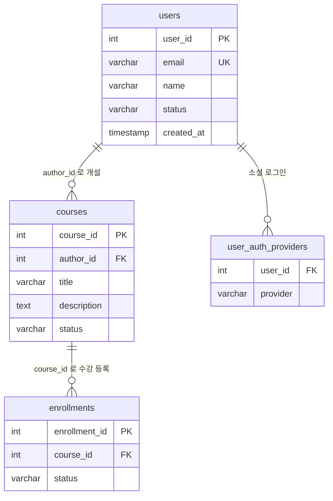
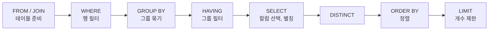
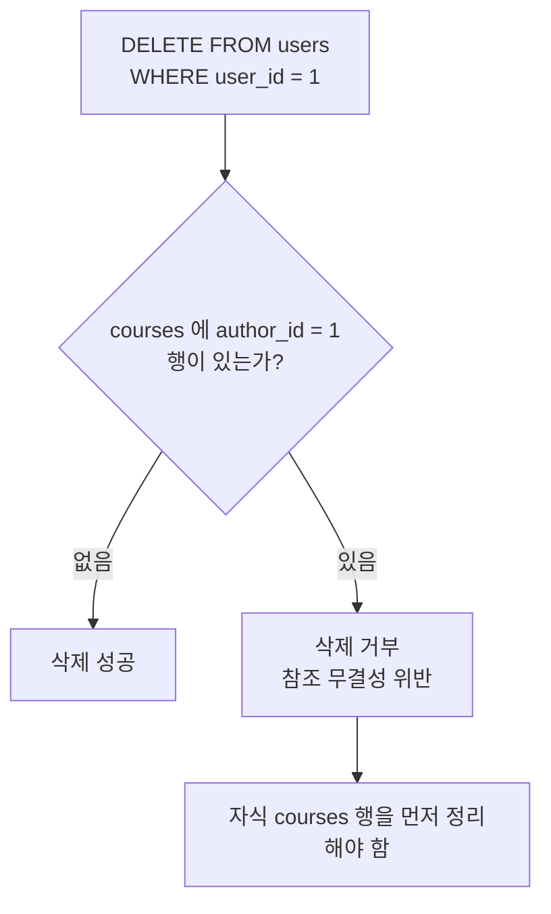
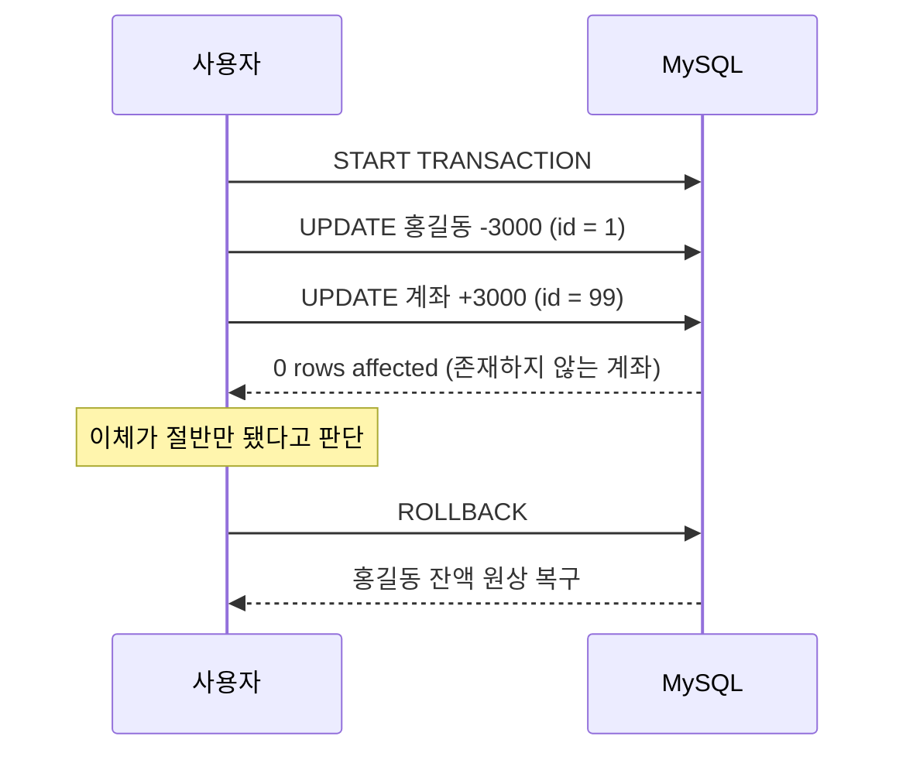

## 들어가며

Java로 프로그램을 만들 수는 있지만, 프로그램이 꺼지면 변수에 담긴 데이터는 사라집니다. 데이터를 오래, 안전하게 보관하고 원하는 만큼 꺼내 쓰려면 **데이터베이스**가 필요합니다. 이번 수업에서는 MySQL로 SQL을 처음부터 배웠습니다.

데이터베이스를 **거대한 도서관**에 비유해 보겠습니다. 테이블은 책장, 행(row)은 책 한 권, 열(column)은 책의 정보 항목(제목, 저자, 가격)입니다. SQL은 사서에게 하는 **요청서**입니다. "3층 책장에서 저자가 '허균'인 책의 제목만 가져다주세요"처럼요.

수업은 SQL 파일 14개로 진행됐고, 아래 순서로 정리합니다.

| 순서 | 파일 | 주제 | 분류 |
|------|------|------|------|
| 01 | select | 컬럼 조회, `*`, 별칭, 기본 함수 | 조회 (DQL) |
| 02 | orderby | 정렬, NULL 정렬 | 조회 |
| 03 | where | 조건절, 비교/논리 연산자, LIKE, IN, BETWEEN, IS NULL | 조회 |
| 04 | distinct | 중복 제거 | 조회 |
| 05 | limit | 개수 제한, 페이징 | 조회 |
| 06 | grouping | 집계 함수, GROUP BY, HAVING | 조회 |
| 07 | join | INNER / LEFT / RIGHT JOIN | 조회 |
| 08 | subqueries | WHERE 서브쿼리, FROM 서브쿼리 | 조회 |
| 09 | ddl | CREATE, 데이터 타입, 제약 조건, ALTER, DROP, TRUNCATE | 정의 (DDL) |
| 10 | dml | INSERT, UPDATE, DELETE, 제약 조건 위반 | 조작 (DML) |
| 11 | union | 결과 합치기 | 조회 |
| 12 | view | 가상 테이블 | 정의 |
| 13 | index | 인덱스, EXPLAIN | 성능 |
| 14 | transaction | START TRANSACTION, COMMIT, ROLLBACK | 제어 (TCL) |

실습에 쓴 데이터는 크게 두 가지였습니다. 앞부분(01~05)은 식당 메뉴 데이터(`tbl_menu`, `tbl_category`), 뒷부분(06~)은 온라인 학습 플랫폼 데이터베이스 `wanted_lms`(`users`, `courses`, `enrollments`, `grades`, `user_auth_providers`)입니다. 수업 파일에 등장한 컬럼만으로 LMS 테이블 관계를 그려 보면 이렇습니다.



> 위 다이어그램은 수업 SQL에 등장한 컬럼만 표시한 것이고, 실제 테이블에는 컬럼이 더 있을 수 있습니다.

## 01. SELECT — 무엇을 가져올까

`SELECT`는 데이터를 조회하는 가장 기본 명령어입니다. 수업에서는 SQL을 우리말로 읽는 연습부터 했습니다.

수업 예제 코드:

```sql
select          -- 조회해줘
    menu_name   -- 무엇을? (컬럼)
from            -- 어디에서?
    tbl_menu;   -- (테이블)

-- * (애스터리스크) : 모든 열
select * from tbl_menu;

-- as : 별칭(Alias) 부여
select
    menu_name as '메뉴 이름',
    menu_price as '가격'
from
    tbl_menu;

-- MySQL 기본 함수
select now();                 -- 현재 날짜와 시간
select concat('조', '평훈');   -- 문자열 합치기
```

`*`는 편하지만 필요 없는 컬럼까지 모두 가져오므로, 실제로 필요한 컬럼을 명시하는 습관이 좋습니다. 별칭은 결과 화면의 컬럼 이름만 바꾸는 것이라 원본 테이블에는 영향이 없습니다.

## 02. ORDER BY — 정렬하기

수업 예제 코드:

```sql
select menu_code, menu_name, menu_price
from tbl_menu
order by menu_price desc;   -- asc : 오름차순(기본값), desc : 내림차순

-- 계산식에 별칭을 붙이고 그 별칭으로 정렬
select
    menu_code,
    menu_price,
    menu_code * menu_price as `연산결과`
from tbl_menu
order by `연산결과` desc;
```

`SELECT`에서 만든 별칭을 `ORDER BY`에서 쓸 수 있다는 점이 포인트입니다. 이유는 아래 실행 순서에서 나오는데, `ORDER BY`가 `SELECT`보다 **나중에** 실행되기 때문입니다.

NULL이 있는 컬럼 정렬도 다뤘습니다. MySQL은 오름차순 정렬 시 **NULL을 가장 작은 값으로 취급해 맨 위**에 둡니다. NULL을 아래로 보내고 싶을 때 수업에서는 `is null` 식을 정렬 기준으로 썼습니다.

수업 예제 코드:

```sql
select * from tbl_category
order by ref_category_code is null asc;
```

`ref_category_code is null`은 NULL이면 1, 아니면 0이 되므로, 오름차순이면 0(값 있음)이 먼저, 1(NULL)이 뒤로 갑니다.

> 보충: 이 식만으로는 "NULL 여부"로만 나뉘고 값끼리의 순서는 보장되지 않습니다. 값 순서까지 원하면 `order by ref_category_code is null, ref_category_code`처럼 정렬 기준을 하나 더 적으면 됩니다.

## 03. WHERE — 어떤 행을 가져올까

수업에서 SQL 조회의 핵심을 두 가지로 정리했습니다.

1. **어떤 열**을 가져올 것인가 → `SELECT`
2. **어떤 행**을 가져올 것인가 → `WHERE`

| 연산자 | 의미 | 수업 예제 |
|--------|------|-----------|
| `=` | 같다 | `orderable_status = 'Y'` |
| `!=`, `<>` | 같지 않다 | |
| `>`, `<`, `>=`, `<=` | 크기 비교 | `menu_price <= 13000` |
| `AND` / `OR` | 모두 만족 / 하나라도 만족 | `orderable_status = 'Y' or category_code = 10` |
| `BETWEEN a AND b` | a 이상 b 이하 | `menu_price between 10000 and 20000` |
| `LIKE` | 패턴 일치 | `menu_name like '생마늘%'` |
| `IN (...)` | 목록 중 하나 | `category_code not in (4, 5, 6)` |
| `IS NULL` / `IS NOT NULL` | NULL 여부 | `ref_category_code is not null` |
| `NOT` | 부정 | `not between`, `not in` |

수업 예제 코드:

```sql
-- 10000원 이상, 20000원 미만
select * from tbl_menu
where menu_price >= 10000
  and menu_price < 20000;

-- LIKE 패턴
--   '%단어'  : 단어로 끝남
--   '단어%'  : 단어로 시작
--   '%단어%' : 단어를 포함
select menu_name, menu_price
from tbl_menu
where menu_name like '생마늘%';

-- NULL 제외
select * from tbl_category
where ref_category_code is not null;
```

`BETWEEN`은 양 끝 값을 **포함**합니다. 그래서 "10000 이상 20000 미만"처럼 한쪽만 포함하려면 `>=`, `<`로 직접 써야 합니다.

### NULL은 값이 아니라 "빈칸"

JOIN 파일에서 다시 강조된 내용인데, 여기서 같이 정리합니다. NULL은 실제 값이 들어 있는 게 아니라 **비어 있는 공간**을 의미합니다. 그래서 `where name = null`은 동작하지 않고, 반드시 `is null`로 비교해야 합니다. "빈칸이 빈칸과 같은가?"라는 질문에는 참/거짓으로 답할 수 없다고 생각하면 기억하기 쉽습니다.

## 04. DISTINCT — 중복 제거

수업 예제 코드:

```sql
select distinct category_code   -- 중복이 있는 컬럼 앞에 작성
from tbl_menu
order by category_code;
```

메뉴가 여러 개 있어도 카테고리 코드는 종류별로 한 번씩만 나옵니다. "우리 가게에 어떤 카테고리가 있지?"를 물을 때 유용합니다.

## 05. LIMIT — 개수 제한과 페이징

데이터가 수백만 건이면 한 번에 다 조회하는 것만으로 시스템에 큰 부하가 갑니다. `LIMIT`은 "상위 5개만", "1페이지에 10개만" 같은 **페이징**의 기반입니다.

수업 예제 코드:

```sql
-- limit [offset, ] row_count
-- offset : 시작할 행 번호 (0부터 시작)
select * from tbl_menu
order by menu_price desc
limit 1, 5;    -- 2번째 행부터 5개
```

| 표현 | 의미 |
|------|------|
| `limit 5` | 처음부터 5개 |
| `limit 0, 5` | 0번(첫 행)부터 5개 = 1페이지 |
| `limit 5, 5` | 5번(여섯 번째 행)부터 5개 = 2페이지 |

offset이 **0부터** 시작한다는 점은 Java 배열 인덱스와 같습니다. 그리고 `ORDER BY` 없이 `LIMIT`을 쓰면 "어떤 5개"가 나올지 보장되지 않으므로 정렬과 함께 쓰는 게 기본입니다.

## 06. 그룹핑 — 집계 함수, GROUP BY, HAVING

"우리 서비스의 총 사용자 수는?", "신고를 가장 많이 당한 사람은?" 같은 질문은 행 하나하나가 아니라 **여러 행을 묶어 계산한 결과**가 필요합니다.

| 집계 함수 | 역할 |
|-----------|------|
| `count(컬럼)` | 개수 (NULL 제외). `count(*)`는 행 개수 |
| `sum(컬럼)` | 합계 |
| `avg(컬럼)` | 평균 |
| `max(컬럼)` / `min(컬럼)` | 최댓값 / 최솟값 |

수업 예제 코드:

```sql
select count(*) as '총 사용자 수' from users;

-- 과정을 등록한 교육자 수 (중복 없이)
select count(distinct author_id) as '과정 등록 교육자 수' from courses;

select sum(score) as '총점', avg(score) as '평균' from grades;
```

### 에러 케이스: 집계 함수와 일반 컬럼을 섞으면?

수업 예제 코드:

```sql
-- 에러 발생 케이스
select name, count(*) as '총 사용자 수'
from users;
```

`count(*)`는 결과가 한 줄인데 `name`은 사용자 수만큼 여러 줄입니다. 어떤 `name`을 `count(*)`와 짝지어야 할지 알 수 없으니 에러가 납니다. 이 문제를 푸는 도구가 `GROUP BY`입니다.

> 보충: MySQL은 `ONLY_FULL_GROUP_BY` SQL 모드(기본 활성화)일 때 이 쿼리를 거부합니다. 모드 설정에 따라 동작이 달라질 수 있어, 공식 문서의 [MySQL Handling of GROUP BY](https://dev.mysql.com/doc/refman/8.0/en/group-by-handling.html)를 함께 보면 좋습니다.

### GROUP BY와 HAVING

`GROUP BY`는 특정 컬럼 값이 같은 행끼리 묶고, 각 묶음마다 집계 함수를 계산합니다. 반 별로 학생을 줄 세운 뒤 반마다 인원을 세는 것과 같습니다.

수업 예제 코드:

```sql
-- status 별 사용자 수
select status, count(*) as '사용자 수'
from users
group by status;

-- 개설 강좌가 3개 이상인 교육자
select author_id as '교육자 번호', count(*) as '개설 강좌 수'
from courses
group by author_id
having count(*) >= 3;

-- 수강 완료(completed) 상태 중, 2명 이상이 등록한 과정
select course_id, count(*) '학생 수'
from enrollments
where status = 'completed'   -- 그룹화 전: 행 필터링
group by course_id
having count(*) >= 2;        -- 그룹화 후: 그룹 필터링
```

| 구분 | WHERE | HAVING |
|------|-------|--------|
| 필터링 시점 | 그룹화 **전** | 그룹화 **후** |
| 대상 | 개별 행 | 그룹 |
| 집계 함수 사용 | 불가 | 가능 |

마지막 예제가 두 절을 모두 쓰는 이유가 여기에 있습니다. "completed인 행만 남기기"는 행 조건이라 `WHERE`, "학생 수 2명 이상"은 그룹의 집계 결과에 대한 조건이라 `HAVING`입니다.

### SELECT 문의 논리적 실행 순서

작성 순서와 실행 순서가 다르다는 걸 알면 위 규칙들이 전부 설명됩니다.



- `WHERE`는 `GROUP BY`보다 먼저라서 집계 함수를 쓸 수 없습니다.
- `ORDER BY`는 `SELECT`보다 나중이라 별칭(`연산결과`)을 쓸 수 있습니다.

## 07. JOIN — 흩어진 테이블 합치기

수업에서 "굉장히 중요!!!"라고 강조한 부분입니다. 실제 데이터베이스는 의미별로 데이터를 **여러 테이블에 나눠** 저장합니다. 과정 정보는 `courses`에, 사람 정보는 `users`에 있습니다. "과정 제목과 그 과정을 만든 교육자 이름"을 보려면 두 테이블을 공통 값으로 이어 붙여야 하고, 이것이 JOIN입니다.

`courses.author_id`는 `users.user_id` 값을 가져다 쓴 컬럼이며, 이런 연결용 컬럼을 **외래키(FK)** 라고 합니다. `desc 테이블명`으로 테이블 구조를 먼저 확인하고 시작했습니다.

수업 예제 코드:

```sql
select
    c.title as '과정 제목',
    u.name  as '교육자 이름'
from courses as c
join users as u
  on c.author_id = u.user_id;
```

`as c`, `as u`는 테이블 별칭입니다. 테이블 이름이 길거나 같은 컬럼명이 양쪽에 있을 때 `c.`, `u.`로 어느 테이블 컬럼인지 구분합니다.

### LEFT / RIGHT JOIN

수업 예제 코드:

```sql
-- users 를 기준으로, 소셜 로그인 정보가 없어도(NULL) 출력
select u.name as '사용자 이름', uap.provider as '소셜 로그인 제공자'
from users as u
left join user_auth_providers as uap
  on u.user_id = uap.user_id;

-- user_auth_providers 를 기준으로 출력
select u.name, uap.provider
from users as u
right join user_auth_providers as uap
  on u.user_id = uap.user_id;
```

| JOIN 종류 | 결과 | 비유 |
|-----------|------|------|
| INNER JOIN (`join`) | 양쪽 모두 짝이 있는 행만 | 짝꿍이 있는 학생만 출석 |
| LEFT JOIN | 왼쪽 테이블 전부 + 오른쪽은 짝이 없으면 NULL | 왼쪽 반 학생 전원 출석, 짝이 없으면 옆자리 비움 |
| RIGHT JOIN | 오른쪽 테이블 전부 + 왼쪽은 짝이 없으면 NULL | LEFT의 방향만 반대 |

수업에서 JOIN 종류로 inner, left, right, self, outer를 소개했고, 실습은 inner/left/right로 진행했습니다. "소셜 로그인을 연결하지 않은 사용자"도 목록에 보여야 한다면 `LEFT JOIN`을 써야 합니다. `INNER JOIN`을 쓰면 그 사용자들은 결과에서 조용히 사라집니다.

## 08. 서브쿼리 — 쿼리 안의 쿼리

문제의 조건이 한 번의 쿼리로는 부족할 때, 쿼리 결과를 다른 쿼리의 재료로 쓰는 것이 서브쿼리입니다. 수업에서는 `use wanted_lms;`로 사용할 데이터베이스를 지정한 뒤 시작했습니다.

**문제**: '홍길동'과 같은 해에 가입한 모든 사용자의 이름과 가입일

수업에서는 먼저 문제를 두 단계로 쪼갰습니다.

1. '홍길동'의 가입 연도 구하기
2. 그 연도에 가입한 사용자 조회하기

수업 예제 코드 (WHERE 절 서브쿼리):

```sql
select name, created_at
from users
where year(created_at) = (
    select year(created_at)
    from users
    where name = '홍길동'
);
```

괄호 안이 먼저 실행되어 연도 하나를 돌려주고, 바깥 쿼리가 그 값을 조건으로 씁니다. 문제를 단계로 나눈 뒤 각 단계를 쿼리로 쓰고, 마지막에 끼워 넣는 방식이 서브쿼리 작성의 정석입니다.

수업 예제 코드 (FROM 절 서브쿼리 = 가상 테이블):

```sql
select
    u.name as '교육자 이름',
    aut.course_count as '교육자 개설 과정 수'
from users u
join (
    select author_id, count(*) as course_count
    from courses
    group by author_id
) as aut on u.user_id = aut.author_id
order by `교육자 개설 과정 수` desc;
```

FROM 절의 서브쿼리 결과는 **하나의 임시 테이블**처럼 취급되고, 별칭(`aut`)을 붙여 JOIN까지 할 수 있습니다. "교육자별 개설 수"를 먼저 집계해 두고, 사람 이름은 `users`에서 붙여 오는 구조입니다.

## 09. DDL — 테이블을 설계하기

DDL(Data Definition Language)은 데이터를 담을 **구조를 정의**하는 언어입니다. 수업 자료의 설명이 인상적이었는데, 테이블을 만드는 건 단순히 칸을 나누는 게 아니라 **데이터가 지켜야 할 규칙을 정해서 DB가 스스로 데이터 품질을 지키게 만드는 일**이라는 것입니다. 그 규칙의 두 축이 데이터 타입과 제약 조건입니다.

### 데이터 타입 — 칸에 들어갈 수 있는 것의 종류

'나이' 칸에 '스무살'이라는 글자가 들어가는 걸 원천 차단하고, 데이터 종류에 맞는 공간만 써서 저장 효율도 높입니다.

| 타입 | 저장하는 값 | 예 |
|------|-------------|-----|
| INT / BIGINT | 정수 | user_id, author_id |
| VARCHAR(n) | 최대 n글자 가변 길이 문자열 | email, name |
| TEXT | 매우 긴 텍스트 | description, content |
| DATE | 날짜 (YYYY-MM-DD) | 생일 |
| DATETIME / TIMESTAMP | 날짜 + 시간 | created_at |
| DECIMAL(p, s) | 정확한 소수 (트랜잭션 실습의 잔액) | balance |

### 제약 조건 — DB의 "자동 경찰"

| 제약 조건 | 의미 |
|-----------|------|
| NOT NULL | 비워둘 수 없음 (필수 입력) |
| UNIQUE | 테이블 안에서 중복 불가 |
| PRIMARY KEY | NOT NULL + UNIQUE, 테이블의 대표 식별자 |
| FOREIGN KEY | 다른 테이블의 키를 참조해 관계를 맺고 일관성 보장 |
| DEFAULT | 값을 안 넣었을 때 쓸 기본값 |

수업 예제 코드:

```sql
create table tb1 (
    user_id     int primary key,
    user_pwd    varchar(12) not null comment '사용자 비밀번호',
    email       varchar(30) not null unique comment '이메일',
    user_status varchar(10) default 'active' comment '계정 활성 상태',
    created_at  timestamp not null default current_timestamp comment '가입 일시'
) comment '서비스 유저 정보 테이블';

create table tb2 (
    user_id   int primary key,
    author_id int not null comment 'tb1 에서 전달 받는 외래키',
    -- ... 생략 ...
    foreign key (`author_id`) references `tb1`(`user_id`)
) comment '서비스 유저 정보 테이블2';
```

`foreign key ... references`는 "`tb2.author_id`에는 `tb1.user_id`에 실제로 존재하는 값만 들어올 수 있다"는 뜻입니다. 부모 테이블에 없는 값을 넣으려 하면 DB가 자동으로 막는데, 이것이 **참조 무결성**을 지키는 메커니즘입니다. `comment`로 컬럼과 테이블에 설명을 달 수 있고, `describe`(또는 `desc`)로 구조를 확인합니다.

### ALTER, DROP, TRUNCATE

실습은 원본을 건드리지 않도록 `courses`를 복제한 임시 테이블에서 했습니다.

수업 예제 코드:

```sql
create table courses_temp as select * from courses;   -- 테이블 복제

alter table courses_temp add column price int not null default 0;              -- 컬럼 추가
alter table courses_temp modify column price varchar(200) not null default '0원'; -- 컬럼 수정
alter table courses_temp drop column price;                                     -- 컬럼 삭제

truncate table courses_temp;   -- 구조는 남기고 데이터만 삭제
drop table courses_temp;       -- 구조와 데이터 모두 삭제
```

| 명령 | 테이블 구조 | 데이터 | 특징 |
|------|-------------|--------|------|
| `DROP TABLE` | 삭제 | 삭제 | 매우 빠르지만 되돌릴 수 없음. 신중하게 |
| `TRUNCATE TABLE` | 유지 | 전부 삭제 | 빈 테이블로 초기화 |
| `DELETE FROM` (DML) | 유지 | 조건에 맞는 행 삭제 | 트랜잭션 안에서 롤백 가능 |

## 10. DML — 데이터 넣고, 고치고, 지우기

DML(Data Manipulation Language)은 `INSERT`, `UPDATE`, `DELETE`입니다. 이 파일은 **일부러 에러를 내 보는** 구성이었고, 수업에서 가장 강조한 문장은 이것이었습니다.

> 데이터를 삽입할 때 에러가 많이 발생한다. 이럴 때 확인해야 하는 건 **테이블의 제약 조건과 데이터 타입**이다.

수업 예제 코드:

```sql
-- insert into 테이블명 (컬럼...) values (값...)
insert into users (`email`, `name`) values ('email@gmail.com', '조평훈');

-- UNIQUE 위반: 같은 이메일 재등록
insert into users (`email`, `name`) values ('email@gmail.com', '조평순');

-- NOT NULL 위반: name 누락
insert into users (`email`) values ('email2@gmail.com');

-- 외래키 참조 무결성 위반: users 에 없는 999 번 회원
insert into courses (`author_id`, `title`, `description`)
values (999, 'SQL 제약조건!', '제약조건을 확인해보아요~');
```

| 시도 | 위반한 규칙 | 결과 |
|------|-------------|------|
| 중복 이메일 INSERT | UNIQUE | 거부 |
| name 없이 INSERT | NOT NULL | 거부 |
| 없는 author_id로 과정 INSERT | FOREIGN KEY | 거부 (고아 데이터 방지) |
| name에 숫자 `123` INSERT | (위반 아님) | **성공**: 문자열로 자동 형변환 |

마지막 줄이 흥미로웠습니다. VARCHAR 컬럼에 정수 `123`을 넣으면 에러 없이 문자열 `'123'`으로 들어갑니다. 그래서 수업에서는 "이름에 숫자가 들어오면 안 된다" 같은 검증은 DB에만 맡기지 말고 **프론트엔드와 백엔드에서 처리해야 한다**고 정리했습니다.

### UPDATE와 DELETE — WHERE가 생명

수업 예제 코드:

```sql
update users set `name` = '조평훈';                     -- WHERE 없음 → 모든 행이 바뀜!
update users set `name` = '조평순' where `user_id` = 1;  -- 한 행만

delete from users where email = 'email@gmail.com';

-- 에러 케이스: courses 가 user_id 1 을 author_id 로 참조 중
delete from users where user_id = 1;
```

수정과 삭제에서 가장 먼저 생각해야 할 것은 **WHERE 조건절**입니다. 조건이 없으면 테이블 전체가 바뀝니다. 그리고 조건에는 한 행을 확실히 식별하는 값(PK, UNIQUE 컬럼)을 쓰는 것이 권장됩니다. 이름처럼 중복될 수 있는 값으로 지우면 동명이인까지 함께 지워질 수 있습니다.

마지막 DELETE가 거부되는 이유는 FK 관계 때문입니다. FK를 **주는** 쪽(`users`)이 부모, **받는** 쪽(`courses`)이 자식인데, 부모 행을 지우면 자식 행이 가리킬 대상이 사라져 고아 데이터가 됩니다. 그래서 DB가 삭제를 막습니다.



> 보충: 수업에서는 기본 동작(삭제 거부)만 다뤘습니다. FK에 `ON DELETE CASCADE` 등 옵션을 주면 부모 삭제 시 자식도 함께 처리되도록 바꿀 수 있습니다. ([MySQL - FOREIGN KEY Constraints](https://dev.mysql.com/doc/refman/8.0/en/create-table-foreign-keys.html))

## 11. UNION — 쿼리 결과 합치기

`UNION`은 여러 SELECT 결과를 위아래로 이어 붙이는 **합집합**이며, 중복 행은 제거됩니다. 수업 시나리오는 "active 사용자와 suspended 사용자 모두에게 이메일을 보내되, 탈퇴한 deleted 유저는 제외"였습니다.

UNION의 규칙은 두 가지입니다.

1. 각 SELECT의 **컬럼 개수가 같아야** 한다.
2. 컬럼 **순서와 데이터 타입이 호환**되어야 한다.

수업 파일에는 첫 번째 SELECT가 2개 컬럼(`email`, `status`), 두 번째가 3개 컬럼(`name`, `email`, `status`)으로 되어 있어, 바로 이 1번 규칙을 위반해 에러가 나는 형태였습니다. 규칙에 맞게 컬럼을 맞추면 다음과 같습니다.

수업 예제 코드 (컬럼 수를 맞춰 정리):

```sql
select `name`, `email`, `status`
from users
where status = 'active'
union
select `name`, `email`, `status`
from users
where status = 'suspended';
```

같은 테이블이라 `where status in ('active', 'suspended')` 한 번으로도 되지만, UNION은 **서로 다른 테이블이나 서로 다른 조건의 결과**를 하나로 합칠 때 진가를 발휘합니다. 중복을 제거하지 않고 그대로 붙이려면 `UNION ALL`을 씁니다.

## 12. VIEW — 자주 쓰는 쿼리에 이름 붙이기

뷰는 **가상의 테이블**입니다. 실제 데이터를 따로 저장하는 게 아니라, 저장된 쿼리에 이름을 붙여 테이블처럼 부를 수 있게 한 것입니다. 수업 시나리오는 두 가지였습니다.

- 데이터 분석팀은 '과정별 등록 학생 수' 통계를 **매일** 확인한다 → 매번 긴 JOIN + GROUP BY를 쓰기 번거롭다.
- 마케팅팀에는 사용자 전체 정보가 아니라 **이메일과 이름만** 주고 싶다 → 민감한 컬럼을 숨기고 싶다.

| 이유 | 설명 |
|------|------|
| 편의성 | 복잡한 쿼리를 한 번 만들어 두면 이후엔 단순 테이블처럼 조회 |
| 보안성 | 원본 테이블의 민감 정보는 숨기고 허용된 컬럼만 노출 |
| 가독성 | 자주 쓰는 컬럼만으로 구성해 쿼리가 짧아짐 |

수업 예제 코드:

```sql
-- create view 뷰이름 as 쿼리문
create view v_coureses_stats as
select
    c.course_id,
    c.title,
    count(e.enrollment_id) as '등록 학생 수'
from courses as c
left join enrollments as e on c.course_id = e.course_id
group by c.course_id, c.title;

-- 뷰를 테이블처럼 사용
select * from v_coureses_stats
where `등록 학생 수` >= 3;

-- 수정: create or replace view
create or replace view v_coureses_stats as
select c.course_id, c.title, c.status, count(e.enrollment_id) as '등록 학생 수'
from courses as c
left join enrollments as e on c.course_id = e.course_id
group by c.course_id, c.title;

drop view v_coureses_stats;   -- 삭제
```

`LEFT JOIN`을 쓴 이유도 짚어 볼 만합니다. 수강생이 0명인 과정도 통계에 "0명"으로 나와야 하므로, 과정 테이블을 기준으로 남겨야 합니다. 그리고 `count(*)`가 아니라 `count(e.enrollment_id)`를 쓴 덕분에 짝이 없는(NULL) 경우 1이 아닌 0으로 셉니다.

> 보충: 수업 자료에 "조회 속도가 빨라진다"는 설명이 있었는데, MySQL의 일반 뷰는 결과를 따로 저장하지 않고 조회할 때마다 원본 쿼리를 실행합니다. 그래서 뷰 자체가 쿼리를 빠르게 만들어 주지는 않으며, 성능은 원본 쿼리와 인덱스에 달려 있습니다. ([MySQL - Using Views](https://dev.mysql.com/doc/refman/8.0/en/views.html))

## 13. INDEX — 책의 목차

100만 명의 `users` 중에서 '홍길동'을 찾는다고 해 봅시다. 아무 준비가 없으면 DB는 첫 행부터 마지막 행까지 하나씩 비교합니다. 이것이 **Full Table Scan**입니다. 인덱스는 특정 컬럼 값과 그 데이터의 물리적 위치를 **목차처럼 미리 정리**해 둔 구조라, 목차를 보고 바로 해당 페이지로 이동할 수 있게 해 줍니다.

> 여기서 "인덱스"는 Java 배열처럼 0부터 시작하는 번호가 아니라 **목차**라는 뜻이라는 점을 수업에서 따로 짚었습니다.

수업 예제 코드:

```sql
-- 실행 계획 확인
explain select * from users where name = '홍길동';

-- create index 인덱스이름 on 테이블명(컬럼명)
create index idx_users_name on users(name);

explain select * from users where name = '홍길동';
```

수업 실습에서 `EXPLAIN` 결과로 확인한 차이는 다음과 같았습니다.

| 시점 | 스캔한 행 수 (EXPLAIN의 rows) |
|------|------------------------------|
| 인덱스 적용 전 | 120 rows (Full Scan) |
| 인덱스 적용 후 | 1 row |

PK와 UNIQUE 제약 조건이 걸린 컬럼은 값의 유일성을 보장하기 위해 **테이블 생성 시 자동으로 인덱스**가 만들어집니다.

### 인덱스는 양날의 검 (trade-off)

| 구분 | 영향 |
|------|------|
| SELECT | 빨라짐 |
| 저장 공간 | 인덱스용 별도 공간이 필요해 전체 용량 증가 (책의 목차도 10~20페이지를 차지하듯) |
| INSERT | 인덱스에도 정렬된 위치를 찾아 항목 추가 |
| DELETE | 인덱스에서도 해당 항목을 찾아 삭제 |
| UPDATE (인덱스 컬럼) | 가장 나쁜 경우. 기존 항목 삭제 + 새 위치에 삽입이 모두 필요 |

그래서 인덱스를 거는 대상은 다음 기준으로 고르라고 배웠습니다.

1. **조회 비율이 압도적으로 높은 테이블** (DML이 조금 느려지는 건 감수)
2. DML 중에서도 **수정이 자주 일어나지 않는 컬럼**

## 14. 트랜잭션 — 전부 아니면 전무

마지막 주제는 계좌 이체였습니다. 홍길동 계좌에서 김짱구 계좌로 3000원을 보내는 일은 논리적으로 **하나의 작업**이지만, 실제로는 UPDATE가 두 번 일어납니다.

1. 홍길동 계좌 -3000
2. 김짱구 계좌 +3000

1번만 실행되고 그 사이에 은행이 정전된다면? 돈이 공중으로 사라집니다. **트랜잭션**은 여러 작업을 하나의 논리적 작업 단위로 묶어서, **하나라도 잘못되면 전부 되돌리는(rollback)** 장치입니다.

| 명령 | 의미 |
|------|------|
| `START TRANSACTION` | 트랜잭션 시작 |
| `COMMIT` | 지금까지 작업을 영구 반영 |
| `ROLLBACK` | 시작 시점으로 모두 되돌림 |

수업 예제 코드 (정상 흐름):

```sql
create table accouts (
    id      int primary key,
    owner   varchar(50),
    balance decimal(10, 2)
);
insert into accouts (id, owner, balance)
values (1, '홍길동', 10000.00), (2, '김짱구', 5000.00);

start transaction;
update accouts set balance = balance - 3000 where id = 1;
update accouts set balance = balance + 3000 where id = 2;
select * from accouts;   -- 중간 확인 (아직 영구 반영 아님)
commit;
```

수업 예제 코드 (비정상 흐름):

```sql
start transaction;
update accouts set balance = balance - 3000 where id = 1;
update accouts set balance = balance + 3000 where id = 99;  -- 존재하지 않는 계좌
rollback;                -- 차감도 함께 취소
select * from accouts;
```



비정상 흐름에서 눈여겨볼 점은, 없는 계좌(id = 99)에 대한 UPDATE는 **에러가 아니라 "0개 행이 바뀜"으로 조용히 끝난다**는 것입니다. DB가 알아서 되돌려 주지 않으니, 결과를 확인하고 `ROLLBACK`을 결정하는 건 사람(나중에는 애플리케이션 코드)의 몫입니다. 이후 JDBC나 Spring에서 트랜잭션을 코드로 다루게 되는 이유이기도 합니다.

잔액 컬럼에 `DECIMAL(10, 2)`를 쓴 것도 의미가 있습니다. 금액처럼 오차가 있으면 안 되는 값은 근사값인 FLOAT/DOUBLE 대신 정확한 소수 타입을 씁니다.

## 정리

| 분류 | 명령어 | 수업에서 얻은 핵심 |
|------|--------|-------------------|
| 조회 | SELECT, WHERE, ORDER BY, DISTINCT, LIMIT | "어떤 열"과 "어떤 행"을 고르는 것이 조회의 전부. NULL은 `IS NULL`로 비교 |
| 집계 | 집계 함수, GROUP BY, HAVING | WHERE는 그룹 전, HAVING은 그룹 후. 실행 순서를 알면 규칙이 보인다 |
| 결합 | JOIN, 서브쿼리, UNION | 나뉜 테이블을 FK로 잇고, 복잡한 문제는 단계로 쪼개 서브쿼리로 조합 |
| 정의 | CREATE, ALTER, DROP, TRUNCATE, VIEW | 테이블 설계는 규칙(타입 + 제약 조건) 설계. 뷰로 편의성과 보안 확보 |
| 조작 | INSERT, UPDATE, DELETE | 에러가 나면 제약 조건과 타입부터 확인. UPDATE/DELETE는 WHERE 필수 |
| 성능 | INDEX, EXPLAIN | 조회는 빨라지지만 DML과 저장 공간 비용이 있는 trade-off |
| 제어 | START TRANSACTION, COMMIT, ROLLBACK | 여러 작업을 하나로 묶어 전부 성공하거나 전부 취소 |

수업 전체를 관통한 메시지는 "**데이터베이스는 그냥 저장소가 아니라 규칙을 지키는 시스템**"이라는 것이었습니다. 제약 조건이 잘못된 데이터를 막고, 외래키가 고아 데이터를 막고, 트랜잭션이 절반만 실행된 작업을 막습니다. 반대로 문자열 자동 형변환처럼 DB가 막아 주지 못하는 영역도 있어서, 애플리케이션 쪽 검증도 함께 필요합니다.

## 더 학습하면 좋은 개념

- **정규화(Normalization)** — 데이터를 왜 여러 테이블로 나누는지에 대한 이론적 근거입니다. JOIN이 왜 필요한지, 테이블을 어떻게 나눌지 판단하는 기준이 됩니다.
- **트랜잭션 격리 수준(Isolation Level)과 ACID** — 여러 사용자가 동시에 같은 데이터를 수정할 때 무엇이 보이는지를 결정합니다. 계좌 이체 예제를 동시성 관점으로 확장하는 다음 단계입니다.
- **B-Tree 인덱스와 복합 인덱스** — MySQL InnoDB 인덱스의 내부 구조를 알면 "왜 이 쿼리는 인덱스를 안 타지?"를 EXPLAIN으로 해석할 수 있습니다.
- **외래키 참조 옵션 (ON DELETE / ON UPDATE CASCADE, SET NULL)** — 수업에서 본 "부모 삭제 거부" 외에 어떤 선택지가 있고 각각 언제 위험한지 알 수 있습니다.
- **SQL Injection과 PreparedStatement** — 다음 과정인 JDBC에서 SQL을 Java 코드로 실행할 때 가장 먼저 알아야 할 보안 개념입니다.

## 참고 자료

- [MySQL 8.0 Reference Manual - SELECT Statement](https://dev.mysql.com/doc/refman/8.0/en/select.html)
- [MySQL 8.0 Reference Manual - JOIN Clause](https://dev.mysql.com/doc/refman/8.0/en/join.html)
- [MySQL 8.0 Reference Manual - Aggregate Functions](https://dev.mysql.com/doc/refman/8.0/en/aggregate-functions.html)
- [MySQL 8.0 Reference Manual - MySQL Handling of GROUP BY](https://dev.mysql.com/doc/refman/8.0/en/group-by-handling.html)
- [MySQL 8.0 Reference Manual - CREATE TABLE Statement](https://dev.mysql.com/doc/refman/8.0/en/create-table.html)
- [MySQL 8.0 Reference Manual - FOREIGN KEY Constraints](https://dev.mysql.com/doc/refman/8.0/en/create-table-foreign-keys.html)
- [MySQL 8.0 Reference Manual - Using Views](https://dev.mysql.com/doc/refman/8.0/en/views.html)
- [MySQL 8.0 Reference Manual - EXPLAIN Statement](https://dev.mysql.com/doc/refman/8.0/en/explain.html)
- [MySQL 8.0 Reference Manual - START TRANSACTION, COMMIT, and ROLLBACK](https://dev.mysql.com/doc/refman/8.0/en/commit.html)
