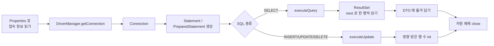
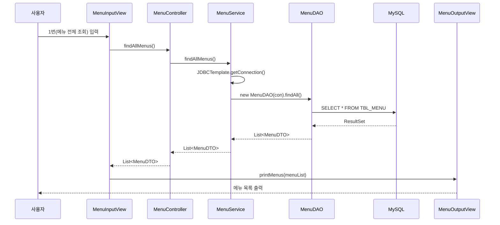

## 들어가며

지금까지 SQL은 DB 클라이언트 도구에서 직접 실행했습니다. 하지만 실제 서비스에서는 사용자가 버튼을 누르면 **자바 프로그램이 대신 SQL을 실행**하고, 그 결과를 화면에 보여줘야 합니다. 이때 자바와 데이터베이스 사이를 이어주는 표준 다리가 바로 **JDBC(Java Database Connectivity)** 입니다.

비유하자면 JDBC는 **"세계 공용 전원 어댑터 규격"** 과 비슷합니다. 자바는 "콘센트 모양은 이렇게 생겨야 한다"는 규격(인터페이스)만 정해두고, 실제 플러그(구현체)는 MySQL, Oracle 같은 DB 회사가 **드라이버** 형태로 만들어 제공합니다. 그래서 개발자는 `Connection`, `Statement`, `ResultSet` 같은 같은 인터페이스만 익히면 어떤 DB든 비슷한 방식으로 다룰 수 있습니다.

이번 수업은 세 단계로 진행되었습니다.

| 챕터 | 주제 | 핵심 키워드 |
|------|------|-------------|
| chap01 | DB 연결 | `DriverManager`, `Connection`, `Properties`, `JDBCTemplate` |
| chap02 | SQL 실행 | `Statement`, `ResultSet`, `PreparedStatement`, DTO, XML 쿼리 분리, `executeUpdate()` |
| chap03 | 계층 구조로 CRUD | View → Controller → Service → DAO, try-with-resources, `QueryUtil` |

수업에서는 `menudb` 데이터베이스의 `TBL_MENU` 테이블(메뉴 코드, 이름, 가격, 카테고리 코드, 주문 가능 상태)을 예제로 사용했습니다.

## 준비: MySQL 드라이버 의존성 추가

JDBC 인터페이스 자체는 JDK(`java.sql` 패키지)에 들어 있지만, **MySQL용 구현체(드라이버)** 는 따로 받아와야 합니다. Gradle에 한 줄을 추가하면 됩니다.

**수업 예제 코드** (`build.gradle`)

```groovy
dependencies {
    // mysql 연동을 위한 외부 api 의존성
    implementation 'com.mysql:mysql-connector-j:8.4.0'
}
```

## chap01. 데이터베이스 연결하기

### 1단계: 가장 기본적인 Connection 만들기

DB와 대화하려면 먼저 **전화 연결**부터 해야 합니다. 그 연결 통로가 `Connection` 객체입니다.

**수업 예제 코드** (`a_connection/Application01.java`, 축약)

```java
Connection con = null;
try {
    // MySQL 을 연결하기 위한 드라이버
    Class.forName("com.mysql.cj.jdbc.Driver");

    // Connection 은 인터페이스라서 직접 new 할 수 없다.
    // DriverManager 를 통해서 연결 객체를 만든다.
    con = DriverManager.getConnection(
            "jdbc:mysql://localhost/menudb",
            "<DB_USER>",
            "<DB_PASSWORD>"
    );
    System.out.println("con = " + con); // 값이 나오면 접속 성공
} catch (ClassNotFoundException | SQLException e) {
    throw new RuntimeException(e);
}
```

여기서 짚고 넘어갈 점이 몇 가지 있습니다.

- **`Class.forName(...)`**: 드라이버 클래스를 메모리에 올려 `DriverManager`에 등록시키는 코드입니다. 참고로 JDBC 4.0 이상 드라이버는 클래스패스에 있기만 하면 자동 등록되기 때문에, 요즘은 생략해도 동작합니다. 수업에서는 "드라이버가 필요하다"는 흐름을 눈으로 확인하기 위해 명시적으로 작성했습니다.
- **`Connection`은 인터페이스**입니다. 그래서 `new Connection()`이 불가능하고, `DriverManager.getConnection()`이 드라이버의 구현 객체를 대신 만들어 돌려줍니다.
- **JDBC URL** `jdbc:mysql://localhost/menudb`는 "JDBC 방식으로, MySQL에, localhost의 menudb에 접속하겠다"는 주소입니다.

### 2단계: 민감 정보를 Properties 파일로 분리하기

위 코드의 문제는 **DB 주소, 계정, 비밀번호가 소스 코드에 그대로 노출**된다는 점입니다. 코드를 GitHub에 올리는 순간 비밀번호도 함께 공개되겠죠. 그래서 접속 정보를 별도의 `.properties` 파일로 빼고, 파일 입출력으로 읽어오도록 바꿨습니다.

**수업 예제 코드** (`jdbc-config.properties`, 값은 플레이스홀더로 대체)

```properties
driver=com.mysql.cj.jdbc.Driver
url=jdbc:mysql://localhost/menudb
user=<DB_USER>
password=<DB_PASSWORD>
```

**수업 예제 코드** (`a_connection/Application02.java`, 축약)

```java
Properties prop = new Properties();
prop.load(new FileReader("src/main/java/com/wanted/a_connection/jdbc-config.properties"));

String driver = prop.getProperty("driver");
String url = prop.getProperty("url");
String user = prop.getProperty("user");
String password = prop.getProperty("password");

Class.forName(driver);
con = DriverManager.getConnection(url, user, password);
```

`Properties`는 `key=value` 형태의 설정 파일을 읽어 `Map`처럼 꺼내 쓸 수 있게 해주는 클래스입니다. 이제 접속 정보가 바뀌어도 자바 코드는 손댈 필요 없이 설정 파일만 고치면 됩니다.

> 분리한 설정 파일은 `.gitignore`에 등록하거나 환경 변수로 관리해야 진짜로 "숨긴" 효과가 납니다. 파일로 빼는 것은 그 첫걸음입니다.

### 3단계: 반복 코드를 JDBCTemplate으로 묶기

회원가입, 로그인, 정보 수정, 탈퇴… 기능마다 DB 접근이 필요한데, 그때마다 위 코드를 복사해 붙이는 건 비효율적입니다. 수업에서는 반복되는 세 가지를 정리했습니다.

- 프로퍼티 객체 생성 및 파일 읽기
- 커넥션 생성
- 커넥션 자원 해제

이 코드를 `static` 메서드로 묶은 클래스가 `JDBCTemplate`입니다.

**수업 예제 코드** (`b_template/JDBCTemplate.java`, 축약)

```java
public class JDBCTemplate {

    // Connection 객체를 생성하는 코드를 메서드화
    public static Connection getConnection() {
        Connection con = null;
        Properties prop = new Properties();
        try {
            prop.load(new FileReader("src/main/java/com/wanted/a_connection/jdbc-config.properties"));
            Class.forName(prop.getProperty("driver"));
            con = DriverManager.getConnection(
                    prop.getProperty("url"),
                    prop.getProperty("user"),
                    prop.getProperty("password"));
        } catch (IOException | ClassNotFoundException | SQLException e) {
            throw new RuntimeException(e);
        }
        return con;
    }

    // 사용한 Connection 객체를 해제하는 메서드
    public static void close(Connection con) {
        try {
            if (con != null && !con.isClosed()) {
                con.close();
            }
        } catch (SQLException e) {
            throw new RuntimeException(e);
        }
    }
}
```

사용하는 쪽은 `static import` 덕분에 아주 짧아집니다.

```java
import static com.wanted.b_template.JDBCTemplate.close;
import static com.wanted.b_template.JDBCTemplate.getConnection;

Connection con = getConnection();
// con 을 활용해서 회원가입 진행!
close(con);
```

**왜 close()가 중요할까요?** Connection은 DB 서버와의 실제 네트워크 연결이라 무한정 만들 수 없는 **한정된 자원**입니다. 도서관 열람실 좌석처럼, 다 쓰고 반납하지 않으면 다른 사람이 앉을 수 없습니다. 참고로 `Application01`처럼 `finally`에서 `con = null`만 하는 것은 변수만 비울 뿐 실제 연결을 닫지 않으므로, 반드시 `close()`를 호출해야 합니다.

## chap02. SQL 실행하기: Statement와 PreparedStatement

### JDBC의 핵심 인터페이스 흐름

연결이 되었으니 이제 SQL을 보내고 결과를 받을 차례입니다. 수업 주석에서 강조한 핵심 인터페이스는 두 가지입니다.

| 인터페이스 | 역할 | 생성 방법 |
|-----------|------|-----------|
| `Statement` | SQL 쿼리문을 저장하고 실행 | `con.createStatement()` |
| `ResultSet` | SELECT 결과를 결과 집합(표 형태)으로 받아옴 | `stmt.executeQuery(sql)`의 반환값 |

전체 흐름을 그림으로 보면 다음과 같습니다.



### Statement로 전체 조회하기

**수업 예제 코드** (`a_statements/Application01.java`, 축약)

```java
Connection con = getConnection();
Statement stmt = null;
ResultSet rset = null;
try {
    // Statement 도 인터페이스라 Connection 이 제공하는 메서드로 생성
    stmt = con.createStatement();

    // executeQuery() 는 쿼리를 실행하고 ResultSet 을 반환
    rset = stmt.executeQuery("SELECT * FROM TBL_MENU");

    // next() : 다음 행이 있으면 true, 없으면 false
    while (rset.next()) {
        System.out.println(
            rset.getString("MENU_NAME") + " 은/는 "
            + rset.getString("MENU_PRICE") + "원 입니다.");
    }
} finally {
    close(rset);
    close(stmt);
    close(con);
}
```

`ResultSet`은 **책갈피(커서)** 가 꽂힌 표라고 생각하면 쉽습니다. 처음에는 책갈피가 첫 행 "앞"에 있고, `next()`를 호출할 때마다 한 줄씩 내려가며 그 줄의 컬럼 값을 `getString("컬럼명")`, `getInt("컬럼명")`으로 꺼냅니다. 결과가 여러 행이면 `while`, 한 행만 기대한다면 `if (rset.next())`를 씁니다.

chap02의 `JDBCTemplate`에는 `close(Statement)`, `close(ResultSet)`이 **메서드 오버로딩**으로 추가되었습니다. 자원은 **생성의 역순**(ResultSet → Statement → Connection)으로 닫는 것이 일반적인 권장 순서입니다.

### 사용자 입력으로 조회하기와 그 문제점

`Scanner`로 메뉴 이름을 받아 조회하는 실습도 했습니다.

**수업 예제 코드** (`a_statements/Application02.java`, 축약)

```java
String menuName = sc.nextLine();
stmt = con.createStatement();
rset = stmt.executeQuery(
    "SELECT MENU_CODE, MENU_PRICE , ORDERABLE_STATUS FROM TBL_MENU WHERE MENU_NAME = '" + menuName + "'");
```

동작은 하지만 두 가지 불편함이 보입니다.

1. 문자열 값을 넣을 때 `'" + 변수 + "'`처럼 따옴표를 직접 이어 붙여야 해서 읽기 어렵고 실수하기 쉽습니다.
2. 사용자의 입력이 **SQL 문장의 일부로 그대로 합쳐집니다**. 누군가 이름 칸에 `' OR '1'='1` 같은 값을 넣으면 조건절 자체가 바뀌어버리는데, 이것이 유명한 **SQL Injection** 공격입니다.

### 조회 결과를 DTO에 옮겨 담기

단순히 출력만 하고 끝나면 결과를 다른 곳에서 재사용할 수 없습니다. 그래서 DB의 한 행을 **자바 객체 하나**에 옮겨 담는 연습을 했고, 그 그릇이 **DTO(Data Transfer Object)** 입니다.

**수업 예제 코드** (`common/MenuDTO.java`, 축약)

```java
public class MenuDTO {
    /* DTO 기본 구성 요소
     * 1. 필드  2. 기본 생성자  3. 모든 필드를 초기화하는 생성자
     * 4. Getter, Setter  5. toString */
    private int menuCode;
    private String menuName;
    private int menuPrice;
    private int categoryCode;
    private char orderableStatus;
    // 생성자, getter/setter, toString 생략
}
```

**수업 예제 코드** (`a_statements/Application03.java`, 축약)

```java
if (rset.next()) {
    menu = new MenuDTO();
    menu.setMenuCode(rset.getInt("MENU_CODE"));
    menu.setMenuName(rset.getString("MENU_NAME"));
    menu.setMenuPrice(rset.getInt("MENU_PRICE"));
    menu.setCategoryCode(rset.getInt("CATEGORY_CODE"));
    menu.setOrderableStatus(rset.getString("ORDERABLE_STATUS").charAt(0));
}
```

DB 테이블의 **컬럼 ↔ DTO의 필드**, **행 1개 ↔ 객체 1개**가 대응된다고 생각하면 됩니다. 여러 행이라면 `List<MenuDTO>`에 차곡차곡 담으면 되고, 이것이 하브루타 과제(전체 메뉴를 객체로 옮겨 담기, 다른 DB로 연습하기)이기도 했습니다.

### PreparedStatement: 미리 준비된 SQL

수업 주석에서 설명한 `Statement`와 `PreparedStatement`의 차이를 정리하면 다음과 같습니다.

| 비교 항목 | Statement | PreparedStatement |
|-----------|-----------|-------------------|
| 생성 | `con.createStatement()` | `con.prepareStatement(sql)` (생성 시점에 SQL 전달) |
| SQL 전달 시점 | 실행할 때 `executeQuery(sql)` | 생성할 때, 실행은 `executeQuery()` |
| 값 넣는 방식 | 문자열 이어 붙이기 | `?` 플레이스홀더 + `setXxx()` |
| 같은 SQL 재실행 | 매번 파싱·컴파일 | 컴파일된 SQL 재사용 가능 → 성능 이점 |
| SQL Injection | 취약 | 값이 SQL 문법이 아닌 "데이터"로만 바인딩되어 안전 |

**수업 예제 코드** (`b_preparedstatements/Application02.java`, 축약)

```java
pstmt = con.prepareStatement(
    "SELECT MENU_CODE, MENU_PRICE , ORDERABLE_STATUS FROM TBL_MENU WHERE MENU_NAME = ?");
// ? 의 순서대로 parameterIndex 가 1부터 결정된다.
// ? 는 반드시 set 메서드로 값을 채워주어야 한다.
pstmt.setString(1, menuName);

rset = pstmt.executeQuery();
```

`?`는 **빈칸이 있는 신청서 양식**이라고 생각하면 됩니다. 양식(SQL)은 미리 인쇄해두고, 빈칸에는 `setString(1, ...)`, `setInt(2, ...)`로 값만 채워 넣습니다. 따옴표를 신경 쓸 필요가 없고, 입력값이 양식 자체를 바꿀 수 없으니 SQL Injection도 막아줍니다. 인덱스가 **0이 아니라 1부터** 시작한다는 점은 자주 헷갈리는 부분입니다.

> 컴파일된 SQL을 실제로 재사용하는지(서버 측 prepared statement 사용 여부)는 드라이버 설정에 따라 다릅니다. MySQL Connector/J는 기본적으로 클라이언트 측에서 값을 안전하게 바인딩하며, `useServerPrepStmts` 같은 옵션으로 서버 측 방식을 켤 수 있습니다. 세부 동작은 Connector/J 공식 문서를 확인하는 것이 좋습니다.

### SQL을 XML 파일로 분리하기

SQL이 한 줄이면 문자열로 써도 괜찮지만, JOIN이나 긴 WHERE 조건이 붙으면 문자열 이어 붙이기로는 관리가 어렵습니다. 그래서 SQL을 **XML 파일로 분리**하고, `Properties.loadFromXML()`로 읽어왔습니다. DOCTYPE을 `properties`로 지정하면 XML을 properties처럼 key로 꺼내 쓸 수 있습니다.

**수업 예제 코드** (`b_preparedstatements/menu-query.xml`)

```xml
<?xml version="1.0" encoding="UTF-8" ?>
<!DOCTYPE properties SYSTEM "http://java.sun.com/dtd/properties.dtd">
<properties>
    <entry key="findMenuByMenuName">
        SELECT * FROM TBL_MENU WHERE MENU_NAME = ?
    </entry>
    <entry key="modifyMenuPriceByMenuName">
        UPDATE TBL_MENU
        SET MENU_PRICE = ?
        WHERE MENU_NAME = ?
    </entry>
</properties>
```

**수업 예제 코드** (`b_preparedstatements/Application03.java`, 축약)

```java
Properties prop = new Properties();
prop.loadFromXML(new FileInputStream(
        "src/main/java/com/wanted/b_preparedstatements/menu-query.xml"));

// 읽은 파일에서 어떤 key 를 가져올 지
String query = prop.getProperty("findMenuByMenuName");
pstmt = con.prepareStatement(query);
pstmt.setString(1, menuName);
```

이렇게 하면 자바 코드는 "무슨 일을 할지"(로직)에, XML은 "어떤 SQL을 쓸지"(쿼리)에 집중할 수 있습니다. 이후에 배울 MyBatis의 Mapper XML이 바로 이 아이디어를 발전시킨 형태입니다.

### DML은 executeUpdate()

조회(SELECT)가 아닌 INSERT/UPDATE/DELETE, 즉 **DML**은 결과 표가 없으므로 `ResultSet`이 필요 없습니다. 대신 `executeUpdate()`를 쓰고, **영향 받은 행의 수**를 `int`로 돌려받습니다.

**수업 예제 코드** (`b_preparedstatements/Application04.java`, 축약)

```java
String query = prop.getProperty("modifyMenuPriceByMenuName");
pstmt = con.prepareStatement(query);
pstmt.setInt(1, price);       // 첫 번째 ? : 변경할 가격
pstmt.setString(2, menuName); // 두 번째 ? : 메뉴 이름

// 반환 타입 int : DML 수행 후 영향을 받은 행의 수
result = pstmt.executeUpdate();

if (result > 0) {
    System.out.println(menuName + " 메뉴 가격 수정 성공!! (영향 받은 행 : " + result + ")");
} else {
    System.out.println(menuName + " 메뉴 가격 변경 실패!! 메뉴 이름을 다시 확인해주세요");
}
```

| 메서드 | 용도 | 반환 타입 |
|--------|------|-----------|
| `executeQuery()` | SELECT (Read) | `ResultSet` |
| `executeUpdate()` | INSERT / UPDATE / DELETE (Create, Update, Delete) | `int` (영향 받은 행 수) |

결과가 0이면 "에러"가 아니라 **조건에 맞는 행이 없었다**는 뜻입니다. 예를 들어 존재하지 않는 메뉴 이름을 입력하면 SQL은 정상 실행되지만 바뀐 행이 0개입니다.

## chap03. 계층 구조로 나누어 CRUD 만들기

chap02까지는 `main` 메서드 하나에 입력, SQL, 출력이 전부 섞여 있었습니다. 프로그램이 커지면 이런 코드는 고치기 어렵습니다. chap03에서는 **역할별로 클래스를 나누는 계층 구조**를 맛보았습니다. 식당에 비유하면 이렇습니다.

| 계층 | 식당 비유 | 해야 할 일 | 하면 안 되는 일 |
|------|-----------|-----------|----------------|
| View (Input/Output) | 홀 직원 | Scanner 입력 받기, Controller 호출, 결과 출력 요청 | SQL 작성, 비즈니스 로직, commit/rollback |
| Controller | 주문 접수대 | View 요청을 받아 알맞은 Service 호출, 필요 시 DTO 조립·간단한 검증 | Scanner 입력, 비즈니스 로직, SQL |
| Service | 주방장 | 비즈니스 로직, DAO 호출·조합, 트랜잭션(commit/rollback), Connection 생성, 예외 처리 | 화면 입출력 |
| DAO | 식재료 창고 담당 | SQL 실행, PreparedStatement 생성, 파라미터 바인딩, ResultSet → 자바 객체 변환 | 비즈니스 판단 |

요청이 흘러가는 순서를 그림으로 그려보면 다음과 같습니다.



### 객체 조립: Application

**수업 예제 코드** (`restaurant/Application.java`)

```java
// 객체 조립 진행
// 추후 배울 Spring 에서는 Application 이 실행되면 모든 객체가 조립이 된다.
MenuService service = new MenuService();
MenuController controller = new MenuController(service);
MenuOutputView outputView = new MenuOutputView();
MenuInputView inputView = new MenuInputView(controller, outputView);

inputView.displayMainView();
```

각 클래스가 필요한 객체를 **생성자로 전달받는** 구조입니다. 지금은 `main`에서 손으로 조립하지만, Spring에서는 이 조립을 프레임워크가 대신 해줍니다(의존성 주입, DI).

### 설정과 쿼리를 resources에서 읽기

chap03에서는 설정 파일 위치도 `src/main/resources`로 옮기고, **클래스로더**를 통해 읽도록 바뀌었습니다. 파일 경로를 하드코딩하던 이전 방식은 실행 위치가 바뀌면 파일을 못 찾을 수 있지만, 클래스패스 기준으로 읽으면 빌드된 결과물 안에서도 안정적으로 찾을 수 있습니다.

**수업 예제 코드** (`global/config/JDBCTemplate.java`, 축약)

```java
public class JDBCTemplate {
    private static final Properties prop = new Properties();

    // static 블록 : 클래스가 로드 될 때 한 번만 실행된다.
    static {
        try {
            prop.load(JDBCTemplate.class.getClassLoader()
                    .getResourceAsStream("db-info.properties"));
        } catch (IOException e) {
            throw new RuntimeException(e);
        }
    }

    // 커넥션 풀 없이 호출할 때마다 새로운 물리 연결을 만든다.
    public static Connection getConnection() throws SQLException {
        return DriverManager.getConnection(
                prop.getProperty("db.url"),
                prop.getProperty("db.username"),
                prop.getProperty("db.password"));
    }
}
```

`static` 블록 덕분에 설정 파일은 **프로그램 실행 중 한 번만** 읽고, 이후에는 메모리에 있는 값을 재사용합니다. 쿼리 XML도 같은 방식으로 `QueryUtil`이 담당합니다.

**수업 예제 코드** (`global/common/QueryUtil.java`, 축약)

```java
public class QueryUtil {
    private static final Properties queries = new Properties();

    static {
        try (InputStream inputStream = QueryUtil.class.getClassLoader()
                .getResourceAsStream("queries.xml")) {
            queries.loadFromXML(inputStream);
        } catch (Exception e) {
            throw new RuntimeException("쿼리 로딩 중 오류 발생", e);
        }
    }

    public static String getQuery(String key) {
        return queries.getProperty(key).trim();
    }
}
```

`queries.xml`에는 `menu.findAll`처럼 **도메인.동작** 형태의 key를 붙여 SQL이 많아져도 찾기 쉽게 했습니다.

### Service: Connection과 try-with-resources

**수업 예제 코드** (`menu/model/service/MenuService.java`, 축약)

```java
public List<MenuDTO> findAllMenus() {
    // try-with-resources : try() 소괄호 안의 자원을 자동으로 해제해준다.
    try (Connection con = JDBCTemplate.getConnection()) {
        return new MenuDAO(con).findAll();
    } catch (SQLException e) {
        throw new RuntimeException(e);
    }
}
```

chap02까지는 `finally`에서 `close()`를 일일이 호출했습니다. **try-with-resources**는 `AutoCloseable`을 구현한 자원을 `try ( ... )` 안에 선언하면, 블록이 끝날 때(예외가 나더라도) 자동으로 `close()`를 호출해줍니다. `Connection`, `PreparedStatement`, `ResultSet` 모두 `AutoCloseable`이라 이 문법을 쓸 수 있습니다.

| 방식 | 자원 해제 | 코드 길이 | 실수 가능성 |
|------|-----------|-----------|-------------|
| try-catch-finally | `finally`에서 직접 `close()` | 길다 | 닫기 누락·순서 실수 가능 |
| try-with-resources | 블록 종료 시 자동 `close()` (선언 역순) | 짧다 | 낮음 |

Connection을 **Service에서 여는 이유**는 트랜잭션 때문입니다. 예를 들어 "메뉴 생성 시 카테고리도 같이 삽입"처럼 여러 DAO 작업을 하나로 묶어 모두 성공하면 commit, 하나라도 실패하면 rollback해야 하는데, 그러려면 같은 Connection을 여러 DAO가 공유해야 합니다. 그래서 Service가 Connection을 만들어 DAO 생성자에 넘겨줍니다.

### DAO: SQL 실행과 객체 변환

**수업 예제 코드** (`menu/model/dao/MenuDAO.java`, 축약)

```java
public class MenuDAO {
    private final Connection connection;

    public MenuDAO(Connection connection) {
        this.connection = connection;
    }

    public List<MenuDTO> findAll() throws SQLException {
        String query = QueryUtil.getQuery("menu.findAll");
        List<MenuDTO> menus = new ArrayList<>();

        try (PreparedStatement pstmt = connection.prepareStatement(query)) {
            ResultSet rset = pstmt.executeQuery();
            while (rset.next()) {
                menus.add(new MenuDTO(
                        rset.getInt("MENU_CODE"),
                        rset.getString("MENU_NAME"),
                        rset.getInt("MENU_PRICE"),
                        rset.getInt("CATEGORY_CODE"),
                        rset.getString("ORDERABLE_STATUS")));
            }
        }
        return menus;
    }
}
```

DAO는 오직 "DB에 가서 데이터를 가져와 자바 객체로 바꿔주는 일"만 합니다. Connection은 받아서 쓰기만 하고 닫지 않는데, Connection의 주인(생성하고 닫는 쪽)이 Service이기 때문입니다. `PreparedStatement`가 닫히면 그로부터 만든 `ResultSet`도 함께 닫히도록 JDBC 명세에 정해져 있습니다.

### Controller와 View

**수업 예제 코드** (`MenuController.java`, `MenuInputView.java`, 축약)

```java
// Controller : View 와 Service 사이를 연결하는 커맨드 센터
public List<MenuDTO> findAllMenus() {
    return menuService.findAllMenus();
}

// InputView : 사용자와 상호작용
int menu = sc.nextInt();
switch (menu) {
    case 1:
        List<MenuDTO> menuList = menuController.findAllMenus();
        menuOutputView.printMenus(menuList);
        break;
}
```

지금은 "전체 조회" 하나뿐이라 계층이 과해 보일 수 있습니다. 하지만 기능이 추가될 때 **어디를 고쳐야 할지가 명확**해진다는 것이 큰 장점입니다. SQL이 바뀌면 XML과 DAO만, 화면 문구가 바뀌면 View만 보면 됩니다.

## 정리

| 단계 | 배운 것 | 왜 필요한가 |
|------|---------|-------------|
| 연결 | `DriverManager.getConnection()`으로 `Connection` 생성 | 자바와 DB 사이의 통로 |
| 설정 분리 | `Properties`, `.properties` 파일 | 민감 정보를 코드에서 분리 |
| 템플릿화 | `JDBCTemplate.getConnection()/close()` | 반복 코드 제거, 자원 해제 보장 |
| 조회 | `Statement` → `executeQuery()` → `ResultSet.next()` | SELECT 결과를 한 행씩 읽기 |
| 객체 변환 | `MenuDTO` | DB 행을 자바 객체로 다루기 |
| 안전한 SQL | `PreparedStatement`, `?`, `setXxx()` | 가독성, SQL Injection 방지, 재사용 |
| 쿼리 분리 | XML + `loadFromXML()` | 긴 SQL을 로직과 분리 |
| DML | `executeUpdate()` → 영향 받은 행 수 | INSERT/UPDATE/DELETE 결과 확인 |
| 구조화 | View → Controller → Service → DAO | 책임 분리, 유지보수성 |
| 자원 관리 | try-with-resources, `static` 블록 | 자동 해제, 설정 1회 로딩 |

한 문장으로 요약하면, **"연결하고(Connection) → 준비하고(PreparedStatement) → 실행하고(execute) → 결과를 객체로 옮기고(DTO) → 반드시 닫는다(close)"** 가 JDBC의 기본 리듬이고, 이 리듬을 계층별로 나눠 맡긴 것이 chap03의 구조였습니다.

## 더 학습하면 좋은 개념

- **트랜잭션 제어 (`setAutoCommit`, `commit`, `rollback`)** — Service 계층의 책임으로 언급된 트랜잭션을 실제로 구현하려면 JDBC의 auto-commit 모드를 끄고 직접 commit/rollback하는 방법을 알아야 합니다.
- **커넥션 풀 (HikariCP, `DataSource`)** — 수업 코드는 호출마다 새 물리 연결을 만들고 끊는데, 실무에서는 연결을 미리 만들어 재사용하는 풀을 사용합니다. 성능 차이의 이유를 이해하면 Spring의 DB 설정이 쉬워집니다.
- **SQL Injection과 바인딩 원리** — `PreparedStatement`가 왜 안전한지, 어떤 경우(테이블명·정렬 컬럼을 문자열로 붙일 때)에는 여전히 위험한지 알아두면 보안 사고를 예방할 수 있습니다.
- **MyBatis** — XML로 SQL을 분리하고 결과를 DTO로 자동 매핑해주는 프레임워크로, 이번 수업의 `QueryUtil` + DAO 패턴이 그대로 발전한 형태입니다.
- **의존성 주입(DI)과 Spring** — `Application`에서 손으로 하던 객체 조립을 프레임워크가 대신 해주는 원리로, 계층 구조를 실무 규모로 확장하는 다음 단계입니다.

## 참고 자료

- [Oracle Java Tutorials - JDBC Basics](https://docs.oracle.com/javase/tutorial/jdbc/basics/index.html)
- [Oracle Java Tutorials - Using Prepared Statements](https://docs.oracle.com/javase/tutorial/jdbc/basics/prepared.html)
- [Oracle Java Tutorials - Using Transactions](https://docs.oracle.com/javase/tutorial/jdbc/basics/transactions.html)
- [Oracle Java Tutorials - The try-with-resources Statement](https://docs.oracle.com/javase/tutorial/essential/exceptions/tryResourceClose.html)
- [Java SE 17 API - java.sql 패키지](https://docs.oracle.com/en/java/javase/17/docs/api/java.sql/java/sql/package-summary.html)
- [Java SE 17 API - Properties](https://docs.oracle.com/en/java/javase/17/docs/api/java.base/java/util/Properties.html)
- [MySQL Connector/J Developer Guide](https://dev.mysql.com/doc/connector-j/en/)
