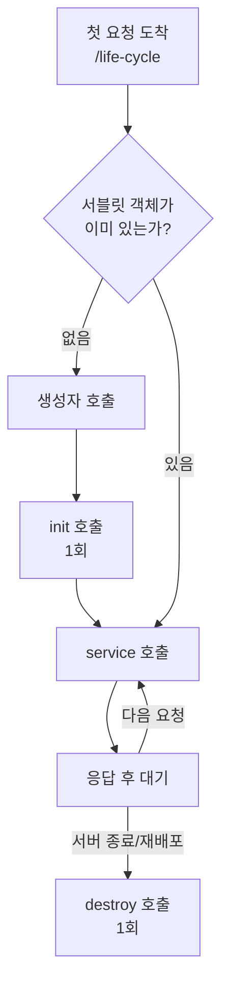
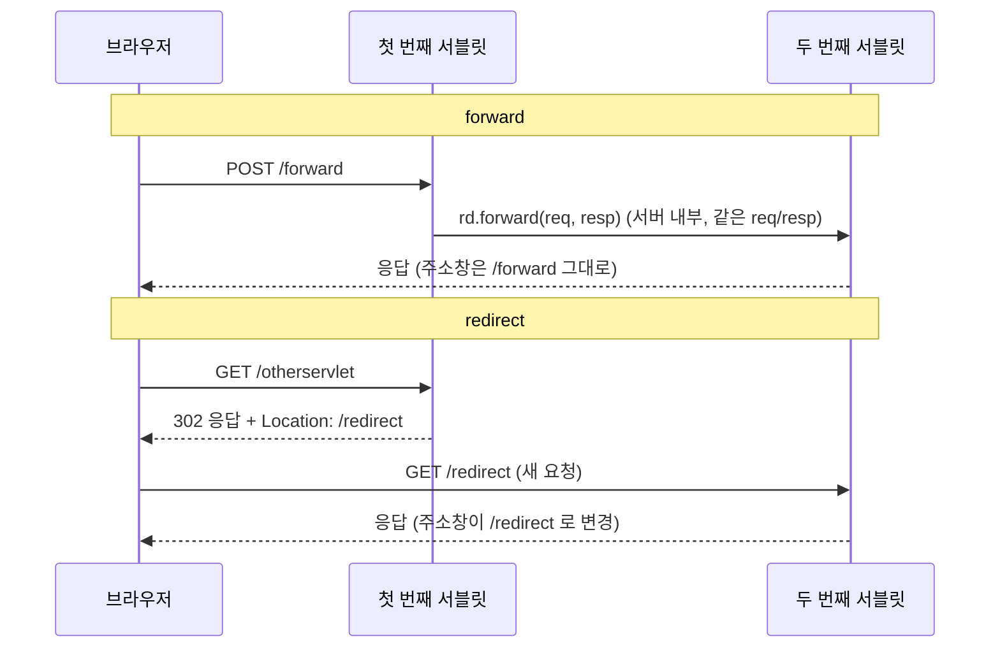
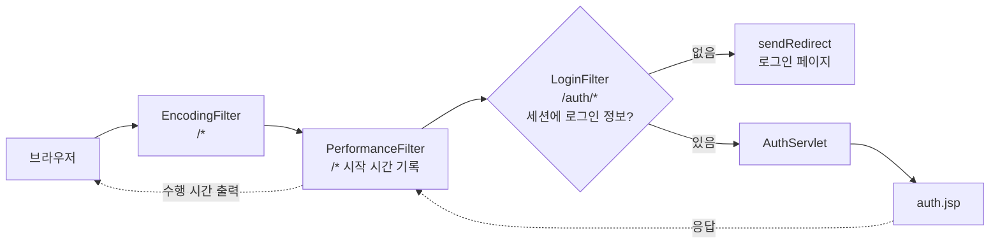

## 들어가며

JDBC 수업에서는 콘솔(Scanner)로 입력을 받아 DB를 조회했습니다. 하지만 실제 사용자는 콘솔이 아니라 **브라우저**로 들어옵니다. 브라우저가 보낸 HTTP 요청을 자바 코드가 받아서 처리하고, 다시 HTML로 응답해주는 역할을 하는 것이 **서블릿(Servlet)** 입니다.

식당에 비유하면 이렇습니다.

- **브라우저** = 손님
- **WAS(톰캣 같은 서블릿 컨테이너)** = 식당 건물과 매니저. 손님을 맞이하고, 어떤 직원에게 주문을 넘길지 정하고, 직원을 고용하고 퇴근시킵니다.
- **서블릿** = 특정 주문을 담당하는 직원. "`/life-cycle` 주문은 제가 받습니다"처럼 담당 URL이 정해져 있습니다.

중요한 점은 서블릿 객체를 **우리가 `new`로 만들지 않는다**는 것입니다. 생성, 호출, 소멸을 모두 컨테이너가 관리합니다. 이번 수업(`chap01-servlet`)은 아래 순서로 진행되었습니다.

| 패키지 | 주제 | 핵심 키워드 |
|--------|------|-------------|
| a_lifecycle | 서블릿 생명주기 | `@WebServlet`, `init()`, `service()`, `destroy()` |
| b_service | HTTP 메서드 분기 | `doGet()`, `doPost()` |
| c_parameter | 요청 파라미터 | `getParameter()`, 쿼리스트링, 폼 데이터 |
| d_response | 응답 | `PrintWriter`, `setContentType()` |
| e_exception | 에러 페이지 | `sendError()`, `web.xml`의 `<error-page>` |
| f_forward | 포워드 | `RequestDispatcher`, `setAttribute()` |
| g_redirect | 리다이렉트 | `sendRedirect()` |
| h_cookie_session | 상태 유지 | `Cookie`, `HttpSession`, JSP |
| i_filter | 필터 | `Filter`, `FilterChain`, `@WebFilter` |

## 준비: 프로젝트 설정

서블릿 API는 JDK에 기본 포함되어 있지 않습니다. 수업 프로젝트는 `war` 플러그인과 Jakarta Servlet API를 사용했습니다.

**수업 예제 코드** (`build.gradle`, 축약)

```groovy
plugins {
    id 'java'
    id 'war'
}

dependencies {
    compileOnly('jakarta.servlet:jakarta.servlet-api:6.1.0')
}
```

`compileOnly`인 이유는, 컴파일할 때만 API가 필요하고 **실행할 때는 톰캣 같은 컨테이너가 이미 같은 API를 가지고 있기 때문**입니다. 결과물을 `.war`(웹 애플리케이션 아카이브)로 묶어 컨테이너에 배포합니다. 패키지 이름이 `javax.servlet`이 아니라 `jakarta.servlet`인 것은 Java EE가 Jakarta EE로 이관되면서 네임스페이스가 바뀌었기 때문입니다.

## 1. 서블릿의 생명주기 (a_lifecycle)

**수업 예제 코드** (`LifeCycleServlet.java`, 축약)

```java
// @WebServlet : 해당 클래스가 서블릿임을 명시
// value 속성 : 이 서블릿이 처리할 URL 패턴 (/life-cycle 요청이 오면 동작)
@WebServlet(value = "/life-cycle")
public class LifeCycleServlet extends HttpServlet {

    private int initCount = 1;
    private int serviceCount = 1;
    private int destroyCount = 1;

    public LifeCycleServlet() {
        System.out.println("기본생성자 호출됨...");
    }

    @Override
    public void init(ServletConfig config) throws ServletException {
        System.out.println("init() 호출됨... : " + initCount++);
    }

    @Override
    protected void service(HttpServletRequest req, HttpServletResponse resp)
            throws ServletException, IOException {
        System.out.println("service() 호출됨... : " + serviceCount++);
    }

    @Override
    public void destroy() {
        System.out.println("destory() 호출됨... : " + destroyCount++);
    }
}
```

브라우저에서 `/life-cycle`을 여러 번 새로고침하면 콘솔 출력이 이렇게 됩니다.

- 생성자, `init()`: **처음 한 번만** 호출 (count가 1에서 더 오르지 않음)
- `service()`: **요청마다** 호출 (1, 2, 3, … 증가)
- `destroy()`: 서버를 종료하거나 재배포할 때 **한 번**



즉, 서블릿은 **객체 하나를 만들어 두고 계속 재사용**합니다(싱글톤처럼 동작). 요청이 동시에 여러 개 들어오면 같은 객체의 `service()`가 여러 스레드에서 동시에 실행됩니다. 그래서 수업 예제의 `serviceCount` 같은 **필드에 요청별 데이터를 저장하면 위험**하다는 점도 함께 기억해두면 좋습니다(여기서는 생명주기 확인용 데모입니다).

## 2. service()와 doGet/doPost (b_service)

`HttpServlet`의 기본 `service()`는 요청의 HTTP 메서드를 보고 알맞은 `doXxx()` 메서드로 **분배**해주는 교통정리 역할을 합니다. 수업에서는 처음에 `service()`를 직접 오버라이드해 `req.getMethod()`로 메서드를 찍어보고, 이후 이를 주석 처리한 뒤 `doGet()`/`doPost()`만 구현했습니다.

**수업 예제 코드** (`ServiceMethodServlet.java`)

```java
@WebServlet(value = "/request-service")
public class ServiceMethodServlet extends HttpServlet {

    @Override
    protected void doGet(HttpServletRequest req, HttpServletResponse resp) {
        System.out.println("GET 요청을 처리할 메소드 호출됨...");
    }

    @Override
    protected void doPost(HttpServletRequest req, HttpServletResponse resp) {
        System.out.println("POST 요청을 처리할 메소드 호출됨...");
    }
}
```

어떤 HTML 동작이 어떤 메서드로 들어오는지 `service.html`로 실험했습니다.

| HTML 동작 | HTTP 메서드 | 호출되는 메서드 |
|-----------|-------------|-----------------|
| `<a href="/request-service">` 클릭 | GET | `doGet()` |
| `<form method="get">` 제출 | GET | `doGet()` |
| `<form method="post">` 제출 | POST | `doPost()` |
| 주소창에 URL 직접 입력 | GET | `doGet()` |

수업 주석의 표현처럼 **URL이 바뀌는 방식은 곧 GET 요청**입니다. `service()`를 직접 오버라이드하면 이 자동 분배가 사라지므로, 보통은 `doGet()`/`doPost()`만 구현합니다.

## 3. 요청 파라미터 꺼내기 (c_parameter)

사용자가 보낸 값은 `req.getParameter("name속성값")`으로 꺼냅니다. 폼 `<input>`의 `name` 속성이 곧 key가 됩니다.

**수업 예제 코드** (`parameter.html`, 축약)

```html
<form action="/querystring" method="get">
    <label>이름 : </label><input type="text" name="name">
    <label>나이 : </label><input type="number" name="age">
    <input type="checkbox" name="hobbies" value="movie">
    <input type="checkbox" name="hobbies" value="music">
    <input type="submit" value="GET 요청">
</form>
```

**수업 예제 코드** (`QueryStringServlet.java`, 축약)

```java
@WebServlet(value = "/querystring")
public class QueryStringServlet extends HttpServlet {
    @Override
    protected void doGet(HttpServletRequest req, HttpServletResponse resp) {
        // /querystring?name=홍길동&age=20&...&hobbies=movie&hobbies=music
        String name = req.getParameter("name");

        // URL 로 전달되는 데이터는 모두 String 타입이다.
        // 원하는 자료형으로 담기 위해서는 파싱이 필요하다.
        int age = Integer.parseInt(req.getParameter("age"));
    }
}
```

GET 폼을 제출하면 값이 `?name=...&age=...` 형태의 **쿼리스트링**으로 URL 뒤에 붙습니다. `<a href>`에 쿼리스트링을 직접 적어도 똑같이 동작합니다. 체크박스처럼 **같은 이름으로 값이 여러 개** 오는 경우(`hobbies`)에는 `getParameterValues("hobbies")`로 배열을 받습니다(`getParameter`는 첫 번째 값만 반환).

POST 폼은 `/formdata`의 `doPost()`에서 같은 `getParameter()`로 꺼냅니다. 꺼내는 방법은 같지만, **데이터가 실려 가는 위치**가 다릅니다.

| 비교 | GET | POST |
|------|-----|------|
| 데이터 위치 | URL 쿼리스트링 | 요청 본문(Body, Payload) |
| URL 노출 | 노출됨 (브라우저 기록, 로그에 남음) | 노출되지 않음 |
| 데이터 크기 | URL 길이 제한이 있어 작음 | 훨씬 큰 데이터 가능 |
| 주 용도 | 조회 | 등록, 수정 같은 데이터 변경 |
| 즐겨찾기·공유 | 가능 | 불가 |

> URL 길이 제한은 HTTP 명세가 정한 고정값이 아니라 브라우저와 서버마다 다릅니다. 또 POST도 본문이 평문으로 전송되므로, 진짜 보안은 HTTPS로 확보해야 합니다. "POST = 안전"이 아니라 "POST = URL에 덜 드러남" 정도로 이해하는 것이 정확합니다.

## 4. 응답 보내기 (d_response)

수업 주석에서 정리한 서블릿의 역할은 세 가지였습니다.

1. **요청 전달 받기**: GET/POST에 따라 파라미터 꺼내기
2. **Controller 역할**: 받은 데이터를 Service 계층으로 전달 (JDBC 수업의 계층 구조와 연결됩니다)
3. **응답 전달하기**: Response 객체로 사용자에게 응답

**수업 예제 코드** (`ResponseServlet.java`, 축약)

```java
@WebServlet("/response")
public class ResponseServlet extends HttpServlet {
    @Override
    protected void doGet(HttpServletRequest req, HttpServletResponse resp) throws IOException {
        StringBuilder response = new StringBuilder();
        response.append("<!doctype html>\n")
                .append("<html>\n<body>\n")
                .append("<h1>Servlet 의 응답 결과!</h1>")
                .append("</body>\n</html>\n");

        // 응답 데이터의 형태와 문자 인코딩 지정
        // resp.setContentType("text/html; charset=UTF-8");

        // 브라우저 화면에 노출 시키는 객체
        PrintWriter out = resp.getWriter();
        out.print(response);
        out.flush();
        out.close();
    }
}
```

`resp.getWriter()`로 얻은 `PrintWriter`에 문자열을 쓰면, 그것이 그대로 브라우저로 전송되는 HTML이 됩니다. 이때 **`setContentType("text/html; charset=UTF-8")`** 이 없으면 브라우저가 한글을 제대로 해석하지 못해 글자가 깨집니다. 수업 코드에서 이 줄이 주석 처리되어 있는 이유는, 뒤에서 배울 **인코딩 필터가 모든 응답에 대신 설정해주기 때문**입니다(9장에서 다룹니다).

자바 코드 안에서 HTML을 문자열로 이어 붙이는 방식은 보다시피 매우 번거롭습니다. 이 불편함이 JSP(그리고 이후 템플릿 엔진)가 등장한 이유입니다.

## 5. 에러 페이지 처리 (e_exception)

`resp.sendError(상태코드, 메시지)`를 호출하면 컨테이너에게 "에러 응답을 보내라"고 알립니다.

**수업 예제 코드** (`Show404Servlet.java`, `Show500Servlet.java`, 축약)

```java
@WebServlet("/show404")
public class Show404Servlet extends HttpServlet {
    @Override
    protected void doGet(HttpServletRequest req, HttpServletResponse resp) throws IOException {
        resp.sendError(404, "페이지가 없습니다!");
    }
}

// /show500
resp.sendError(500, "500번대 Error 는 순전히 개발자의 잘못.");
```

이 상태로는 컨테이너 기본 에러 화면이 나옵니다. 우리가 만든 화면을 보여주려면 배포 설정 파일인 `web.xml`에 **에러 코드별 이동 위치**를 등록합니다.

**수업 예제 코드** (`WEB-INF/web.xml`, 축약)

```xml
<error-page>
    <error-code>404</error-code>
    <location>/showerrorpage</location>
</error-page>
<error-page>
    <error-code>500</error-code>
    <location>/showerrorpage</location>
</error-page>
```

이제 404나 500이 발생하면 컨테이너가 내부적으로 `/showerrorpage` 서블릿에게 요청을 넘깁니다. 이 서블릿은 컨테이너가 request에 담아둔 **에러 정보 속성**을 꺼내서 화면을 만듭니다.

**수업 예제 코드** (`ExceptionServlet.java`, 축약)

```java
@WebServlet("/showerrorpage")
public class ExceptionServlet extends HttpServlet {
    @Override
    protected void doGet(HttpServletRequest req, HttpServletResponse resp) throws IOException {
        int statusCode = (int) req.getAttribute("jakarta.servlet.error.status_code");
        String msg = req.getAttribute("jakarta.servlet.error.message").toString();

        StringBuilder sb = new StringBuilder();
        sb.append("<!doctype html>\n<html>\n<body>\n")
          .append("<h1>").append(statusCode).append(" - ").append(msg).append("</h1>")
          .append("</body>\n</html>\n");

        PrintWriter out = resp.getWriter();
        out.print(sb);
        out.flush();
        out.close();
    }
}
```

주석에서는 이것을 다음 장의 **forward 개념**과 연결해 설명했습니다. 사용자는 `/show404`에 요청했는데, 실제 화면은 `/showerrorpage`가 만들어줍니다. 그런데도 주소창 URL은 바뀌지 않으므로, 마치 요청 받은 서블릿이 직접 응답한 것처럼 보입니다.

| 상태 코드 범위 | 의미 | 수업 예시 |
|----------------|------|-----------|
| 4xx | 클라이언트 쪽 문제 (잘못된 주소, 권한 없음 등) | 404 페이지 없음 |
| 5xx | 서버 쪽 문제 (코드 버그, 예외) | 500 서버 내부 오류 |

## 6. 포워드: 서버 안에서 일 넘기기 (f_forward)

서블릿 하나가 로그인 처리도 하고 HTML 응답도 만들면 책임이 너무 많아집니다. 그래서 수업에서는 **로그인 처리 서블릿**과 **응답 전용 서블릿**을 나눴습니다.

**수업 예제 코드** (`RequestInfoServlet.java`, 축약)

```java
@WebServlet("/forward")
public class RequestInfoServlet extends HttpServlet {
    @Override
    protected void doPost(HttpServletRequest req, HttpServletResponse resp)
            throws ServletException, IOException {
        String id = req.getParameter("userId");
        String pwd = req.getParameter("password");

        // memberService.login(id, pwd); 로그인 처리했다고 가정

        // 전달해줄 값을 request 에 담기
        req.setAttribute("userId", id);

        RequestDispatcher rd = req.getRequestDispatcher("/print");
        rd.forward(req, resp);
    }
}
```

**수업 예제 코드** (`ResponseLoginServlet.java`, 축약)

```java
@WebServlet("/print")
public class ResponseLoginServlet extends HttpServlet {
    // forward 를 요청한 서블릿이 doPost 였으므로 여기서도 doPost 를 오버라이딩
    @Override
    protected void doPost(HttpServletRequest req, HttpServletResponse resp) throws IOException {
        // 이전 서블릿이 전달해준 id 꺼내기
        String id = req.getAttribute("userId").toString();
        // "id 님 환영합니다." HTML 응답 작성 ...
    }
}
```

여기서 `getParameter()`와 `getAttribute()`의 차이를 구분해야 합니다.

| 메서드 | 값을 넣는 쪽 | 타입 | 용도 |
|--------|-------------|------|------|
| `getParameter()` | 클라이언트(폼, 쿼리스트링) | 항상 `String` | 사용자 입력 꺼내기 |
| `setAttribute()` / `getAttribute()` | 서버 코드 | `Object` | 서버 내부에서 서블릿·JSP끼리 데이터 공유 |

수업 주석에서 **"중요!"** 로 표시한 forward의 특징은 세 가지입니다.

1. 서로 다른 서블릿이 **같은 req, resp 객체를 공유**한다. 그래서 `setAttribute()`로 넣은 값을 다음 서블릿이 꺼낼 수 있다.
2. 위임 받은 서블릿은 클라이언트에게 **노출되지 않는다**. URL이 바뀌지 않는다.
3. 새로고침하면 **원래 요청(POST 포함)이 그대로 다시 전송**된다. 그래서 INSERT/UPDATE/DELETE 같은 DML 뒤에 forward를 쓰면 같은 작업이 중복 실행될 수 있다. 조회에는 forward, DML 뒤에는 redirect를 쓰는 이유다.

## 7. 리다이렉트: 브라우저에게 다시 요청하라고 알려주기 (g_redirect)

**수업 예제 코드** (`OtherServlet.java`, `RedirectServlet.java`, 축약)

```java
@WebServlet("/otherservlet")
public class OtherServlet extends HttpServlet {
    @Override
    protected void doGet(HttpServletRequest req, HttpServletResponse resp) throws IOException {
        // memberService.signUp(); 회원정보 DB Insert 완료했다고 가정
        // 응답으로 "어디로 재요청을 보내야 하는지"를 알려준다.
        resp.sendRedirect("/redirect");
    }
}

@WebServlet("/redirect")
public class RedirectServlet extends HttpServlet {
    // URL 이 바뀌는 것은 a 태그를 누르는 것과 같은 효과 → GET 방식
    @Override
    protected void doGet(HttpServletRequest req, HttpServletResponse resp) throws IOException {
        // "리다이랙트 성공!" HTML 응답 ...
    }
}
```

forward가 "주방 안에서 다른 요리사에게 접시를 넘기는 것"이라면, redirect는 **"그 메뉴는 2번 창구에서 받으세요"라고 손님에게 안내하는 것**입니다. 손님(브라우저)이 직접 2번 창구로 다시 가야 하므로 요청이 두 번 발생합니다.



| 비교 | forward | redirect |
|------|---------|----------|
| 요청 횟수 | 1번 (서버 내부 이동) | 2번 (브라우저가 재요청) |
| URL 변화 | 없음 | 새 경로로 바뀜 |
| req/resp 공유 | 공유 (`setAttribute` 값 전달 가능) | 새 요청이라 이전 정보 사라짐 |
| 재요청 메서드 | 원래 메서드 유지 | GET |
| 새로고침 시 | 원래 요청 반복 (DML 중복 위험) | 마지막 GET만 반복 |
| 주 용도 | 조회 결과 화면 | 등록·수정·삭제 후 이동 |

수업 주석은 redirect를 이렇게 정리했습니다. **"이전 요청을 아예 모른다"는 것이 장점이자 단점**이다. DML 중복은 막아주지만, 이전 요청의 정보를 이어받을 수 없다. 이 단점을 극복하기 위해 등장하는 것이 바로 쿠키와 세션입니다.

## 8. 쿠키와 세션: 요청 사이에 정보 기억하기 (h_cookie_session)

HTTP는 기본적으로 **무상태(stateless)** 입니다. 서버는 방금 요청한 사람이 아까 그 사람인지 기억하지 못합니다. 이를 보완하는 두 가지 방법을 배웠습니다.

### 쿠키: 브라우저에 저장하는 메모

**수업 예제 코드** (`CookieServlet.java`, 축약)

```java
@WebServlet("/cookie")
public class CookieServlet extends HttpServlet {
    @Override
    protected void doPost(HttpServletRequest req, HttpServletResponse resp)
            throws ServletException, IOException {
        String cookieValue = req.getParameter("cookieValue");

        Cookie cookie = new Cookie("userValue", cookieValue);
        cookie.setMaxAge(60 * 60);   // 만료 1시간 (초 단위)
        resp.addCookie(cookie);      // 브라우저에게 보낼 쿠키 추가

        doGet(req, resp);
    }

    @Override
    protected void doGet(HttpServletRequest req, HttpServletResponse resp)
            throws ServletException, IOException {
        String savedValue = "없음!";
        Cookie[] cookies = req.getCookies();
        if (cookies != null) {
            for (Cookie cookie : cookies) {
                if ("userValue".equals(cookie.getName())) {
                    savedValue = cookie.getValue();
                    break;
                }
            }
        }
        req.setAttribute("savedValue", savedValue);
        req.getRequestDispatcher("/h_cookie_session/cookie-result.jsp").forward(req, resp);
    }
}
```

쿠키는 서버가 응답 헤더(`Set-Cookie`)로 보내면 **브라우저가 저장해뒀다가 이후 요청마다 자동으로 다시 보내주는** 작은 메모입니다. 놀이공원 손목 띠처럼, 손님이 차고 다니며 매번 보여주는 방식이죠. `req.getCookies()`는 배열로 모든 쿠키를 주기 때문에 이름으로 찾아야 하고, 쿠키가 하나도 없으면 `null`이 오므로 null 체크가 필요합니다.

결과 화면은 **JSP**로 만들었습니다. JSP 안의 `${savedValue}`는 EL(Expression Language)로, request에 `setAttribute()`로 담은 값을 꺼내 출력합니다.

**수업 예제 코드** (`cookie-result.jsp`, 축약)

```jsp
<%@ page contentType="text/html;charset=UTF-8" language="java" %>
<html>
  <body>
    <h1> 쿠키에 저장 된 값 꺼내기! </h1>
    <h3> 쿠키에 저장 된 값 : ${savedValue} </h3>
  </body>
</html>
```

### 세션: 서버에 저장하는 사물함

**수업 예제 코드** (`SessionServlet.java`, 축약)

```java
@WebServlet("/session")
public class SessionServlet extends HttpServlet {

    @Override
    protected void doPost(HttpServletRequest req, HttpServletResponse resp)
            throws ServletException, IOException {
        String userId = req.getParameter("userId");
        String userPwd = req.getParameter("userPwd");

        if (userId != null && !userPwd.isEmpty()) {
            HttpSession session = req.getSession(true); // 없으면 새로 만든다
            // null 일 수 있는 값은 toString() 보다 캐스트 연산자가 안전하다.
            String existUser = (String) session.getAttribute("loggedInUser");

            session.setAttribute("loggedInUser", userId);
            session.setMaxInactiveInterval(30); // 유효 기간 30초
            doGet(req, resp);
        }
    }

    @Override
    protected void doGet(HttpServletRequest req, HttpServletResponse resp)
            throws ServletException, IOException {
        // false : 기존 세션만 사용하고, 없으면 null 반환
        HttpSession session = req.getSession(false);
        String loggedInUser = null;
        if (session != null) {
            loggedInUser = session.getAttribute("loggedInUser").toString();
        }
        req.setAttribute("loggedInUser", loggedInUser != null ? loggedInUser : "로그인 안됨!!");
        req.getRequestDispatcher("/h_cookie_session/session-result.jsp").forward(req, resp);
    }
}
```

세션은 데이터를 **서버 쪽 사물함**에 보관하고, 브라우저에는 **사물함 열쇠 번호(세션 ID, 톰캣에서는 `JSESSIONID` 쿠키)** 만 주는 방식입니다. 그래서 세션도 내부적으로는 쿠키를 이용합니다.

| `getSession()` 호출 | 세션이 있을 때 | 세션이 없을 때 |
|---------------------|----------------|----------------|
| `getSession()` / `getSession(true)` | 기존 세션 반환 | 새로 생성 |
| `getSession(false)` | 기존 세션 반환 | `null` 반환 |

"로그인 상태 확인"처럼 **세션을 새로 만들면 안 되는 곳**에서는 `getSession(false)`를 써야 합니다. 로그아웃은 `ExpireServlet`에서 `session.invalidate()`로 세션을 무효화한 뒤 `/session`으로 redirect하는 방식으로 구현했습니다.

```java
HttpSession session = req.getSession(false);
if (session != null) {
    session.invalidate(); // 세션 무효화
}
resp.sendRedirect("/session");
```

> 수업 예제는 세션 동작을 눈으로 확인하기 위해 비밀번호도 세션에 담아 화면에 출력했습니다. 실제 서비스에서는 비밀번호를 세션이나 화면에 절대 저장·노출하지 않고, 로그인 성공 후 사용자 식별 정보만 세션에 둡니다.

| 비교 | 쿠키 | 세션 |
|------|------|------|
| 저장 위치 | 브라우저(클라이언트) | 서버 |
| 보안 | 사용자가 보거나 조작 가능 | 상대적으로 안전 (세션 ID만 오감) |
| 수명 설정 | `setMaxAge(초)` | `setMaxInactiveInterval(초)` (마지막 요청 이후 비활성 시간) |
| 서버 부담 | 없음 | 사용자 수만큼 메모리 사용 |
| 예시 | 아이디 저장, 팝업 다시 보지 않기 | 로그인 상태 유지 |

## 9. 필터: 서블릿 앞의 검문소 (i_filter)

필터는 **요청이 서블릿에 도달하기 전**(그리고 응답이 나가기 전)에 동작하는 컴포넌트입니다. 건물 입구의 보안 검색대처럼, 모든 사람(또는 특정 층으로 가는 사람)을 먼저 확인합니다. 여러 서블릿에 반복되는 공통 작업을 한 곳에 모을 수 있다는 것이 핵심입니다.

수업 주석에 따르면 필터를 등록하는 방법은 두 가지입니다.

| 방법 | 수업 예시 | 특징 |
|------|-----------|------|
| `@WebFilter` 어노테이션 | `LoginFilter`, `PerformanceFilter` | 클래스에 바로 선언, 간편 |
| `web.xml` | `EncodingFilter` | 초기 파라미터 전달, 순서 지정 등 설정 위주 |

### EncodingFilter: 모든 응답의 한글 깨짐 방지

**수업 예제 코드** (`web.xml`의 필터 설정, `EncodingFilter.java`, 축약)

```xml
<filter>
    <filter-name>encoding</filter-name>
    <filter-class>com.wanted.servlet.i_filter.EncodingFilter</filter-class>
    <init-param>
        <param-name>encoding-type</param-name>
        <param-value>text/html; charset=UTF-8</param-value>
    </init-param>
</filter>
<filter-mapping>
    <filter-name>encoding</filter-name>
    <url-pattern>/*</url-pattern>
</filter-mapping>
```

```java
public class EncodingFilter implements Filter {
    private String encodingType;

    @Override
    public void init(FilterConfig filterConfig) {
        // web.xml 의 init-param 값 읽기
        encodingType = filterConfig.getInitParameter("encoding-type");
    }

    @Override
    public void doFilter(ServletRequest request, ServletResponse response, FilterChain chain)
            throws IOException, ServletException {
        response.setContentType(encodingType);
        chain.doFilter(request, response); // 다음 필터 또는 서블릿으로 진행
    }
}
```

앞서 모든 서블릿에서 `resp.setContentType("text/html; charset=UTF-8")`이 주석 처리되어 있던 이유가 바로 이것입니다. "계속 반복되는 코드"를 필터 하나로 모은 것이죠.

### LoginFilter: 로그인하지 않은 사용자 막기

**수업 예제 코드** (`LoginFilter.java`, 축약)

```java
// Filter 는 Http 요청이 Servlet 에 도달하기 전에 동작한다.
@WebFilter("/auth/*")
public class LoginFilter implements Filter {
    @Override
    public void doFilter(ServletRequest request, ServletResponse response, FilterChain chain)
            throws IOException, ServletException {
        // 자식(Http~) 타입의 getSession() 등을 쓰기 위해 형변환
        HttpServletRequest req = (HttpServletRequest) request;
        HttpServletResponse resp = (HttpServletResponse) response;

        HttpSession session = req.getSession(false);
        if (session == null || session.getAttribute("loggedInUser") == null) {
            // 에러를 내는 대신 로그인 페이지로 보낸다
            resp.sendRedirect("/h_cookie_session/cookie_session.html");
        } else {
            chain.doFilter(req, resp); // 정상 → 서블릿으로 통과
        }
    }
}
```

`AuthServlet`(`/auth`)은 세션에서 `loggedInUser`를 꺼내 쓰는데, 세션이 없으면 `NullPointerException`으로 500 에러가 납니다. 필터가 먼저 검사해서 **로그인이 안 된 사용자는 서블릿에 도달하기 전에 로그인 페이지로 돌려보내므로**, 서블릿은 "로그인된 사용자만 온다"고 믿고 본연의 일에 집중할 수 있습니다. `chain.doFilter()`를 호출하지 않으면 요청은 그 자리에서 멈춥니다.

### PerformanceFilter: 요청 처리 시간 측정

**수업 예제 코드** (`PerformanceFilter.java`, 축약)

```java
@WebFilter("/*")   // 모든 요청에 동작
public class PerformanceFilter implements Filter {
    @Override
    public void doFilter(ServletRequest request, ServletResponse response, FilterChain chain)
            throws IOException, ServletException {
        long startTime = System.currentTimeMillis();
        HttpServletRequest req = (HttpServletRequest) request;
        System.out.println("[요청 된 URL] : " + req.getRequestURI());

        chain.doFilter(request, response); // 다음 필터 OR 서블릿 호출

        long endTime = System.currentTimeMillis();
        System.out.println("[" + req.getRequestURI() + " 의 최종 수행 시간] : "
                + (endTime - startTime) + "(ms)");
    }
}
```

이 예제는 필터의 구조를 잘 보여줍니다. `chain.doFilter()` **앞**의 코드는 요청이 들어갈 때, **뒤**의 코드는 서블릿 처리가 끝나고 응답이 돌아 나올 때 실행됩니다.



> 여러 필터가 같은 요청에 걸릴 때 실행 순서는 `web.xml`의 `<filter-mapping>` 순서를 따르며, `@WebFilter`만으로는 순서를 명확히 보장하기 어렵습니다. 위 그림의 필터 순서는 이해를 돕기 위한 예시이고, 순서가 중요하다면 `web.xml`로 지정하는 것이 안전합니다.

### JSP도 사실은 서블릿

마지막으로 `auth.jsp`의 주석이 짚은 포인트입니다.

**수업 예제 코드** (`auth.jsp`, 축약)

```jsp
<h3>
  <%
      // JSP 파일은 HTML 처럼 보이지만 실제로는 Java 로 이루어진 Servlet 이다.
      // <% %> 태그 내부에서 Java 소스코드를 입력할 수 있다.
      String user = (String) session.getAttribute("loggedInUser");
  %>
  <%= user %>
</h3>
```

JSP는 컨테이너가 서블릿 자바 코드로 **변환한 뒤 컴파일해서 실행**합니다. 그래서 JSP 안에서는 `session`, `request` 같은 객체를 선언 없이 바로 쓸 수 있습니다(내장 객체). 4장에서 `StringBuilder`로 HTML을 이어 붙이던 고통을, "HTML 안에 자바를 넣는" 방향으로 뒤집은 것이 JSP입니다.

## 정리

수업 전체를 하나의 흐름으로 묶으면 다음과 같습니다.

| 단계 | 배운 것 | 핵심 API |
|------|---------|----------|
| 서블릿 등록 | URL과 클래스 연결 | `@WebServlet`, `web.xml` |
| 생명주기 | 1회 생성·초기화, 요청마다 service, 종료 시 destroy | `init()`, `service()`, `destroy()` |
| 메서드 분기 | GET/POST별 처리 | `doGet()`, `doPost()` |
| 요청 | 사용자 입력 꺼내기 (항상 String) | `getParameter()`, `getParameterValues()` |
| 응답 | HTML 작성, 인코딩 지정 | `getWriter()`, `setContentType()` |
| 에러 | 상태 코드별 에러 페이지 | `sendError()`, `<error-page>` |
| 포워드 | 서버 내부 위임, req/resp 공유 | `RequestDispatcher.forward()`, `setAttribute()` |
| 리다이렉트 | 브라우저 재요청, DML 중복 방지 | `sendRedirect()` |
| 상태 유지 | 브라우저 저장 vs 서버 저장 | `Cookie`, `HttpSession` |
| 필터 | 서블릿 앞 공통 처리 | `Filter`, `FilterChain`, `@WebFilter` |
| 뷰 | HTML 안에 자바 표현 | JSP, EL `${}` |

한 문장으로 요약하면, **"컨테이너가 서블릿을 관리하고, 서블릿은 요청을 받아(Request) 처리를 위임하거나(forward/redirect) 응답하며(Response), 쿠키·세션으로 상태를 기억하고, 필터로 공통 관심사를 앞단에서 처리한다"** 입니다. 그리고 이 모든 구조는 이후 배울 Spring MVC의 `DispatcherServlet`이 내부에서 그대로 사용하는 기반입니다.

## 더 학습하면 좋은 개념

- **Spring MVC와 DispatcherServlet** — Spring MVC는 모든 요청을 서블릿 하나(`DispatcherServlet`)가 받아 컨트롤러로 분배하는 구조로, 이번 수업의 서블릿·forward·redirect 개념 위에 만들어져 있습니다.
- **PRG 패턴 (Post/Redirect/Get)** — POST 처리 후 redirect로 GET 화면을 보여주는 표준 패턴으로, 수업에서 배운 "DML 후에는 redirect" 원칙을 정식화한 것입니다.
- **서블릿 스레드 안전성(Thread Safety)** — 서블릿 객체 하나를 여러 스레드가 공유하므로, 필드에 상태를 두면 동시성 버그가 생깁니다. 이후 Spring 싱글톤 빈을 이해하는 데도 필요합니다.
- **쿠키 보안 속성 (HttpOnly, Secure, SameSite)** — 세션 ID가 담긴 쿠키를 탈취당하지 않도록 하는 설정으로, 로그인 기능을 만들 때 반드시 고려해야 합니다.
- **HTTP 상태 코드와 리다이렉트 종류 (301, 302, 303, 307)** — `sendRedirect()`가 실제로 어떤 응답을 만드는지, 상황별로 어떤 코드가 적절한지 알면 API 설계가 정확해집니다.

## 참고 자료

- [Jakarta Servlet 6.1 Specification](https://jakarta.ee/specifications/servlet/6.1/)
- [Jakarta Servlet 6.1 API 문서](https://jakarta.ee/specifications/servlet/6.1/apidocs/)
- [Apache Tomcat 공식 문서](https://tomcat.apache.org/)
- [MDN - HTTP 요청 메서드](https://developer.mozilla.org/en-US/docs/Web/HTTP/Methods)
- [MDN - HTTP 쿠키 사용하기](https://developer.mozilla.org/en-US/docs/Web/HTTP/Cookies)
- [MDN - HTTP 리다이렉션](https://developer.mozilla.org/en-US/docs/Web/HTTP/Redirections)
- [MDN - HTTP 상태 코드](https://developer.mozilla.org/en-US/docs/Web/HTTP/Status)
