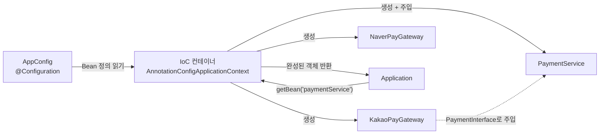
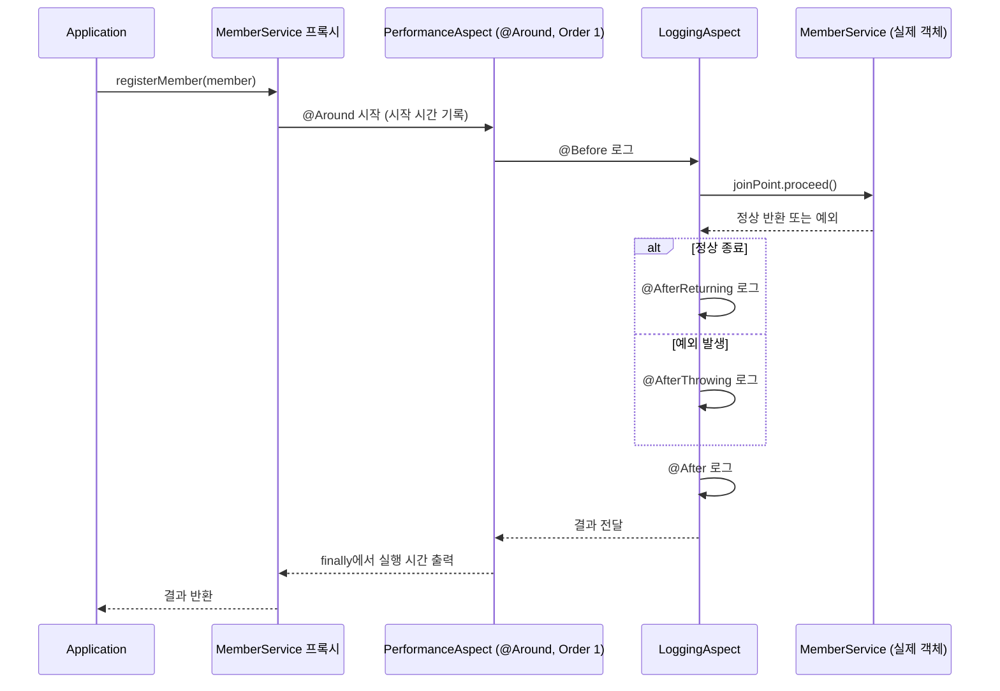
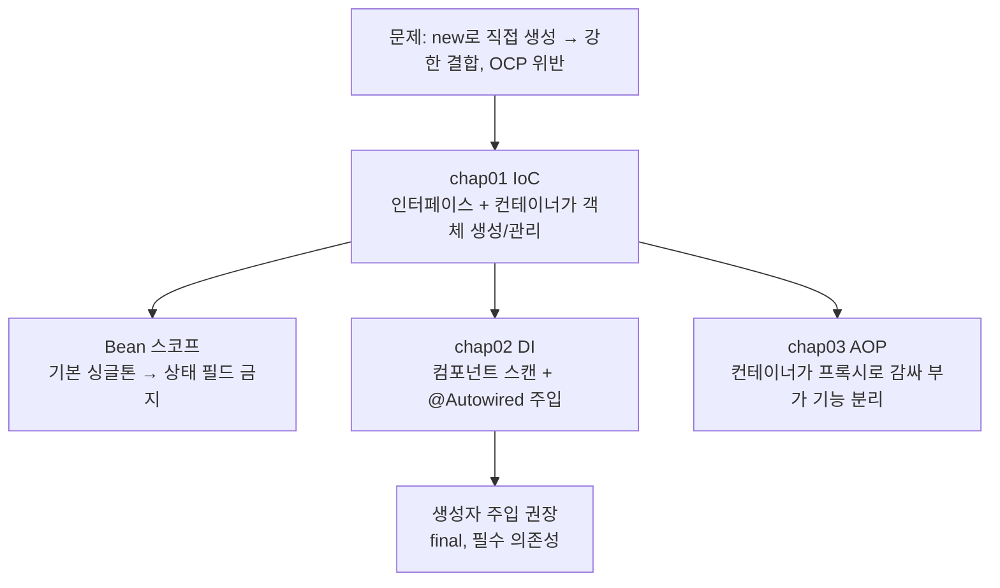

## 들어가며

Spring을 처음 배우면 "Bean", "컨테이너", "주입" 같은 단어가 한꺼번에 쏟아져서 막막하게 느껴지기 쉽습니다. 이번 수업은 이 개념들을 **결제 시스템 예제 하나로 조금씩 발전시키면서** 왜 필요한지부터 짚어 갔습니다.

비유를 하나 들어 보겠습니다. 지금까지 우리는 **필요한 재료를 직접 사 와서 요리하는 자취생**이었습니다. 요리(비즈니스 로직)를 하려면 장보기(객체 생성)부터 직접 해야 했죠. Spring을 쓰면 **재료를 손질해서 갖다 주는 주방 보조(IoC 컨테이너)** 가 생깁니다. 요리사는 "양파가 필요해요"라고 말만 하면 되고, 어떤 마트에서 샀는지는 몰라도 됩니다.

수업은 세 챕터로 진행되었습니다.

| 챕터 | 주제 | 핵심 질문 |
|------|------|-----------|
| chap01 | IoC Container | 객체를 누가 만들고 관리하는가? |
| chap02 | Dependency Injection | 객체끼리 어떻게 연결하는가? |
| chap03 | AOP | 모든 메서드에 반복되는 코드는 어떻게 떼어내는가? |

실습 프로젝트는 Spring Boot 없이 순수 Spring(`spring-context` 7.0.8)과 Gradle로 구성했습니다. Boot의 자동 설정 없이 컨테이너를 직접 만들어 보면서 내부 동작을 눈으로 확인하는 것이 목적이었습니다.

```groovy
// 수업 예제 코드 - build.gradle
dependencies {
    /* spring-context : Spring 프레임 워크의 핵심 의존성. IoC Container 생성 */
    implementation 'org.springframework:spring-context:7.0.8'
}
```

## chap01. IoC 컨테이너

### section01: Spring 없이 직접 객체를 만들면 생기는 문제

시나리오는 이렇습니다. 쇼핑몰에 결제 기능이 있고, 결제 수단으로 카카오페이와 네이버페이가 있습니다. `Application`이 `PaymentService`를 호출하면, 서비스가 적절한 Pay를 불러서 결제합니다.

```java
// 수업 예제 코드 - section01/service/PaymentService.java
public class PaymentService {

//    private NaverPayGateway naverPayGateway;
    private KakaoPayGateway kakaoPayGateway;

    public PaymentService() {
//        this.naverPayGateway = new NaverPayGateway();
        this.kakaoPayGateway = new KakaoPayGateway();
    }

    public boolean processPay(String orderId, int amount) {
//        boolean result = naverPayGateway.pay(orderId, amount);
        boolean result = kakaoPayGateway.pay(orderId, amount);
        ...
    }
}
```

주석 처리된 부분이 보이시나요? "네이버페이를 카카오페이로 바꿔 주세요"라는 요구사항이 들어오자 **필드 타입, 생성자, 메서드 호출부까지 세 군데를 고쳐야** 했습니다. 게다가 두 게이트웨이는 메서드 시그니처마저 달랐습니다.

```java
// 수업 예제 코드 - 두 게이트웨이의 시그니처 차이
public boolean pay(String orderId, int amount)    // KakaoPayGateway
public boolean pay(String orderId, double amount) // NaverPayGateway
```

수업에서는 이 상황을 SOLID 원칙 중 **OCP(개방-폐쇄 원칙)** 위반으로 정리했습니다.

> 소프트웨어는 확장에는 열려 있어야 하며, 변경에는 닫혀 있어야 한다.

결제 수단을 하나 바꿨을 뿐인데 서비스 코드가 줄줄이 바뀌는 건, `PaymentService`가 구체 클래스에 **강하게 결합**되어 있기 때문입니다.

### section02: 인터페이스 + IoC 컨테이너로 해결하기

해결은 두 단계로 이뤄졌습니다.

**1단계: 인터페이스로 규격을 통일합니다.** 메서드 이름과 매개변수가 제각각이던 문제를 인터페이스로 맞춥니다. 콘센트 규격이 통일되어 있으면 어느 회사 전자제품이든 꽂을 수 있는 것과 같습니다.

```java
// 수업 예제 코드 - section02/gateway/PaymentInterface.java
public interface PaymentInterface {
    boolean processPay(String orderId, int amount);
}
```

`PaymentService`는 이제 구체 클래스가 아니라 인터페이스에만 의존하고, 무엇을 쓸지는 **생성자로 전달받습니다.**

```java
// 수업 예제 코드 - section02/service/PaymentService.java
public class PaymentService {

    private final PaymentInterface paymentInterface;

    public PaymentService(PaymentInterface paymentInterface) {
        this.paymentInterface = paymentInterface;
    }
    ...
}
```

**2단계: 객체 생성과 조립을 컨테이너에 맡깁니다.** 누가 어떤 구현체를 넣어 줄지는 설정 클래스 `AppConfig`가 결정합니다.

```java
// 수업 예제 코드 - section02/config/AppConfig.java
@Configuration
public class AppConfig {

    @Bean
    public KakaoPayGateway kakaoPayGateway() {
        return new KakaoPayGateway();
    }

    @Bean
    public NaverPayGateway naverPayGateway() {
        return new NaverPayGateway();
    }

    @Bean
    public PaymentService paymentService() {
        return new PaymentService(kakaoPayGateway());
    }
}
```

- `@Configuration`: "이 클래스는 컨테이너에 등록할 객체 목록을 모아 둔 설정 파일입니다"라는 표시
- `@Bean`: 메서드가 반환하는 객체를 컨테이너에 등록. **Bean 이름의 기본값은 메서드명**입니다.
- **Bean**: Spring 컨테이너가 관리하는 객체를 부르는 이름

이제 결제 수단을 바꾸고 싶으면 `AppConfig`의 `kakaoPayGateway()`를 `naverPayGateway()`로 바꾸는 한 줄이면 됩니다. `PaymentService`는 손댈 필요가 없죠.

```java
// 수업 예제 코드 - section02/Application.java
// IoC Container == Application Context == Bean Factory
ApplicationContext context =
        new AnnotationConfigApplicationContext(AppConfig.class);

// getBean() : 컨테이너 내부에 있는 객체를 꺼내오는 메서드
PaymentService paymentService = context.getBean("paymentService", PaymentService.class);
boolean result = paymentService.processPay("order-001", 3);
```

**IoC(Inversion of Control, 제어의 역전)** 라는 이름이 여기서 나옵니다. 원래는 개발자가 `new`로 객체를 만들고 연결하는 "제어권"을 갖고 있었는데, 그 제어권이 컨테이너로 **뒤집혀** 넘어갔다는 뜻입니다.



수업 주석에서 `IoC Container == Application Context == Bean Factory`라고 정리했는데, 엄밀히 말하면 `BeanFactory`가 가장 기본 인터페이스이고 `ApplicationContext`는 이를 확장해 이벤트, 메시지 처리 같은 기능을 더한 인터페이스입니다. 실무에서는 거의 항상 `ApplicationContext`를 사용하므로 "컨테이너"라고 하면 보통 이것을 가리킵니다.

| 비교 | section01 (직접 생성) | section02 (IoC 컨테이너) |
|------|----------------------|--------------------------|
| 객체 생성 주체 | 개발자 (`new`) | 컨테이너 |
| 서비스가 아는 대상 | 구체 클래스 (`KakaoPayGateway`) | 인터페이스 (`PaymentInterface`) |
| 결제 수단 변경 시 | 서비스 코드 여러 곳 수정 | 설정 클래스 한 줄 수정 |
| 결합도 | 높음 | 낮음 |

### section03: Bean의 스코프(Scope)

같은 Bean을 `getBean()`으로 두 번 꺼내면 같은 객체일까요, 다른 객체일까요? 이 질문에 답하는 것이 **스코프**입니다.

```java
// 수업 예제 코드 - section03/config/AppConfig.java
@Bean("single")          // 기본은 메서드명이지만, 직접 이름 지정 가능
@Scope("singleton")      // default 설정은 싱글톤이다.
public PaymentService paymentService() {
    return new PaymentService(kakaoPayGateway());
}

@Bean("proto")
@Scope("prototype")      // 요청 시마다 매번 새로운 인스턴스를 반환
public PaymentService paymentService2() {
    return new PaymentService(kakaoPayGateway());
}
```

확인을 위해 `PaymentService`에 일부러 `orderId`라는 **상태 필드**를 두고, `processPay()`가 호출될 때 값을 저장하게 했습니다.

```java
// 수업 예제 코드 - section03/Application.java
PaymentService single = context.getBean("single", PaymentService.class);
single.processPay("order-001", 3);
PaymentService single2 = context.getBean("single", PaymentService.class);
System.out.println("single2 의 주문 ID = " + single2.getOrderId()); // order-001

PaymentService proto = context.getBean("proto", PaymentService.class);
proto.processPay("order-002", 3);
PaymentService proto2 = context.getBean("proto", PaymentService.class);
System.out.println("proto2 의 주문 ID = " + proto2.getOrderId());   // null
```

`single2`는 결제를 한 적이 없는데도 `order-001`이 찍힙니다. 두 변수가 **같은 인스턴스**를 가리키기 때문입니다. 반면 `proto2`는 새로 만들어진 객체라 `null`이 나옵니다.

| 스코프 | 인스턴스 개수 | 장점 | 주의할 점 |
|--------|--------------|------|-----------|
| `singleton` (기본값) | 컨테이너당 1개 | 메모리 효율, 동작 예측 가능 | 상태 필드를 두면 모든 요청이 공유 |
| `prototype` | 요청할 때마다 새로 생성 | 객체마다 독립된 상태 | 생성 이후 관리(소멸 콜백 등)는 컨테이너가 하지 않음 |

수업에서 "가장 주의!!!!"라고 강조한 부분이 바로 이것입니다.

> Bean이 상태(필드) 값을 가지게 되면 모든 요청이 해당 필드 값을 공유하게 된다. 따라서 필드에는 행위 위주의 클래스(service, dao)만 작성하고, 데이터 저장이 필요하면 각 요청별로 DTO를 통해서 저장한다.

비유하면 싱글톤 Bean은 **회사 공용 화이트보드**입니다. 업무 절차(행위)를 적어 두기엔 좋지만, 한 사람이 자기 주문번호를 적어 두면 다른 사람이 그 번호를 보고 결제해 버리는 사고가 납니다. 웹 서버처럼 여러 요청이 동시에 들어오는 환경에서는 이런 문제가 실제 데이터 오염으로 이어집니다.

## chap02. 의존성 주입(DI)

### section01: Bean이 100개라면? — 컴포넌트 스캔

chap01처럼 `@Bean` 메서드를 하나하나 작성하는 방식은, Bean이 100개가 되면 설정 파일이 감당하기 어렵게 커집니다. 그래서 등장한 것이 **컴포넌트 스캔**입니다. 클래스에 표시만 해 두면 컨테이너가 알아서 찾아서 등록합니다.

```java
// 수업 예제 코드 - di/section01/gateway/NaverPayGateway.java
@Component
public class NaverPayGateway implements PaymentInterface { ... }

// 수업 예제 코드 - di/section01/service/PaymentService.java
/* @Service 어노테이션은 @Component 의 특수한 형태이다.
 * MVC 패턴 중 Service 계층에 해당하는 Bean에 붙이게 된다. */
@Service
public class PaymentService { ... }
```

설정 클래스는 이제 텅 비어 있고, 어디를 스캔할지만 알려 줍니다.

```java
// 수업 예제 코드 - di/section01/config/AppConfig.java
@Configuration
@ComponentScan(basePackages = "com.wanted.di.section01",
    excludeFilters = @ComponentScan.Filter(
        // 1. 클래스명 제외
//      type = FilterType.ASSIGNABLE_TYPE, classes = {PaymentService.class}
        // 2. 어노테이션 제외
//      type = FilterType.ANNOTATION, classes = {org.springframework.stereotype.Service.class}
        // 3. 정규표현식 제외
//      type = FilterType.REGEX, pattern = {"com.wanted.di.section01.service.*"}
    )
)
public class AppConfig { }
```

정리하면 다음과 같습니다.

- `basePackages`를 지정하지 않으면 **`@ComponentScan`이 붙은 클래스의 패키지와 그 하위 패키지**만 스캔합니다. 예제에서 `AppConfig`는 `config` 패키지에 있으므로, 지정하지 않으면 `gateway`, `service` 패키지는 스캔되지 않습니다. 그래서 상위 패키지를 `basePackages`로 직접 지정했습니다. (`config` 패키지에 일부러 `@Component Test` 클래스를 두어 범위를 비교해 볼 수 있게 했습니다.)
- `excludeFilters`로 특정 Bean을 스캔에서 뺄 수 있습니다.

| FilterType | 기준 | 예시 |
|------------|------|------|
| `ASSIGNABLE_TYPE` | 특정 클래스(및 하위 타입) | `PaymentService.class` |
| `ANNOTATION` | 특정 어노테이션이 붙은 클래스 | `@Service` |
| `REGEX` | 클래스 이름 정규표현식 | `com.wanted...service.*` |

`@Service` 외에도 `@Controller`, `@Repository`가 모두 `@Component`의 특수한 형태입니다. 기능상 스캔 대상이 되는 건 같지만, **이 클래스가 어떤 계층인지 이름으로 드러내는 효과**가 있습니다.

생성자가 하나뿐인 `PaymentService`는 `@Autowired` 없이도 컨테이너에 있는 `PaymentInterface` 구현체(`NaverPayGateway`)를 자동으로 받습니다. 이 "자동으로 받는" 동작이 바로 다음 section의 주제입니다.

### section02: 의존성을 주입하는 세 가지 방법

> DI : 의존성 주입. Spring은 IoC 컨테이너 기능을 통해서 개발자가 직접 객체와 객체 간의 결합을 관리하는 것이 아닌, IoC 컨테이너가 자동으로 객체 간의 의존성을 주입하는 것을 의미한다. (== new X)

`@Autowired`는 "컨테이너에서 이 타입의 Bean을 찾아서 여기에 넣어 주세요"라는 뜻입니다. 붙이는 위치에 따라 세 가지 방식이 있습니다.

**1) 필드 주입**

```java
// 수업 예제 코드 - service/field/PaymentServiceField.java
@Service("field")
public class PaymentServiceField {

    @Autowired
    private PaymentInterface paymentInterface;

    public boolean processPay(String orderId, int amount) {
//      paymentInterface = new NaverPayGateway();  // 이렇게 바꿔치기해도 컴파일 에러가 안 난다
        ...
    }
}
```

가장 짧지만, `final`을 붙일 수 없어서 메서드 안에서 다른 객체로 바꿔치기해도 컴파일러가 막아 주지 못합니다.

**2) Setter 주입**

```java
// 수업 예제 코드 - service/setter/PaymentServiceSetter.java
@Service("setter")
public class PaymentServiceSetter {

    private PaymentInterface paymentInterface;

    @Autowired
    public void setPaymentInterface(PaymentInterface paymentInterface) {
        this.paymentInterface = paymentInterface;
    }
}
```

setter가 호출되지 않으면 필드가 `null`인 채로 남습니다. 대신 "있으면 쓰고 없어도 되는" **선택적 의존성**을 표현할 때는 유용합니다.

**3) 생성자 주입 (Spring 공식 권장)**

```java
// 수업 예제 코드 - service/constructor/PaymentServiceConstructor.java
@Service("constructor")
public class PaymentServiceConstructor {

    private final PaymentInterface paymentInterface;

    @Autowired  // 생성자가 1개뿐이라면 생략해도 자동 주입된다
    public PaymentServiceConstructor(PaymentInterface paymentInterface) {
        this.paymentInterface = paymentInterface;
    }
}
```

`final` 필드는 반드시 초기화해야 하므로, **객체가 만들어지는 순간 의존 관계가 확정**됩니다. 의존성 없이 객체가 만들어지는 상황 자체가 불가능해지는 거죠.

| 방식 | `final` 사용 | 누락 시 | 장점 | 단점 |
|------|-------------|---------|------|------|
| 필드 주입 | 불가 | 런타임에 `null` | 코드가 짧음 | 바꿔치기 방지 불가, 테스트 시 주입 어려움 |
| Setter 주입 | 불가 | setter 미호출 시 `null` | 선택적 의존성 표현 | 불변성 보장 안 됨 |
| 생성자 주입 | 가능 | 객체 생성 자체가 실패 | 불변성, 필수 의존성 강제 | 의존성이 많으면 생성자가 길어짐 |

생성자 주입을 레스토랑에 비유하면, **주방장이 출근할 때 칼을 지급받고 시작하는 것**입니다. 칼 없이 출근하는 주방장은 애초에 존재할 수 없습니다. 반면 필드/setter 주입은 "일단 출근하고 칼은 나중에 받아"인 셈이라, 칼을 못 받은 채 요리를 시작하는 사고가 생길 수 있습니다.

## chap03. AOP (관점 지향 프로그래밍)

### section01: AOP 적용 전 — 핵심 로직이 부가 코드에 묻히는 문제

이번 예제는 회원 관리 프로그램입니다.

- **기능(핵심 관심사)**: 회원가입, 회원조회, 비밀번호 수정, 탈퇴
- **비기능(횡단 관심사)**: 로깅, 성능 측정, 트랜잭션

AOP를 적용하기 전 `registerMember()`를 보면, 핵심 로직보다 부가 코드가 더 많습니다.

```java
// 수업 예제 코드 - aop/section01/MemberService.java (요약)
public void registerMember(MemberDTO member) {
    long startTime = System.currentTimeMillis();          // 성능 측정 - 횡단 관심사 #1
    try {
        System.out.println("[로그] 회원 가입 시작: " + member.getEmail()); // 로깅 - #2
        // beginTransaction();                            // 트랜잭션 - #3

        // ----- 핵심 비즈니스 로직 시작 -----
        if (memberRepository.containsKey(member.getEmail())) {
            throw new IllegalArgumentException("이미 등록된 이메일입니다: " + member.getEmail());
        }
        memberRepository.put(member.getEmail(), member);
        // ----- 핵심 비즈니스 로직 종료 -----

        // commitTransaction();
        System.out.println("[로그] 회원 가입 성공: " + member.getEmail());
    } catch (Exception e) {
        // rollbackTransaction();
        System.out.println("[로그] 회원 가입 실패: " + e.getMessage());
        throw e;
    } finally {
        long endTime = System.currentTimeMillis();
        System.out.println("[성능] 회원 가입 처리 시간: " + (endTime - startTime) + "ms");
    }
}
```

`getMember()`, `updatePassword()`, `deleteMember()`도 똑같은 try-catch-finally 틀을 반복합니다. 수업에서 정리한 문제점은 세 가지입니다.

1. **코드 중복**: 모든 메서드마다 로깅, 성능 측정, 트랜잭션 코드가 반복됩니다.
2. **낮은 응집도**: 메서드가 핵심 로직 외의 일까지 떠안고 있습니다.
3. **유지보수 어려움**: 로그 양식이 바뀌면 모든 메서드를 찾아다니며 고쳐야 합니다.

참고로 `MemberDTO`는 Lombok(`@Getter`, `@Setter`, `@ToString`, `@NoArgsConstructor`, `@AllArgsConstructor`)으로 작성했습니다. 수업 주석대로 **DTO는 행위가 아닌 데이터 위주의 객체**이고, chap01에서 배운 "싱글톤 Bean에는 상태를 두지 말고 DTO로 데이터를 옮긴다"는 원칙과 이어집니다.

### section02: AOP 적용 후 — 부가 기능을 Aspect로 분리하기

AOP를 적용하면 `MemberService`에는 **핵심 로직만** 남습니다.

```java
// 수업 예제 코드 - aop/section02/MemberService.java
@Service
public class MemberService {

    private Map<String, MemberDTO> memberRepository = new HashMap<>();

    public void registerMember(MemberDTO member) {
        if (memberRepository.containsKey(member.getEmail())) {
            throw new IllegalArgumentException("이미 등록된 이메일입니다: " + member.getEmail());
        }
        memberRepository.put(member.getEmail(), member);
    }
    ...
}
```

로깅과 성능 측정은 별도의 Aspect 클래스로 옮겨 갔습니다. AOP를 켜려면 설정 클래스에 `@EnableAspectJAutoProxy`를 붙이고, `spring-aop`과 `aspectjweaver` 의존성을 추가합니다.

```java
// 수업 예제 코드 - aop/section02/config/AppConfig.java
@Configuration
@ComponentScan("com.wanted.aop.section02")
@EnableAspectJAutoProxy
public class AppConfig { }
```

#### AOP 용어 정리

| 용어 | 의미 | 예제에서 |
|------|------|----------|
| Aspect | 횡단 관심사를 모아 둔 모듈 | `LoggingAspect`, `PerformanceAspect` |
| Advice | 언제, 무엇을 할지 정의한 메서드 | `logBefore()`, `performance()` |
| Pointcut | 어디에 적용할지 고르는 표현식 | `execution(* ...MemberService.*(..))` |
| JoinPoint | Advice가 적용되는 지점의 정보 | 메서드 이름, 매개변수 |
| Target | Advice가 적용되는 실제 객체 | `MemberService` |

#### Pointcut 표현식 읽는 법

```text
execution( 접근제어자 반환타입 패키지.클래스.메서드(파라미터) )
execution( *          com.wanted.aop.section02.MemberService.*(..) )
```

| 파라미터 패턴 | 의미 |
|---------------|------|
| `(..)` | 매개변수 0개 이상 (모두) |
| `()` | 매개변수 없는 메서드 |
| `(String)` | String 1개인 메서드 |
| `(String, ..)` | 첫 번째가 String, 나머지는 상관없음 |

#### 다섯 가지 Advice

```java
// 수업 예제 코드 - aspect/LoggingAspect.java
@Component
@Aspect
public class LoggingAspect {

    @Before("execution(* com.wanted.aop.section02.MemberService.*(..))")
    public void logBefore(JoinPoint joinPoint) {
        String methodName = joinPoint.getSignature().getName();
        Object[] args = joinPoint.getArgs();
        System.out.println("[Before 로그] " + methodName + " 메서드 실행 시작 됨");
    }

    @After("execution(* com.wanted.aop.section02.MemberService.*(..))")
    public void logAfter(JoinPoint joinPoint) { ... }

    @AfterReturning(
            pointcut = "execution(* com.wanted.aop.section02.MemberService.*(..))",
            returning = "result")   // 반환값을 result 매개변수로 받는다
    public void logAfterReturning(JoinPoint joinPoint, Object result) { ... }

    @AfterThrowing(
            pointcut = "execution(* com.wanted.aop.section02.MemberService.*(..))",
            throwing = "exception") // 발생한 예외를 exception 매개변수로 받는다
    public void logAfterThrowing(JoinPoint joinPoint, Exception exception) { ... }
}
```

| Advice | 실행 시점 | 쓰임새 |
|--------|-----------|--------|
| `@Before` | 타겟 메서드 실행 전 | 시작 로그, 매개변수 확인 |
| `@After` | 정상/예외 상관없이 종료 후 | 종료 로그, 자원 정리 |
| `@AfterReturning` | 정상 반환 후 | 반환값 확인/가공 |
| `@AfterThrowing` | 예외 발생 시 | 예외 로그 |
| `@Around` | 앞과 뒤 모두 | 성능 측정, 트랜잭션 등 실행 자체를 감싸야 할 때 |

`@Around`는 수업에서 "Advice 중 가장 강력한 어노테이션"이라고 소개했습니다. `ProceedingJoinPoint.proceed()`를 호출해야 비로소 타겟 메서드가 실행되므로, **실행 여부와 시점을 직접 제어**할 수 있기 때문입니다.

```java
// 수업 예제 코드 - aspect/PerformanceAspect.java
@Component
@Aspect
@Order(1)
public class PerformanceAspect {

    @Around("execution(* com.wanted.aop.section02.MemberService.*(..))")
    public Object performance(ProceedingJoinPoint joinPoint) {
        long startTime = System.currentTimeMillis();
        try {
            return joinPoint.proceed();       // 여기서 타겟 메서드가 실행된다
        } catch (Throwable e) {
            throw new RuntimeException(e);
        } finally {
            long endTime = System.currentTimeMillis();
            System.out.println("[Around 성능 측정] " + joinPoint.getSignature().getName()
                    + " 메서드 실행 시간 : " + (endTime - startTime) + "(ms)");
        }
    }
}
```

`@Order(1)`은 Aspect가 여러 개일 때의 우선순위입니다. 숫자가 작을수록 먼저(바깥쪽에서) 실행되므로, 성능 측정이 로깅까지 포함한 전체 시간을 감싸게 됩니다.

한 가지 짚어 둘 점은 `catch (Throwable e)`에서 원래 예외를 `RuntimeException`으로 감싸 다시 던진다는 것입니다. 그래서 테스트 5(존재하지 않는 회원 조회)에서 `Application`이 받는 예외는 `IllegalArgumentException`이 아니라 그것을 감싼 `RuntimeException`이 되고, 메시지 앞에 원래 예외 클래스 이름이 붙어 출력됩니다. 원래 예외 타입을 유지하고 싶다면 `throws Throwable`로 그대로 던지는 방식도 있습니다.

#### 프록시로 동작하는 원리

그런데 `MemberService` 코드 어디에도 Aspect를 호출하는 부분이 없는데 어떻게 로그가 찍힐까요? 비밀은 **프록시(대리인)** 입니다. `@EnableAspectJAutoProxy`가 켜져 있으면, 컨테이너는 `MemberService` 대신 **그것을 감싼 프록시 객체**를 Bean으로 등록합니다. `context.getBean(MemberService.class)`로 꺼낸 것은 사실 이 프록시입니다.

연예인과 매니저로 비유하면, 외부 요청은 항상 매니저(프록시)를 거칩니다. 매니저는 일정 기록(로깅)과 시간 체크(성능 측정)를 하고, 실제 공연(핵심 로직)은 연예인(타겟)에게 맡깁니다.



| 비교 | section01 (AOP 전) | section02 (AOP 후) |
|------|--------------------|--------------------|
| `MemberService` 내용 | 핵심 로직 + 로깅 + 성능 측정 + 트랜잭션 | 핵심 로직만 |
| 로그 양식 변경 시 | 4개 메서드 모두 수정 | `LoggingAspect` 한 곳만 수정 |
| 객체 생성 | `new MemberService()` | 컨테이너가 프록시로 감싸서 제공 |

## 정리

세 챕터는 "변경에 강한 코드"라는 하나의 목표로 이어져 있었습니다.



- **IoC**: 객체 생성과 연결의 제어권을 컨테이너에 넘깁니다. 컨테이너는 `AnnotationConfigApplicationContext`로 만들고 `getBean()`으로 꺼냅니다.
- **Bean 스코프**: 기본은 싱글톤입니다. 싱글톤 Bean에 상태 필드를 두면 모든 요청이 그 값을 공유하므로, 데이터는 DTO로 주고받습니다.
- **컴포넌트 스캔**: `@Component` 계열(`@Service` 등)을 붙이고 `@ComponentScan`으로 범위를 지정합니다. 필요하면 `excludeFilters`로 제외합니다.
- **DI**: 필드, setter, 생성자 주입이 있으며, 불변성과 필수 의존성을 보장하는 생성자 주입이 권장됩니다.
- **AOP**: 로깅, 성능 측정처럼 여러 곳에 흩어진 횡단 관심사를 Aspect로 모읍니다. Pointcut으로 위치를, Advice로 시점과 동작을 정하고, 실제로는 프록시를 통해 적용됩니다.

## 더 학습하면 좋은 개념

- **`@Configuration`의 CGLIB 프록시** — `AppConfig`에서 `paymentService()`가 `kakaoPayGateway()`를 직접 호출해도 싱글톤이 유지되는 이유입니다. 이를 알면 `@Configuration`과 단순 `@Component` 설정 클래스의 차이를 이해할 수 있습니다.
- **Bean 생명주기 콜백 (`@PostConstruct`, `@PreDestroy`)** — 컨테이너가 Bean을 만들고 없애는 시점에 초기화/정리 코드를 넣는 방법입니다. 프로토타입 스코프에서 소멸 콜백이 호출되지 않는 이유도 함께 볼 수 있습니다.
- **같은 타입 Bean이 여러 개일 때 (`@Primary`, `@Qualifier`)** — 이번 예제는 `PaymentInterface` 구현체가 하나라 문제가 없었지만, 카카오와 네이버를 모두 `@Component`로 등록하면 어떤 것을 주입할지 모호해집니다. 실무에서 바로 마주치는 상황입니다.
- **JDK 동적 프록시 vs CGLIB 프록시** — AOP 프록시가 어떤 방식으로 만들어지는지, 그리고 같은 클래스 안에서 메서드를 호출(self-invocation)하면 Advice가 적용되지 않는 이유를 설명해 줍니다.
- **`@Transactional`** — 수업에서 의사코드로만 다룬 트랜잭션 처리가 실제로 AOP로 구현된 대표 사례입니다. 데이터베이스 수업과 연결됩니다.

## 참고 자료

- [Spring Framework 공식 문서 - The IoC Container](https://docs.spring.io/spring-framework/reference/core/beans.html)
- [Spring Framework 공식 문서 - Dependency Injection](https://docs.spring.io/spring-framework/reference/core/beans/dependencies/factory-collaborators.html)
- [Spring Framework 공식 문서 - Bean Scopes](https://docs.spring.io/spring-framework/reference/core/beans/factory-scopes.html)
- [Spring Framework 공식 문서 - Classpath Scanning and Managed Components](https://docs.spring.io/spring-framework/reference/core/beans/classpath-scanning.html)
- [Spring Framework 공식 문서 - Aspect Oriented Programming with Spring](https://docs.spring.io/spring-framework/reference/core/aop.html)
