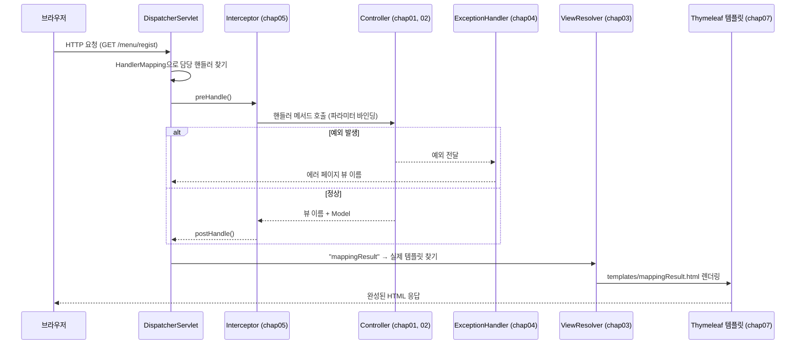
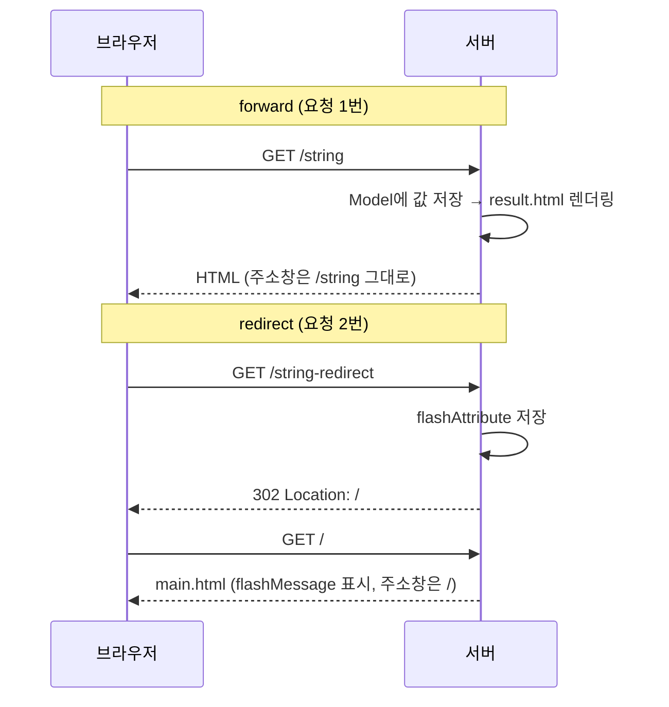
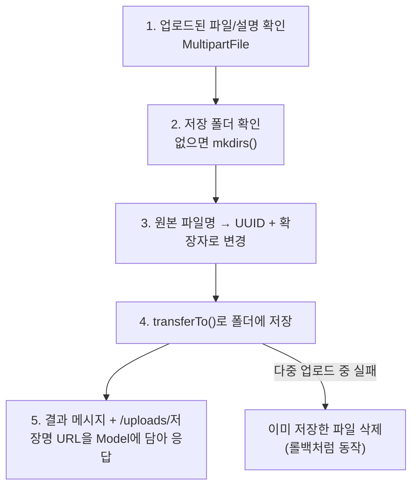
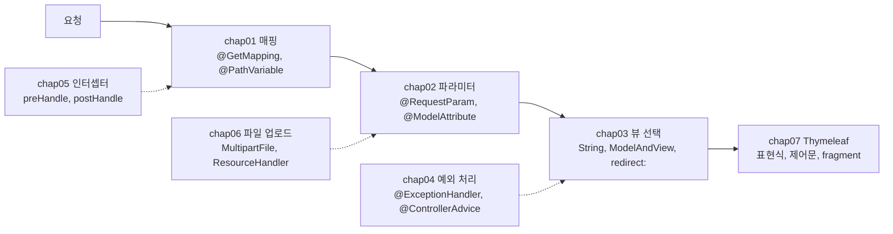

## 들어가며

Spring Core 수업에서 IoC 컨테이너, DI, AOP를 배웠다면, 이번에는 그 위에서 **웹 요청을 처리하는 방법**을 배웠습니다. 서블릿 시절에는 URL마다 서블릿 클래스를 만들고, `request.getParameter()`로 값을 꺼내고, `forward()`로 화면을 넘겼죠. Spring Web MVC는 이 반복 작업을 어노테이션 몇 개로 줄여 줍니다.

비유하자면 서블릿은 **손님이 올 때마다 사장님이 직접 주문을 받고 요리하고 서빙하는 작은 가게**이고, Spring MVC는 **안내 데스크(DispatcherServlet)가 손님을 맞아 담당 직원(컨트롤러)에게 연결하고, 완성된 요리는 플레이팅 담당(ViewResolver)이 접시에 담아 내보내는 레스토랑**입니다.

이번 실습은 Spring Boot 4.1.2, Java 21 기반이며 `spring-boot-starter-webmvc`와 `spring-boot-starter-thymeleaf`를 사용했습니다. Boot에는 Tomcat이 내장되어 있어서 별도 서버 설치 없이 `main()`만 실행하면 웹 서버가 뜹니다.

| 챕터 | 주제 | 핵심 |
|------|------|------|
| chap01 | Request Mapping | URL과 HTTP 메서드를 핸들러 메서드에 연결 |
| chap02 | Handler Method | 요청 파라미터를 받는 방법 |
| chap03 | View Resolver | 응답할 화면을 고르는 방법, forward와 redirect |
| chap04 | Exception Handler | 컨트롤러별/전역 예외 처리 |
| chap05 | Interceptor | 컨트롤러 전후에 공통 로직 끼워 넣기 |
| chap06 | File Upload | MultipartFile로 파일 저장, 정적 리소스 매핑 |
| chap07 | Thymeleaf | 템플릿 표현식, 제어문, fragment |

먼저 전체 흐름을 그림으로 보고 시작하겠습니다. 이 그림의 각 칸이 이번 수업의 각 챕터에 대응합니다.



## chap01. Request Mapping — 요청을 어떤 메서드가 받을까

### 메서드에 요청 매핑하기

```java
// 수업 예제 코드 - MethodController.java
@Controller
public class MethodController {

    @RequestMapping("/menu/regist")
    public String registMenu(Model model) {
        model.addAttribute("message", "GET 방식의 메뉴 등록 핸들러 메서드 동작함..");
        return "mappingResult";
    }

    @RequestMapping(value = "/menu/regist", method = RequestMethod.POST)
    public String postRegistMenu(Model model) {
        model.addAttribute("message", "POST 방식의 메뉴 등록 핸들러 메서드 동작함..");
        return "mappingResult";
    }

    @GetMapping("/menu/modify")
    public String getModifyMenu(Model model) { ... }

    @PostMapping("/menu/modify")
    public String postModifyMenu(Model model) { ... }
}
```

수업 주석에 핵심이 잘 담겨 있습니다.

- 내장 Tomcat의 서블릿(DispatcherServlet)은 HTTP 요청을 받으면 **`@Controller`가 붙은 클래스에 처리를 위임**합니다.
- `@RequestMapping`은 서블릿의 `service()`처럼 경로를 받아 주는 역할입니다. `method`를 지정하지 않으면 모든 HTTP 메서드를 받고, 지정하면 그 방식만 받습니다.
- `@GetMapping`, `@PostMapping`은 `@RequestMapping(method = ...)`를 짧게 쓴 버전입니다.

| 어노테이션 | 의미 |
|------------|------|
| `@RequestMapping("/path")` | 모든 HTTP 메서드 매핑 |
| `@RequestMapping(value = "/path", method = RequestMethod.POST)` | POST만 매핑 |
| `@GetMapping("/path")` | GET만 매핑 (축약형) |
| `@PostMapping("/path")` | POST만 매핑 (축약형) |

### Model과 반환값

`Model`은 **백엔드에서 만든 값을 화면에 넘겨주는 key-value 바구니**입니다. 서블릿에서 `request.setAttribute()`로 하던 일을 대신합니다.

그리고 컨트롤러의 마지막 임무는 "어떤 화면으로 응답할지" 정하는 것입니다. 메서드가 `String`을 반환하면 그 문자열 앞에 `resources/templates/`가, 뒤에 `.html`이 붙어 화면 파일을 찾습니다. 서블릿의 `forward(req, res)`에 해당합니다.

```html
<!-- 수업 예제 코드 - templates/mappingResult.html -->
<h3 th:text="${message}"></h3>
```

### 클래스에 요청 매핑하기와 @PathVariable

같은 접두사를 가진 URL이 여러 개라면 클래스 레벨에 공통 경로를 둘 수 있습니다.

```java
// 수업 예제 코드 - ClassController.java
@Controller
@RequestMapping("/order/*")
public class ClassController {

    @GetMapping("/regist")
    public String registOrder(Model model) { ... }

    /* 요청 경로 : /order/detail/3
     * 3 : pathVariable 이라고 불리우며 요청 url 을 타고 서버로 넘어오는 값 */
    @GetMapping("/detail/{orderNo}")
    public String pathVariable(Model model, @PathVariable("orderNo") int no) {
        model.addAttribute("message", no + "번 주문 상세조회!!");
        return "mappingResult";
    }
}
```

`@PathVariable`은 쿼리스트링(`?no=3`)이 아니라 **URL 경로 자체에 들어 있는 값**을 꺼냅니다. `{orderNo}` 자리에 들어온 문자열이 `int no`로 변환되어 들어옵니다.

실습용 `index.html`에는 `/order/modify`, `/order/delete` 버튼도 있었는데, 컨트롤러에 해당 매핑이 없어서 404가 나는 것을 확인하는 용도로 쓸 수 있습니다. 또 `application.yaml`에서 `server.port: 7777`로 서버 포트를 바꾸는 방법도 다뤘습니다.

## chap02. Handler Method — 요청 파라미터 받기

같은 "메뉴 정보"를 받더라도 방법이 여러 가지입니다. 수업은 원시적인 방법에서 편리한 방법 순서로 진행되었습니다.

### void 반환 — URL이 곧 뷰 경로

```java
// 수업 예제 코드 - RequestController.java
@Controller
@RequestMapping("/request/*")
public class RequestController {

    @GetMapping("regist")
    public void regist() {}   // /request/regist 요청 → templates/request/regist.html
```

반환 타입이 `void`면 요청 URL이 그대로 뷰 이름이 됩니다. 폼 화면만 보여 주는 GET 핸들러에서 간단히 쓸 수 있습니다.

### 1) WebRequest

```java
// 수업 예제 코드 - RequestController.java
@PostMapping("regist")
public String registMenu(Model model, WebRequest request) {
    // WebRequest 는 Servlet 환경의 HttpServletRequest 의 역할을 한다.
    String menuName = request.getParameter("name");
    int menuPrice = Integer.parseInt(request.getParameter("price"));
    int categoryCode = Integer.parseInt(request.getParameter("categoryCode"));
    ...
    return "request/printResult";
}
```

서블릿 방식과 거의 같습니다. 값이 모두 문자열로 오기 때문에 `Integer.parseInt()`로 직접 변환해야 합니다.

### 2) @RequestParam

```java
// 수업 예제 코드 - RequestController.java
@PostMapping("modify")
public String modifyMenu(Model model,
                         @RequestParam("modifyName") String name,
                         @RequestParam int modifyPrice) {
    ...
}
```

```html
<!-- 수업 예제 코드 - templates/request/modify.html -->
<form action="modify" method="post">
    수정할 메뉴의 이름 : <input type="text" name="modifyName"><br>
    수정할 메뉴의 가격 : <input type="number" name="modifyPrice"><br>
</form>
```

파라미터 하나를 바로 원하는 타입으로 받아 줍니다. 수업에서 "가장 주의해야 할 것"으로 강조한 부분은 **input의 `name` 속성과 이름이 일치하지 않으면 400 Bad Request**가 난다는 점입니다. 이름이 다르면 `@RequestParam("modifyName") String name`처럼 괄호 안에 실제 파라미터 이름을 적어 주면 됩니다.

### 3) @ModelAttribute

파라미터가 많아지면 하나씩 받기 번거롭습니다. `@ModelAttribute`는 **여러 입력값을 DTO 하나로 묶어** 받습니다.

```java
// 수업 예제 코드 - MenuDTO.java
@NoArgsConstructor @AllArgsConstructor @Getter @Setter @ToString
public class MenuDTO {
    private String name;
    private int price;
    private int categoryCode;
    private String orderableStatus;
}

// 수업 예제 코드 - RequestController.java
@PostMapping("search")
public String searchMenu(@ModelAttribute("menu") MenuDTO menu) {
    System.out.println("menu = " + menu);
    return "request/searchResult";
}
```

input의 `name`(`name`, `price`, `categoryCode`, `orderableStatus`)과 DTO의 필드명이 같으면, Spring이 기본 생성자로 객체를 만든 뒤 setter로 값을 채워 줍니다. 게다가 `@ModelAttribute`로 받은 객체는 **Model에 자동으로 담겨** forward되는 화면에서 바로 쓸 수 있습니다.

모델에 담기는 이름도 짚고 넘어가겠습니다. 수업 주석에 따르면 이름을 생략하면 클래스명의 첫 글자를 소문자로 바꾼 `menuDTO`가 키가 됩니다. 반대로 예제처럼 `@ModelAttribute("menu")`로 이름을 지정하면 키는 `menu`가 되므로, 템플릿에서도 `${menu.name}`처럼 지정한 이름으로 꺼내는 것이 맞습니다. 결과 템플릿(`searchResult.html`)은 `${menuDTO...}`로 작성되어 있었으니, 이름을 지정할지 말지와 템플릿의 키를 맞춰 주는 것이 중요합니다.

| 방식 | 받는 단위 | 타입 변환 | 적합한 상황 |
|------|----------|-----------|-------------|
| `WebRequest` | 요청 전체 | 직접 (`parseInt`) | 서블릿 방식이 필요할 때 |
| `@RequestParam` | 파라미터 1개 | 자동 | 값이 1~2개일 때 |
| `@ModelAttribute` | DTO 객체 | 자동 | 폼 입력이 여러 개일 때 |

`index.html`에는 4번째 항목으로 `@RequestBody`가 예고되어 있었습니다. 폼 데이터가 아니라 JSON 같은 요청 본문을 객체로 받는 방식으로, REST API를 만들 때 주로 사용합니다.

## chap03. View Resolver — 어떤 화면으로 응답할까

수업에서는 `@Controller`가 View를 반환하는 방법을 세 가지로 정리했습니다.

| 반환 타입 | 뷰 경로 결정 방식 |
|-----------|-------------------|
| `void` | 요청 URL이 곧 뷰 경로 |
| `String` | 반환한 문자열이 뷰 경로 |
| `ModelAndView` | `setViewName("문자열")`의 값이 뷰 경로 |

```java
// 수업 예제 코드 - MainController.java
// {} 내부에는 여러 경로를 , 기준으로 작성할 수 있다.
@RequestMapping(value = {"/", "/main"})
public String mainPage() {
    return "main";
}
```

### String 반환과 ViewResolver

```java
// 수업 예제 코드 - ResolverController.java
@GetMapping("/string")
public String stringView(Model model) {
    model.addAttribute("forwardMessage", "문자열로 View 반환");
    // ViewResolver 객체는 리턴되는 문자열에
    // 접두사로 resources/templates, 접미사로 .html 을 붙여주게 된다.
    return "result";   // → resources/templates/result.html
}
```

**ViewResolver**는 컨트롤러가 돌려준 "논리적인 이름"(`result`)을 "실제 파일 위치"(`templates/result.html`)로 바꿔 주는 번역가입니다. 덕분에 컨트롤러는 파일 경로를 몰라도 됩니다.

### forward와 redirect

Spring의 기본 응답 방식은 **forward**입니다. 그런데 회원가입처럼 데이터를 저장하는 요청 뒤에 forward로 응답하면, 사용자가 새로고침할 때 같은 요청이 다시 전송되어 회원가입이 두 번 될 수 있습니다. 이럴 때 **redirect**를 씁니다.

```java
// 수업 예제 코드 - ResolverController.java
@GetMapping("/string-redirect")
public String redirect(RedirectAttributes rttr) {
    // service.registMember(); insert 가정
    rttr.addFlashAttribute("flashMessage", "리다이랙트 된 페이지에서도 유지되는 값!");
    return "redirect:/";
}
```

redirect는 "다른 창구로 다시 가세요"라고 안내하는 것이라 **요청이 두 번** 발생합니다. 그래서 첫 요청의 Model에 담은 값은 두 번째 요청에서 사라집니다. 서블릿에서는 이 문제를 session이나 cookie로 풀었는데, Spring은 `RedirectAttributes.addFlashAttribute()`를 제공합니다. 플래시 속성은 redirect 직후 한 번만 쓰고 사라지는 값이라, 이름 그대로 "반짝" 하고 없어집니다.



| 비교 | forward | redirect |
|------|---------|----------|
| 요청 횟수 | 1번 | 2번 |
| 주소창 URL | 원래 요청 URL 유지 | 새 URL로 바뀜 |
| Model 값 | 유지 | 소멸 (flash attribute로 전달) |
| 사용 예 | 조회 결과 화면 | 등록/수정/삭제 후 이동 |
| 작성법 | `return "result";` | `return "redirect:/";` |

### ModelAndView

```java
// 수업 예제 코드 - ResolverController.java
@GetMapping("modelAndView")
public ModelAndView modelAndView(ModelAndView mv) {
    mv.addObject("forwardMessage", "MV 활용 뷰와 데이터!");
    mv.setViewName("result");
    return mv;
}
```

데이터(Model)와 화면(View)을 한 객체에 담아 반환하는 방식입니다. 이후 chap06, chap07에서도 계속 사용합니다.

## chap04. Exception Handler — 예외를 친절한 화면으로

### 컨트롤러 안의 @ExceptionHandler

```java
// 수업 예제 코드 - ExceptionTestController.java
@Controller
public class ExceptionTestController {

    @GetMapping("nullpointer")
    public String nullPointer() {
        String str = null;
        System.out.println(str.toLowerCase(Locale.ROOT)); // NullPointerException 발생
        return "/";
    }

    @ExceptionHandler(NullPointerException.class)
    public String nullHandler(Model model, NullPointerException e) {
        model.addAttribute("key", e.getMessage());
        return "error/nullPointer";
    }
}
```

`@ExceptionHandler(예외 클래스)`를 정의해 두면, 그 예외가 발생했을 때 핸들러가 **컨트롤러의 흐름을 가로채서** 대신 응답합니다. 사용자는 하얀 에러 화면 대신 준비된 안내 페이지를 보게 됩니다.

사용자 정의 예외도 같은 방식으로 처리했습니다.

```java
// 수업 예제 코드 - MemberNotFoundException.java
public class MemberNotFoundException extends Throwable {
    public MemberNotFoundException(String message) { super(message); }
}
```

한 가지 주의할 점은 이 예외가 `Exception`이 아니라 `Throwable`을 상속한다는 것입니다. 그래서 아래 전역 핸들러의 `@ExceptionHandler(Exception.class)`로는 잡히지 않습니다. 사용자 정의 예외는 보통 `Exception`이나 `RuntimeException`을 상속해서 만듭니다.

### @ControllerAdvice로 전역 처리

`ExceptionTestController`에 만든 핸들러는 **다른 컨트롤러에서 난 예외는 처리하지 못합니다.** `GlobalTestController`의 `/global-nullpointer`에서 같은 NPE가 나도 그 핸들러는 동작하지 않죠. 그래서 공통 예외 처리기를 따로 모읍니다.

```java
// 수업 예제 코드 - GlobalExceptionHandler.java
@ControllerAdvice
public class GlobalExceptionHandler {

    @ExceptionHandler(NullPointerException.class)
    public String nullHandler(Model model, NullPointerException e) {
        System.out.println("전역 예외처리 핸들러 동작!!!");
        model.addAttribute("key", e.getMessage());
        return "error/nullPointer";
    }

    @ExceptionHandler(Exception.class)
    public String defaultException(Model model, Exception e) {
        model.addAttribute("class", e.getClass());
        model.addAttribute("message", e.getMessage());
        return "error/default";
    }
}
```

AOP 수업에서 Advice가 "반복적으로 동작해야 하는 코드를 뭉쳐 둔 메서드"였던 것처럼, `@ControllerAdvice`는 **여러 컨트롤러에 공통으로 적용되는 예외 처리 핸들러를 묶어 둔 클래스**입니다. `/global-default`에서 배열 범위를 벗어나는 예외(`ArrayIndexOutOfBoundsException`)는 따로 핸들러가 없으므로 `Exception.class` 핸들러가 받아 기본 에러 페이지를 보여 줍니다.

| 우선순위 | 위치 | 적용 범위 |
|----------|------|-----------|
| 1 (높음) | 같은 컨트롤러 안의 `@ExceptionHandler` | 그 컨트롤러만 |
| 2 | `@ControllerAdvice` 안의 `@ExceptionHandler` | 모든 컨트롤러 |

같은 위치 안에서는 더 구체적인 예외 타입(`NullPointerException`)이 상위 타입(`Exception`)보다 먼저 선택됩니다.

## chap05. Interceptor — 컨트롤러 앞뒤에 끼어들기

요청 처리 시간을 모든 핸들러에서 재고 싶다면, AOP처럼 **공통 로직을 한곳에 모으는 장치**가 필요합니다. Spring MVC에서는 인터셉터가 그 역할을 합니다. 공항 보안 검색대처럼 컨트롤러에 들어가기 전과 나온 후에 한 번씩 거치는 관문입니다.

```java
// 수업 예제 코드 - TimerInterceptor.java
@Component
public class TimerInterceptor implements HandlerInterceptor {

    // 컨트롤러 도달 전
    @Override
    public boolean preHandle(HttpServletRequest request, HttpServletResponse response, Object handler) {
        long startTime = System.currentTimeMillis();
        request.setAttribute("startTime", startTime);
        // true : 다음 인터셉터가 있다면 호출 / 없다면 컨트롤러의 핸들러 메서드 호출
        return true;
    }

    // 컨트롤러 핸들러메서드 실행 후
    @Override
    public void postHandle(HttpServletRequest request, HttpServletResponse response,
                           Object handler, ModelAndView modelAndView) {
        long endTime = System.currentTimeMillis();
        long startTime = (long) request.getAttribute("startTime");
        modelAndView.addObject("interval", endTime - startTime);
    }
}
```

`preHandle()`에서 시작 시간을 request에 저장하고, `postHandle()`에서 꺼내 걸린 시간을 Model에 넣습니다. 핸들러가 `Thread.sleep(2000)`으로 2초를 쉬므로, 결과 화면에는 약 2000ms가 찍힙니다. `preHandle()`이 `false`를 반환하면 컨트롤러까지 가지 않고 요청이 멈추기 때문에, 로그인 확인 같은 용도로도 많이 쓰입니다.

| 메서드 | 호출 시점 | 예제에서 한 일 |
|--------|-----------|----------------|
| `preHandle()` | 핸들러 실행 전 | 시작 시간 저장, `true` 반환 |
| `postHandle()` | 핸들러 실행 후, 뷰 렌더링 전 | 소요 시간을 Model에 추가 |
| `afterCompletion()` | 뷰 렌더링까지 끝난 후 | (예제에서는 구현하지 않음) 자원 정리 등 |

인터셉터는 만들기만 해서는 동작하지 않고, `WebMvcConfigurer`를 구현한 설정 클래스에서 등록해야 합니다.

```java
// 수업 예제 코드 - WebConfig.java
@Configuration
public class WebConfig implements WebMvcConfigurer {

    private final TimerInterceptor timerInterceptor;

    // 생성자를 통한 Bean 간의 의존성 주입
    @Autowired
    public WebConfig(TimerInterceptor timerInterceptor) {
        this.timerInterceptor = timerInterceptor;
    }

    @Override
    public void addInterceptors(InterceptorRegistry registry) {
        registry.addInterceptor(timerInterceptor)
                .addPathPatterns("/*")              // 인터셉터가 동작할 URL
                .excludePathPatterns("/css/**")     // 정적 리소스 제외
                .excludePathPatterns("/images/**")
                .excludePathPatterns("/js/**")
                .excludePathPatterns("/video/**");
    }
}
```

`WebMvcConfigurer`는 **Spring MVC의 기본 설정은 유지하면서 필요한 부분만 커스터마이징**할 때 구현하는 인터페이스입니다(인터셉터 추가, CORS 설정, 정적 리소스 핸들링 등). Core 수업에서 배운 생성자 주입이 여기서 그대로 쓰인다는 점도 눈여겨볼 만합니다. 경로 패턴에서 `/*`는 한 단계 경로만, `/**`는 모든 하위 경로까지 포함합니다.

| 비교 | Interceptor | AOP (Core 수업) |
|------|-------------|-----------------|
| 적용 대상 | URL 패턴 | Pointcut 표현식 (메서드) |
| 다루는 정보 | `HttpServletRequest/Response`, `ModelAndView` | `JoinPoint` (메서드명, 인자) |
| 주 용도 | 인증 체크, 요청 시간 측정, 공통 Model 값 | 로깅, 트랜잭션, 성능 측정 |

## chap06. File Upload — 파일 받고 저장하고 보여 주기

### 업로드 설정

```yaml
# 수업 예제 코드 - application.yaml
spring:
  servlet:
    multipart:
      max-file-size: 200MB       # 파일 1개의 최대 크기
      max-request-size: 1000MB   # 한 요청에 담긴 파일 합계의 최대 크기

# 프로젝트에서 파일을 어디 저장할 건지에 대한 경로 지정
file:
  upload-dir: ./uploads
```

`file.upload-dir`은 Spring이 정한 키가 아니라 **우리가 직접 정의한 설정값**입니다. 코드에서는 `@Value("${file.upload-dir}")`로 꺼내 씁니다.

폼은 반드시 `enctype="multipart/form-data"`로 보내야 Spring이 파일을 `MultipartFile` 타입으로 받을 수 있습니다. 여러 파일은 `multiple` 속성을 붙입니다.

```html
<!-- 수업 예제 코드 - templates/main.html -->
<form action="multi-file" method="post" enctype="multipart/form-data">
    파일 : <input type="file" name="multiFile" multiple> <br>
    파일 설명 : <input type="text" name="description"><br>
    <input type="submit">
</form>
```

### 저장 과정

수업에서 정리한 순서는 다음과 같습니다.



```java
// 수업 예제 코드 - FileController.java
private String save(MultipartFile file) throws IOException {
    String originName = file.getOriginalFilename();                  // test.PNG
    String ext = originName.substring(originName.lastIndexOf(".")).toLowerCase(); // .png
    String savedName = UUID.randomUUID().toString() + ext;           // 3829382d....png

    File dir = new File(uploadDir).getAbsoluteFile();
    dir.mkdirs();
    file.transferTo(new File(dir, savedName));
    return savedName;
}
```

왜 원래 파일명을 그대로 쓰지 않을까요? 두 사람이 모두 `스크린샷.png`를 올리면 뒤에 올린 파일이 앞 파일을 덮어쓰기 때문입니다. UUID는 사실상 겹치지 않는 고유값이라 이 문제를 막아 줍니다. 원본 이름은 `FileDTO`의 `originFileName`에 따로 보관해 둡니다.

다중 업로드에서는 5개 중 4개만 저장되고 1개가 실패하는 상황을 고려했습니다. 데이터베이스 트랜잭션의 rollback처럼, 실패하면 이미 저장한 파일을 지워서 "전부 성공 아니면 전부 취소"에 가깝게 만듭니다.

```java
// 수업 예제 코드 - FileController.java (multiFileUpload)
try {
    for (MultipartFile file : multipartFile) {
        String savedName = save(file);
        files.add(new FileDTO(file.getOriginalFilename(), savedName, uploadDir, description));
        savedFiles.add("/uploads/" + savedName);
    }
} catch (Exception e) {
    for (FileDTO file : files) {
        new File(new File(uploadDir).getAbsoluteFile(), file.getSavedName()).delete();
    }
    mv.addObject("message", "멀티 파일 업로드 실패!");
}
```

### 저장한 파일을 브라우저에 보여 주기

``를 그리면 브라우저는 서버에 `/uploads/abc.png`를 요청합니다. 그런데 이 파일은 `static` 폴더가 아니라 프로젝트 밖의 `./uploads`에 있죠. 그래서 **URL과 실제 폴더를 연결**해 주는 설정이 필요합니다. 이것도 `WebMvcConfigurer`로 합니다.

```java
// 수업 예제 코드 - WebConfig.java (chap06)
@Override
public void addResourceHandlers(ResourceHandlerRegistry registry) {
    registry.addResourceHandler("/uploads/**")
            .addResourceLocations("file:" + uploadDir + "/");
}
```

수업에서는 이 방식이 "추후에는 권장하지 않는 방식이지만, 현재 기술 스택에서는 최선"이라고 짚었습니다. 실무에서는 파일을 애플리케이션 서버 디스크 대신 별도 스토리지에 저장하는 경우가 많기 때문입니다.

## chap07. Thymeleaf — 서버 데이터를 HTML에 입히기

Thymeleaf는 HTML 태그에 `th:` 속성을 붙여 서버 데이터를 끼워 넣는 템플릿 엔진입니다. 사용하려면 `<html xmlns:th="http://www.thymeleaf.org">`로 네임스페이스를 선언합니다. 서버 없이 파일을 열어도 일반 HTML로 보이는 **내추럴 템플릿**이라는 점이 특징입니다.

먼저 설정 쪽 이야기입니다. 이 프로젝트는 메인 클래스가 `config` 패키지에 있어서, `@SpringBootApplication`이 `config`와 그 하위만 스캔합니다. 그래서 `controller` 패키지를 찾을 수 있도록 `ContextConfiguration`에 `@ComponentScan(basePackages = "com.wanted.thymeleaf")`를 따로 지정했습니다. Core 수업의 컴포넌트 스캔 범위 이야기가 그대로 이어지는 부분입니다.

뷰 이름 규칙도 다시 정리됐습니다. Boot의 기본값은 `spring.thymeleaf.prefix=classpath:/templates/`, `suffix=.html`이고, 뷰 이름 앞에 `/`를 붙이면 경로가 `templates//lecture/...`가 되어 jar 배포 시 템플릿을 못 찾을 수 있으니 붙이지 않습니다.

### 표현식

| 표현식 | 이름 | 용도 |
|--------|------|------|
| `${...}` | 변수 표현식 | Model 값, `param`, `session` 꺼내기 |
| `*{...}` | 선택 변수 표현식 | `th:object`로 고른 객체의 필드 |
| `#{...}` | 메시지 표현식 | `messages.properties`의 값 |
| `@{...}` | 링크 표현식 | URL 생성 (context path 자동 처리) |
| `~{...}` | 조각 표현식 | fragment 불러오기 |
| `[[...]]`, `[(...)]` | 인라인 표현식 | 태그 속성 없이 본문에 값 출력 |


```html
<!-- 수업 예제 코드 - lecture/expression.html -->
<!-- 요청 파라미터: /lecture/expression?title=표현식&no=5&no=6 -->
<p th:text="${ param.title }"></p>
<p th:text="${ param.no[0] }"></p>   <!-- 같은 이름이 여러 개면 인덱스로 -->

<!-- 메시지 표현식: messages.properties 의 message.value=hello world -->
<p th:text="#{ message.value }"></p>

<!-- 링크 표현식: 괄호 안은 쿼리스트링 → /lecture/expression?title=링크&no=1 -->
<a th:href="@{/lecture/expression(title='링크', no=1)}">파라미터를 포함한 링크</a>

<!-- 선택 변수 표현식 -->
<div th:object="${ member }">
    <p th:text="*{ address }"></p>
</div>
```


값을 꺼내는 위치에 따라 쓰는 법이 다릅니다. 요청 파라미터는 `${param.이름}`, 세션은 `${session.이름}`, Model 값은 `${이름}`입니다. 수업 주석에 따르면 Thymeleaf 3.1(Spring Boot 3)부터는 보안상 `${#request}`, `${#response}` 같은 객체에 직접 접근할 수 없습니다.

주석도 두 종류가 있습니다.

| 주석 | 문법 | 동작 |
|------|------|------|
| parser-level | `<!--/* ... */-->` | Thymeleaf 처리 시 제거되어 클라이언트에 노출되지 않음 |
| prototype-only | `<!--/*/ ... /*/-->` | 정적으로 열면 주석, Thymeleaf 처리 후에는 화면에 보임 |

### th:text vs th:utext, 인라인 표현식

컨트롤러에서 `"hello!<h3>Thymeleaf</h3>"`처럼 태그가 섞인 문자열을 넘기고 비교했습니다.

| 속성 | 인라인 | escape | 결과 |
|------|--------|--------|------|
| `th:text` | `[[...]]` | 적용 | 태그가 글자 그대로 보임 |
| `th:utext` | `[(...)]` | 미적용 | 태그가 실제 HTML로 렌더링됨 |

`th:utext`는 사용자가 입력한 값에 `<script>`가 섞여 있으면 그대로 실행되어 **XSS 공격**에 노출되므로, 신뢰할 수 있는 값에만 쓰고 기본은 `th:text`를 씁니다. `th:inline="none"`을 주면 `[[...]]`를 해석하지 않고 글자 그대로 출력합니다.

자바스크립트 안에서 서버 값을 쓸 때는 `th:inline="javascript"`가 필요하고, 수업에서는 세 가지 작성법을 비교한 뒤 **내추럴 템플릿 방식**을 권장했습니다.


```html
<!-- 수업 예제 코드 - lecture/expression.html -->
<script th:inline="javascript">
    // let hello = [[${ hello }]];     → 정적으로 열면 JS 문법 오류
    // let hello = "[[${ hello }]]";   → 동적 페이지에서 따옴표 중복 오류
    let hello = /*[[${ hello }]]*/ '기본값';   // 정적/동적 모두 정상 (권장)
</script>
```


문자열을 `+` 없이 합치는 **리터럴 치환** `|...|`, 그리고 태그를 추가하지 않고 범위만 묶는 `th:block`도 다뤘습니다.


```html
<!-- 수업 예제 코드 - lecture/expression.html -->
<p th:object="${ member }" th:text="|name = '*{ name }'|"></p>
<th:block th:object="${ member }">
    <p th:text="*{ age }"></p>
</th:block>
```


### 제어문


```html
<!-- 수업 예제 코드 - lecture/conditional.html -->
<p th:if="${ num > 0 }">넘어온 값은 0보다 크다.</p>
<p th:unless="${ num < 0 }">넘어온 값은 0보다 작지 않다.</p>
<p th:if="${ !#strings.isEmpty(str) and str == '바나나' }">바나나 좋아요!</p>

<th:block th:switch="${ str }">
    <span th:case="사과">사과가 선택되었습니다</span>
    <span th:case="바나나">바나나가 선택되었습니다</span>
    <span th:case="*">사과도 바나나도 아닙니다</span>  <!-- default -->
</th:block>

<tr th:each="member, stat : ${ memberList }">
    <td th:text="${ member.name }"></td>
    <td th:text="${ stat.count }"></td>
</tr>
```


- `th:if`는 조건이 true일 때, `th:unless`는 false일 때 해당 태그를 그립니다. `and`, `or`로 조건을 묶을 수 있습니다.
- `th:switch` / `th:case`에서 `th:case="*"`는 Java switch의 `default`입니다.
- `th:each`는 Java의 향상된 for문입니다. 두 번째 변수(`stat`)로 반복 상태를 볼 수 있고, 생략하면 `변수명Stat`(예: `memberStat`)으로 접근합니다.

| 반복 상태 | 의미 |
|-----------|------|
| `index` | 0부터 시작하는 인덱스 |
| `count` | 1부터 시작하는 순번 |
| `size` | 전체 개수 |
| `current` | 현재 객체 |
| `even` / `odd` | 짝수/홀수 번째 여부 |
| `first` / `last` | 첫 번째/마지막 여부 |

`#strings`, `#numbers` 같은 **Utility Objects**도 소개되었습니다. `#numbers.sequence(5, 10)`으로 5부터 10까지 반복하는 식입니다. 이 밖에 `#objects`, `#arrays`, `#lists`, `#maps`, `#messages`, `#dates`, `#calendars`가 있습니다.

### 기타: th:with, SpringEL, 페이징 버튼


```html
<!-- 수업 예제 코드 - lecture/etc.html -->
<th:block th:with="start = ${ selectCriteria.startPage }, last = ${ selectCriteria.endPage }">
    <th:block th:each="p : ${ #numbers.sequence(start, last) }">
        <th:block th:if="${ selectCriteria.pageNo eq p }">
            <button th:text="${ p }" disabled></button>   <!-- 현재 페이지만 비활성화 -->
        </th:block>
        <th:block th:if="${ selectCriteria.pageNo ne p }">
            <button th:text="${ p }"></button>
        </th:block>
    </th:block>
</th:block>
```


`th:with`는 템플릿 안의 지역 변수입니다. 비교 연산자는 `eq`, `ne`, `gt`, `lt`, `ge`, `le`처럼 문자로도 쓸 수 있습니다. 컨트롤러에서 `mv.addObject(selectCriteria)`처럼 **키 없이 객체만 담으면 클래스명 첫 글자를 소문자로 바꾼 `selectCriteria`가 키**가 된다는 점도 함께 확인했습니다.

`${...}` 안에서는 **SpringEL**을 쓸 수 있어서 Object, List, Map에 다양한 방식으로 접근할 수 있습니다.

| 대상 | 접근 방법 |
|------|-----------|
| Object | `member.name`, `member['age']`, `member.getGender()` |
| List | `memberList[1].name`, `memberList.get(1).address` |
| Map | `memberMap['m03'].name`, `th:each`로 돌리면 `entry.key`, `entry.value` |

세 방식 모두 내부적으로 getter를 호출하므로, 필드가 private인데 getter가 없으면 모두 에러가 납니다. 또 Map 출력 순서를 넣은 순서대로 유지하려고 `HashMap` 대신 `LinkedHashMap`을 썼습니다.

마지막으로 Spring Security를 적용한 뒤 쓸 수 있는 `sec:authorize="isAuthenticated()"` 문법도 미리 소개되었습니다. 현재 프로젝트에는 Security 의존성이 없어서 주석 처리해 두었습니다.

### Fragment로 공통 레이아웃 재사용하기

Header, Nav, Footer처럼 모든 페이지에 반복되는 영역을 페이지마다 복사해 두면, 메뉴 하나 바꿀 때 페이지 수만큼 수정해야 합니다. Fragment는 이 공통 영역을 **조각으로 떼어 내 필요한 곳에 끼워 넣는** 기능입니다.


```html
<!-- 수업 예제 코드 - common/aside.html (매개변수를 받는 조각) -->
<aside th:fragment="asideFragment(parameter, parameter1)" class="aside">
    <ul>
        <li th:text="${parameter}"></li>
        <li th:text="${parameter1}"></li>
    </ul>
</aside>

<!-- 수업 예제 코드 - lecture/fragment.html -->
<header th:replace="~{common/header :: headerFragment}">
    <h1>나는 header</h1>
</header>
<aside th:replace="~{common/aside :: asideFragment(${test1}, ${test2})}"></aside>
<footer th:insert="~{common/footer :: footerFragment}">
    <h2>나는 footer</h2>
</footer>
```


| 문법 | 동작 | 결과 |
|------|------|------|
| `th:replace` | 작성한 태그까지 통째로 교체 | `<header class="header">...</header>` |
| `th:insert` | 작성한 태그는 유지, 안쪽에 조각 삽입 | `<footer><footer class="footer">...</footer></footer>` |

조각 경로는 `~{템플릿 경로 :: 조각 이름}` 형식이고, `templates` 기준이며 `.html`과 맨 앞 `/`는 생략합니다.

## 정리



- **요청 매핑**: `@RequestMapping`과 `@GetMapping`/`@PostMapping`으로 URL과 HTTP 메서드를 메서드에 연결하고, `@PathVariable`로 경로 속 값을 꺼냅니다.
- **파라미터 받기**: `WebRequest` → `@RequestParam` → `@ModelAttribute` 순으로 편해집니다. 핵심은 input의 `name`과 변수/필드 이름을 맞추는 것입니다.
- **뷰 반환**: `void`, `String`, `ModelAndView` 세 가지가 있고, ViewResolver가 `templates/` + 이름 + `.html`로 파일을 찾습니다. 기본은 forward이며, 저장 후 이동은 `redirect:`와 flash attribute를 씁니다.
- **예외 처리**: 컨트롤러 내부 `@ExceptionHandler`가 우선이고, 공통 처리는 `@ControllerAdvice`에 모읍니다.
- **인터셉터**: `HandlerInterceptor`를 구현하고 `WebMvcConfigurer.addInterceptors()`로 URL 패턴과 함께 등록합니다.
- **파일 업로드**: `multipart/form-data` + `MultipartFile`, UUID로 이름 충돌을 막고, `addResourceHandlers()`로 저장 폴더를 URL에 연결합니다.
- **Thymeleaf**: 6가지 표현식, `th:text`/`th:utext`의 escape 차이, `th:if`/`th:each`/`th:switch`, SpringEL, fragment로 공통 영역 재사용을 배웠습니다.

## 더 학습하면 좋은 개념

- **DispatcherServlet과 HandlerMapping/HandlerAdapter 구조** — 이번 수업의 모든 어노테이션이 내부에서 어떻게 연결되는지 설명하는 Spring MVC의 뼈대입니다. 동작 원리를 알면 404, 400 에러의 원인을 빠르게 찾을 수 있습니다.
- **`@RestController`와 `@RequestBody`/`@ResponseBody`** — chap02에서 예고만 된 내용으로, HTML 대신 JSON을 주고받는 REST API를 만들 때 필요합니다. 프론트엔드와 분리된 구조로 넘어가는 다음 단계입니다.
- **Bean Validation (`@Valid`, `@NotBlank` 등)** — `@ModelAttribute`로 받은 값을 선언적으로 검증하는 방법입니다. 지금은 서비스 코드에서 `if`로 하던 검증을 깔끔하게 분리할 수 있습니다.
- **PRG(Post-Redirect-Get) 패턴** — chap03의 redirect를 왜 써야 하는지 이론적으로 정리한 패턴입니다. 새로고침 시 중복 등록 문제를 체계적으로 이해할 수 있습니다.
- **Servlet Filter vs Interceptor** — 둘 다 요청 전후에 끼어들지만 동작 위치(서블릿 컨테이너 vs Spring MVC)가 다릅니다. 이후 Spring Security가 Filter 기반이라는 점과 연결됩니다.

## 참고 자료

- [Spring Framework 공식 문서 - Spring Web MVC](https://docs.spring.io/spring-framework/reference/web/webmvc.html)
- [Spring Framework 공식 문서 - DispatcherServlet](https://docs.spring.io/spring-framework/reference/web/webmvc/mvc-servlet.html)
- [Spring Framework 공식 문서 - Mapping Requests](https://docs.spring.io/spring-framework/reference/web/webmvc/mvc-controller/ann-requestmapping.html)
- [Spring Framework 공식 문서 - Exceptions (@ExceptionHandler)](https://docs.spring.io/spring-framework/reference/web/webmvc/mvc-controller/ann-exceptionhandler.html)
- [Spring Boot 공식 문서 - Servlet Web Applications](https://docs.spring.io/spring-boot/reference/web/servlet.html)
- [Thymeleaf 공식 문서 - Tutorial: Using Thymeleaf (3.1)](https://www.thymeleaf.org/doc/tutorials/3.1/usingthymeleaf.html)
