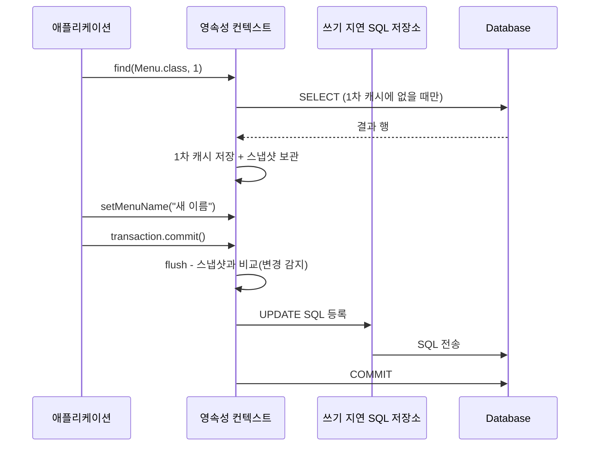
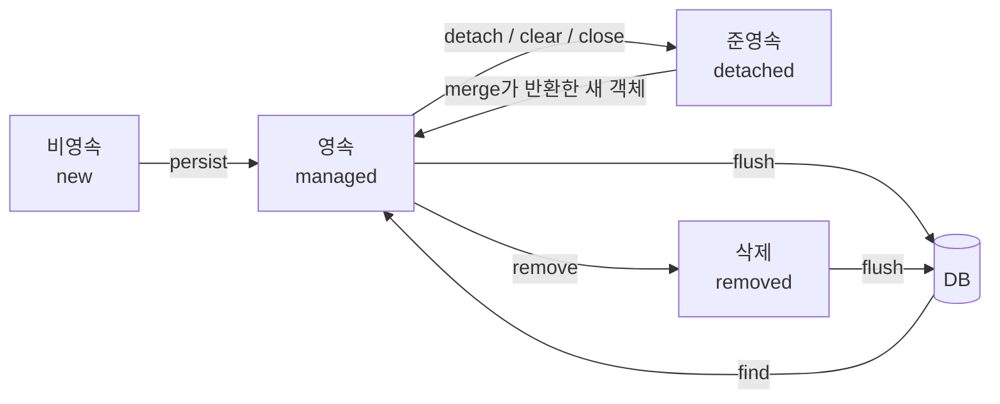
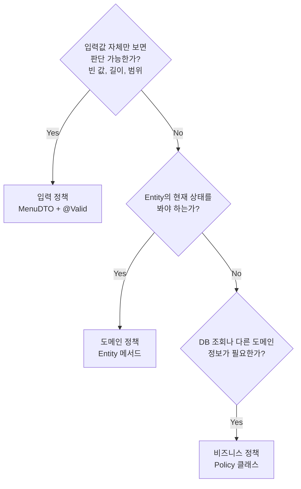

## 들어가며

지금까지 우리는 JDBC로 직접 SQL을 쓰고, `ResultSet`에서 값을 하나씩 꺼내 객체에 옮겨 담았습니다. 동작은 하지만, 조회 기능이 하나 늘 때마다 비슷한 코드가 복사되고, 요구사항이 바뀌면 SQL → DTO → 매핑 코드가 줄줄이 수정되어야 했죠.

이번 JPA 수업은 바로 이 불편함에서 출발합니다. 비유하자면 JDBC는 **직접 은행 창구에 가서 서류를 하나하나 작성하는 것**이고, JPA는 **유능한 비서에게 "이 객체 저장해 줘"라고 말하면 서류 작성부터 제출까지 알아서 해주는 것**입니다.

수업은 다음 순서로 진행되었습니다.

| 모듈 | 주제 | 핵심 키워드 |
|------|------|-------------|
| chap01-jpa-intro | JDBC의 문제점과 JPA의 해결 | ORM, 패러다임 불일치, 동일성 보장 |
| chap02-persistence-context | 엔티티 매니저와 영속성 컨텍스트 | `persist`, 쓰기 지연, 변경 감지, 생명주기 |
| chap03-entity-mapping | 엔티티 매핑 | `@Column` 속성, `@GeneratedValue`, `@Enumerated`, 계층 구조 |
| module07-jpa-mini-project | Spring Data JPA 미니 프로젝트 | `JpaRepository`, 쿼리 메서드, `@Query`, 검증, 정책 분리, 전역 예외 처리 |

## 1. chap01 — JDBC를 직접 쓰면 무엇이 불편할까?

### 1-1. JDBC의 네 가지 문제

수업에서는 먼저 JPA 없이 JDBC만으로 메뉴를 조회하면서 문제점을 직접 확인했습니다. `JdbcProblem` 클래스의 주석에 정리된 문제는 네 가지입니다.

**① 반복되는 JDBC 코드와 수작업 매핑**

수업 예제 코드:

```java
try (Connection con = dataSource.getConnection();
     Statement stmt = con.createStatement();
     ResultSet rset = stmt.executeQuery(query)) {

    while (rset.next()) {
        // 조회 결과(행) 1개를 객체 1개로 직접 옮겨 담는다.
        Menu menu = new Menu();
        menu.setMenuCode(rset.getInt("menu_code"));
        menu.setMenuName(rset.getString("menu_name"));
        menu.setMenuPrice(rset.getInt("menu_price"));
        menu.setCategoryCode(rset.getInt("category_code"));
        menu.setOrderableStatus(rset.getString("orderable_status"));
        menuList.add(menu);
    }
}
```

`try-with-resources` 덕분에 자원 반납은 자동이지만, Connection/Statement/ResultSet을 만드는 코드와 컬럼 → 필드 매핑 코드는 조회 기능마다 반복됩니다.

**② SQL에 의존적인 개발**

"메뉴 목록에 카테고리 이름도 보여주세요"라는 요구가 들어오면, SQL을 JOIN으로 바꾸고, 결과를 담을 `MenuCategoryDTO`를 새로 만들고, 매핑 코드도 다시 짜야 합니다. 수업 주석의 표현대로 **객체 중심이 아니라 SQL(테이블) 중심으로 개발**하게 되는 것이죠.

**③ 패러다임 불일치**

| 관점 | 1:N 관계를 표현하는 방법 |
|------|--------------------------|
| SQL (테이블) | `tbl_menu`가 `category_code`라는 **값(FK)** 을 가진다 |
| Java (객체) | `Menu`가 `Category` **객체를 필드로** 가진다 → `menu.getCategory()` |

테이블 구조에 맞춰 만든 `Menu`는 `categoryCode` 값만 있으므로, 카테고리 정보가 필요하면 그 값으로 SQL을 한 번 더 실행해 직접 조립해야 합니다.

**④ 동일성 보장 문제**

수업 예제 코드:

```java
Menu menu1 = findMenuByMenuCode(menuCode);
Menu menu2 = findMenuByMenuCode(menuCode);

System.out.println("menu1 == menu2 : " + (menu1 == menu2)); // false

menu1.setMenuName("이름 변경 테스트");
// menu2 는 변경 사실을 알 수 없다.
```

DB의 같은 행을 조회했는데도 서로 다른 객체가 만들어지기 때문에, 한쪽을 수정해도 다른 쪽은 그 사실을 모릅니다.

### 1-2. JPA로 해결하기

JPA는 **자바 진영의 ORM(Object Relational Mapping) 기술 표준**입니다. Java 객체와 DB 테이블을 매핑해 주고, 실제 구현체로는 Hibernate가 사용됩니다.

수업 예제 코드:

```java
@Entity                    // JPA 가 관리하는 객체라는 것을 명시
@Table(name = "tbl_menu")  // 매핑될 테이블 이름
public class Menu {

    @Id
    @Column(name = "menu_code")
    private int menuCode;

    @Column(name = "menu_name")
    private String menuName;

    // FK 값이 아닌 Category 객체를 필드로 가진다 → 패러다임 불일치 해결
    @ManyToOne
    @JoinColumn(name = "category_code")
    private Category category;
    // ...
}
```

```java
@PersistenceContext
private EntityManager manager;

public void findMenu(int menuCode) {
    // SQL 작성, JDBC 코드, 객체 매핑을 JPA 가 대신 처리한다.
    Menu foundMenu = manager.find(Menu.class, menuCode);
}

@Transactional(readOnly = true)
public void compareSameMenu(int menuCode) {
    Menu menu1 = manager.find(Menu.class, menuCode);
    Menu menu2 = manager.find(Menu.class, menuCode);
    System.out.println(menu1 == menu2); // true → 동일성 보장
}
```

JDBC의 문제를 JPA가 어떻게 해결하는지 한눈에 정리하면 다음과 같습니다.

| JDBC 문제 | JPA의 해결 |
|-----------|------------|
| JDBC 코드·매핑 반복 | `manager.find(Menu.class, pk)` 한 줄로 SQL 생성·실행·매핑 |
| SQL 의존 개발 | 엔티티 중심으로 개발, SQL은 JPA가 생성 |
| 패러다임 불일치 | `@ManyToOne`으로 객체 참조 → `menu.getCategory()` 탐색 가능 |
| 동일성 미보장 | 같은 트랜잭션 안에서 같은 PK는 항상 **같은 객체** 반환 |

> `@Transactional`을 메서드에 붙이면 메서드 시작 시 트랜잭션이 시작되고, 정상 종료 시 commit, 예외 발생 시 rollback이 자동으로 처리됩니다. `readOnly = true`는 조회 전용 트랜잭션입니다.

### 1-3. application.yaml 설정

수업 예제 코드 (접속 정보는 placeholder로 대체):

```yaml
spring:
  datasource:
    driver-class-name: com.mysql.cj.jdbc.Driver
    url: jdbc:mysql://localhost:3306/menudb
    username: <DB_USERNAME>
    password: <DB_PASSWORD>
  jpa:
    show-sql: true          # JPA 가 생성한 SQL 출력
    hibernate:
      ddl-auto: none        # 테이블 자동 생성 전략
    properties:
      hibernate:
        format_sql: true    # SQL 을 보기 좋게 포맷팅
```

`ddl-auto` 옵션은 수업 주석에 이렇게 정리되어 있었습니다.

| 값 | 동작 | 사용 상황 |
|----|------|-----------|
| `create` | 실행 시 테이블을 새로 생성 (기존 데이터 삭제) | 매핑 실습 (chap03) |
| `create-drop` | 실행 시 생성, 종료 시 삭제 | 테스트 |
| `update` | 변경된 엔티티 구조만 반영 | 개발 중 |
| `none` | 아무것도 하지 않음, 미리 실행한 DDL 스크립트 사용 | chap01·02, 미니 프로젝트 |

또 하나의 팁: 섹션마다 `@SpringBootApplication` 실행 클래스를 따로 두면, 해당 패키지 하위만 스캔하므로 이름이 같은 `Menu` 엔티티끼리 충돌하지 않습니다.

## 2. chap02 — 엔티티 매니저와 영속성 컨텍스트

### 2-1. 영속성 컨텍스트란?

**영속성 컨텍스트(Persistence Context)는 엔티티 객체를 관리하는 컨테이너**입니다. 우리는 `EntityManager`를 통해 엔티티를 넣고(persist), 꺼내고(find), 지웁니다(remove).

비유하자면 영속성 컨텍스트는 **DB 앞에 놓인 "작업 책상"** 입니다. 서류(엔티티)를 책상 위에 올려두고 수정하다가, 퇴근(commit) 직전에 변경분을 한꺼번에 DB라는 서류함에 반영하는 것이죠.

수업에서는 `EntityManagerFactory`로부터 **요청 1개당 EntityManager 1개**를 만들어 쓰는 방식을 연습했습니다. 엔티티 매니저는 스레드 간에 공유하면 안 되기 때문입니다.

### 2-2. EntityManager로 CRUD

수업 예제 코드:

```java
public void registMenu(Menu menu) {
    EntityManager manager = factory.createEntityManager();
    EntityTransaction transaction = manager.getTransaction();
    transaction.begin();   // DML 은 반드시 트랜잭션 안에서

    try {
        // INSERT 를 바로 보내지 않고 "쓰기 지연 SQL 저장소" 에 모아둔다.
        manager.persist(menu);
        // commit() 호출 시 flush 가 자동 실행된다.
        transaction.commit();
    } catch (Exception e) {
        transaction.rollback();
    } finally {
        manager.close();
    }
}
```

| 작업 | 메서드 | 핵심 포인트 |
|------|--------|-------------|
| 조회 | `find(엔티티타입, PK)` | 1차 캐시 → 없으면 DB SELECT |
| 등록 | `persist(엔티티)` | 쓰기 지연 저장소에 INSERT 등록, commit 시 전송 |
| 수정 | **별도 메서드 없음** | 값만 바꾸면 **변경 감지(Dirty Checking)** 가 UPDATE 생성 |
| 삭제 | `remove(엔티티)` | 영속 상태인 엔티티만 삭제 가능, commit 시 DELETE 전송 |

특히 수정이 흥미로운데요, 수업 주석을 정리하면 이렇습니다.

1. 영속성 컨텍스트는 엔티티를 처음 `find`하는 순간 **스냅샷**을 보관합니다.
2. commit 시점에 스냅샷과 현재 엔티티를 비교합니다.
3. 변경된 부분이 있으면 UPDATE SQL을 만들어 쓰기 지연 저장소에 등록하고 DB로 보냅니다.

수업 예제 코드:

```java
Menu foundMenu = manager.find(Menu.class, menuCode);
transaction.begin();
foundMenu.setMenuName(menuName);   // 값만 바꾼다. update() 같은 메서드는 없다.
transaction.commit();              // 이 시점에 UPDATE 실행
```



### 2-3. 엔티티의 생명주기

`EntityLifeCycle` 예제에서는 엔티티의 네 가지 상태를 하나씩 확인했습니다.

| 상태 | 설명 | 진입 방법 |
|------|------|-----------|
| 비영속 (new/transient) | 객체만 생성, 영속성 컨텍스트와 무관 | `new Menu()` |
| 영속 (managed) | 영속성 컨텍스트가 관리 | `persist()`, `find()`, `merge()` 반환값 |
| 준영속 (detached) | 관리되다가 분리됨, 변경 감지 X | `detach()`, `clear()`, `close()` |
| 삭제 (removed) | 삭제 예정 | `remove()` |



**비영속**: `find`로 가져온 엔티티와 값이 똑같은 객체를 `new`로 만들어도, `manager.contains(newMenu)`는 `false`입니다. 값이 같아도 관리 대상이 아니죠.

**영속**: 같은 PK로 두 번 `find`하면 두 번째는 SELECT 없이 **1차 캐시**에서 꺼내므로 `==` 비교가 `true`입니다.

**준영속과 flush**: 이 예제가 가장 중요했습니다.

수업 예제 코드:

```java
Menu foundMenu1 = manager.find(Menu.class, menuCode1);
Menu foundMenu2 = manager.find(Menu.class, menuCode2);

manager.detach(foundMenu2);   // foundMenu2 만 준영속으로

foundMenu1.setMenuPrice(foundMenu1.getMenuPrice() + 1000);
foundMenu2.setMenuPrice(foundMenu2.getMenuPrice() + 1000);

System.out.println("===== flush =====");
manager.flush();              // foundMenu1 의 UPDATE 만 실행된다.
transaction.rollback();       // 실습 데이터 보호
```

콘솔을 보면 가격 변경 코드가 먼저 실행되었는데도 UPDATE 구문은 `===== flush =====` **아래에** 찍힙니다(쓰기 지연). 그리고 두 메뉴를 모두 바꿨지만 영속 상태인 메뉴의 UPDATE만 나갑니다.

flush에 대해 수업에서 강조한 내용을 정리하면 다음과 같습니다.

| 질문 | 답 |
|------|----|
| flush란? | 영속성 컨텍스트의 변경 내용을 DB에 **SQL로 전달**하는 것 |
| 언제 일어나나? | `commit()` 시 자동, `flush()` 직접 호출, **JPQL 실행 직전** 자동 |
| 1차 캐시를 비우나? | 아니요. 캐시는 그대로 유지됩니다 |
| commit인가? | 아니요. 그래서 flush 후 rollback하면 전송된 SQL도 취소됩니다 |

**삭제 상태**: `remove()` 후 같은 PK로 `find`하면 `null`이 반환되고, DELETE 구문 역시 flush 시점에 나갑니다.

**merge**: 준영속 엔티티를 다시 관리하고 싶을 때 씁니다. 주의할 점은 **파라미터로 넘긴 객체가 영속 상태가 되는 게 아니라는 것**입니다.

1. 전달된 엔티티의 PK로 1차 캐시(없으면 DB)에서 영속 엔티티를 찾습니다.
2. 찾은 영속 엔티티에 준영속 엔티티의 값을 복사합니다.
3. 그 **영속 엔티티를 반환**합니다. (PK로 찾은 게 없으면 새 엔티티로 보고 INSERT)

그래서 예제에서 `detachMenu == mergedMenu`는 `false`, `contains(detachMenu)`는 `false`, `contains(mergedMenu)`는 `true`가 나옵니다.

## 3. chap03 — 엔티티 매핑

### 3-1. 컬럼 매핑과 PK 생성 전략

이번에는 `ddl-auto: create`로 두고, 엔티티 정의만으로 `tbl_member` 테이블이 생성되는 것을 확인했습니다.

수업 예제 코드:

```java
@Entity
@Table(name = "tbl_member")
public class Member {

    @Id
    @Column(name = "member_no")
    @GeneratedValue(strategy = GenerationType.IDENTITY)
    private int memberNo;

    @Column(name = "member_id", nullable = false,
            unique = true, columnDefinition = "varchar(10)")
    private String memberId;

    @Column(name = "address", length = 900)
    private String address;

    @Column(name = "enroll_date")
    private LocalDateTime enrollDate;

    @Column(name = "member_role")
    @Enumerated(EnumType.STRING)
    private MemberRole memberRole;

    @Column(name = "status", columnDefinition = "char(1) default 'Y'")
    private String status;
}
```

`@Column`의 주요 속성은 **JPA가 DDL을 생성할 때** 사용됩니다.

| 속성 | 의미 | 기본값 |
|------|------|--------|
| `name` | 매핑할 컬럼 이름 | 필드 이름 |
| `nullable` | `false`면 NOT NULL 제약조건 | `true` |
| `unique` | UNIQUE 제약조건 | `false` |
| `columnDefinition` | 자료형·기본값 등을 직접 작성 | - |
| `length` | 문자열 컬럼 길이 | 255 |

`@GeneratedValue` 전략도 비교했습니다.

| 전략 | 방식 | 쓰기 지연 |
|------|------|-----------|
| `IDENTITY` | DB에 위임 (MySQL `AUTO_INCREMENT`) | **X** — INSERT를 해야 PK를 알 수 있어 `persist()` 시점에 바로 INSERT |
| `SEQUENCE` | DB 시퀀스 객체 사용 (Oracle, PostgreSQL) | O — PK만 먼저 받고 INSERT는 flush 시점 |
| `TABLE` | 키 생성 전용 테이블 사용 | - |
| `AUTO` | DB에 맞춰 자동 선택 (기본값) | - |

날짜는 `LocalDate`(날짜만)와 `LocalDateTime`(날짜+시간)을 Hibernate가 자동 지원합니다.

### 3-2. Enum 매핑: ORDINAL vs STRING

수업 예제 코드:

```java
public enum MemberRole {
    // 우리 프로젝트에서 회원의 권한은 2개로 고정!
    ROLE_MEMBER, ROLE_ADMIN;
}
```

| 방식 | 저장 값 | 장점 | 단점 |
|------|---------|------|------|
| `EnumType.ORDINAL` | 0, 1, ... | 저장 공간이 작음 | 가독성 낮음, enum 순서 변경 시 데이터 의미가 뒤바뀜 |
| `EnumType.STRING` | `"ROLE_MEMBER"` | 가독성 좋고 순서 변경에 안전 | 저장 크기가 조금 큼 (큰 문제 아님) |

실무에서는 `STRING`을 권장합니다. 수업 주석에 따르면 Hibernate 6 + MySQL에서는 STRING 매핑 시 컬럼이 MySQL `enum(...)` 타입으로 생성되므로, varchar로 만들고 싶다면 `columnDefinition = "varchar(20)"`처럼 직접 지정합니다.

### 3-3. Controller → Service → Repository 계층

chap03에서는 JPA를 계층 구조 안에 넣어 봤습니다. JDBC 시절의 DAO를 Spring + JPA 환경에서는 **Repository**라고 부릅니다.

수업 예제 코드:

```java
@Repository
public class MemberRepository {
    @PersistenceContext
    private EntityManager manager;

    public void save(Member member) { manager.persist(member); }
    public Member findByMemberNo(int memberNo) { return manager.find(Member.class, memberNo); }
}

@Service
public class MemberService {
    @Transactional   // 시작 시 begin, 정상 종료 시 commit, 예외 시 rollback
    public int registMember(MemberRegistDTO dto) {
        Member member = new Member(dto.getMemberId(), /* ... */ dto.getStatus()); // DTO -> Entity
        memberRepository.save(member);
        return member.getMemberNo();
    }

    @Transactional(readOnly = true)  // 불필요한 변경 감지를 하지 않는다.
    public MemberRegistDTO findByMemberNo(int memberNo) { /* Entity -> DTO */ }
}
```

수업에서 정리한 Service의 책임은 ① 비즈니스 로직 작성, ② Repository 호출, ③ **트랜잭션 관리**입니다. 여러 로직 중 하나라도 실패하면 rollback되어야 하기 때문이죠. 주석에는 "Checked/Unchecked 예외의 `@Transactional` 동작"과 "트랜잭션 전파"가 블로그 키워드로 남아 있어, 아래 학습 개념에 포함했습니다.

## 4. module07 — Spring Data JPA 미니 프로젝트

마지막 모듈은 **레스토랑 메뉴 관리 웹 서비스**를 PRD(제품 요구사항 문서)를 보고 구현하는 미니 프로젝트였습니다. README의 첫 문장이 인상적이었는데, 좋은 PRD는 "무엇을 만들지"를 빠짐없이 정해 두어서 **코드는 그 내용을 옮겨 적는 일**이 된다는 것입니다.

### 4-1. PRD의 각 장이 코드 계층이 된다

| PRD 장 | 코드로 옮겨지는 곳 |
|--------|-------------------|
| 화면 설계 | `templates/**.html`, View 이름, Model 이름 |
| API 명세 | `MenuController` |
| 정책 정의 | DTO(입력) / Entity(도메인) / Policy(비즈니스) |
| 에러 정의 | `ErrorCode`, `GlobalExceptionHandler` |
| DB 설계 | Entity, Repository |
| 협업 계약 | 인터페이스 + Fake 구현체 |

### 4-2. JpaRepository와 쿼리 메서드

`JpaRepository`를 상속한 **인터페이스만 선언하면** 구현체는 Spring Data JPA가 만들어 줍니다. `findById`, `findAll`, `save`, `delete` 같은 기본 메서드를 바로 쓸 수 있죠.

수업 예제 코드:

```java
// JpaRepository<관리할 엔티티, @Id 컬럼의 타입>
@Repository
public interface MenuRepository extends JpaRepository<Menu, Integer> {

    // 쿼리 메서드 : 메서드 이름으로 조건/정렬을 표현
    List<Menu> findByMenuPriceGreaterThanOrderByMenuPrice(int menuPrice);

    boolean existsByMenuName(String menuName);

    boolean existsByMenuNameAndMenuCodeNot(String newMenuName, int menuCode);
}
```

`findByMenuPriceGreaterThanOrderByMenuPrice`는 이름만 읽어도 "가격이 입력값**보다 큰** 메뉴를 가격 순으로"라는 뜻이 드러납니다. 다만 조건이 많아지거나 JOIN이 필요하면 이름이 지나치게 길어지는데, 그럴 때 `@Query`를 씁니다.

수업 예제 코드:

```java
@Repository
public interface CategoryRepository extends JpaRepository<Category, Integer> {

    @Query(value = "select * from tbl_category m where ref_category_code is not null order by category_code",
           nativeQuery = true)
    List<Category> findSubCategory();
}
```

| 방식 | 작성 대상 | 장점 | 단점 |
|------|-----------|------|------|
| 쿼리 메서드 | 메서드 이름 | 조건이 적을 때 간결 | 조건·JOIN이 많으면 가독성 저하 |
| `@Query` JPQL (기본값) | **엔티티** 기준 SQL | DB 종류에 독립적 | JPQL 문법 학습 필요 |
| `@Query(nativeQuery = true)` | **실제 DB** SQL | 익숙한 SQL 그대로 | 특정 DB에 종속 |

Service에서는 `findById`가 `Optional`을 반환하는 점을 이용해, 없으면 바로 예외를 던집니다. 정렬은 `Sort.by`, Entity → DTO 변환은 stream과 메서드 참조로 처리했습니다.

수업 예제 코드:

```java
Menu foundMenu = menuRepository.findById(menuCode)
        .orElseThrow(() -> new BusinessException(ErrorCode.MENU_NOT_FOUND));

List<Menu> menuList = menuRepository.findAll(Sort.by("menuCode"));
return menuList.stream()
        .map(MenuDTO::from)   // menu -> MenuDTO.from(menu) 의 축약
        .toList();
```

### 4-3. Entity는 setter 대신 "이름 있는 메서드"로

미니 프로젝트의 `Menu` 엔티티는 setter가 없고, 전체 필드 생성자도 `private`입니다. Entity는 DB의 한 행이므로 아무 데서나 값을 바꾸지 못하게 막고, **정적 팩터리 메서드와 도메인 메서드**로만 생성·변경하게 했습니다.

수업 예제 코드:

```java
@NoArgsConstructor
@AllArgsConstructor(access = AccessLevel.PRIVATE)
@Getter
@Entity
@Table(name = "tbl_menu")
public class Menu {

    private static final String ON_SALE = "Y";   // 의미 없는 값에 이름 붙이기
    private static final String STOPPED = "N";

    @Id
    @Column(name = "menu_code")
    @GeneratedValue(strategy = GenerationType.IDENTITY)
    private int menuCode;
    // ... 생략

    public static Menu create(String menuName, int menuPrice, int categoryCode) {
        return new Menu(0, menuName, menuPrice, categoryCode, ON_SALE); // 신규 메뉴는 항상 판매중
    }

    public void stopSelling() {
        if (!isOnSale()) {
            throw new BusinessException(ErrorCode.ALREADY_STOPPED_MENU);
        }
        this.orderableStatus = STOPPED;
    }
}
```

이름 수정도 `changeMenuName()`만 호출하면 끝입니다. chap02에서 배운 **변경 감지** 덕분에 `save()`를 다시 부를 필요가 없죠.

수업 예제 코드:

```java
@Transactional
public void modifyMenuName(int menuCode, String menuName) {
    Menu foundMenu = menuRepository.findById(menuCode)
            .orElseThrow(() -> new BusinessException(ErrorCode.MENU_NOT_FOUND));
    foundMenu.changeMenuName(menuName);
    // 메서드 종료 → commit 직전 스냅샷 비교 → UPDATE 자동 실행
}
```

### 4-4. 정책은 "어디서 판단하는가"로 나눈다

이 프로젝트의 가장 큰 배움은 **규칙의 위치를 정하는 기준**이었습니다. PRD에는 다음 질문이 적혀 있습니다.



| 종류 | 예시 | 판단 위치 |
|------|------|-----------|
| 입력 | 메뉴 이름 필수·30자 이하, 가격 0원 이상 | `MenuDTO` (`@NotBlank`, `@Size`, `@Min`, `@Positive`) |
| 도메인 | 이미 판매중지된 메뉴는 다시 판매중지 불가, 판매중 메뉴는 삭제 불가 | `Menu.stopSelling()`, `Menu.validateDeletable()` |
| 비즈니스 | 메뉴 이름 중복 불가, 하위 카테고리에만 등록, 주문 이력 있으면 삭제 불가 | `MenuNamePolicy`, `MenuCategoryPolicy`, `MenuDeletionPolicy` |

Service 주석에는 Before/After가 함께 남아 있었습니다. Before에서는 Service 안에 if문이 쌓여서 ① 같은 중복 규칙이 등록·수정에 복사되고, ② `refCategoryCode == null` 같은 Category 내부 사정을 Service가 알아야 하며, ③ 정작 "흐름"이 묻혀 버리는 문제가 있었습니다. After에서는 Service가 **흐름만 조립**합니다.

수업 예제 코드:

```java
@Transactional
public int registNewMenu(MenuDTO registMenu) {
    // 1. 비즈니스 규칙 확인 (Policy 에게 위임)
    menuNamePolicy.validateNewName(registMenu.getMenuName());
    menuCategoryPolicy.validateRegistrable(registMenu.getCategoryCode());

    // 2. Entity 생성 (생성 규칙은 Entity 의 책임)
    Menu menu = Menu.create(registMenu.getMenuName(), registMenu.getMenuPrice(), registMenu.getCategoryCode());

    // 3. 영속성 컨텍스트에 persist
    menuRepository.save(menu);
    return menu.getMenuCode();
}

@Transactional
public void deleteMenu(int menuCode) {
    Menu found = menuRepository.findById(menuCode)
            .orElseThrow(() -> new BusinessException(ErrorCode.MENU_NOT_FOUND));
    found.validateDeletable();                     // 도메인 규칙 (자기 상태)
    menuDeletionPolicy.validateDeletable(menuCode); // 비즈니스 규칙 (다른 도메인)
    menuRepository.delete(found);
}
```

`MenuCategoryPolicy`도 `category.getRefCategoryCode() == null`을 직접 해석하지 않고 `category.isSubCategory()`에게 **물어봅니다**. 화면에서 하위 카테고리만 보여주더라도 서버가 반드시 다시 검사하는 이유는, 요청은 화면을 거치지 않고도 보낼 수 있기 때문입니다.

`MenuNamePolicy` 주석에는 한계점도 적혀 있었습니다. 두 사람이 동시에 같은 이름을 등록하면 "조회 → 저장" 사이의 간격 때문에 둘 다 통과할 수 있으므로, 운영 환경에서는 `menu_name`에 UNIQUE 제약조건까지 걸어야 합니다.

### 4-5. 다른 팀과의 계약: 인터페이스 + Fake

"주문 이력이 있는 메뉴는 삭제할 수 없다"는 규칙은 **Order 팀의 데이터**가 필요합니다. 그렇다고 Menu 팀이 Order 팀의 Repository를 직접 import하면, 이미 Order → Menu 의존이 있는 상황에서 순환 의존이 생깁니다.

해결책은 **필요한 쪽(Menu)이 인터페이스를 정의하고, 정보를 가진 쪽(Order)이 구현**하는 것입니다(의존성 역전).

수업 예제 코드:

```java
// Menu 팀이 정의한 계약
public interface MenuOrderHistoryChecker {
    boolean hasOrdered(int menuCode);
}

// Order 팀 구현 전까지 사용하는 Fake (1, 2, 3번 메뉴는 주문 이력 있음)
@Component
public class FakeMenuOrderHistoryChecker implements MenuOrderHistoryChecker {
    private static final Set<Integer> ORDERED_MENU_CODES = Set.of(1, 2, 3);

    @Override
    public boolean hasOrdered(int menuCode) {
        return ORDERED_MENU_CODES.contains(menuCode);
    }
}
```

Order 팀의 진짜 구현이 완성되면 Fake만 지우면 되고, `MenuDeletionPolicy`는 한 줄도 바뀌지 않습니다. 레고 블록의 **규격(인터페이스)만 맞추면 어떤 블록이든 끼울 수 있는 것**과 같습니다.

### 4-6. Controller, 검증, @ResponseBody

수업 예제 코드:

```java
@Controller
@RequiredArgsConstructor           // final 필드 생성자 자동 생성 → 생성자 주입
@RequestMapping("/menu/*")
public class MenuController {

    @GetMapping("/{menuCode}")      // URL 경로 값 → @PathVariable
    public ModelAndView findByMenuByPathVariable(@PathVariable int menuCode, ModelAndView mv) { ... }

    @GetMapping("/search")          // /search?menuPrice=1000 → @RequestParam
    public ModelAndView findByMenuPrice(@RequestParam
                                        @Min(value = 0, message = "가격은 0원 이상 입력!") int menuPrice,
                                        ModelAndView mv) { ... }

    @GetMapping("/category")
    @ResponseBody                   // View 가 아닌 데이터(JSON) 를 반환
    public List<CategoryDTO> findCategoryList() {
        return menuService.findSubCategories();
    }

    @PostMapping("/regist")
    public ModelAndView registMenu(@Valid @ModelAttribute MenuDTO registMenu, ModelAndView mv) {
        int menuCode = menuService.registNewMenu(registMenu);
        mv.setViewName("redirect:/menu/" + menuCode);   // PRG 패턴
        return mv;
    }
}
```

몇 가지 포인트를 정리하면 다음과 같습니다.

- **프론트 검증만으로는 부족합니다.** URL이나 body를 조작하면 JS 검증은 우회되므로 백엔드 검증이 필수입니다. DTO에 검증 어노테이션을 달고, `@Valid`를 붙여야 실제로 검사가 실행됩니다.
- **`@ResponseBody`** 는 Controller의 "View 반환" 책임을 없애고 데이터만 응답하게 합니다. 등록 화면은 `fetch('/menu/category')`로 이 JSON을 비동기로 받아 `<select>`의 옵션을 채웁니다.
- 등록·수정·삭제 후에는 **redirect**합니다(PRG 패턴). 새로고침해도 POST 요청이 반복되지 않게 하기 위해서입니다.

### 4-7. 전역 예외 처리

Controller와 Service에는 try-catch를 쓰지 않습니다. 규칙을 어기면 `BusinessException(ErrorCode.XXX)`을 던지기만 하고, 화면 처리는 `@ControllerAdvice`가 맡습니다.

수업 예제 코드:

```java
@Getter
@RequiredArgsConstructor
public enum ErrorCode {
    MENU_NOT_FOUND(HttpStatus.NOT_FOUND, "메뉴를 찾을 수 없습니다."),
    ALREADY_STOPPED_MENU(HttpStatus.CONFLICT, "이미 판매중지된 메뉴입니다."),
    DUPLICATE_MENU_NAME(HttpStatus.CONFLICT, "이미 존재하는 메뉴 이름입니다."),
    // ...
    ;
    private final HttpStatus status;
    private final String message;
}

@Slf4j
@ControllerAdvice
public class GlobalExceptionHandler {

    @ExceptionHandler(BusinessException.class)
    public ModelAndView handleBusinessException(BusinessException e) {
        return errorPage(e.getErrorCode().getStatus(), e.getMessage());
    }

    @ExceptionHandler(Exception.class)
    public ModelAndView handleException(Exception e) {
        log.error("예상하지 못한 오류 발생", e);   // 원인은 로그로, 화면엔 내부 정보 숨김
        return errorPage(HttpStatus.INTERNAL_SERVER_ERROR, "일시적인 오류가 발생했습니다. 잠시 후 다시 시도해주세요.");
    }
}
```

`BusinessException`은 `RuntimeException`(unchecked)이므로 `throws` 선언 없이 전파되고, `@Transactional` 메서드 안에서 발생하면 롤백됩니다.

| 상황 | 예외 | 상태 |
|------|------|------|
| 도메인/비즈니스 규칙 위반 | `BusinessException` | ErrorCode의 상태 |
| `@Valid` DTO 검증 실패, 숫자 칸에 문자 | `BindException` | 400 |
| `@RequestParam`에 붙인 `@Min` 등 실패 | `HandlerMethodValidationException` | 400 |
| 필수 파라미터 누락, `/menu/abc` | `MissingServletRequestParameterException`, `MethodArgumentTypeMismatchException` | 400 |
| 정책이 못 막은 DB 제약조건 위반 | `DataIntegrityViolationException` | 409 |
| 없는 URL | `NoResourceFoundException` | 404 |
| 그 외 | `Exception` | 500 |

`NoResourceFoundException` 핸들러가 없으면 마지막 `Exception` 핸들러가 잡아서 404가 아니라 500이 된다는 점도 주석에서 짚고 있었습니다.

### 4-8. 설정 클래스 분리

실행 클래스가 `global.config` 패키지에 있어 기본 스캔 범위가 좁기 때문에, 스캔 설정을 따로 분리했습니다.

수업 예제 코드:

```java
@Configuration
@ComponentScan(basePackages = "com.wanted.project")      // 일반 Bean 스캔
public class ContextConfig { }

@Configuration
@EnableJpaRepositories(basePackages = "com.wanted.project") // Repository 스캔
@EntityScan(basePackages = "com.wanted.project")            // Entity 스캔
public class JpaConfig { }
```

이 외에 `spring-boot-starter-validation`(검증), `spring-boot-devtools`(코드 변경 시 자동 재시작) 의존성도 추가했습니다.

## 정리

| 단계 | 배운 것 | 한 줄 요약 |
|------|---------|-----------|
| chap01 | JDBC 4대 문제와 JPA | SQL·매핑은 JPA에게, 우리는 객체에 집중 |
| chap02 | 영속성 컨텍스트 | 1차 캐시, 쓰기 지연, 변경 감지, 생명주기, flush, merge |
| chap03 | 엔티티 매핑 | `@Column` 속성, PK 전략, Enum은 STRING, 계층별 책임 |
| module07 | Spring Data JPA 실전 | 인터페이스만으로 Repository, 규칙은 DTO/Entity/Policy로 분리 |

돌이켜 보면 수업의 흐름은 "JPA가 무엇을 대신해 주는가"에서 시작해 "그렇다면 우리 코드는 어떤 책임만 남겨야 하는가"로 끝났습니다. 영속성 컨텍스트의 변경 감지를 이해하면 `save()` 없이도 수정이 되는 이유가 보이고, 그 덕분에 Entity에 setter 대신 의미 있는 도메인 메서드를 둘 수 있게 됩니다.

## 더 학습하면 좋은 개념

- **트랜잭션 전파(Propagation)와 롤백 규칙** — `@Transactional`은 기본적으로 unchecked 예외에서만 롤백합니다. 수업 주석에 남은 "Checked/Unchecked 예외의 동작", "전파" 키워드를 이해해야 Service 간 호출에서 의도치 않은 커밋을 막을 수 있습니다.
- **연관관계 매핑과 지연 로딩(LAZY)** — chap01에서 `@ManyToOne`을 맛봤는데, 양방향 매핑과 `FetchType.LAZY`를 알아야 실제 도메인 모델을 객체 그래프로 다룰 수 있습니다.
- **N+1 문제와 fetch join** — 연관 엔티티를 조회할 때 쿼리가 폭증하는 대표적인 JPA 성능 문제로, 연관관계를 쓰기 시작하면 반드시 만나게 됩니다.
- **JPQL과 Criteria/Querydsl** — 쿼리 메서드와 native query 사이에서, 엔티티 기준으로 타입 안전하게 동적 쿼리를 작성하는 방법입니다.
- **낙관적 락(@Version)** — 미니 프로젝트의 "동시에 같은 이름 등록" 한계처럼, 동시성 문제를 JPA 차원에서 다루는 방법입니다.

## 참고 자료

- [Spring Data JPA 공식 문서](https://docs.spring.io/spring-data/jpa/reference/)
- [Spring Data JPA - Query Methods](https://docs.spring.io/spring-data/jpa/reference/jpa/query-methods.html)
- [Spring Framework - Transaction Management](https://docs.spring.io/spring-framework/reference/data-access/transaction.html)
- [Hibernate ORM 공식 문서](https://hibernate.org/orm/documentation/)
- [Jakarta Persistence 명세](https://jakarta.ee/specifications/persistence/)
- [Spring Boot - Validation](https://docs.spring.io/spring-boot/reference/io/validation.html)
