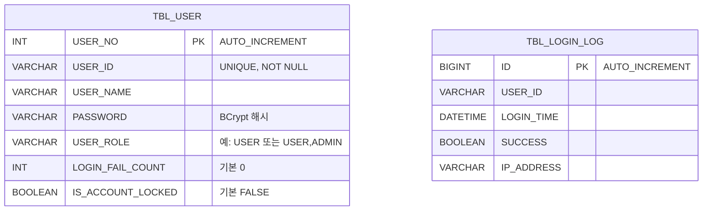
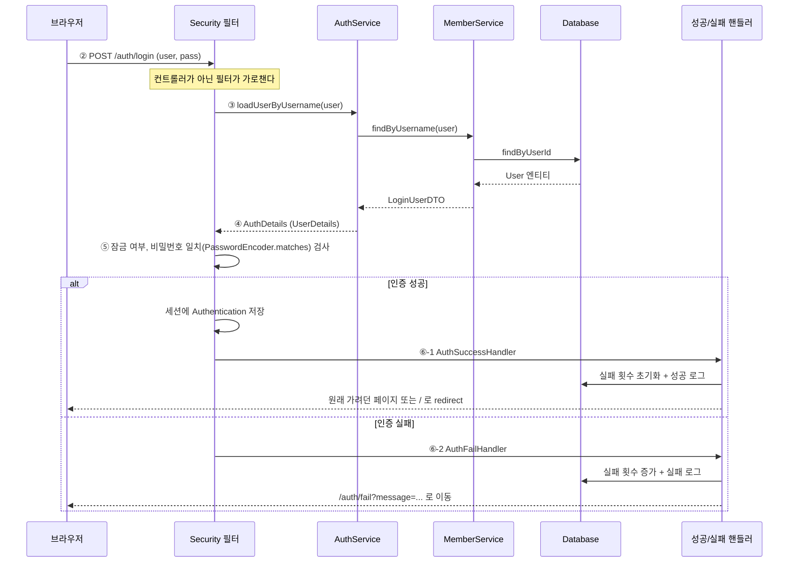
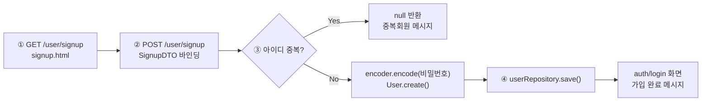
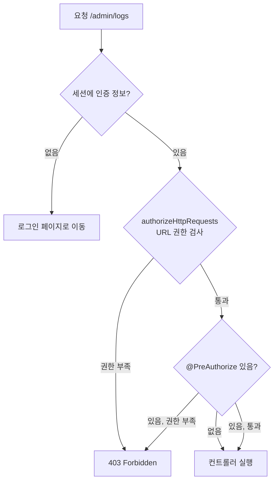

## 들어가며

웹 서비스에서 "누가 들어왔는지 확인하고(인증), 그 사람이 무엇을 할 수 있는지 정하는 것(인가)"은 빠질 수 없는 기능입니다. 직접 구현하려면 비밀번호 암호화, 세션 관리, 페이지별 접근 제어, 로그아웃 처리까지 신경 쓸 게 정말 많죠.

**Spring Security**는 이 일을 대신 맡아주는 프레임워크입니다. 비유하자면 건물 입구의 **보안 게이트**입니다. 방문자(요청)는 사무실(컨트롤러)에 도착하기 전에 반드시 게이트를 통과해야 하고, 게이트는 출입증(세션)을 확인하고 층별 출입 권한(ADMIN, USER)을 검사합니다.

이번 수업(`module01-security-session`)에서는 JPA 미니 프로젝트에서 익힌 Entity/Repository/Service 구조 위에 Spring Security를 얹어 **세션 기반 로그인 시스템**을 만들었습니다.

| 기능 | 담당 클래스 |
|------|-------------|
| 보안 규칙 설정 | `SecurityConfig` |
| 회원가입 (비밀번호 암호화) | `UserController`, `MemberService`, `User` |
| 로그인 시 회원 조회 | `AuthService` (`UserDetailsService` 구현) |
| 로그인 사용자 정보 표현 | `AuthDetails` (`UserDetails` 구현) |
| 로그인 성공/실패 후처리 | `AuthSuccessHandler`, `AuthFailHandler` |
| 관리자 로그 조회, 활성 사용자 수 | `AdminController`, `SessionRegistry` |
| 화면에서 권한별 표시 | Thymeleaf + `thymeleaf-extras-springsecurity6` |

## 1. 의존성과 DB 준비

수업 예제 코드:

```groovy
dependencies {
    implementation 'org.springframework.boot:spring-boot-starter-data-jpa'
    // Spring 에서 제공하는 인증/인가 기능을 사용하기 위한 의존성
    implementation 'org.springframework.boot:spring-boot-starter-security'
    implementation 'org.springframework.boot:spring-boot-starter-thymeleaf'
    implementation 'org.springframework.boot:spring-boot-starter-web'
    // Thymeleaf 에서 sec: 문법을 쓰기 위한 확장 의존성
    implementation 'org.thymeleaf.extras:thymeleaf-extras-springsecurity6'
    testImplementation 'org.springframework.security:spring-security-test'
}
```

`starter-security`를 추가하는 순간, 아무 설정을 하지 않아도 모든 요청이 막히고 기본 로그인 페이지가 나타납니다. 그래서 우리가 할 일은 "막는 것"이 아니라 **"어디를 누구에게 열어줄지"를 설정하는 것**입니다.

테이블은 `ddl-auto: none`으로 두고 SQL 스크립트로 직접 만들었습니다. 회원 테이블에는 로그인 실패 횟수와 잠금 여부 컬럼이 있고, 로그인 이력을 남길 로그 테이블도 따로 있습니다.



## 2. 전체 흐름 지도

`SecurityConfig` 상단 주석에는 회원가입·로그인·로그아웃 전체 흐름이 번호로 정리되어 있었고, 각 클래스 주석에 같은 번호(`[로그인 ③]` 등)가 붙어 있어 따라 읽기 좋았습니다. 가장 중요한 로그인 흐름을 다이어그램으로 옮겨 보면 이렇습니다.



핵심은 **`POST /auth/login`을 처리하는 컨트롤러를 우리가 만들지 않는다**는 점입니다. `AuthController`에는 로그인 **화면**을 보여주는 GET 메서드만 있고, 폼이 POST로 전송되면 Security 필터가 가로채서 처리합니다. 우리는 "회원 조회 방법(③)"과 "성공/실패 후처리(⑥)"만 끼워 넣는 셈이죠.

## 3. SecurityConfig — 보안 규칙 한곳에 모으기

### 3-1. 기본 Bean들

수업 예제 코드:

```java
@Configuration
@EnableWebSecurity
public class SecurityConfig {

    @Bean
    public PasswordEncoder passwordEncoder() {
        return new BCryptPasswordEncoder();
    }

    @Bean
    public HttpSessionEventPublisher httpSessionEventPublisher() {
        return new HttpSessionEventPublisher();
    }

    @Bean
    public SessionRegistry sessionRegistry() {
        return new SessionRegistryImpl();
    }

    // 정적 리소스(css, js, image 등)는 Security 검사에서 제외
    @Bean
    public WebSecurityCustomizer webSecurityCustomizer() {
        return web -> web.ignoring().requestMatchers(PathRequest.toStaticResources().atCommonLocations());
    }
}
```

**왜 BCrypt일까요?** 수업 주석에 정리된 이유는 다음과 같습니다.

| 이유 | 설명 |
|------|------|
| 보안성 | 해시마다 **무작위 솔트**를 적용 → 같은 비밀번호도 매번 다른 해시 |
| 비용 조절 | 강도(cost) 값으로 해시 생성 시간을 늘려 무차별 대입 공격을 어렵게 함 |
| 호환성 | 결과가 문자열이라 DB에 저장하기 쉬움 |
| 신뢰성 | 오랫동안 검증·평가된 알고리즘 |

`HttpSessionEventPublisher`와 `SessionRegistry`는 짝입니다. 세션이 생성·소멸될 때 Publisher가 이벤트를 알리면 Registry가 활성 세션 목록을 정확히 유지합니다. 이 목록은 뒤에서 **동시 접속 제한**과 **관리자 페이지의 활성 사용자 수**에 쓰입니다.

### 3-2. SecurityFilterChain

`SecurityFilterChain`은 **모든 요청이 컨트롤러에 도착하기 전에 거치는 보안 규칙 모음**입니다. 수업에서 별 다섯 개를 붙인 부분이죠.

수업 예제 코드 (Remember Me key는 placeholder로 대체):

```java
@Bean
public SecurityFilterChain configure(HttpSecurity http,
                                     AuthFailHandler authFailHandler,
                                     AuthSuccessHandler authSuccessHandler,
                                     SessionRegistry sessionRegistry) throws Exception {

    /* 1. 요청 별 접근 권한 (위에서부터 순서대로 검사) */
    http.authorizeHttpRequests(auth -> {
        auth.requestMatchers("/auth/login", "/user/signup", "/auth/fail", "/").permitAll();
        auth.requestMatchers("/admin/*").hasAnyAuthority("ADMIN");
        auth.requestMatchers("/user/*").hasAnyAuthority("USER", "ADMIN");
        auth.anyRequest().authenticated();   // 나머지는 로그인만 하면 가능
    })
    /* 2. 로그인 */
    .formLogin(login -> {
        login.loginPage("/auth/login");       // GET 로그인 화면 경로
        login.usernameParameter("user");      // input name 과 일치
        login.passwordParameter("pass");
        login.successHandler(authSuccessHandler);
        login.failureHandler(authFailHandler);
    })
    /* 3. Remember Me */
    .rememberMe(rememberMe -> {
        rememberMe.rememberMeParameter("remember-me");
        rememberMe.tokenValiditySeconds(86400);   // 24시간
        rememberMe.key("<REMEMBER_ME_KEY>");      // 토큰 생성용 Key
    })
    /* 4. 로그아웃 */
    .logout(logout -> {
        logout.logoutUrl("/auth/logout");
        logout.deleteCookies("JSESSIONID");
        logout.deleteCookies("remember-me");
        logout.invalidateHttpSession(true);
        logout.logoutSuccessUrl("/");
    })
    /* 5. 세션 */
    .sessionManagement(session -> {
        session.maximumSessions(1).sessionRegistry(sessionRegistry); // 계정당 동시 접속 1개
        session.invalidSessionUrl("/");
    })
    /* 6. CSRF (학습 목적으로 비활성화) */
    .csrf(csrf -> csrf.disable());

    return http.build();
}
```

각 설정을 표로 정리하면 다음과 같습니다.

| 설정 | 역할 | 주의할 점 |
|------|------|-----------|
| `authorizeHttpRequests` | URL별 접근 권한 | **위에서부터 순서대로** 매칭되므로 구체적인 규칙을 먼저, `anyRequest()`는 마지막에 |
| `formLogin` | 폼 로그인 처리 | `usernameParameter`/`passwordParameter`는 `login.html`의 `name`과 반드시 같아야 함 |
| `rememberMe` | 브라우저를 껐다 켜도 로그인 유지 | 체크박스 `name="remember-me"`와 일치, key는 실제 서비스에서 외부 설정으로 관리 |
| `logout` | 로그아웃도 컨트롤러 없이 처리 | 세션 무효화 + `JSESSIONID`, `remember-me` 쿠키 삭제 |
| `sessionManagement` | 동시 세션 수 제한 | `SessionRegistry` 연결 |
| `csrf` | CSRF 공격 방어 | 수업에서는 비활성화, **운영 환경에서는 반드시 활성화** |

권한 검사 메서드의 의미도 짚고 넘어가겠습니다.

| 메서드 | 의미 |
|--------|------|
| `permitAll()` | 누구나 접근 (비로그인 포함) |
| `authenticated()` | 로그인(인증)만 되어 있으면 접근 |
| `hasAnyAuthority("USER", "ADMIN")` | 나열한 권한 중 하나라도 있으면 접근 |

### 3-3. CSRF는 왜 끄면 안 될까?

수업 주석에서 CSRF(Cross-Site Request Forgery)를 이렇게 설명합니다. 사용자가 은행 사이트에 로그인한 상태에서 공격자의 악성 사이트를 방문하면, 그 사이트가 몰래 송금 요청을 보낼 수 있습니다. 브라우저는 은행 사이트로 가는 요청에 **세션 쿠키를 자동으로 실어 보내기** 때문이죠.

| 인증 방식 | CSRF 보호 |
|-----------|-----------|
| 세션 기반 (쿠키 자동 전송) | **필수** |
| JWT 토큰 기반 (Stateless) | 불필요한 경우가 많음 |

이번 수업은 학습 편의를 위해 껐지만, 세션 방식을 쓰는 실제 서비스라면 반드시 켜야 합니다.

## 4. 회원가입 — 비밀번호는 절대 그대로 저장하지 않는다



수업 예제 코드:

```java
@Transactional
public Integer regist(SignupDTO signupDTO) {

    // 중복 아이디 체크 -> 중복이면 null 반환
    if (userRepository.existsByUserId(signupDTO.getUserId())) {
        return null;
    }

    try {
        // 비밀번호는 절대 그대로 저장하지 않는다! 암호화 된 값으로 Entity 를 만든다.
        User user = User.create(
                signupDTO.getUserId(),
                signupDTO.getUserName(),
                encoder.encode(signupDTO.getUserPass()),   // BCrypt 적용
                signupDTO.getRole()
        );
        return userRepository.save(user).getUserCode();
    } catch (Exception e) {
        e.printStackTrace();
        return 0;   // 서버 오류
    }
}
```

`UserController`는 반환값으로 결과를 구분합니다. `null`이면 중복 아이디, `0`이면 서버 오류, 1 이상이면 가입 성공(생성된 회원 번호)입니다.

`User` 엔티티는 JPA 미니 프로젝트의 `Menu`처럼 전체 필드 생성자를 `private`으로 막고 **정적 팩토리 메서드**로만 만들 수 있게 했습니다.

수업 예제 코드:

```java
@AllArgsConstructor(access = AccessLevel.PRIVATE)
@Entity
@Table(name = "TBL_USER",
       uniqueConstraints = { @UniqueConstraint(name = "uk_user_id", columnNames = "USER_ID") })
public class User {
    // ... 필드 생략

    // password 는 반드시 "암호화 된 값" 을 전달 받는다.
    public static User create(String userId, String userName, String encodedPassword, String userRole) {
        return new User(null, userId, userName, encodedPassword, userRole, 0, false);
    }

    public void increaseLoginFailCount() {
        this.loginFailCount++;
        if (this.loginFailCount >= 5) {
            this.isAccountLocked = true;   // 5회 실패 시 계정 잠금
        }
    }

    public void resetLoginFailCount() {
        this.loginFailCount = 0;
    }
}
```

`build.gradle` 주석을 보면 이전에는 ModelMapper로 Entity와 DTO를 변환했지만, 이번에는 `LoginUserDTO.from(user)`(Entity → DTO), `User.create(...)`(DTO → Entity) 같은 **정적 팩토리 메서드로 바꿨다**는 점도 눈여겨볼 만합니다. 변환 규칙이 코드에 그대로 드러나서 추적하기 쉽습니다.

## 5. 로그인 — UserDetailsService와 UserDetails

### 5-1. AuthService: "이 아이디의 회원 정보를 가져와줘"

Security는 로그인 요청이 오면 `UserDetailsService.loadUserByUsername()`을 호출합니다. 우리는 **회원을 조회만** 하고, 비밀번호 비교는 Security가 직접 합니다.

수업 예제 코드:

```java
@Service
@RequiredArgsConstructor
public class AuthService implements UserDetailsService {

    private final MemberService memberService;

    @Override
    public UserDetails loadUserByUsername(String username) throws UsernameNotFoundException {

        LoginUserDTO loginUser = memberService.findByUsername(username);

        if (Objects.isNull(loginUser)) {
            throw new UsernameNotFoundException("회원정보가 존재하지 않습니다!");
        }

        // return 되는 객체가 곧 Session 에 저장되는 객체!
        return new AuthDetails(loginUser);
    }
}
```

`MemberService.findByUsername()`은 `Optional`을 활용해 짧게 작성했습니다.

수업 예제 코드:

```java
public LoginUserDTO findByUsername(String username) {
    return userRepository.findByUserId(username)
                         .map(LoginUserDTO::from)   // user -> LoginUserDTO.from(user)
                         .orElse(null);
}
```

### 5-2. AuthDetails: 우리 회원을 Security의 언어로 번역

`AuthDetails`는 우리가 만든 `LoginUserDTO`를 Security가 이해하는 `UserDetails` 형태로 **감싸는 어댑터**입니다. 여행 비유로 말하면, 우리나라 신분증(LoginUserDTO)을 공항 보안 검색대가 읽을 수 있는 **여권 형식(UserDetails)** 으로 바꿔주는 역할입니다.

수업 예제 코드:

```java
public class AuthDetails implements UserDetails {

    private LoginUserDTO loginUserDTO;

    @Override
    public Collection<? extends GrantedAuthority> getAuthorities() {
        // 다중 권한 때문에 반환 타입이 Collection 이다.
        Collection<GrantedAuthority> authorities = new ArrayList<>();
        // GrantedAuthority 는 메서드가 1개인 인터페이스 -> 람다로 생성
        loginUserDTO.getRole().forEach(role -> authorities.add(() -> role));
        return authorities;
    }

    @Override
    public String getPassword() { return loginUserDTO.getPassword(); }

    @Override
    public String getUsername() { return loginUserDTO.getUserId(); }

    @Override
    public boolean isAccountNonLocked() {
        return !loginUserDTO.isAccountLocked();   // 잠긴 계정이면 false
    }
    // isAccountNonExpired, isCredentialsNonExpired, isEnabled 는 true
}
```

`LoginUserDTO.getRole()`은 `"USER,ADMIN"` 같은 문자열을 쉼표로 나눠 `["USER", "ADMIN"]` 리스트로 바꿔 줍니다. 그래서 한 사용자가 여러 권한을 가질 수 있습니다.

Security가 로그인 가능 여부를 판단할 때 사용하는 메서드는 다음과 같습니다.

| 메서드 | 의미 | 이번 수업 |
|--------|------|-----------|
| `getPassword()` | 입력값과 비교할 DB 비밀번호(해시) | DTO의 비밀번호 |
| `getAuthorities()` | `hasAnyAuthority` 검사용 권한 목록 | `USER_ROLE` 분리 |
| `isAccountNonExpired()` | 계정 만료 여부 | `true` |
| `isAccountNonLocked()` | 계정 잠금 여부 | **DB 값으로 판단** |
| `isCredentialsNonExpired()` | 비밀번호 만료 여부 | `true` |
| `isEnabled()` | 계정 활성화 여부 (탈퇴 등) | `true` |

### 5-3. equals/hashCode가 왜 필요할까? (실습 과제)

`AuthDetails` 주석에는 equals/hashCode 오버라이딩이 TODO 과제로 남아 있었습니다. 이유가 흥미롭습니다. `SessionRegistry`는 내부적으로 Map으로 사용자를 관리하는데, 같은 사용자라도 로그인할 때마다 **새 AuthDetails 객체**가 생기므로 기본 `Object.equals()`(주소 비교)를 쓰면 서로 다른 사용자로 인식됩니다. 그러면 `maximumSessions(1)` 동시 접속 제한과 활성 사용자 수 계산이 틀어지죠.

주석의 안내(userId 기준, `Objects.hash` 활용)를 따르면 대략 이런 형태가 됩니다.

예시 코드 (수업 TODO를 바탕으로 작성):

```java
@Override
public boolean equals(Object o) {
    if (this == o) return true;
    if (!(o instanceof AuthDetails that)) return false;
    return Objects.equals(getUsername(), that.getUsername());
}

@Override
public int hashCode() {
    return Objects.hash(getUsername());   // equals 와 "같은 기준"
}
```

equals와 hashCode는 반드시 **같은 기준으로 함께** 오버라이딩해야 한다는 점이 핵심입니다.

## 6. 로그인 성공·실패 핸들러

두 핸들러 모두 인터페이스를 직접 구현하지 않고, 이미 기본 동작(페이지 이동)이 구현된 `SimpleUrl...Handler`를 **상속**해서 필요한 기능만 덧붙였습니다.

| | 성공 핸들러 | 실패 핸들러 |
|---|---|---|
| 부모 클래스 | `SimpleUrlAuthenticationSuccessHandler` | `SimpleUrlAuthenticationFailureHandler` |
| 사용자 아이디 얻는 법 | `authentication.getName()` | 인증 객체가 없으므로 `request.getParameter("user")` |
| 추가 기능 | 실패 횟수 초기화 + 성공 로그 | 실패 횟수 증가(5회 시 잠금) + 실패 로그 |
| 이동 | 원래 가려던 페이지, 없으면 `/` | `/auth/fail?message=...` |

### 6-1. 성공 핸들러

수업 예제 코드:

```java
@Override
public void onAuthenticationSuccess(HttpServletRequest request, HttpServletResponse response,
                                    Authentication authentication) throws IOException, ServletException {

    String username = authentication.getName();

    memberService.resetLoginFailCount(username);   // 4번 실패 후 성공하면 0 으로 리셋

    LoginLog log = LoginLog.create(username, true, request.getRemoteAddr()); // 접속 IP
    loginLogRepository.save(log);

    // 로그인 전에 가려던 페이지가 있으면 그 페이지로, 없으면 "/" 로
    super.onAuthenticationSuccess(request, response, authentication);
}
```

### 6-2. 실패 핸들러: 예외 타입으로 원인 구분

실패 원인은 `exception`의 **타입**으로 구분합니다.

수업 예제 코드:

```java
String username = request.getParameter("user");

if (exception instanceof BadCredentialsException) {
    errorMessage = "아이디가 존재하지 않거나 비밀번호가 일치하지 않습니다.";
    if (username != null && !username.isEmpty()) {
        memberService.incrementLoginFailCount(username);
    }
} else if (exception instanceof LockedException) {
    errorMessage = "계정이 잠겨있습니다. 관리자에게 문의하세요.";
} else if (exception instanceof InternalAuthenticationServiceException) {
    errorMessage = "서버에서 오류가 발생되었습니다.";
} else if (exception instanceof UsernameNotFoundException) {
    errorMessage = "존재하지 않는 아이디입니다.";
} else if (exception instanceof AuthenticationCredentialsNotFoundException) {
    errorMessage = "인증 요청이 거부되었습니다.";
} else {
    errorMessage = "알 수 없는 오류로 로그인 요청을 처리할 수 없습니다.";
}

loginLogRepository.save(LoginLog.create(username, false, request.getRemoteAddr()));

// URL 에 한글을 그대로 넣을 수 없으므로 인코딩
errorMessage = URLEncoder.encode(errorMessage, "UTF-8");
setDefaultFailureUrl("/auth/fail?message=" + errorMessage);
super.onAuthenticationFailure(request, response, exception);
```

| 예외 | 발생 상황 |
|------|-----------|
| `BadCredentialsException` | 아이디가 없거나 비밀번호 불일치 |
| `LockedException` | `isAccountNonLocked()`가 `false` (5회 이상 실패) |
| `InternalAuthenticationServiceException` | 사용자 정보 검증 중 서버 오류 |
| `UsernameNotFoundException` | `AuthService`에서 던진 예외 |
| `AuthenticationCredentialsNotFoundException` | 인증 정보 없이 보안 리소스 접근 |

**"아이디가 없거나 비밀번호가 틀렸다"를 한 문장으로 뭉뚱그리는 이유**도 생각해 볼 만합니다. 둘을 구분해서 알려주면 공격자가 "이 아이디는 존재한다"는 정보를 얻을 수 있기 때문입니다.

### 6-3. 변경 감지로 실패 횟수 업데이트

실패 횟수 증가에는 JPA 수업의 **변경 감지**가 그대로 쓰였습니다.

수업 예제 코드:

```java
@Transactional
public void incrementLoginFailCount(String username) {
    userRepository.findByUserId(username)
                  .ifPresent(User::increaseLoginFailCount);   // 회원이 있을 때만
    // save() 호출 없이, 커밋 시 dirty checking 으로 UPDATE 실행
}
```

값 변경은 Entity의 도메인 메서드가, UPDATE는 변경 감지가 처리하니 Service는 흐름만 남습니다.

## 7. 인가 — URL 방식과 메서드 방식

로그인 이후 요청은 세션(`JSESSIONID`)으로 사용자를 확인하고, 권한을 검사한 뒤 컨트롤러로 보내집니다.



`IndexController`에서는 두 방식을 비교했습니다.

수업 예제 코드:

```java
// [방법 1] URL 단위 - SecurityConfig 의 "/admin/*" 규칙이 컨트롤러보다 먼저 검사
@GetMapping("/admin/page")
public String admin() { return "admin/admin"; }

// [방법 2] 메서드 단위 - "/method/*" 는 anyRequest().authenticated() 로 로그인만 하면 통과하지만,
// 메서드에 붙은 @PreAuthorize 가 실행 직전에 한 번 더 검사한다.
@GetMapping("/method/admin")
// TODO @PreAuthorize 로 ADMIN 만 호출 가능하도록 막아보자.
@ResponseBody
public String methodAdmin() {
    return "ADMIN 권한 확인 완료! (@PreAuthorize 통과)";
}
```

메서드 방식은 실습 과제로 남아 있었는데, 주석 안내대로라면 `SecurityConfig`에 `@EnableMethodSecurity`를 붙이고 핸들러에 `@PreAuthorize`를 다는 형태가 됩니다.

예시 코드 (수업 TODO를 바탕으로 작성):

```java
@Configuration
@EnableWebSecurity
@EnableMethodSecurity      // 이게 없으면 @PreAuthorize 가 동작하지 않는다.
public class SecurityConfig { ... }

@GetMapping("/method/admin")
@PreAuthorize("hasAnyAuthority('ADMIN')")
@ResponseBody
public String methodAdmin() { ... }
```

USER로 로그인해 `/method/admin`을 요청하면 403이 나고 메서드는 실행조차 되지 않습니다.

| 방식 | 장점 | 적합한 상황 |
|------|------|-------------|
| URL 방식 (`authorizeHttpRequests`) | 한곳(SecurityConfig)에서 경로 단위로 관리 | `/admin/**`처럼 경로로 권한이 나뉠 때 |
| 메서드 방식 (`@PreAuthorize`) | 같은 컨트롤러 안에서도 메서드마다 다르게 지정 | 세밀한 권한 제어가 필요할 때 |

## 8. 세션 관리와 관리자 페이지

`AdminController`는 로그인 로그를 최신순으로 보여주고, `SessionRegistry`로 **현재 활성 사용자 수**를 계산합니다.

수업 예제 코드:

```java
@GetMapping("/admin/logs")
public ModelAndView getLoginLogs(ModelAndView mv) {

    List<LoginLog> logs = loginLogRepository.findAllByOrderByLoginTimeDesc(); // 쿼리 메서드

    int activeUserCount = 0;
    for (Object principal : sessionRegistry.getAllPrincipals()) {
        // false : 만료된 세션 제외
        List<SessionInformation> sessions = sessionRegistry.getAllSessions(principal, false);
        if (!sessions.isEmpty()) {
            activeUserCount++;
        }
    }

    mv.addObject("logs", logs);
    mv.addObject("activeUsers", activeUserCount);
    mv.setViewName("admin/admin");
    return mv;
}
```

`getAllPrincipals().size()`만 쓰면 이미 로그아웃했거나 세션이 만료된 사용자까지 셀 수 있어서, 사용자마다 **살아있는 세션이 있는지** 확인한 뒤 셉니다. 이 메서드가 실행되었다는 것 자체가 이미 "로그인 + ADMIN 권한" 검사를 통과했다는 뜻이라는 점도 기억할 만합니다.

## 9. Thymeleaf에서 보안 정보 쓰기

`thymeleaf-extras-springsecurity6`를 추가하면 `sec:` 속성으로 화면에서도 인증 상태와 권한에 따라 요소를 보여주거나 숨길 수 있습니다.

수업 예제 코드 (`index.html` 일부):

```html
<html xmlns:th="http://www.thymeleaf.org"
      xmlns:sec="http://www.thymeleaf.org/extras/spring-security">

<div sec:authorize="isAuthenticated()">
    현재 로그인 사용자: <span sec:authentication="name"></span>
</div>
<div sec:authorize="isAnonymous()">현재 로그인 상태가 아닙니다.</div>

<a th:href="@{/admin/logs}" sec:authorize="hasAnyAuthority('ADMIN')">관리자 페이지</a>

<form th:action="@{/auth/logout}" th:method="post">
    <button type="submit">로그아웃</button>
</form>
```

| 표현 | 의미 |
|------|------|
| `sec:authorize="isAuthenticated()"` | 로그인한 사용자에게만 표시 |
| `sec:authorize="isAnonymous()"` | 비로그인 사용자에게만 표시 |
| `sec:authorize="hasAnyAuthority('ADMIN')"` | 해당 권한이 있을 때만 표시 |
| `sec:authentication="name"` | 로그인한 사용자 이름 출력 |
| `${#authentication.principal.loginUserDTO.userId}` | 커스텀 `AuthDetails` 안의 값 접근 |

로그인 폼도 설정과 맞물려 있습니다.

수업 예제 코드 (`login.html` 일부):

```html
<!-- POST /auth/login 은 컨트롤러가 아닌 Security 필터가 처리한다. -->
<form th:action="@{/auth/login}" method="post">
    <input type="text" name="user">          <!-- usernameParameter("user") -->
    <input type="password" name="pass">      <!-- passwordParameter("pass") -->
    <input type="checkbox" name="remember-me"> 로그인 유지   <!-- rememberMeParameter -->
    <button type="submit">로그인</button>
</form>
```

화면에서 숨기는 것은 **사용자 편의**일 뿐, 실제 차단은 서버(SecurityFilterChain)가 해야 한다는 점을 잊지 말아야 합니다. JPA 미니 프로젝트에서 "화면에서 하위 카테고리만 보여줘도 서버가 다시 검사한다"고 배운 것과 같은 원리입니다.

## 10. 로그인 사용자 정보는 서버에서 꺼내자

`UserController`에는 주석으로 중요한 보안 팁이 남아 있었습니다. 글 작성자 같은 정보를 화면의 hidden input으로 넘기면, 사용자가 값을 바꿔 **다른 사람 ID로 글을 등록하는 조작**이 가능합니다. 대신 `@AuthenticationPrincipal`로 서버가 현재 로그인한 사용자를 기준으로 정해야 합니다.

수업 예제 코드 (주석으로 제시된 예):

```java
@PostMapping("/posts")
public String createPost(@AuthenticationPrincipal AuthDetails authDetails,
                         PostRequest request) {
    postService.create(request.getTitle(), request.getContent(), authDetails.getUsername());
    return "redirect:/posts";
}
```

## 정리

| 단계 | 핵심 | 우리가 작성한 것 |
|------|------|------------------|
| 설정 | 모든 요청은 컨트롤러 전에 SecurityFilterChain을 통과 | `SecurityConfig` |
| 회원가입 | 비밀번호는 BCrypt로 해싱해서 저장 | `MemberService.regist`, `User.create` |
| 로그인 | 조회는 우리가, 비밀번호 비교는 Security가 | `AuthService`, `AuthDetails` |
| 후처리 | 실패 횟수·잠금·로그 기록 | `AuthSuccessHandler`, `AuthFailHandler` |
| 인가 | URL 방식 + 메서드 방식 | `authorizeHttpRequests`, `@PreAuthorize` |
| 세션 | 동시 접속 제한, 활성 사용자 집계 | `SessionRegistry`, `AdminController` |
| 화면 | 권한별 표시 | `sec:authorize`, `sec:authentication` |

이번 수업의 핵심은 Spring Security가 **틀(필터 체인)을 제공하고, 우리는 정해진 구멍(`UserDetailsService`, `UserDetails`, 핸들러)에 우리 도메인을 끼워 넣는다**는 구조를 이해하는 것이었습니다. 그리고 그 안에서 JPA 수업에서 배운 정적 팩토리 메서드, 변경 감지, 쿼리 메서드가 자연스럽게 다시 쓰였습니다.

## 더 학습하면 좋은 개념

- **Security Filter Chain의 내부 구조** — `UsernamePasswordAuthenticationFilter`, `AuthenticationManager`, `AuthenticationProvider`가 어떻게 협력하는지 알면 "컨트롤러 없이 로그인이 처리되는" 원리가 명확해집니다.
- **SecurityContext와 SecurityContextHolder** — 세션에 저장된 인증 정보가 요청마다 어떻게 복원되는지 이해해야 `@AuthenticationPrincipal`의 동작을 설명할 수 있습니다.
- **CSRF 토큰 동작 방식** — 수업에서는 비활성화했지만, 세션 기반 서비스라면 반드시 켜야 하므로 Thymeleaf 폼에 토큰이 들어가는 원리를 알아둬야 합니다.
- **JWT 기반 Stateless 인증** — 세션 방식과 비교해 서버 확장성, CSRF 필요 여부가 어떻게 달라지는지 이해하는 다음 단계입니다.
- **세션 고정 공격(Session Fixation)과 대응** — 로그인 시 세션 ID를 바꾸는 이유를 알면 세션 관리 설정의 의미가 더 분명해집니다.

## 참고 자료

- [Spring Security 공식 문서](https://docs.spring.io/spring-security/reference/)
- [Spring Security - Servlet Architecture](https://docs.spring.io/spring-security/reference/servlet/architecture.html)
- [Spring Security - Username/Password Authentication](https://docs.spring.io/spring-security/reference/servlet/authentication/passwords/index.html)
- [Spring Security - Authorize HttpServletRequests](https://docs.spring.io/spring-security/reference/servlet/authorization/authorize-http-requests.html)
- [Spring Security - Method Security](https://docs.spring.io/spring-security/reference/servlet/authorization/method-security.html)
- [Spring Security - CSRF](https://docs.spring.io/spring-security/reference/servlet/exploits/csrf.html)
- [Thymeleaf + Spring Security integration](https://github.com/thymeleaf/thymeleaf-extras-springsecurity)
