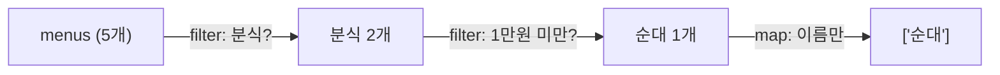
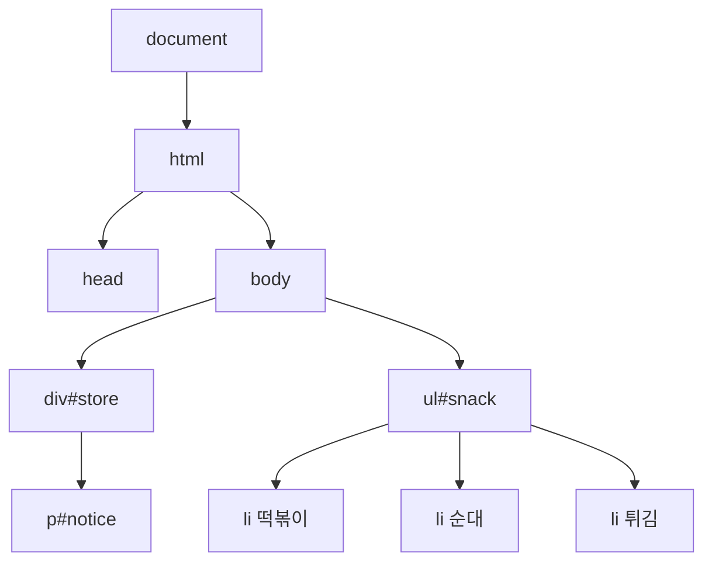
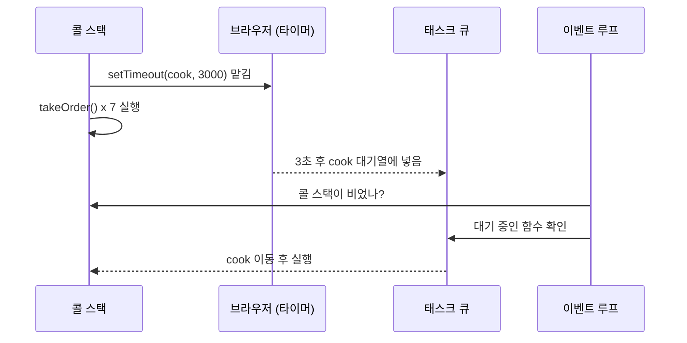
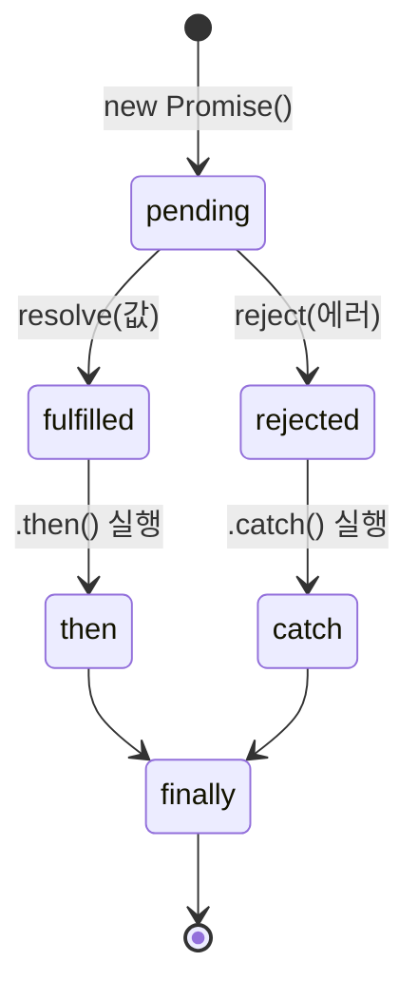
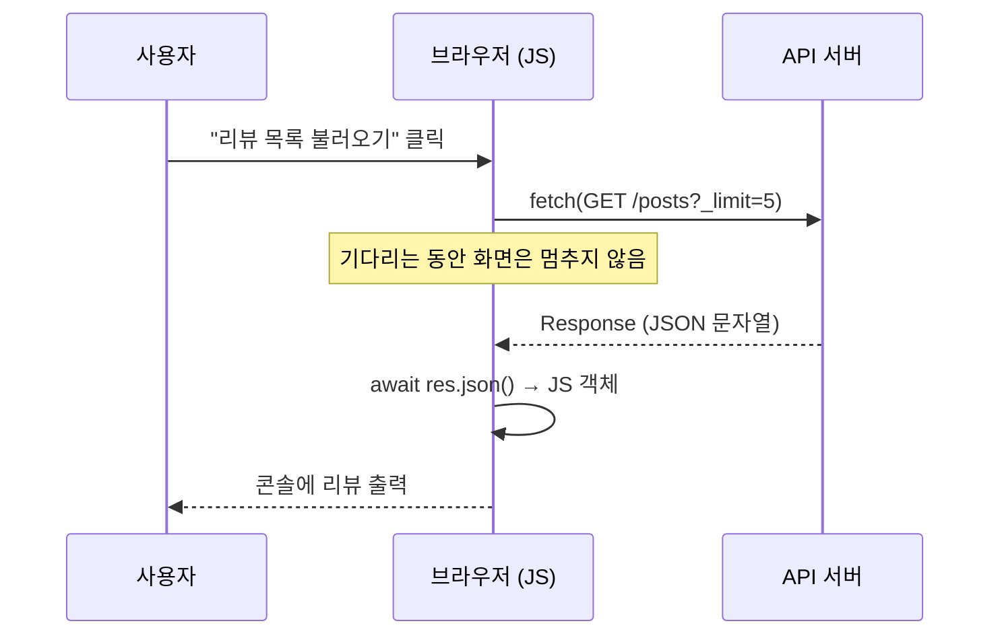

## 들어가며

HTML이 집의 **뼈대**, CSS가 **인테리어**라면 JavaScript는 집에 들어가는 **전기와 배선**입니다. 스위치를 누르면 불이 켜지고, 초인종을 누르면 소리가 나는 것처럼 "무언가 일어났을 때 반응하는" 동작을 담당하죠.

이번 수업은 Java를 먼저 배운 상태에서 JavaScript를 처음 접하는 흐름으로 진행되었습니다. 그래서 수업 예제 곳곳에 "Java로 치면 ~"이라는 비교가 많이 등장합니다. 이 글도 그 흐름을 따라 세 단계로 정리합니다.

| 폴더 | 주제 | 핵심 질문 |
|------|------|-----------|
| `01_Core` | 언어 문법 | 변수, 객체, 함수, 배열은 Java와 무엇이 다를까? |
| `02_Web` | DOM과 이벤트 | 브라우저 화면을 JS로 어떻게 찾고 바꿀까? |
| `03_Async` | 비동기 | 오래 걸리는 작업을 기다리는 동안 화면이 멈추지 않게 하려면? |

수업 예제는 전부 "분식집 주문"이라는 하나의 상황으로 이어져 있어서, 이 글에서도 그 비유를 그대로 사용하겠습니다.

## 01_Core — JavaScript 언어 문법

### 변수: var, let, const와 동적 타입

JavaScript에는 변수 선언 키워드가 `var`, `let`, `const` 세 가지 있습니다. 수업에서는 `let`과 `const`를 중심으로 다뤘습니다.

**수업 예제 코드** (`01_variable.js`)

```js
// const 변수 표현식은 상수의 의미를 가지고 있다.
// 즉 java 에서의 final
const shop = "원티드 식당";
// shop = 1;  // 재할당 불가 → 에러

let test = 1;
test = "문자열";   // 숫자였다가 문자열로 바뀌어도 OK
console.log(test);
```

Java는 `String str = "문자열";`처럼 **선언할 때 타입을 정하고**, 그 뒤로는 다른 타입을 넣을 수 없습니다. 반면 JavaScript는 **값을 할당하는 시점에 타입이 결정되는 동적 타입 언어**입니다.

| 항목 | Java (정적 타입) | JavaScript (동적 타입) |
|------|------------------|------------------------|
| 타입 결정 시점 | 선언 시점 | 할당 시점 |
| 다른 타입 재할당 | 컴파일 에러 | 가능 |
| 장점 | 타입을 확신할 수 있음 | 자료형을 신경 쓰지 않고 빠르게 작성 |
| 단점 | 코드가 길어짐 | 값을 확인하기 전까지 타입을 확신할 수 없음 |

수업 주석에서 강조한 단점은 이것입니다. `test`가 문자열일 때 `test.length`를 쓰는 코드를 작성했는데, 중간에 누군가 `test = 10`을 넣으면 그 코드는 더 이상 의도대로 동작하지 않습니다. "이 코드가 끝까지 잘 동작할 것"이라는 확신을 갖기 어려운 것이죠.

그래서 현재 타입을 확인하는 `typeof` 연산자가 중요합니다.

```js
let test1;
console.log(typeof test1);   // undefined
test1 = 1;           // number
test1 = "java";      // string
test1 = true;        // boolean
test1 = null;        // object  (!)
test1 = {};          // object
test1 = [];          // object  (!)
test1 = function(){};// function
```

여기서 눈여겨볼 점은 `typeof null`과 `typeof []`가 모두 `"object"`라는 것입니다. `null`이 `object`로 나오는 것은 JavaScript 초기 설계에서 남은 유명한 특이점이고, 배열인지 확인하려면 `Array.isArray()`를 사용해야 합니다.

> `var`는 함수 단위 스코프와 호이스팅 때문에 예상치 못한 버그를 만들기 쉬워서, 요즘은 재할당이 필요하면 `let`, 아니면 `const`를 기본으로 사용합니다.

### 객체: 키-값으로 이루어진 프로퍼티의 집합

JavaScript에서 중괄호 `{}`는 **객체**를 의미합니다. 객체는 `key: value` 쌍(프로퍼티)의 집합입니다.

**수업 예제 코드** (`02_object.js`)

```js
// Java 로 치면 Store : 클래스, name/category : 필드, getInfo : 메서드
const store = {
    name : '원티드 식당',
    category : '분식',
    getInfo : function() {
        return `${this.name} 은 ${this.category} 전문점 입니다!`
    }
};
console.log(store.getInfo());

const order = { menuName : '치킨' }
order.sauce = "뿌링클 시즈닝";   // 동적으로 프로퍼티 추가
order.sauce = '맛초킹 시즈닝';   // 프로퍼티 수정
```

Java에서는 필드를 추가하려면 클래스 정의를 고쳐야 하지만, JavaScript 객체는 **실행 중에도 프로퍼티를 자유롭게 추가·수정**할 수 있습니다. 클래스라는 설계도 없이 바로 물건을 만들고, 필요하면 부품을 붙이는 느낌입니다.

또 하나 주목할 점은 `const order`인데도 `order.sauce`를 바꿀 수 있다는 것입니다. `const`가 막는 것은 **변수에 다른 객체를 다시 할당하는 것**이지, 객체 내부를 바꾸는 것까지 막지는 않습니다.

문자열 안의 `` `${this.name}` ``은 **템플릿 리터럴**입니다. 백틱(`` ` ``)으로 감싼 문자열 안에서 `${}`로 변수나 표현식을 바로 끼워 넣을 수 있어 `+`로 이어 붙이는 것보다 훨씬 읽기 좋습니다.

### 함수: 선언문, 표현식, 그리고 호이스팅

수업에서는 "Java가 **클래스 기반** 객체지향 언어라면, JS는 **함수 기반** 객체지향 언어"라고 표현했습니다. 그만큼 함수가 중요합니다.

**수업 예제 코드** (`03_function.js`)

```js
// 함수 선언문
function welcome(name) {
    return `${name} 님 , 반갑습니다~~!`
}

// 함수 표현식 (함수를 변수에 담는다)
const welcome2 = function (name) {
    return `${name} 님 , 반갑습니다~~!`
}

// 이름이 있는 함수 표현식: hello 라는 이름은 함수 내부에서만 쓸 수 있다
const welcome3 = function hello(name) { ... }
// console.log(hello("..."));  // 외부에서는 hello 를 찾을 수 없음
```

함수를 **변수에 담을 수 있다**는 점이 Java와 가장 큰 차이입니다. 함수도 숫자나 문자열처럼 하나의 "값"으로 취급되기 때문에, 변수에 넣고 다른 함수에 넘기고 반환할 수도 있습니다. 이 성질이 뒤에 나오는 고차 함수와 이벤트 핸들러의 기반이 됩니다.

**호이스팅**도 함께 다뤘습니다.

```js
console.log(cook('떡볶이'));   // 정상 동작!

function cook(menuName) {
    return `${menuName} 조리 시~작~!`
}

console.log(test1("떡볶이"))   // 에러!

const test1 = function (menuName) {
    return `${menuName} 조리 시~작~!`
}
```

함수 선언문은 코드가 실행되기 전에 JS 엔진이 먼저 인식하기 때문에, 선언보다 위에서 호출해도 동작합니다. 이것을 **호이스팅**이라고 합니다. 반면 `const`에 담은 함수 표현식은 해당 줄이 실행되어 값이 할당되기 전까지 사용할 수 없어 `ReferenceError`가 발생합니다.

| 구분 | 함수 선언문 | 함수 표현식 |
|------|-------------|-------------|
| 형태 | `function cook() {}` | `const cook = function() {}` |
| 선언 전 호출 | 가능 (호이스팅) | 불가 (ReferenceError) |
| 특징 | 어디서든 호출 가능 | 코드 순서대로 읽혀 흐름이 명확 |

> 수업의 미션은 "Java와 JavaScript의 동작 원리를 비교해 서로에게 설명할 수 있는 자료 만들기"였습니다. 호이스팅은 그 비교에서 꼭 짚어야 할 포인트입니다. Java는 컴파일 후 실행되지만, JS 엔진도 실행 전에 선언을 먼저 훑는 단계가 있다는 점이 핵심입니다.

### 화살표 함수: 더 짧게 쓰는 함수

**수업 예제 코드** (`04_arrow-function.js`)

```js
message = function() { return '주문 접수 OK!👌' }

message = () => { return '주문 접수 OK!👌' }

// 본문이 한 줄이면 중괄호와 return 생략
message = () => '주문 접수 OK!👌'

// 매개변수가 여러 개
message = (menuName, menuPrice) => `${menuName} 의 가격 ${menuPrice}`

// 매개변수가 1개면 소괄호도 생략 가능
message = menuName => `${menuName} !!`
```

화살표 함수는 `function` 키워드, 중괄호, `return`을 생략할 수 있는 문법입니다. 본문 코드가 여러 줄이면 중괄호와 `return`은 생략할 수 없습니다.

어디에 가장 많이 쓰일까요? 바로 뒤에서 볼 **배열 고차 함수**입니다.

```js
// 메뉴가격 10% 할인!
const menuPriceList = [4000, 5000, 140000];
menuPriceList.map( function(price) { return price * 0.9 } )
menuPriceList.map( price => price * 0.9 )   // 훨씬 간결!
```

수업에서는 Java의 **람다 표현식**이 이 화살표 함수와 같은 아이디어라고 소개했습니다. Java를 먼저 배웠다면 `price -> price * 0.9`와 거의 같은 모양이라는 걸 알 수 있습니다.

### 배열: 무엇이든 담을 수 있는 상자

**수업 예제 코드** (`05_array.js`)

```js
const menus = ['제육', '떡볶이', '순대', 1, {name : 'hi'}, function() {}];

for (let i = 0; i < menus.length; i++) {
    console.log(menus[i]);
}
```

Java 배열은 `int[]`, `String[]`처럼 같은 자료형만 담을 수 있지만, JavaScript 배열은 자료형을 명시하지 않기 때문에 문자열, 숫자, 객체, 함수까지 **아무 값이나 섞어 담을 수 있습니다**. 크기도 고정되어 있지 않아 `push`로 계속 추가할 수 있습니다.

### 고차 함수: forEach, map, filter

**고차 함수**란 함수를 인자로 받거나 함수를 반환하는 함수입니다. 배열의 고차 함수는 **콜백 함수**를 받아서 배열의 각 요소를 순회하며 처리합니다.

**수업 예제 코드** (`06_higher-order-method.js`)

```js
const menus = [
    { name: '치즈 떡볶이', category: '분식', price: 14000 },
    { name: '순대',        category: '분식', price: 3000 },
    { name: '파스타',      category: '양식', price: 19000 },
    { name: '제육볶음',    category: '한식', price: 10000 },
    { name: '김치찜',      category: '한식', price: 8000 }
];

menus.forEach( menu => console.log(menu) );            // 반환값 없음
const names  = menus.map( menu => menu.name );         // 이름만 모은 새 배열
const snacks = menus.filter( menu => menu.category === '분식' ); // 조건 true 만
```

| 메서드 | 하는 일 | 반환값 | 분식집 비유 |
|--------|---------|--------|-------------|
| `forEach` | 각 요소마다 콜백 실행 | 없음 (`undefined`) | 메뉴판을 한 줄씩 소리 내어 읽기 |
| `map` | 콜백의 반환값으로 새 배열 생성 | 같은 길이의 새 배열 | 메뉴판에서 이름만 옮겨 적기 |
| `filter` | 콜백이 `true`인 요소만 모음 | 조건에 맞는 새 배열 | 분식 메뉴만 골라내기 |

`map`과 `filter`는 **원본 배열을 바꾸지 않고 새 배열을 반환**하기 때문에, 메서드를 이어 붙이는 **체이닝**이 가능합니다.

```js
// 분식 중에서 가격이 1만원 미만인 메뉴의 이름 목록
const result = menus
                .filter(menu => menu.category === '분식')
                .filter(menu => menu.price < 10000)
                .map(menu => menu.name);
// ['순대']
```



#### `==`와 `===`의 차이

`filter` 예제 중간에 비교 연산자도 다뤘습니다.

```js
console.log(1 == '1');    // true  (타입 변환 후 비교)
console.log(1 === '1');   // false (타입까지 비교)
```

| 연산자 | 이름 | 동작 |
|--------|------|------|
| `==` | 동등 비교 | 암묵적으로 타입을 변환해 같은 값인지 비교 |
| `===` | 일치 비교 | 타입과 값이 모두 같아야 `true` |

동적 타입 언어에서 `==`는 예상치 못한 결과를 만들기 쉬우므로 **`===`를 기본으로 사용**하는 것이 좋습니다.

### 스프레드 문법: 배열과 객체 복사하기

**수업 예제 코드** (`07_spread-syntax.js`)

```js
const cart = ['치킨', '피자'];
const cartRef  = cart;        // 주소값(참조)만 복사
const cartCopy = [...cart];   // 값을 펼쳐서 새로운 배열 생성

cartRef.push('파스타');
console.log(cart, cartRef);   // 둘 다 ['치킨','피자','파스타']

cartCopy.push('빠네파스타');
console.log(cart, cartCopy);  // cart 는 그대로!

const order = { menuName : '뿌링클', qty : 2 };
const orderRef  = order;
const orderCopy = {...order};
console.log(order === orderRef);   // true  (같은 주소)
console.log(order === orderCopy);  // false (새 주소)
```

`cartRef = cart`는 같은 장바구니를 가리키는 **열쇠를 하나 더 복사한 것**입니다. 그래서 `cartRef`로 파스타를 넣으면 `cart`에도 들어가 있죠. 반면 `[...cart]`는 장바구니 내용물을 **새 장바구니에 옮겨 담은 것**이라 서로 영향을 주지 않습니다.

수업 주석에서 짚은 문제는 이것입니다. 메뉴 데이터를 여러 곳에서 같이 쓰는데 참조만 복사해 두면, 한 군데에서 수정했을 때 다른 곳에서는 **영문도 모른 채 값이 바뀌게** 됩니다.

> 용어 정리: 수업 주석에서는 `cartRef = cart`를 "깊은 복사", `[...cart]`를 "얕은 복사"라고 적었는데, 일반적으로 쓰는 용어로는 `cartRef = cart`는 **참조 복사(주소 공유)**이고 `[...cart]`가 **얕은 복사**입니다. 얕은 복사는 1단계만 새로 만들기 때문에, 배열 안에 객체가 들어 있으면 그 객체는 여전히 공유됩니다. 안쪽까지 모두 새로 만드는 것이 **깊은 복사**이며, 이때는 `structuredClone()` 같은 방법을 사용합니다.

| 방식 | 코드 | 새 배열/객체? | 안쪽 객체 |
|------|------|---------------|-----------|
| 참조 복사 | `b = a` | X (같은 것을 가리킴) | 공유 |
| 얕은 복사 | `b = [...a]`, `b = {...a}` | O | 공유 |
| 깊은 복사 | `b = structuredClone(a)` | O | 새로 생성 |

### 구조 분해 할당: 꺼내서 바로 변수에 담기

**수업 예제 코드** (`08_destructuring.js`)

```js
// 배열 구조 분해: 순서대로 꺼낸다
const menuArr = ['치킨', '피자'];
const [chi1, piz1] = menuArr;
// 기존 방식: const chi = menuArr[0]; const piz = menuArr[1];

// 객체 구조 분해: 프로퍼티 key 와 변수명이 일치해야 한다
const menu = { name : '치즈알밥', price : 7500, category : '퓨전한식' };
const { name, price, category } = menu;

// 스프레드와 결합하면 객체 복사도 가능
const { ...rest } = menu;
```

배열은 **순서(위치)** 로, 객체는 **이름(key)** 으로 꺼낸다는 차이를 기억하면 됩니다. 이 문법은 뒤에서 React를 배울 때 `const [state, setState] = useState()`나 `function Card({ name })`처럼 정말 자주 등장합니다.

## 02_Web — DOM과 이벤트

### DOM이란? 요소 노드 취득하기

브라우저는 HTML 문서를 읽어서 **DOM(Document Object Model)** 이라는 트리 구조의 객체로 만듭니다. JavaScript는 이 DOM에 접근해 화면을 읽고 바꿀 수 있습니다. 수업 주석의 표현을 빌리면, JS는 **HTML + CSS로 구성된 Document에 접근할 수 있는 프로그래밍 언어**입니다.



**수업 예제 코드** (`01_DOM/01_get-element.html`)

```html
<div id="store" class="area">냠냠분식 본점 ...</div>
<div id="store" class="area">냠냠분식 2호점 (id 중복!)</div>
<ul id="snack">
    <li>떡볶이</li><li>순대</li><li>튀김</li>
</ul>
<div class="box"><p>오늘의 추천 메뉴</p></div>
<div class="box"><p>이번 주 인기 메뉴</p></div>

<script>
    // 1) id 로 취득 → 중복되면 첫 번째 요소만 반환
    const $store = document.getElementById('store');
    $store.style.backgroundColor = 'yellow';

    // 2) 태그 이름으로 취득 → HTMLCollection
    const $snack = document.getElementById('snack');
    const $snackLiList = $snack.getElementsByTagName('li');

    // HTMLCollection 은 유사 배열 → 배열로 변환해야 forEach/map/filter 사용 가능
    const liList = Array.from($snackLiList);
    liList.forEach( li => li.style.color = 'red' );

    // 3) class 로 취득
    const $menus = document.getElementsByClassName('menu');

    // 4) CSS 선택자로 취득 (권장)
    const $box = document.querySelector(".box");  // 첫 번째 하나만
    $box.style.backgroundColor = 'green';
</script>
```

| 메서드 | 기준 | 반환 | 비고 |
|--------|------|------|------|
| `getElementById('id')` | id | 요소 1개 | id 중복 시 첫 번째만 |
| `getElementsByTagName('li')` | 태그 이름 | HTMLCollection | 특정 요소 하위에서도 호출 가능 |
| `getElementsByClassName('menu')` | class | HTMLCollection | |
| `querySelector('.box')` | CSS 선택자 | 첫 번째 요소 1개 | **권장** |
| `querySelectorAll('.box')` | CSS 선택자 | NodeList (여러 개) | **권장** |

몇 가지 포인트를 정리하면 다음과 같습니다.

- **`$` 접두사**: `$store`처럼 변수 앞에 `$`를 붙이는 것은 문법이 아니라 "이 변수에는 DOM 요소가 들어 있다"는 표시용 관례입니다.
- **id 중복**: 예제에서 일부러 `id="store"`를 두 번 썼는데, `getElementById`는 첫 번째 것만 가져옵니다. id는 문서에서 유일해야 합니다.
- **유사 배열**: `HTMLCollection`은 배열처럼 생겼지만 배열이 아니라서 `map`, `filter` 같은 배열 메서드가 없습니다. `Array.from()`으로 진짜 배열로 바꿔야 앞에서 배운 고차 함수를 쓸 수 있습니다.
- **querySelector 권장 이유**: CSS에서 이미 익숙한 선택자(`#id`, `.class`, `ul > li` 등)를 그대로 쓸 수 있어 하나의 방식으로 모든 경우를 처리할 수 있습니다.

### 이벤트 핸들러 등록과 제거

**이벤트 핸들러**는 이벤트(클릭, 마우스 올림 등)가 발생했을 때 브라우저에게 호출을 맡겨 둔 함수입니다. "손님이 벨을 누르면 이 직원이 응대한다"고 미리 정해 두는 것과 같죠. 등록 방법은 세 가지가 있습니다.

**수업 예제 코드** (`02_EVENT/01_event-handler.html`)

```html
<!-- (1) 어트리뷰트 방식: on + 이벤트 타입, 값으로 "함수 호출문" -->
<button onclick="alert('주문 완료!');">주문하기</button>
<button onmouseover="recommend('김자바');">오늘의 추천 메뉴</button>

<script>
    // (2) 프로퍼티 방식: 하나의 이벤트에 핸들러 1개만 → 덮어쓰기됨
    const $btnProp = document.getElementById('btn-prop');
    $btnProp.onclick = function() { alert("프로퍼티 방식으로 등록!!"); }
    $btnProp.onclick = () => alert("두번째 이벤트 핸들러 등록!!"); // 이것만 남음

    // (3) addEventListener 방식 (권장): 여러 개 등록 가능
    const $btnListener = document.getElementById('btn-listener');
    $btnListener.addEventListener('click', function() { alert('결제 완료!') });
    $btnListener.addEventListener('click', function() { alert('2번째 addEvent 동작!') });

    // (4) 이벤트 핸들러 제거: 등록할 때와 "같은 함수 참조"를 넘겨야 한다
    const handleMouseOver = () => alert('결제 버튼에 마우스 호버!');
    $btnRemove.addEventListener('mouseover', handleMouseOver);
    $btnRemove.removeEventListener('mouseover', handleMouseOver);
</script>
```

| 방식 | 예시 | 여러 핸들러 | 특징 |
|------|------|-------------|------|
| 어트리뷰트 | `onclick="..."` | - | HTML과 JS가 섞임, 값은 **함수 호출문** |
| 프로퍼티 | `$btn.onclick = fn` | X (덮어씀) | 간단하지만 마지막 것만 남음 |
| `addEventListener` | `$btn.addEventListener('click', fn)` | O | **권장**, 제거도 가능 |

`removeEventListener`로 제거하려면 **등록할 때 넘긴 함수와 같은 함수 참조**를 전달해야 합니다. 그래서 익명 함수가 아니라 `handleMouseOver`처럼 외부에 정의한 함수를 사용했습니다. 수업에서는 "조건에 따라 이벤트를 제거해야 할 때 if 문과 같이 사용된다"고 설명했습니다.

### 이벤트 객체와 this

이벤트가 발생하면 브라우저는 "무슨 일이 언제, 어디서 일어났는지"를 담은 **이벤트 객체**를 만들어 핸들러의 첫 번째 매개변수로 넘겨줍니다.

**수업 예제 코드** (`02_EVENT/02_event-object.html`)

```html
<h3 class="message">📍 배달 받을 위치를 아무 곳이나 클릭해 보세요!</h3>
<div class="map" onmouseover="showMapCoords(event)">지도 영역</div>

<button onclick="handleClick1()">떡볶이</button>
<button onclick="handleClick2(this)">순대</button>

<script>
    const $msg = document.querySelector('.message');

    function showCoords(e) {
        $msg.textContent = `배달 위치 : ${e.clientX} , ${e.clientY}`;
    }
    document.onclick = showCoords;   // 문서 전체 클릭 시 좌표 출력

    function handleClick1() {
        console.log('click1', this);   // window (전역 객체)
    }
    function handleClick2(btn) {
        console.log('click2', btn);    // 클릭된 <button> 요소
    }
</script>
```

- `e.clientX`, `e.clientY`는 클릭한 위치의 좌표입니다. 배달 위치를 지도에서 찍는 상황에 딱 맞는 예제죠.
- 어트리뷰트 방식에서는 `showMapCoords(event)`처럼 **`event`라는 이름**으로 이벤트 객체를 넘겨야 합니다.

`this`는 **함수가 어떻게 호출되었는지에 따라** 가리키는 대상이 달라집니다.

| 등록 방식 | 핸들러 안의 `this` |
|-----------|--------------------|
| 어트리뷰트 방식에서 일반 함수 호출 (`handleClick1()`) | `window` (전역 객체) |
| 어트리뷰트 방식에서 `this`를 인자로 전달 (`handleClick2(this)`) | 인자로 받은 이벤트 대상 요소 |
| 프로퍼티 방식 / `addEventListener` + 일반 함수 | 이벤트를 바인딩한 요소 (`e.currentTarget`과 같음) |
| 화살표 함수 | 자신만의 `this`가 없어 바깥 스코프의 `this`를 사용 |

예제 HTML에는 프로퍼티/`addEventListener` 방식과 화살표 함수용 버튼(`btn1`~`btn4`)도 준비되어 있었는데, 위 표의 아래 두 줄이 그 내용에 해당합니다. 이벤트 대상 요소를 알면 "클릭된 메뉴를 삭제한다"처럼 그 DOM을 직접 조작할 수 있습니다. 화살표 함수의 `this` 동작이 헷갈리면 `e.target`/`e.currentTarget`을 쓰는 것이 더 명확합니다.

### 폼 이벤트: 주문서 다루기

**수업 예제 코드** (`02_EVENT/03_form-event.html`) — 폼 요소 값 다루기

```js
const $form = document.forms.orderForm;      // name 속성으로 form 취득
console.log($form.elements);                 // 폼 안의 입력 요소 모음

const $username = $form.username;
$username.value = '김코틀린';                 // input 값 변경

const $payment = $form.payment;               // 같은 name 의 radio 묶음
$payment[1].checked = true;                   // '현금' 선택

const $menu = $form.menu;                     // select
$menu.options[2].selected = true;
$menu.selectedIndex = 3;
$menu.value = 'ramen';                        // 셋 중 마지막 것이 최종 반영

const $request = $form.request;               // textarea
$request.value = '단무지 많이 주세요!';
```

| 요소 | 값 읽기/쓰기 |
|------|--------------|
| `input`, `textarea` | `.value` |
| `checkbox`, `radio` | `.checked` |
| `select` | `.value`(선택된 값), `.selectedIndex`(선택 번호), `.options`(option 목록) |

`document.forms`로 문서의 모든 form을 가져올 수 있고, `name` 속성(`document.forms.orderForm`)이나 인덱스(`document.forms[0]`)로 꺼낼 수 있습니다. form 안에서도 `$form.username`처럼 **name으로 바로 접근**할 수 있어서 편리합니다.

이어서 폼에서 자주 쓰는 이벤트들을 다뤘습니다.

```js
// focus / blur : 해당 입력 필드에서만, 버블링 X
$username.onfocus = (e) => e.target.classList.toggle('lightgray');
$username.onblur  = (e) => e.target.classList.toggle('lightgray');

// focusin / focusout : 버블링 O → form 하나에 등록해 모든 입력칸 처리
$form.addEventListener('focusin',  (e) => e.target.classList.add('focused'));
$form.addEventListener('focusout', (e) => e.target.classList.remove('focused'));

// change : 변경이 "끝났을 때"
$menu.addEventListener('change', () => alert('메뉴 변경!'));

// input : 값이 바뀔 "때마다" → 요청사항 글자 수 세기
$request.addEventListener('input', (e) => {
    let len = e.target.value.trim().length;
    $form.querySelector('span').textContent = len;
});
```

| 이벤트 | 발생 시점 | 버블링 | 수업 예제 활용 |
|--------|-----------|--------|----------------|
| `focus` / `blur` | 요소에 포커스가 들어올 때 / 나갈 때 | X | 주문자 칸 배경색 토글 |
| `focusin` / `focusout` | 위와 같음 | O | form에 한 번만 등록해 모든 칸에 테두리 |
| `change` | select·radio·checkbox는 선택 직후, 텍스트는 **포커스를 잃을 때** | O | 메뉴 변경 알림 |
| `input` | 키보드, 붙여넣기, 음성 입력 등 **어떤 방법이든 값이 바뀔 때마다** | O | 글자 수 실시간 표시 |

`focusin`/`focusout`이 왜 필요할까요? **버블링**은 자식 요소에서 발생한 이벤트가 부모 요소로 전파되는 현상입니다. `focus`는 버블링되지 않아 입력칸마다 핸들러를 달아야 하지만, `focusin`은 버블링되므로 form 하나에만 등록하면 그 안의 모든 입력칸 이벤트를 받을 수 있습니다. 이 기법을 **이벤트 위임**이라고 부릅니다.

### 폼 제출 이벤트: 검증 후 전송 취소

```html
<form method="GET" action="https://search.naver.com/search.naver" name="search">
    <input type="text" name="query" placeholder="검색할 메뉴를 입력하세요">
    <button type="submit">네이버에서 맛집 검색하기</button>
</form>
<script>
    const $searchForm = document.forms.search;
    $searchForm.onsubmit = function() {
        let keyword = this.querySelector('input[name=query]').value;
        if (!keyword) {
            alert('검색할 메뉴를 입력하지 않았습니다!');
            return false;   // 폼 전송 취소
        }
    };
</script>
```

`submit` 이벤트는 폼을 서버로 보내기 **직전**에 발생합니다. 제출 버튼 클릭뿐 아니라 입력칸에서 Enter를 눌러도 발생하죠. 이 시점에 내용을 검사해서 잘못되었으면 전송을 막을 수 있습니다.

- 프로퍼티 방식(`onsubmit`)에서는 `return false`로 기본 동작(전송)을 취소할 수 있습니다.
- `addEventListener` 방식에서는 `return false`가 통하지 않으므로 `e.preventDefault()`를 사용합니다.

## 03_Async — 비동기 처리

### 타이머: setTimeout과 setInterval

**수업 예제 코드** (`01_timer.html`)

```js
// 피자 조리 시간 5초
setTimeout( () => console.log('5초 경과! 피자 조리 완료~~🍕'), 5000 );
console.log("주문 하실 사람~~~!");   // 이게 먼저 출력된다!

// 세 번째 인자부터는 콜백에 전달할 매개변수
setTimeout( (menuName) => console.log(`3초 경과! ${menuName} 조리 완료~~🍕`), 3000, "치킨" );

// setInterval : 간격을 두고 반복
let count = 1;
const interval = setInterval(() => {
    console.log(`배달 도착까지 ${5 - count} 초`);
    count++;
    if (count == 5) {
        clearInterval(interval);   // 종료 조건이 꼭 필요!
        console.log('배달 완료~~~🛒');
    }
}, 1000);
```

위에서 아래로 실행된다면 "피자 조리 완료"가 먼저 나와야 할 것 같지만, 실제로는 "주문 하실 사람~~~!"이 먼저 출력됩니다. 수업 주석의 설명처럼 **비동기 작업은 끝나기만을 기다리며 대기하는 것이 아니라, 오래 걸리는 작업을 별도로 맡겨 두고 메인 코드의 흐름을 이어 나가는 것**이기 때문입니다.

| 함수 | 역할 | 중지 방법 |
|------|------|-----------|
| `setTimeout(fn, ms, ...args)` | `ms` 뒤에 **한 번** 실행 | `clearTimeout(id)` |
| `setInterval(fn, ms, ...args)` | `ms` 간격으로 **반복** 실행 | `clearInterval(id)` |

`setInterval`은 멈추라고 하기 전까지 계속 돌기 때문에 **종료 조건**을 반드시 달아야 합니다.

### 동기 vs 비동기, 그리고 이벤트 루프

**수업 예제 코드** (`02_asynchronous.html`)

```js
// 동기 방식: while 문으로 3초 동안 실행을 점유
function sleep(func, delay) {
    const delayUntill = Date.now() + delay;
    while (Date.now() < delayUntill);
    func();
}
// sleep(cook, 3000);   // 3초 동안 아무것도 못 함
// takeOrder();         // 3초 뒤에야 주문 받기 가능

// 비동기 방식
setTimeout(cook, 3000);
takeOrder();   // 바로 실행
takeOrder();   // 바로 실행 ... (조리 중에도 계속 주문 받기)
```

| 구분 | 동기 | 비동기 |
|------|------|--------|
| 분식집 비유 | 떡볶이 조리(3초)가 끝날 때까지 다음 손님 주문을 못 받음 | 떡볶이를 불에 올려 두고 다음 손님 주문을 먼저 받음 |
| 실행 순서 | 코드 작성 순서 그대로 | 오래 걸리는 작업은 나중에 끝남 |
| 단점 | 긴 작업이 있으면 전체가 멈춤 | 언제 끝날지 알기 어려움 |

JavaScript는 한 번에 하나의 작업만 처리하는 **싱글 스레드** 언어인데, 어떻게 기다리는 동안 다른 일을 할 수 있을까요? 수업에서 정리한 CS 개념이 바로 그 답입니다.

- **콜 스택**: 지금 실행 중인 함수들이 쌓이는 곳
- **태스크 큐**: 비동기 함수의 콜백이나 이벤트 핸들러가 잠시 대기하는 곳
- **이벤트 루프**: 콜 스택이 비어 있는지, 태스크 큐에 대기 중인 함수가 있는지 반복해서 확인하고, 콜 스택이 비면 태스크 큐의 함수를 **FIFO(선입선출)** 로 콜 스택에 옮깁니다.



수업에서는 이것이 실무에서 왜 중요한지도 짚었습니다. 프론트 서버는 화면을 구성하고, 백엔드 서버는 화면에 표시될 데이터를 돌려줍니다. 백엔드 응답이 느린데 프론트가 동기 방식으로 기다리면, 사용자는 **영문도 모른 채 화면이 멈추는 경험**을 하게 됩니다. 그래서 JS 기반 프론트엔드에서 **API 호출은 모두 비동기로** 처리합니다.

### 콜백 지옥 → Promise → async/await

비동기 작업은 언제 끝날지 모르는데, **순서가 중요한 경우**에는 어떻게 할까요? 수업 예제는 "주문할 때마다 1초 뒤 10P 적립, 한도는 50P"라는 요구사항을 세 가지 방식으로 구현합니다.

#### 1. 콜백 지옥

**수업 예제 코드** (`03_promise-async-await.html`)

```js
function pointCallback(point, func) {
    setTimeout(() => {
        const result = point + 10;
        if (func) func(result);
    }, 1000);
}

function runCallback() {
    pointCallback(0, point => {
        console.log(`${point}P`);              // 10P
        pointCallback(point, point => {
            console.log(`${point}P`);          // 20P
            pointCallback(point, point => {
                console.log(`${point}P`);      // 30P
                // ... 계속 안쪽으로 들어간다
            })
        })
    });
}
```

순서를 지키려면 "끝나면 다음 걸 해줘"라는 콜백을 계속 안쪽에 넣어야 합니다. 코드가 오른쪽으로 계속 밀려나는 이 모양을 **콜백 지옥**이라고 부르고, 수업에서는 "작성하면 안 되는 코드의 예시"로 소개했습니다. 읽기도 어렵고, 중간에 에러가 나면 처리하기도 힘듭니다.

#### 2. Promise

**Promise**는 "지금은 결과가 없지만, 나중에 성공(`resolve`) 또는 실패(`reject`)로 결과를 알려주겠다"는 **약속 객체**입니다. 분식집의 **진동벨**을 떠올리면 쉽습니다. 주문하면 진동벨(Promise)을 받고, 음식이 나오면(resolve) 벨이 울리고, 재료가 떨어지면(reject) 취소 안내를 받는 것이죠.

```js
function earnPoint(point) {
    return new Promise((resolve, reject) => {
        setTimeout(() => {
            const result = point + 10;
            if (result > 50) {
                return reject(new Error("적립 한도 초과"));  // 실패
            }
            return resolve(result);                          // 성공
        }, 1000);
    });
}

function runPromise() {
    earnPoint(0)
        .then(point => { console.log(`${point}P`); return earnPoint(point); })
        .then(point => { console.log(`${point}P`); return earnPoint(point); })
        // ... 같은 패턴 반복
        .catch(e => console.log(e, '발생~!!!!!!'))
        .finally(() => console.log("포인트 적립 종료"));
}
```

`.then()` 안에서 다음 Promise를 반환하면 체인이 이어지기 때문에, 중첩 대신 **위에서 아래로 평평하게** 작성할 수 있습니다. 60P가 되는 순간 `reject`가 호출되어 `.catch()`로 바로 건너뛰고, 성공이든 실패든 마지막에 `.finally()`가 실행됩니다.



#### 3. async / await

```js
async function runAsync() {
    try {
        let point = await earnPoint(0);
        console.log(`${point}P`);
        point = await earnPoint(point);
        console.log(`${point}P`);
        // ...
    } catch (e) {
        console.log(e, '발생!!!');
    }
}
```

`await`는 Promise가 끝날 때까지 기다렸다가 `resolve`된 값을 꺼내 줍니다. 즉 `.then()`을 대신하는 문법입니다. `await`를 쓰려면 함수 앞에 `async`를 붙여야 합니다. 메서드 체이닝이 아니므로 `.catch()` 대신 **`try-catch`로 예외를 처리**합니다.

| 방식 | 순서 보장 방법 | 에러 처리 | 가독성 |
|------|----------------|-----------|--------|
| 콜백 | 콜백 안에 콜백 중첩 | 단계마다 직접 처리 | 깊어질수록 나쁨 |
| Promise | `.then()` 체이닝 | `.catch()` 한 번 | 평평해짐 |
| async/await | `await`로 한 줄씩 | `try-catch` | 동기 코드처럼 읽힘 |

수업에서는 Promise와 async/await를 "비동기 처리를 동기 방식으로 동작하게 만드는 문법"이라고 표현했습니다. 정확히 말하면 **코드를 동기처럼 읽히게** 해 주는 것이고, 실제로 `await`가 기다리는 동안에도 브라우저 전체가 멈추지는 않습니다. 멈추는 것은 그 `async` 함수 내부의 진행뿐이고, 이벤트 루프는 다른 작업(클릭 처리 등)을 계속 처리합니다. 앞의 `sleep` 함수처럼 `while`로 기다리는 것과는 완전히 다릅니다.

### fetch: 외부 API 호출하기

가장 대표적인 비동기 작업은 **외부 서버의 API를 호출하는 것**입니다. 수업에서는 `fetch`(그 외에 ajax, axios도 있다고 언급)를 사용해 리뷰 목록을 불러왔습니다.

**수업 예제 코드** (`04_fetch.html`)

```js
async function getReviews() {
    const data = fetch('https://jsonplaceholder.typicode.com/posts?_limit=5');
    console.log(data);   // Promise 객체 (아직 결과 아님)

    // 1. promise - then()
    // data.then(res => res.json()).then(json => console.log(json));

    // 2. async - await
    const res = await data;            // 응답(Response) 객체
    const reviews = await res.json();  // JSON 문자열 → JS 객체
    console.log(reviews[0].title);
}
```

`fetch`도 Promise를 반환하므로 앞에서 배운 `.then()`이나 `await`를 그대로 쓸 수 있습니다. 응답 본문은 JSON 형식의 문자열로 오기 때문에, `res.json()`으로 **실제 JavaScript 객체로 변환**해야 `reviews[0].title`처럼 사용할 수 있습니다. 그리고 `res.json()`도 Promise를 반환하므로 `await`가 한 번 더 필요합니다.



## 정리

| 단계 | 배운 것 | 핵심 한 줄 |
|------|---------|------------|
| 01_Core | 변수, 객체, 함수, 화살표 함수, 배열, 고차 함수, 스프레드, 구조 분해 | JS는 동적 타입이고, 함수도 값이다 |
| 02_Web | DOM 취득, 이벤트 핸들러 3가지, 이벤트 객체와 this, 폼 이벤트 | 문서를 찾아서(querySelector), 반응을 등록한다(addEventListener) |
| 03_Async | 타이머, 동기/비동기, 이벤트 루프, 콜백 → Promise → async/await, fetch | 오래 걸리는 일은 맡겨 두고, 순서는 Promise로 지킨다 |

세 단계는 따로 떨어진 내용이 아니라 서로 이어져 있습니다. 1단계의 **화살표 함수와 고차 함수**는 2단계에서 `Array.from(...).forEach()`와 이벤트 핸들러로 쓰였고, 2단계의 **addEventListener**는 3단계에서 버튼을 눌러 비동기 함수를 실행하는 데 쓰였습니다. 그리고 1단계의 **구조 분해 할당과 스프레드**는 다음 수업인 React에서 거의 모든 코드에 등장합니다.

## 더 학습하면 좋은 개념

- **클로저(Closure)** — 함수가 자신이 만들어진 환경의 변수를 기억하는 성질입니다. `setInterval` 안에서 바깥의 `count`를 계속 쓸 수 있었던 이유이며, React Hooks를 이해하는 데도 필수입니다.
- **이벤트 전파(버블링·캡처링)와 이벤트 위임** — `focusin`이 왜 form에서 잡히는지의 원리입니다. 목록 항목이 많을 때 부모 하나에 핸들러를 다는 패턴으로 성능과 코드량을 함께 줄일 수 있습니다.
- **마이크로태스크 큐** — Promise의 `.then()` 콜백은 `setTimeout`과 다른 큐에서 더 먼저 처리됩니다. 비동기 코드의 실행 순서를 정확히 예측하려면 알아야 합니다.
- **ES 모듈(import/export)** — 수업 예제는 한 파일 안에 모든 코드를 작성했지만, 실제 프로젝트와 React에서는 파일을 나누고 `import`/`export`로 연결합니다.
- **fetch 에러 처리와 HTTP 상태 코드** — `fetch`는 404, 500 응답에서도 reject되지 않습니다. `res.ok`를 확인하는 습관이 있어야 실무에서 API 오류를 놓치지 않습니다.

## 참고 자료

- [MDN - JavaScript 안내서](https://developer.mozilla.org/ko/docs/Web/JavaScript/Guide)
- [MDN - typeof](https://developer.mozilla.org/en-US/docs/Web/JavaScript/Reference/Operators/typeof)
- [MDN - 화살표 함수](https://developer.mozilla.org/en-US/docs/Web/JavaScript/Reference/Functions/Arrow_functions)
- [MDN - Array.prototype.map()](https://developer.mozilla.org/en-US/docs/Web/JavaScript/Reference/Global_Objects/Array/map)
- [MDN - 전개 구문 (Spread syntax)](https://developer.mozilla.org/en-US/docs/Web/JavaScript/Reference/Operators/Spread_syntax)
- [MDN - 구조 분해 할당](https://developer.mozilla.org/en-US/docs/Web/JavaScript/Reference/Operators/Destructuring_assignment)
- [MDN - structuredClone()](https://developer.mozilla.org/en-US/docs/Web/API/Window/structuredClone)
- [MDN - Document.querySelector()](https://developer.mozilla.org/en-US/docs/Web/API/Document/querySelector)
- [MDN - EventTarget.addEventListener()](https://developer.mozilla.org/en-US/docs/Web/API/EventTarget/addEventListener)
- [MDN - setTimeout()](https://developer.mozilla.org/en-US/docs/Web/API/Window/setTimeout)
- [MDN - Promise](https://developer.mozilla.org/en-US/docs/Web/JavaScript/Reference/Global_Objects/Promise)
- [MDN - async function](https://developer.mozilla.org/en-US/docs/Web/JavaScript/Reference/Statements/async_function)
- [MDN - Fetch API 사용하기](https://developer.mozilla.org/en-US/docs/Web/API/Fetch_API/Using_Fetch)
