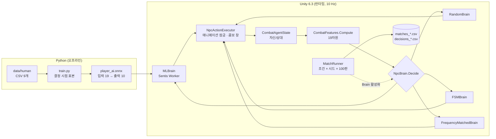

## 들어가며 (Situation)

[Unity-AI-NPC-System](https://github.com/Lezo-Jong/Unity-AI-NPC-System)은 사람의 플레이 로그로 MLP를 학습시키고(PyTorch), ONNX로 내보내 Unity 안에서 추론하는 1대1 칼싸움 NPC 프로젝트입니다.

이 프로젝트의 **예전 버전**이 가진 문제는 [이전 글]({{ site.baseurl }})에서 이미 정리했습니다. NPC의 행동은 `Random.Range(0, 6)`으로 정해졌고, 학습한 모델은 게임과 연결되어 있지 않았으며, README의 테스트 정확도 93.47%는 그래서 게임 안에서 아무 의미가 없었다는 내용입니다.

이 글은 그 **다음 이야기**입니다. 커밋 기록을 보면 2026년 10월 16일부터 11월 23일까지 이 저장소는 거의 새로 만들어졌습니다. README 맨 위에는 다음 메모가 붙었습니다.

> 논문 수정(리뷰어 의견 대응)을 위해 Unity 6.3 LTS와 Unity Sentis 2.6으로 이전하고, 데이터를 다시 수집해 재학습과 통제 실험(900판)을 진행했습니다. 이전 버전의 결과(테스트 정확도 93.47%)는 평가 방식의 문제로 철회했습니다.

즉 이번 작업은 "더 잘 싸우는 NPC 만들기"가 아니라 **리뷰어의 질문에 숫자로 답할 수 있는 실험 시스템 만들기**였습니다.

## 문제 상황 (Task)

`docs/REEXPERIMENT.md`에는 리뷰어 코멘트와 대응이 표로 정리되어 있습니다. 여기에 11월의 2차 리뷰 대응(커밋 메시지의 "reviewer 2, Major 3")까지 합치면 풀어야 할 과제는 다섯 개였습니다.

| # | 리뷰어의 질문 | 기술적으로 바꿔 말하면 |
|---|---|---|
| 1 | 지능적 행동을 어떻게 검증했는가 | 학습한 NPC가 실제로 게임을 움직이고, 그걸 통제된 대전으로 비교해야 한다 |
| 2 | 단일 실험이라 신뢰성이 낮다 | 정확도를 단일 무작위 분할이 아닌 반복 교차검증으로 보고해야 한다 |
| 3 | 10개 클래스인데 출력 뉴런이 14개 | 모델 구조와 행동 정의를 일치시켜야 한다 |
| 4 | Barracuda는 지원이 끝났다 | 현재 지원되는 런타임으로 옮겨야 한다 |
| 5 | (2차) "사람 같다"는 지표가 정말 상태를 반영하는가 | 상태를 보지 않는 비교군으로 지표 자체를 검증해야 한다 |

## 해결 과정 (Action)

### 0. 커밋 타임라인

먼저 전체 흐름부터 보겠습니다. 5월의 초기 커밋 이후, 실질적인 변경은 10월 16일 하루에 몰려 있고, 10월 19~20일에 정리·검증, 11월 23일에 2차 리뷰 대응이 들어갑니다.

| 날짜 | 커밋 | 무엇이 바뀌었나 | 주요 파일 |
|---|---|---|---|
| 05-11 ~ 05-22 | `Initial commit` 외 | 초기 버전, README와 이미지 | — |
| 10-16 00:13 | `6a7770b` | Unity 6.3 LTS 업그레이드, Barracuda → `com.unity.ai.inference` 2.6.1, 학습·분석 도구 추가 | `MLBrain.cs`, `Tools/train.py`, `Tools/analyze_matches.py`, `docs/REEXPERIMENT.md` |
| 10-16 18:38 | `c0f1cfd` | NPC 대 NPC 실험 환경, 부활·로거 버그 수정, 추론 워밍업 | `MatchRunner.cs`, `CombatDataLogger.cs`, `HealthSystem.cs` |
| 10-16 19:06 | `0f64972` | 플레이어 입력 버퍼링, 남아 있던 칼 히트박스, 방어 판정 수정 | `PlayerController.cs`, `Slash2.anim`, `SwordController.cs` |
| 10-16 19:36 | `d713dec` | NPC도 플레이어와 같은 애니메이션 잠금을 따르게 | `NpcActionExecutor.cs`, `NpcBrain.cs` |
| 10-16 19:57 | `5e39b26` | **결정 시점 표본**으로 학습, balanced accuracy 추가, 10클래스 재학습 | `train.py`, `player_ai.onnx` |
| 10-16 20:14 | `57fbfbd` | 부활 후 칼 쿨다운 플래그 초기화 | `SwordController.cs` |
| 10-16 21:13 | `c2dbcaf` | ML NPC가 소극적인 문제 수정: Move 상태 고착, 회피 거리, 확률 샘플링 | `NpcActionExecutor.cs`, `MatchRunner.cs`, `MLBrain.cs`, `train.py` |
| 10-16 21:55 | `e1b9266` | 모든 NPC 결정을 기록하고 사람다움(JS divergence) 측정 | `NpcBrain.cs`, `MatchRunner.cs`, `analyze_matches.py` |
| 10-17 | `37e9720` | 본실험 900판 + 학습 결과 | `Tools/results/` |
| 10-19 | `b1288ed` 외 | 원본 데이터 보관, 결과를 데이터에서 재현 가능하게, README 갱신 | `data/`, `README.md` |
| 10-20 | `baa38ad` · `74fa970` · `20bd907` | 교차검증 설명 정정, S01 민감도 분석, **ONNX 일치 검증** | `train.py`, `check_onnx_consistency.py`, `data/runtime_check/` |
| 11-23 | `18362cb` | **빈도 일치 비교군(FM)** + **logit adjustment(MLAdj)**, 600판 추가 | `FrequencyMatchedBrain.cs`, `MLBrain.cs`, `MatchRunner.cs`, `analyze_conditional.py` |

아래에서는 이 순서를 따라가되, 이전 글과 겹치지 않는 부분 위주로 보겠습니다.

### 1. 런타임 이전: Barracuda에서 Sentis로

`6a7770b` 커밋에서 패키지가 바뀌었습니다. `REEXPERIMENT.md`의 정리를 그대로 옮기면 이렇습니다.

| 항목 | 이전 | 이후 |
|---|---|---|
| 에디터 | 6000.1.0f1 | 6000.3.26f1 (Unity 6.3 LTS) |
| 추론 패키지 | `com.unity.barracuda` 3.0 | `com.unity.ai.inference` 2.6.1 (Unity Sentis) |
| 스크립트 API | `NNModel`, `IWorker`, `WorkerFactory` | `ModelAsset`, `Worker`, `BackendType` |
| 모델 출력 | 14개 뉴런 | 10개 뉴런 = 행동 클래스 10개 |

패키지 이름이 헷갈리는 부분도 커밋(`baa38ad`)에서 바로잡았습니다. 저장소 문서에 따르면 이 패키지는 2.2~2.3에서만 "Inference Engine"이라는 이름이었고 2.4.0부터 다시 Sentis로 불립니다. 다만 C# 네임스페이스는 `Unity.InferenceEngine`이라서, 코드와 문서의 이름이 다르게 보입니다.

새 API로 옮긴 `MLBrain`의 핵심은 이렇습니다.

```csharp
// 프로젝트 코드 — Assets/Experiment/MLBrain.cs (요약)
using Unity.InferenceEngine;

public class MLBrain : NpcBrain
{
    public ModelAsset modelAsset;
    public BackendType backendType = BackendType.CPU;
    private Worker worker;

    protected override void Awake()
    {
        base.Awake();
        Model model = ModelLoader.Load(modelAsset);
        worker = new Worker(model, backendType);

        // Warm-up: 첫 실행의 준비 비용이 결정 지연 측정에 섞이지 않도록
        using (var dummy = new Tensor<float>(new TensorShape(1, CombatFeatures.Count), new float[CombatFeatures.Count]))
        {
            worker.Schedule(dummy);
            (worker.PeekOutput() as Tensor<float>)?.DownloadToArray();
        }
    }
}
```

백엔드를 CPU로 둔 이유는 `REEXPERIMENT.md`에 "19→64→64→10 크기의 작은 MLP는 CPU(Burst)가 GPU보다 지연이 낮다"고 적혀 있습니다. 워밍업은 `c0f1cfd`에서 추가됐는데, 결정 지연을 실험 지표로 보고하기 때문에 첫 호출 비용이 평균에 섞이지 않게 한 것입니다.

추론이 실패하면 FSM 규칙으로 대체하고 그 횟수(`FallbackCount`)를 경기마다 기록합니다. 본실험 900판의 fallback은 모든 조건에서 0이었습니다.

### 2. 구조: Brain만 갈아끼우는 실험 틀

예전 버전의 문제가 "모델이 게임과 연결되어 있지 않다"였다면, 새 구조는 반대로 **모든 행동 선택기가 같은 입력·같은 실행기를 공유**하도록 만들어졌습니다. README에 따르면 이 설계는 후속 프로젝트 LLM-unity-DualArena의 평가 방식(Brain 교체 구조, 공통 실행기, 고정 시드 상대)을 따른 것이고, 의사결정 자체는 LLM이 아니라 원래대로 MLP입니다.



공통 부모 `NpcBrain`은 관측 → 결정 → 실행 사이클과 지연 측정을 한 곳에서 처리합니다. 자식 클래스는 `Decide` 하나만 구현합니다.

```csharp
// 프로젝트 코드 — Assets/Experiment/NpcBrain.cs (요약)
public abstract class NpcBrain : MonoBehaviour
{
    public float decisionHz = 10f;
    public event Action<NpcBrain, float[], ActionClass, bool> Decided;

    private void Update()
    {
        if (Time.time < nextDecisionTime) return;
        nextDecisionTime = Time.time + 1f / decisionHz;
        if (!executor.CanDecide) { Status = "행동 중"; return; }   // 애니메이션 잠금

        stopwatch.Restart();
        CombatFeatures.Compute(self, opponent, features);
        ActionClass a = Decide(features);
        stopwatch.Stop();
        LatenciesMs.Add(stopwatch.Elapsed.TotalMilliseconds);

        Decided?.Invoke(this, features, a, executor.IsBusy);  // MatchRunner가 기록
        executor.Execute(a);
    }

    protected abstract ActionClass Decide(float[] f);
}
```

`CombatFeatures.Compute`는 **데이터 수집(플레이어 시점)과 추론(NPC 시점)에서 같은 함수**를 씁니다. 학습 때의 입력과 게임 안의 입력이 어긋나는 일을 구조적으로 막는 장치입니다. 행동 클래스 순서도 C#의 `ActionClass` enum과 Python의 `ACTIONS` 리스트가 같아야 한다고 양쪽에 주석으로 못 박아 두었습니다.

### 3. 공정한 비교를 위한 게임 쪽 수정들

10월 16일 저녁의 커밋들은 대부분 학습이 아니라 **게임 버그**를 고치는 내용입니다. 비교 실험에서는 컨트롤러 차이가 아닌 다른 이유로 결과가 갈리면 안 되기 때문입니다.

| 커밋 | 발견된 문제 | 수정 |
|---|---|---|
| `0f64972` | `Slash2.anim`의 두 번째 이벤트가 콜라이더를 끄지 않고 한 번 더 켜서 히트박스가 남아 있었다 | 이벤트를 비활성화로 수정 |
| `d713dec` | NPC는 공격 애니메이션 중에도 방어할 수 있었고, 보이지 않는 1초 방어가 있었다 | NPC도 애니메이션이 끝나기 전엔 새 행동 불가, Slash/Slash2 중 콤보 결정 1회만 |
| `57fbfbd` | 공격 쿨다운 코루틴 도중 죽으면 `canAttack`이 영원히 false → 부활 후 칼 데미지 0 | `OnEnable`에서 플래그 초기화 |
| `c2dbcaf` | ML NPC가 소극적: `self_cur_move`가 1에 고착, NavMesh 회피 때문에 교전 거리 3.76 m (사람은 약 3.1 m) | 실제로 멈출 때 Move 종료, 에이전트 회피 끄기(약 3.5 m), softmax 샘플링 옵션 |

`57fbfbd`의 버그는 **이미 수집한 사람 데이터**에도 영향을 줬습니다. `data/README.md`를 보면, 이 버그가 발생한 4개 파일은 "그 뒤로 한 번도 명중하지 못한 첫 사망 시점"에서 잘라 `human/`에 넣고, 잘리기 전 원본은 `human_excluded/before_sword_trim/`에 그대로 보관했습니다. 애니메이션 잠금 수정 전에 녹화된 FSM 세션 하나는 제외했고, 상대 라벨이 잘못 저장된 S02 파일 두 개는 해당 열만 고치고 원본을 따로 남겼습니다.

`d713dec`보다 먼저 녹화됐지만 남겨 둔 S01 파일에 대해서는 `74fa970` 커밋에서 **민감도 분석**을 추가했습니다. S01을 빼고 다시 교차검증한 결과는 아래와 같아서, 포함 여부가 결론을 바꾸지 않는다는 근거가 됩니다.

| 데이터 | 파일 / 표본 | Macro-F1 | Balanced accuracy |
|---|---|---|---|
| 전체 | 9개 / 6,274 | 0.264 ± 0.028 | 0.298 ± 0.032 |
| S01 제외 | 7개 / 5,853 | 0.268 ± 0.029 | 0.318 ± 0.038 |

### 4. 학습: "지금 하는 행동"이 아니라 "다음에 고를 행동"

93.47%가 철회된 이유를 README는 "현재 행동이 입력에 새어 들어간(leak) 단일 무작위 분할"이라고 설명합니다. 19개 입력 중 `self_cur_attack`, `self_cur_defense`, `self_cur_move`, `self_speed`가 같은 순간의 라벨과 거의 같은 정보를 담고 있어서, 모델이 "다음에 할 행동"이 아니라 "지금 하는 행동"을 배운 셈입니다.

`5e39b26` 커밋은 이를 **결정 시점 표본(decision-point samples)**으로 바꿨습니다. NPC가 실제로 결정을 내리는 순간과 같은 조건의 행만 골라, 그 직후 시작된 행동을 라벨로 붙입니다.

```python
# 프로젝트 코드 — Tools/train.py (요약)
FREE = {0, 1, 8}          # Idle, Move, Crouch: 다음 행동을 고를 수 있는 상태
COMBO = {2: 3, 3: 4}      # Slash → Slash2, Slash2 → Slash3
MAX_GAP = 0.25            # 이보다 긴 간격(사망·부활)은 연속 구간으로 보지 않음

def build_decisions(df, horizon):
    for _, g in df.groupby("session_id", sort=False):
        ...
        for i in range(n - 1):
            if a[i] in FREE:
                label = a[i + 1]
                for j in range(i + 1, min(n, i + 1 + horizon)):   # 3틱 = 0.3초 안에
                    if a[j] != a[i]:
                        label = a[j]                              # 새로 시작한 행동
                        break
            elif a[i] in COMBO and (i == 0 or a[i - 1] != a[i]):  # 콤보 시작 순간
                ...
                label = COMBO[a[i]] if follows else 0             # 이어 갔나, 끝냈나(Idle)
```

평가는 `GroupKFold`로 **로그 파일 단위**로 나눠서, 같은 파일의 연속 프레임이 학습·평가 양쪽에 들어가는 누수를 막았습니다. 여기서 한 번 더 정정이 있었습니다. `baa38ad` 커밋 메시지에 따르면 `GroupKFold`는 파일을 크기 순서로 배정하기 때문에 **시드를 바꿔도 분할이 같았고**, 그래서 25회 반복은 서로 독립이 아니라는 점을 docstring과 README에 명시했습니다. 시드는 신경망 초기값과 미니배치 순서만 바꿉니다.

정규화는 모델 안에 넣어서 ONNX 그래프에 같이 내보냅니다. Unity 쪽에서는 원시 feature를 그대로 넣으면 됩니다.

```python
# 프로젝트 코드 — Tools/train.py (요약)
class PolicyMLP(nn.Module):
    def __init__(self, mean, std, hidden=64, dropout=0.1):
        super().__init__()
        self.register_buffer("mean", torch.tensor(mean, dtype=torch.float32))
        self.register_buffer("std", torch.tensor(std, dtype=torch.float32))
        self.net = nn.Sequential(
            nn.Linear(19, hidden), nn.ReLU(), nn.Dropout(dropout),
            nn.Linear(hidden, hidden), nn.ReLU(), nn.Dropout(dropout),
            nn.Linear(hidden, 10),
        )

    def forward(self, x):
        return self.net((x - self.mean) / self.std)

torch.onnx.export(final, torch.zeros(1, 19), args.out,
                  input_names=["input"], output_names=["output"],
                  dynamic_axes={"input": {0: "batch_size"}, "output": {0: "batch_size"}},
                  opset_version=15, dynamo=False)
```

클래스 불균형(Idle·Move가 대부분)은 `CrossEntropyLoss`의 클래스 가중치로 보정합니다. `c2dbcaf`에서 `--class-weight {balanced, sqrt, none}` 옵션이 생겼고, 커밋 메시지에 따르면 예측 행동 분포가 사람과 가장 가까웠던 `sqrt`(역빈도의 제곱근)를 기본값으로 골랐습니다. 이 선택이 11월에 다시 문제가 됩니다.

### 5. 검증: Unity가 계산한 값이 Python과 같은가

`20bd907` 커밋은 런타임 일치 검증입니다. `MLBrain`의 `logDecisions` 옵션을 켜면 매 결정의 입력 19개와 Unity가 계산한 softmax 확률 10개가 CSV로 남습니다. 같은 입력을 Python의 ONNX 참조 구현으로 다시 계산해 비교합니다.

```python
# 프로젝트 코드 — Tools/check_onnx_consistency.py (요약)
from onnx.reference import ReferenceEvaluator

logits = ReferenceEvaluator(args.model).run(None, {"input": d[FEATURES].to_numpy(np.float32)})[0]
p = np.exp(logits - logits.max(1, keepdims=True)); p /= p.sum(1, keepdims=True)
unity = d[["p_" + a for a in ACTIONS]].to_numpy(np.float64)

print("최대 절대 차이 %.2e" % np.abs(p - unity).max())
print("가장 높은 확률의 행동 일치율 %.4f" % (p.argmax(1) == unity.argmax(1)).mean())
```

커밋 메시지에 기록된 결과는 4,050개 결정에서 **최대 차이 5.5e-5, 최고 확률 행동 일치율 100%**입니다. Unity 기록이 소수 넷째 자리까지라 반올림만으로 최대 5e-5 차이가 생기므로, 나머지는 float32 계산 차이로 볼 수 있습니다.

### 6. 1차 결과와 그 지표의 약점

900판(3 run × 3 조건 × 100판, 고정 상대 `ReferenceBotBrain`, 시드 1000/2000/3000)의 1차 결과는 README에 있습니다.

| 지표 | Random | FSM | ML |
|---|---|---|---|
| 승률 [95% CI] | 24.7% [20.1–29.8] | **83.3%** [78.7–87.1] | 17.3% [13.5–22.0] |
| 사람과의 JS divergence (낮을수록 사람 같음) | 0.122 | 0.263 | **0.081** |
| 결정 지연 (ms) | 0.002 | 0.002 | 0.099 |

ML은 가장 약하지만 가장 사람 같다 — 이것이 10월의 결론이었습니다. 그런데 여기서 쓴 JS divergence는 **사거리 안에서 고른 행동의 전체 빈도**만 비교합니다. 상황(상대가 공격 중인가, 거리가 얼마인가)은 보지 않습니다. 그렇다면 상황을 전혀 보지 않고 사람의 행동 빈도대로 주사위를 굴리는 컨트롤러가 오히려 더 좋은 점수를 받을 수 있습니다. 2차 리뷰가 짚은 것이 이 지점입니다.

### 7. 최신 업데이트 (2026-11-23): 지표를 검증하는 비교군과 logit adjustment

마지막 커밋 `18362cb`는 다섯 개 변경을 한 번에 담고 있습니다.

| 변경 | 파일 | 목적 (커밋 메시지) |
|---|---|---|
| `FrequencyMatchedBrain` 추가 | `Assets/Experiment/FrequencyMatchedBrain.cs` (50줄) | 상태를 보지 않는 사람 빈도 샘플러 (reviewer 2, 3) |
| `logitAdjust` 옵션 | `Assets/Experiment/MLBrain.cs` (+8줄) | 추론 때 log 클래스 가중치를 빼기 (reviewer 2, Major 3) |
| 조건 2개 추가 | `Assets/Experiment/MatchRunner.cs` | `FM`, `MLAdj` 조건 |
| 600판 데이터 | `data/matches/*_20261123_*.csv` | run1-3, 조건당 100판 |
| 상태 조건부 분석 | `Tools/analyze_conditional.py` (154줄) | 조건부 JS, 방어 반응도 |

#### 7-1. FrequencyMatchedBrain — 주사위 비교군

"MLP가 행동 빈도 이상의 것을 배웠는가"를 확인하려면, 빈도만 똑같고 상태는 전혀 보지 않는 비교군이 필요합니다.

```csharp
// 프로젝트 코드 — Assets/Experiment/FrequencyMatchedBrain.cs (요약)
// 빈도 출처: data/human 9개 파일 → train.py build_decisions(horizon 3) → 거리 < 4.5 m
public class FrequencyMatchedBrain : NpcBrain
{
    // 한가할 때 행동 확률 (ActionClass 순서). 사람 결정 표본 n = 4,853
    public float[] freeProbs = { 0.36122f, 0.02411f, 0.05358f, 0f, 0f,
                                 0.09273f, 0.09850f, 0.03462f, 0.29116f, 0.04410f };
    public float continueAfterSlash = 0.591f;   // 사람, n = 88
    public float continueAfterSlash2 = 0.731f;  // 사람, n = 52

    protected override ActionClass Decide(float[] f)
    {
        if (f[0] > attackRange) return ActionClass.Move;   // 사거리 밖: 추적

        if (executor.IsBusy)   // 콤보 예약 기회
        {
            float p = executor.CurrentAction == ActionClass.Slash2 ? continueAfterSlash2 : continueAfterSlash;
            return Random.value < p ? ActionClass.Slash : ActionClass.Idle;
        }
        // 한가할 때: 입력 f[1..18]은 전혀 보지 않고 사람 빈도대로 추첨
        float r = Random.value * Sum(freeProbs), acc = 0f;
        for (int i = 0; i < freeProbs.Length; i++)
        {
            acc += freeProbs[i];
            if (r < acc) return (ActionClass)i;
        }
        return ActionClass.Idle;
    }
}
```

`f[0]`(거리) 외에는 입력을 쓰지 않는다는 점이 핵심입니다. `MatchRunner`는 씬에 이 컴포넌트가 없으면 런타임에 붙이고 꺼 둡니다(`AddComponent<FrequencyMatchedBrain>()` 후 `enabled = false`). 기존 씬 파일을 고치지 않고 조건을 늘린 방식입니다.

#### 7-2. logit adjustment — 학습 때 기울인 것을 추론 때 되돌리기

10월에 기본값으로 고른 `sqrt` 클래스 가중치는 드문 행동(Slash2, Slash3 등)의 손실을 키워서 학습시킵니다. 그런데 이 가중치는 모델의 출력 확률 자체를 드문 클래스 쪽으로 기울게 만들고, 10월 실험에서는 그 확률로 **샘플링**해 행동을 골랐습니다. 그래서 1차 결과의 ML 행동 분포를 보면 Slash2·Slash3 비율이 사람보다 높습니다.

`MLBrain`에 추가된 8줄은 추론 시점에 각 클래스 logit에서 학습 때 쓴 가중치의 로그를 빼서 이 기울기를 되돌립니다(logit_c − log w_c). **재학습은 하지 않습니다.**

```csharp
// 프로젝트 코드 — Assets/Experiment/MLBrain.cs (11-23 추가분)
[Header("Logit adjustment (리뷰어 2, Major 3)")]
public bool logitAdjust = false;
// log w_c (ActionClass 순서). train.py 기본 설정(sqrt)과 data/human 9개 파일로 계산
public float[] logClassWeights = { -0.66114f, -0.09389f, 0.43093f, 1.23565f, 1.38901f,
                                    0.16285f, 0.13599f, 0.48047f, -0.40771f, 0.53084f };

// Decide() 안
float[] logits = output.DownloadToArray();
if (logitAdjust)
    for (int i = 0; i < logits.Length && i < logClassWeights.Length; i++)
        logits[i] -= logClassWeights[i];
```

가중치 배열을 보면 Slash3(1.389)과 Slash2(1.236)에서 가장 많이 빼고, Idle(−0.661)과 Crouch(−0.408)에는 오히려 더합니다. `MatchRunner`는 조건에 따라 이 플래그만 켜고 끕니다.

```csharp
// 프로젝트 코드 — Assets/Experiment/MatchRunner.cs (11-23 변경분)
public enum Condition { Random, FSM, ML, FM, MLAdj }   // FM: 인간 빈도 무작위, MLAdj: ML + logit adjustment

if (mlBrain != null) { mlBrain.ResetFallbackCount(); mlBrain.logitAdjust = c == Condition.MLAdj; }
```

#### 7-3. 상태를 보는 지표 두 개

`Tools/analyze_conditional.py`는 기존 JS 외에 상태를 반영한 지표 두 개를 추가합니다.

```python
# 프로젝트 코드 — Tools/analyze_conditional.py (요약)
DEF = {"Block", "CrouchBlock"}
DIST_BINS = [0, 3.2, 3.6, 4.5]

def binid(d):   # 상대 공격 중 여부 × 거리 구간 3개
    return d["opp_attacking"].astype(int).astype(str) + "_" + pd.cut(d["dist"], DIST_BINS).astype(str)

def cjs(d):     # 조건부 JS: 구간별 JS를 사람 표본 비율로 가중 평균 (30개 미만 구간 제외)
    ...

def react(d):   # 방어 반응도: P(방어 | 상대 공격 중) − P(방어 | 상대 공격 아님), 콤보 예약 결정 제외
    return rate(d, DEF, 1) - rate(d, DEF, 0)
```

방어 반응도는 직관적입니다. 상대가 공격할 때 방어를 더 많이 하면 양수, 상대 공격과 무관하게 방어하면 0 근처가 됩니다. 신뢰구간은 경기 단위 부트스트랩으로 구합니다.

#### 7-4. 결과: 주사위가 기존 지표를 이겼다

`Tools/results/conditional_experiment.txt`의 결과입니다. Random·FSM·ML은 10월의 900판, FM·MLAdj는 11월의 600판이며, 씬·상대·사거리·시드는 같고 Brain만 다릅니다.

| 조건 | 승률 [95% CI] | JS (전체 빈도) | 조건부 JS | 방어 반응도 [95% CI] |
|---|---|---|---|---|
| Random | 24.7% [20.1–29.8] | 0.122 | 0.159 | 0.033 [0.004–0.062] |
| FSM | 83.3% [78.7–87.1] | 0.263 | 0.382 | 1.000 |
| ML | 17.3% [13.5–22.0] | 0.081 | 0.100 | 0.257 [0.234–0.280] |
| **FM** (주사위) | 1.0% [0.3–2.9] | **0.011** | 0.041 | −0.006 [−0.028–0.014] |
| **MLAdj** | 6.0% [3.8–9.3] | 0.021 | **0.025** | **0.201** [0.181–0.220] |
| 사람 | – | 0 | 0 | 0.202 |

표에서 읽히는 것을 순서대로 정리하면 이렇습니다.

1. **전체 빈도 JS에서는 FM(0.011)이 ML(0.081)을 크게 이깁니다.** 상태를 전혀 보지 않는 주사위가 "가장 사람 같은" 컨트롤러가 되었습니다. 10월의 지표만으로는 "ML이 가장 사람 같다"는 결론을 지킬 수 없다는 뜻입니다.
2. **상태를 보는 지표에서는 순위가 뒤집힙니다.** 방어 반응도에서 FM은 −0.006으로 사실상 0(상대가 공격하든 말든 똑같이 방어)이고, 사람은 0.202입니다. 다섯 조건 중 **95% CI가 사람 값 0.202를 포함하는 것은 MLAdj뿐**입니다.
3. **logit adjustment가 ML을 사람 쪽으로 옮겼습니다.** 조건부 JS는 ML 0.100 → MLAdj 0.025, MLAdj − FM의 조건부 JS 차이는 −0.014 [−0.023, −0.002]로 0을 포함하지 않습니다.
4. **대신 승률은 더 떨어졌습니다.** ML 17.3% → MLAdj 6.0% (Fisher exact, Holm 보정 p = 3.95e-05). FSM의 방어 반응도 1.000은 "상대가 공격하면 무조건 방어"라는 규칙 그대로라서, 강하지만 사람 같지는 않습니다.

행동 분포로 보면 logit adjustment의 효과가 더 분명합니다.

| 행동 (%) | ML | MLAdj | 사람 |
|---|---|---|---|
| Idle | 23.3 | 40.3 | 36.1 |
| Slash2 | 9.0 | 4.7 | 1.0 |
| Slash3 | 7.8 | 3.2 | 0.8 |
| Crouch | 16.7 | 22.2 | 28.3 |

## 결과 (Result)

| 항목 | 예전 버전 | 2026-11-23 기준 |
|---|---|---|
| 런타임 | Barracuda (지원 종료) | Unity Sentis 2.6.1 (`com.unity.ai.inference`), Unity 6.3 LTS |
| 모델 출력 | 14 뉴런 | 10 뉴런 = 행동 10개 |
| 모델과 게임 연결 | 없음 (출력은 `Debug.Log`) | `MLBrain`이 10 Hz로 행동 결정, 결정당 0.099 ms |
| 정확도 보고 | 93.47% (단일 분할, 누수) — 철회 | Macro-F1 0.264 ± 0.028 (파일 단위 5-fold × 5 시드) |
| Unity–Python 일치 | 확인 안 됨 | 4,050개 결정, 최대 차이 5.5e-5, 최고 확률 행동 100% 일치 |
| 게임플레이 평가 | 없음 | 5개 조건 × 3 run × 100판 = 1,500판, 원본 데이터 공개 |
| 사람다움 지표 | — | 전체 빈도 JS + 조건부 JS + 방어 반응도 |

커밋 기록에서 확인되는 흐름을 한 줄로 요약하면, 이 저장소는 **"정확도 숫자"에서 "검증 가능한 비교 실험"으로** 바뀌었습니다. 그리고 11월의 마지막 커밋은 그 비교 실험의 지표조차 비교군으로 다시 검증했습니다.

이 과정에서 저장소가 보여 주는 실천은 세 가지로 정리할 수 있습니다.

- **철회와 정정을 기록으로 남깁니다.** 93.47%를 README에서 지우는 대신 "철회했다"고 적었고, 교차검증 설명이 틀렸던 것(`baa38ad`)도 "결과와 모델은 run-by-run, weight-by-weight로 동일함을 확인"이라는 메모와 함께 정정했습니다.
- **버린 데이터도 버리지 않습니다.** `data/human_excluded/`에 폴더별로 제외 이유를 표로 남겼고, 애매하게 남긴 S01은 민감도 분석으로 영향을 보였습니다.
- **좋아 보이는 지표를 의심합니다.** FM 비교군이 없었다면 "ML이 가장 사람 같다"는 10월의 결론이 그대로 남았을 것입니다.

남은 한계도 README와 결과 파일에 그대로 있습니다. 학습 데이터는 참가자 1명(P01, 7세션)이고, Accuracy는 25회 중 17회에서 다수 클래스 baseline보다 낮았습니다(클래스 가중치가 Idle 정확도를 희생하기 때문). README의 Future Work에는 블라인드 사용자 평가와 여러 플레이어의 데모 수집이 적혀 있습니다.

## 더 학습하면 좋은 개념

- **Behavioral Cloning과 공변량 이동(covariate shift)** — 사람 로그를 흉내 내는 정책은 학습 때 보지 못한 상태에 들어가면 오차가 누적됩니다. DAgger 같은 기법이 왜 나왔는지 이해하면, 사람 데이터 1명분의 한계를 더 정확히 설명할 수 있습니다.
- **Logit adjustment (long-tail 학습)** — 클래스 가중치나 사전 확률 보정이 출력 확률을 어떻게 바꾸는지, 학습 때 보정할지 추론 때 보정할지의 차이를 다룹니다. 이번 MLAdj 조건의 이론적 배경입니다.
- **Data leakage와 그룹 단위 교차검증** — 시계열·세션 데이터에서 무작위 분할이 왜 위험한지, `GroupKFold`가 왜 분할을 고정하는지 알면 93.47% 같은 숫자를 처음부터 피할 수 있습니다.
- **Jensen-Shannon divergence와 부트스트랩 신뢰구간** — 분포 간 거리를 재는 지표와, 경기 단위 재표집으로 그 불확실성을 구하는 방법입니다. "지표가 무엇을 보지 않는가"를 따지는 습관과 함께 익혀 두면 좋습니다.
- **ONNX opset과 런타임 호환성** — 같은 모델이 PyTorch, ONNX 참조 구현, Sentis에서 같은 값을 내는지 확인하는 과정은 다른 엔진으로 옮길 때도 그대로 필요합니다.

## 참고 자료

- [Unity Sentis 공식 문서 (com.unity.ai.inference)](https://docs.unity3d.com/Packages/com.unity.ai.inference@2.6/manual/index.html)
- [Unity Barracuda 공식 문서](https://docs.unity3d.com/Packages/com.unity.barracuda@3.0/manual/index.html)
- [PyTorch 공식 문서 - torch.onnx](https://pytorch.org/docs/stable/onnx.html)
- [PyTorch 공식 문서 - CrossEntropyLoss](https://pytorch.org/docs/stable/generated/torch.nn.CrossEntropyLoss.html)
- [ONNX 공식 문서 - Python Reference Evaluator](https://onnx.ai/onnx/api/reference.html)
- [scikit-learn 공식 문서 - GroupKFold](https://scikit-learn.org/stable/modules/generated/sklearn.model_selection.GroupKFold.html)
- [SciPy 공식 문서 - scipy.stats.fisher_exact](https://docs.scipy.org/doc/scipy/reference/generated/scipy.stats.fisher_exact.html)
- [SciPy 공식 문서 - scipy.spatial.distance.jensenshannon](https://docs.scipy.org/doc/scipy/reference/generated/scipy.spatial.distance.jensenshannon.html)
- [GitHub - Lezo-Jong/Unity-AI-NPC-System](https://github.com/Lezo-Jong/Unity-AI-NPC-System)
