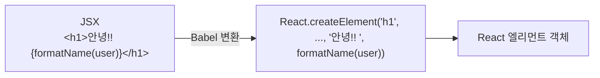
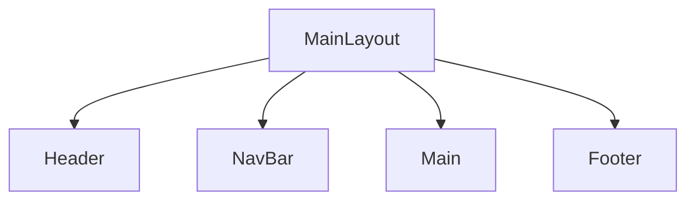
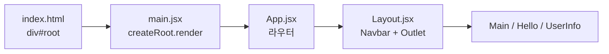
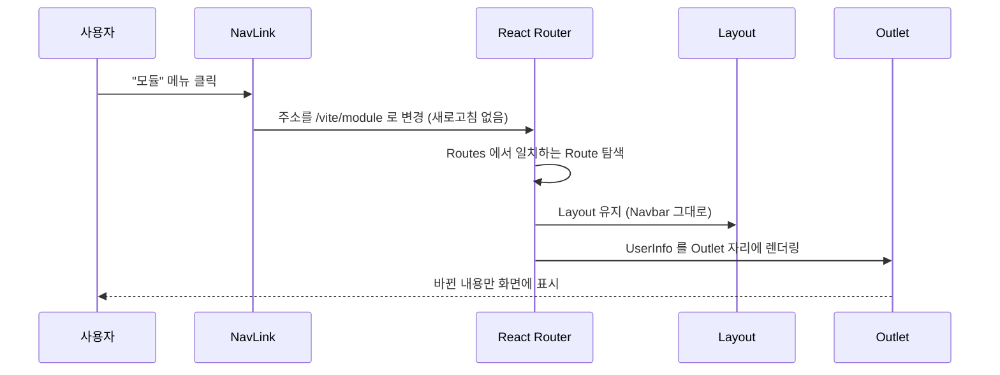

## 들어가며

JavaScript 수업에서는 `document.getElementById()`로 요소를 찾고 `style`이나 `textContent`를 직접 바꿨습니다. 화면이 작을 때는 괜찮지만, 메뉴판·장바구니·리뷰 목록처럼 바뀌는 부분이 많아지면 "어느 요소를 언제 바꿔야 하는지"를 일일이 챙기기가 점점 어려워집니다.

**React**는 이 문제를 다른 방식으로 풉니다. 요소를 하나하나 찾아서 고치는 대신, **"이 데이터일 때 화면은 이렇게 생겼다"를 함수로 선언**하고 실제 DOM 반영은 React에게 맡깁니다. 레고에 비유하면, 블록(컴포넌트)을 만들어 두고 조립 설명서대로 끼워 맞추면 완성품(화면)이 나오는 방식입니다.

이번 수업은 다음 순서로 진행되었습니다.

| 폴더 | 주제 | 핵심 질문 |
|------|------|-----------|
| `01_intro` | createElement, 컴포넌트 개념 | JSX 없이 React는 어떻게 화면을 그릴까? |
| `02_component/01_JSX` | JSX, Fragment | 왜 HTML처럼 생긴 문법을 JS 안에 쓸까? |
| `02_component/02_component` | 함수형 컴포넌트, 조합 | 화면을 어떻게 조각내고 다시 합칠까? |
| `02_component/component-app` | Vite 프로젝트, 모듈, 라우팅, CSS Module | 실제 프로젝트에서는 파일을 어떻게 나누고 연결할까? |

## 01_intro — JSX 없이 React 시작하기

### React를 사용하는 두 가지 방법

수업 주석에서는 React를 쓰는 방법을 크게 두 가지로 소개했습니다.

1. **React 앱 생성** — Vite 같은 도구로 프로젝트를 만들어 사용 (뒤의 `component-app`)
2. **script 태그로 라이브러리 임포트** — HTML 파일에 CDN 주소를 넣어 바로 사용

처음에는 설치 없이 원리를 보기 위해 2번 방식을 사용했습니다.

**수업 예제 코드** (`01_createElement.html`)

```html
<script crossorigin src="https://unpkg.com/react@18.3.1/umd/react.development.js"></script>
<script crossorigin src="https://unpkg.com/react-dom@18.3.1/umd/react-dom.development.js"></script>

<div id="root"></div>

<script>
    /*
        1번째 인자 : 만들려는 요소의 타입 (ex) h1, div, pre)
        2번째 인자 : 요소의 프로퍼티
        3번째 인자 : 자식 요소
    */
    const hiElement = React.createElement('h1', {className: 'hi'}, 'helloworld!!');

    ReactDOM.createRoot(document.getElementById('root')).render(hiElement);
</script>
```

두 개의 라이브러리를 불러온 이유가 있습니다.

| 라이브러리 | 역할 | 비유 |
|------------|------|------|
| `react` | 엘리먼트·컴포넌트를 **만드는** 핵심 기능 | 설계도 작성 |
| `react-dom` | 만든 것을 실제 브라우저 DOM에 **그리는** 기능 | 시공 |

`React.createElement()`는 실제 DOM 요소를 만드는 게 아니라, "h1이고, class는 hi이고, 내용은 helloworld!!"라는 **설명이 담긴 가벼운 JS 객체**를 만듭니다. 이 객체들이 모인 것을 수업에서는 **가상 DOM(Virtual DOM)**, 즉 "메모리 상에 존재하는 DOM"이라고 설명했습니다.

그리고 `ReactDOM.createRoot(#root).render(...)`가 이 설명서를 보고 실제 화면에 그립니다. HTML에는 비어 있는 `<div id="root"></div>` 하나만 있고, 나머지 화면은 전부 React가 이 안에 채워 넣는 구조입니다.

> 참고: HTML의 `class` 속성을 React에서는 `className`으로 씁니다. `class`가 JavaScript 예약어이기 때문입니다.


### 엘리먼트와 컴포넌트

**수업 예제 코드** (`02_component.html`)

```js
/*
    React 에서 중요한 키워드
    1. 엘리먼트 - 요소 노드, 어트리뷰트 노드, 텍스트 노드로 구성
       <h1 class='test'>안녕!!</h1>
    2. 컴포넌트 - 엘리먼트를 반환하는 화면의 구성 조각 단위
*/

// 함수형 컴포넌트 → 함수 이름 앞글자 대문자!!
function Helloworld() {
    return React.createElement('h1', {className: 'hi'}, 'helloworld!!');
}

ReactDOM.createRoot(document.getElementById('root'))
    .render(React.createElement(Helloworld));   // 컴포넌트를 엘리먼트화
```

| 구분 | 엘리먼트 | 컴포넌트 |
|------|----------|----------|
| 정체 | 화면에 그릴 내용을 설명하는 객체 | 엘리먼트를 **반환하는 함수** |
| 비유 | 완성된 레고 블록 하나 | 블록을 찍어내는 틀 |
| 재사용 | 그 자체로 한 번 | 여러 번 호출해 같은 모양을 반복 생성 |

컴포넌트는 그냥 JS 함수이므로 일반 함수와 구분하기 위해 **앞글자를 대문자로** 쓰는 것을 규칙처럼 사용합니다. 이 규칙이 단순한 관례가 아니라 실제로 동작에 영향을 준다는 점은 뒤의 JSX 부분에서 다시 나옵니다.

수업 주석에서 짚었듯이, 요소를 만들 때마다 `createElement`를 중첩해서 쓰면 굉장히 복잡해집니다. 그래서 등장하는 것이 **JSX**입니다.

## 02_component/01_JSX — JSX와 Fragment

### JSX: JS 안에서 HTML처럼 쓰기

**JSX(JavaScript XML)** 는 JavaScript 코드 안에서 XML(HTML과 비슷한) 형태로 엘리먼트를 작성할 수 있게 해 주는 문법입니다. 하지만 브라우저는 JSX를 이해하지 못하기 때문에, **Babel**이라는 트랜스파일러가 JSX를 `React.createElement()` 호출로 변환해 줍니다.

**수업 예제 코드** (`01_jsx-intro.html`)

```html
<!-- 1. 바벨 script 를 head 에 추가 -->
<script crossorigin src="https://unpkg.com/@babel/standalone@8.1.3/babel.min.js"></script>

<!-- 2. script 태그의 type 을 text/babel 로 지정 -->
<script type="text/babel">
    function formatName(user) {
        return `${user.lastName} ${user.firstName}`;
    }
    const user = { firstName : '자바', lastName : '김' };

    // jsx 내에서 중괄호를 활용하여 모든 js 표현식을 사용할 수 있다.
    const element = <h1 class="test">안녕!! {formatName(user)}</h1>
    // const element = React.createElement('h1', {class: "test"}, "안녕!!")

    ReactDOM.createRoot(document.getElementById('root')).render(element);
</script>
```

주석에 남겨진 `createElement` 버전과 비교하면 JSX가 왜 편한지 바로 보입니다. 화면 구조가 HTML처럼 눈에 보이니까요.



JSX 안의 **중괄호 `{ }`** 는 "여기부터는 JavaScript"라는 표시입니다. 변수, 함수 호출, 계산식처럼 **값이 나오는 표현식**이면 무엇이든 넣을 수 있습니다. 다만 `if`문이나 `for`문 같은 "문(statement)"은 값이 아니라 넣을 수 없습니다.

> 예제에서는 `class="test"`를 썼는데, React에서 권장하는 이름은 `className`입니다. 개발 모드에서 `class`를 쓰면 콘솔에 경고가 표시될 수 있으니 실제 코드에서는 `className`을 사용하는 습관을 들이는 것이 좋습니다.

### Fragment: 최상위 요소는 하나여야 한다

JSX에는 지켜야 할 규칙이 있습니다. 수업에서는 그중 가장 먼저 만나게 되는 규칙을 다뤘습니다.

**수업 예제 코드** (`02_fragment.html`)

```jsx
const user = { name : '김자바', phone : '010-0000-0000' }

// 1. 최상위 엘리먼트가 두 개 이상(같은 레벨)이면 문법 에러
// const element = (
//     <h1>{user.name}</h1>
//     <h3>{user.phone}</h3>
// );

// 2. 최상위 엘리먼트 내부에 넣어서 하나의 돔트리 생성
// const element = (
//     <div>
//         <h1>{user.name}</h1>
//         <h3>{user.phone}</h3>
//     </div>
// );

// 3. <></> (React.Fragment)
const element = (
    <>
        <h1>{user.name}</h1>
        <h3>{user.phone}</h3>
    </>
);
```

왜 최상위 요소가 하나여야 할까요? JSX는 결국 `React.createElement(...)` **함수 호출 하나**로 바뀌는데, JavaScript에서 하나의 표현식이 두 개의 값을 동시에 반환할 수는 없기 때문입니다. 택배 상자 두 개를 하나의 송장으로 보낼 수 없으니 큰 상자 하나에 묶어야 하는 것과 같습니다.

| 방법 | 결과 | 단점 |
|------|------|------|
| 형제 요소 나열 | 문법 에러 | - |
| `<div>`로 감싸기 | 동작함 | 실제 DOM에 의미 없는 `div`가 추가되어 레이아웃·CSS에 영향 |
| `<>...</>` (Fragment) | 동작함 | 실제 DOM에는 **아무것도 추가되지 않음** |

Fragment는 "포장지만 있고 상자는 없는" 묶음이라고 생각하면 됩니다. 수업에서는 `div`로 감싸면 **불필요한 div 영역이 생긴다**는 점을 Fragment를 쓰는 이유로 들었습니다.

## 02_component/02_component — 함수형 컴포넌트와 조합

### 함수형 컴포넌트 규칙

**수업 예제 코드** (`01_function-component.html`)

```jsx
// 함수형 컴포넌트의 특징
// 1. 앞글자 대문자!
// 2. return 엘리먼트!
function Header() {
    return (
        <>
            <h1>헤더입니다!!</h1>
            <h3>사이트 이름~~~</h3>
        </>
    );
}

ReactDOM.createRoot(document.getElementById('root'))
        // .render(React.createElement(Header));
        .render(<Header/>);
```

`<Header/>`는 `React.createElement(Header)`를 JSX로 쓴 것입니다. 여기서 대문자 규칙이 중요해집니다. 수업 주석 그대로, **컴포넌트의 앞글자가 소문자면 컴포넌트로 인식하지 않고 단순 HTML 요소로 인식**합니다.

| JSX | Babel 변환 결과 | 의미 |
|-----|-----------------|------|
| `<header/>` | `createElement('header')` | 문자열 → HTML `header` 태그 |
| `<Header/>` | `createElement(Header)` | 함수 참조 → 우리가 만든 컴포넌트 |

### 컴포넌트 조합(Composition)

작은 컴포넌트를 만들었다면 이제 레고처럼 조립할 차례입니다.

**수업 예제 코드** (`02_composition.html`)


```jsx
function Header() { return (<><h1>헤더입니다!!</h1><h3>사이트 이름~~~</h3></>); }
function NavBar() { return (<><h3>네비게이션 바 입니다!!</h3></>); }
function Footer() { return (<><h3>푸터 입니다!!!</h3></>); }

const user = { name : "김자바", age : 20, gender : '남' };

function Main() {
    return (
        <>
            <h3>이름 : {user.name}</h3>
            <h3>나이 : {user.age}</h3>
            <h3>성별 : {user.gender}</h3>
        </>
    );
}

function MainLayout() {
    return (
        <div style={{border : '1px solid black', backgroundColor : 'red'}}>
            <Header/>
            <NavBar/>
            <Main/>
            <Footer/>
        </div>
    );
}

ReactDOM.createRoot(document.getElementById('root')).render(<MainLayout/>);
```




화면을 이렇게 쪼개면 좋은 점이 있습니다.

- **역할이 분리됩니다.** 푸터 문구를 바꾸고 싶으면 `Footer`만 보면 됩니다.
- **재사용할 수 있습니다.** `Header`를 다른 레이아웃에서도 그대로 가져다 쓸 수 있습니다.
- **구조가 읽힙니다.** `MainLayout`만 봐도 페이지가 위에서 아래로 어떻게 구성되는지 한눈에 들어옵니다.

#### 인라인 스타일 문법

`MainLayout`의 `style` 속성에서 중괄호가 두 겹인 이유는 각각 의미가 다르기 때문입니다.

| 부분 | 의미 |
|------|------|
| 바깥 중괄호 | "여기부터 JS 표현식"이라는 JSX 표시 |
| 안쪽 중괄호 | 스타일을 담은 **JS 객체** 리터럴 |
| `backgroundColor` | CSS의 `background-color`를 **카멜 케이스**로 작성 |

HTML에서는 `style="background-color: red"`처럼 문자열이지만, React에서는 스타일을 **객체**로 넘깁니다.

## 02_component/component-app — Vite 프로젝트로 옮기기

CDN + Babel 방식은 원리를 보기에는 좋지만, 브라우저가 매번 JSX를 변환해야 해서 느리고 파일을 나누기도 어렵습니다. 그래서 실제 개발에서는 **Vite** 같은 빌드 도구로 프로젝트를 생성합니다.

| 항목 | CDN + Babel standalone | Vite 프로젝트 |
|------|------------------------|---------------|
| 설치 | 없음 (script 태그) | Node.js + `npm` |
| JSX 변환 | 브라우저에서 실행 중 변환 | 개발 서버·빌드 단계에서 미리 변환 |
| 파일 분리 | 어려움 (한 HTML 안에 작성) | `import`/`export`로 자유롭게 |
| 용도 | 학습·간단한 데모 | 실제 프로젝트 |

### 프로젝트 구조와 시작점

**수업 예제 코드** (`package.json` 일부)

```json
{
  "type": "module",
  "scripts": {
    "dev": "vite",
    "build": "vite build",
    "lint": "oxlint",
    "preview": "vite preview"
  },
  "dependencies": {
    "react": "^19.3.1",
    "react-dom": "^19.3.1",
    "react-router-dom": "^7.18.6"
  }
}
```

`npm run dev`로 개발 서버를 띄우고, `npm run build`로 배포용 파일을 만듭니다. 템플릿에는 코드 검사 도구인 **oxlint** 설정(`.oxlintrc.json`)도 포함되어 있어, 예를 들어 Hooks 규칙(`react/rules-of-hooks`)을 어기면 에러로 알려 줍니다. `vite.config.js`에서는 `@vitejs/plugin-react` 플러그인을 등록해 JSX 변환과 HMR(저장하면 새로고침 없이 바로 반영)을 활성화합니다.

앱이 시작되는 흐름은 CDN 예제와 똑같습니다. 차이는 코드가 파일로 나뉘었다는 것뿐입니다.

**수업 예제 코드** (`index.html`, `src/main.jsx`)

```html
<!-- index.html -->
<div id="root"></div>
<script type="module" src="/src/main.jsx"></script>
```

```jsx
// src/main.jsx
import { createRoot } from 'react-dom/client'
import App from './App.jsx'

createRoot(document.getElementById('root')).render(<App />)
```



`.jsx` 확장자에 대해 수업 주석은 이렇게 설명합니다. 단순 `.js` 파일이 아니라 **JSX 문법으로 컴포넌트를 작성하는 파일임을 확실하게 나타내기 위해** 사용한다는 것이죠.

**수업 예제 코드** (`src/module/01_intro/01_intro.jsx`)

```jsx
function Hello() {
    return <h3>HelloWorld~~~~~~~</h3>
}

export default Hello;
```

### 모듈: import와 export

파일을 나누면 서로 연결해 주는 장치가 필요합니다. 그것이 **ES 모듈**의 `import`/`export`입니다.

**수업 예제 코드** (`src/module/02_module/`)


```js
// user.js — 이름 있는 export (중괄호로 import)
export const user = {
    name : '김자바',
    age : 20,
    email : "java@example.com"
};
```

```jsx
// AgeCard.jsx — default export
import { user } from "./user";

export default function AgeCard() {
    return <h2 style={{color : 'orange'}}>{user.age}</h2>
}
```

```jsx
// UserInfo.jsx — Age, Name, Email 컴포넌트를 하나로 묶는 상위 컴포넌트
import NameCard from "./NameCard";
import AgeCard from "./AgeCard";
import EmailCard from "./EmailCard";

function UserInfo() {
    return (
        <div style={{ width : 300, border : '1px solid black' }}>
            <NameCard/>
            <AgeCard/>
            <EmailCard/>
        </div>
    );
}
export default UserInfo;
```


`NameCard`, `EmailCard`도 `AgeCard`와 같은 모양으로 각각 `user.name`(빨강), `user.email`(파랑)을 보여 줍니다. 데이터(`user.js`)는 한 곳에 두고, 세 컴포넌트가 같은 데이터를 가져다 쓰는 구조입니다. 또 `width : 300`처럼 단위 없이 숫자를 넣으면 React가 `px`로 처리합니다.

| 구분 | `export default` | `export` (named) |
|------|------------------|------------------|
| 파일당 개수 | **1개** | 여러 개 가능 |
| 내보내기 | `export default function AgeCard()` | `export const user = ...` |
| 가져오기 | `import AgeCard from "./AgeCard"` (중괄호 없음, 이름 자유) | `import { user } from "./user"` (중괄호, 이름 일치) |
| 주 용도 | 파일의 대표 컴포넌트 | 데이터, 유틸 함수, 여러 개를 내보낼 때 |

수업 주석에서는 실전 팁도 남겼습니다. **React에서는 import/export가 굉장히 중요하며, 오류가 나면 가장 먼저 import 구문을 확인하라**는 것입니다. 경로 오타, default와 named를 헷갈린 경우(중괄호 유무)가 초보 단계에서 가장 흔한 에러 원인입니다.

### 라우팅: react-router-dom

`Hello`와 `UserInfo`를 만들었으니 `App`에 넣으면 화면에 나옵니다. 처음에는 이렇게 했습니다.

```jsx
// 처음 버전 (주석 처리됨)
// <>
//   <Hello/>
//   <UserInfo/>
// </>
```

하지만 수업 주석의 지적처럼, 실제 프로젝트에는 **여러 페이지가 있고 페이지마다 보여야 할 컴포넌트가 다릅니다**. 모든 컴포넌트를 한 화면에 늘어놓을 수는 없죠. 그래서 **라우팅**, 즉 요청한 URL 주소에 따라 보여 줄 컴포넌트를 정하는 기능이 필요합니다.

**수업 예제 코드** (`src/App.jsx`)

```jsx
import { BrowserRouter, Routes, Route } from 'react-router-dom';
import Layout from "./layouts/Layout";
import Main from "./pages/Main";
import Hello from "./module/01_intro/01_intro"
import UserInfo from "./module/02_module/UserInfo"

function App() {
  return (
    <BrowserRouter>
        <Routes>
          <Route path="/" element={<Layout/>}>
             <Route index element={<Main/>}/>
             <Route path="vite/intro" element={<Hello/>}/>
             <Route path="vite/module" element={<UserInfo/>}/>
          </Route>
        </Routes>
    </BrowserRouter>
  )
}
export default App
```

| 컴포넌트 | 역할 |
|----------|------|
| `BrowserRouter` | 라우팅을 사용할 영역 전체를 감싸는 최상위 요소 |
| `Routes` | 여러 `Route`를 묶는 부모. 현재 주소와 맞는 것을 골라 줌 |
| `Route` | `path`(주소)와 `element`(보여 줄 컴포넌트)를 연결 |
| `index` | 부모 경로(`/`) 그대로일 때 보여 줄 기본 자식 |

`Route` 안에 `Route`가 들어 있는 **중첩 라우트** 구조라는 점이 중요합니다. 부모 `Layout`은 항상 보이고, 자식 경로에 따라 안쪽 내용만 바뀝니다.

| 주소 | 보이는 화면 |
|------|-------------|
| `/` | Layout + `Main` ("왼쪽 메뉴바에서 챕터를 선택해주세요") |
| `/vite/intro` | Layout + `Hello` |
| `/vite/module` | Layout + `UserInfo` |

### Outlet: 바뀌는 자리를 비워 두기

**수업 예제 코드** (`src/layouts/Layout.jsx`)

```jsx
import { Outlet } from 'react-router-dom';
import Navbar from '../components/Navbar';
import styles from './Layout.module.css';

function Layout() {
    return (
        <div className={styles.layout}>
            <Navbar/>
            <main className={styles.content}>
                {/* JSX 내부의 주석
                    Outlet 은 경로(Path)에 따라 다른 컴포넌트로 대체되는 엘리먼트 */}
                <Outlet/>
            </main>
        </div>
    );
}
export default Layout;
```

`Outlet`은 액자의 **빈 틀**과 같습니다. 액자 테두리(`Navbar`)는 그대로 두고, 주소가 바뀔 때마다 틀 안의 사진(자식 Route의 컴포넌트)만 갈아 끼웁니다. 그래서 메뉴를 클릭해도 Navbar는 그대로 있고 `Outlet` 부분만 바뀝니다.

여기서 하나 더 배운 것이 **JSX 주석** 문법입니다. JSX 안에서는 HTML 주석(`<!-- -->`)을 쓸 수 없고, 중괄호 안에 JS 블록 주석을 넣는 `{/* ... */}` 형태로 작성합니다.



### Link / NavLink: 새로고침 없는 이동

**수업 예제 코드** (`src/components/Navbar.jsx`)

```jsx
import { NavLink } from 'react-router-dom';
import styles from './Navbar.module.css';

// 현재 주소와 일치하면 isActive 가 true → 스타일 변경
const activeStyle = ({isActive}) =>
    isActive ? {backgroundColor: 'orangered', color: 'white'} : undefined;

function Navbar() {
    return (
        <nav className={styles.nav}>
            <h2><NavLink to="/">React 챕터</NavLink></h2>
            <h4>01. Vite</h4>
            <NavLink to="/vite/intro" style={activeStyle}>프로젝트 생성</NavLink>
            <NavLink to="/vite/module" style={activeStyle}>모듈</NavLink>
        </nav>
    );
}
export default Navbar;
```

| 방식 | 동작 | 특징 |
|------|------|------|
| `<a href>` | 페이지 전체를 서버에서 새로 불러옴 | 화면 깜빡임, 상태 초기화 |
| `<Link to>` | 새로고침 없이 주소만 바꾸고 컴포넌트 교체 | 빠르고 부드러움 |
| `<NavLink to>` | `Link`와 같음 + 현재 주소와 일치하면 `isActive: true` | 현재 메뉴 강조 표시에 적합 |

`NavLink`의 `style`에는 객체 대신 **함수**를 넘길 수 있습니다. React Router가 `{ isActive }`를 인자로 넣어 호출해 주고, 그 반환값이 스타일이 됩니다. JavaScript 수업에서 배운 **객체 구조 분해(`{isActive}`)** 와 **화살표 함수**, **삼항 연산자**가 한 줄에 모두 쓰인 좋은 예입니다.

### CSS Module: 스타일 충돌 막기

**수업 예제 코드** (`Navbar.module.css`, `Layout.module.css`)

```css
/* Navbar.module.css */
.nav {
    width: 180px;
    padding: 10px;
    background-color: #f2f2f2;
    display: flex;
    flex-direction: column;
}

/* Layout.module.css */
.layout { display: flex; min-height: 100vh; }
.content { flex: 1; padding: 20px; }
```

```jsx
import styles from './Navbar.module.css';
<nav className={styles.nav}>...</nav>
```

일반 CSS(`import './style.css'`)는 **페이지 전체에 적용**됩니다. 그래서 `Navbar`의 `.nav`와 다른 컴포넌트의 `.nav`가 서로 덮어쓰는 충돌이 생길 수 있습니다. 컴포넌트가 많아질수록 이 문제는 커지죠.

**CSS Module**은 파일 이름을 `이름.module.css`로 짓고 객체처럼 import해서 `className`에 넣는 방식입니다. 빌드할 때 클래스 이름이 `Navbar-module__nav__xxxxx`처럼 **고유한 이름으로 바뀌기 때문에** 다른 컴포넌트와 충돌하지 않습니다.

| 방식 | 가져오기 | 적용 범위 | 충돌 가능성 |
|------|----------|-----------|-------------|
| 일반 CSS | `import './style.css'` | 페이지 전체 | 있음 |
| CSS Module | `import styles from './X.module.css'` | 해당 컴포넌트 | 없음 (이름 자동 변환) |
| 인라인 스타일 | `style` 속성에 객체 | 해당 요소 하나 | 없음 (단, 재사용·hover 등 표현 제한) |

레이아웃 쪽은 `display: flex`로 왼쪽에 고정 폭(180px)의 Navbar, 오른쪽에 `flex: 1`로 남은 공간을 모두 차지하는 본문 영역을 배치했습니다.

## 정리

| 단계 | 배운 것 | 핵심 한 줄 |
|------|---------|------------|
| 01_intro | CDN, `createElement`, `createRoot().render()`, 엘리먼트 vs 컴포넌트 | React는 JS 객체(가상 DOM)로 화면을 설명하고 ReactDOM이 그린다 |
| 01_JSX | JSX, Babel, 중괄호 표현식, Fragment | JSX는 `createElement`의 편한 표기법이며 최상위는 하나 |
| 02_component | 함수형 컴포넌트, 대문자 규칙, 조합, 인라인 스타일 | 화면을 작은 함수로 쪼개고 레고처럼 조립한다 |
| component-app | Vite, `.jsx`, import/export, react-router-dom, Outlet, NavLink, CSS Module | 실제 프로젝트는 파일을 나누고 URL에 따라 컴포넌트를 바꿔 끼운다 |

한 문장으로 정리하면, React는 **"화면을 직접 고치는 방식"에서 "화면을 함수로 선언하는 방식"으로의 전환**입니다. 이번 수업에서 만든 컴포넌트들은 아직 데이터가 고정되어 있지만(`user` 객체를 직접 import), 다음 단계에서 props와 state를 배우면 같은 컴포넌트가 다른 데이터를 받아 다르게 보이고, 사용자 동작에 따라 스스로 다시 그려지게 됩니다.

## 더 학습하면 좋은 개념

- **Props** — 부모 컴포넌트가 자식에게 데이터를 넘기는 방법입니다. 지금은 `NameCard`가 `user`를 직접 import하지만, props를 쓰면 어떤 사용자든 보여 주는 재사용 가능한 카드가 됩니다.
- **State와 useState** — 컴포넌트가 기억하는 값이며, 바뀌면 React가 화면을 다시 그립니다. JavaScript 수업에서 DOM을 직접 바꾸던 작업을 React 방식으로 바꾸는 핵심입니다.
- **리스트 렌더링과 key** — 배열의 `map()`으로 컴포넌트 목록을 만드는 방법입니다. JavaScript 수업의 고차 함수가 React에서 가장 많이 쓰이는 자리이며, `key`가 왜 필요한지 알아야 렌더링 버그를 피할 수 있습니다.
- **렌더링과 재조정(Reconciliation)** — 가상 DOM을 비교해 바뀐 부분만 실제 DOM에 반영하는 과정입니다. "왜 React가 빠른가", "왜 불필요한 리렌더링을 줄여야 하는가"를 이해하는 기반이 됩니다.
- **React Router의 useParams·useNavigate** — URL의 일부를 값으로 꺼내거나 코드로 페이지를 이동하는 기능입니다. 상세 페이지(`/menu/3`)나 로그인 후 이동 같은 실제 기능을 만들 때 필요합니다.

## 참고 자료

- [React 공식 문서 - 빠르게 시작하기](https://react.dev/learn)
- [React 공식 문서 - JSX로 마크업 작성하기](https://react.dev/learn/writing-markup-with-jsx)
- [React 공식 문서 - 첫 번째 컴포넌트](https://react.dev/learn/your-first-component)
- [React 공식 문서 - 컴포넌트 import 및 export 하기](https://react.dev/learn/importing-and-exporting-components)
- [React 공식 문서 - Fragment](https://react.dev/reference/react/Fragment)
- [React 공식 문서 - createElement](https://react.dev/reference/react/createElement)
- [React 공식 문서 - createRoot](https://react.dev/reference/react-dom/client/createRoot)
- [Vite 공식 문서 - 시작하기](https://vite.dev/guide/)
- [MDN - JavaScript 모듈](https://developer.mozilla.org/en-US/docs/Web/JavaScript/Guide/Modules)
