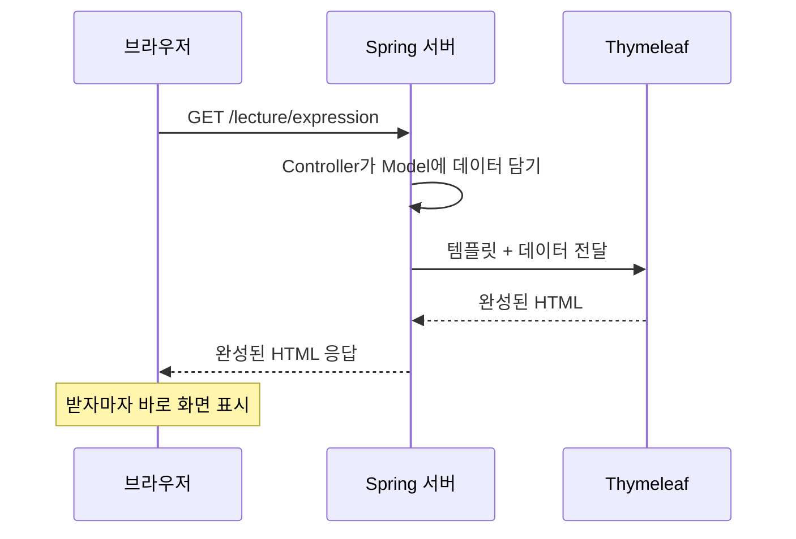
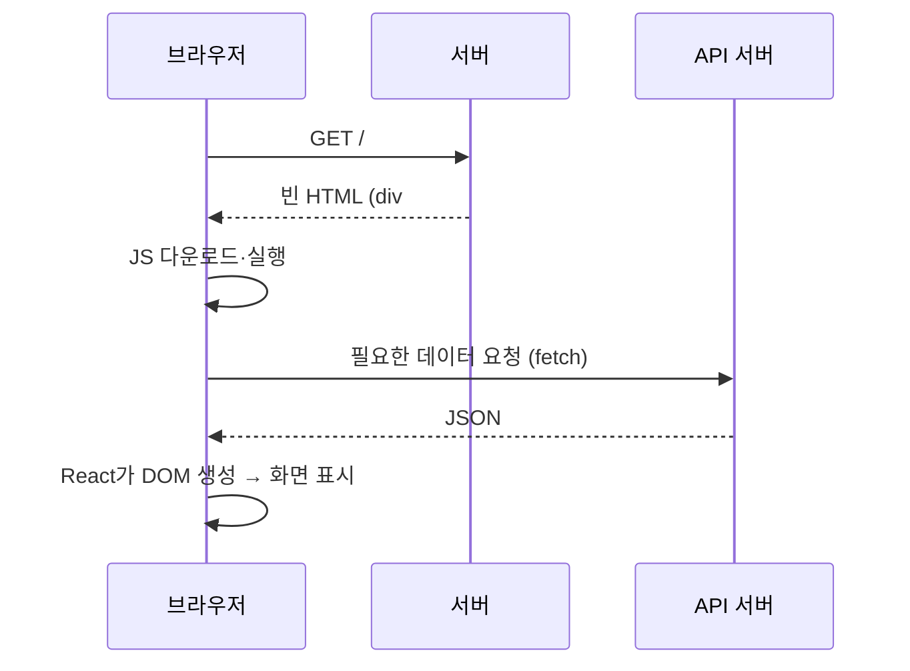
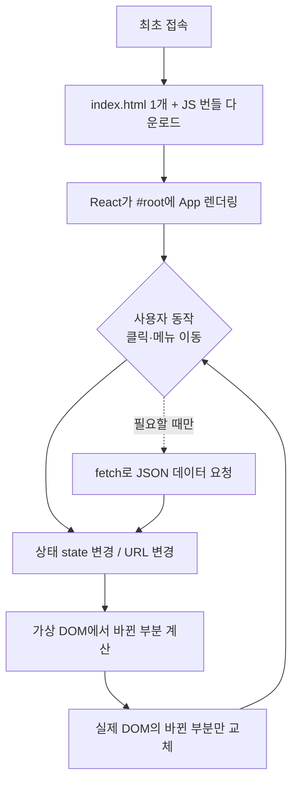
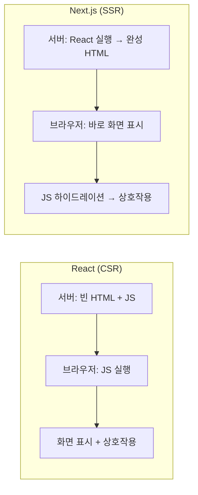
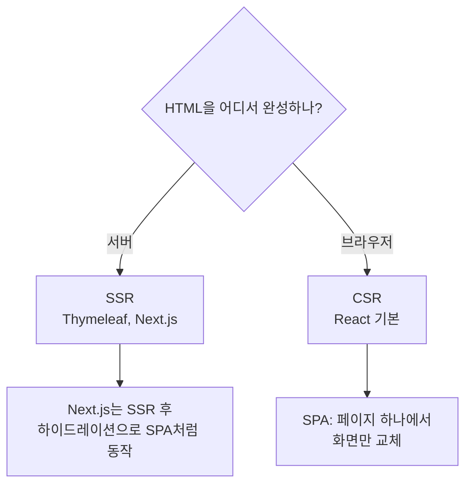

## 들어가며

지금까지 수업에서 화면을 만드는 방법을 두 가지 배웠습니다.

- **Spring Web MVC + Thymeleaf**: 컨트롤러가 데이터를 모델에 담고, Thymeleaf 템플릿이 그 데이터를 채운 **완성된 HTML**을 브라우저로 보냅니다.
- **React**: 브라우저가 거의 빈 HTML(`<div id="root"></div>`)과 JavaScript를 받은 뒤, **JavaScript가 직접 화면을 그립니다.**

둘 다 결국 브라우저에 HTML이 보이는 건 같지만, **"HTML을 누가, 어디서 완성하느냐"**가 다릅니다. 오늘 수업 키워드 세 가지를 이 질문 하나로 정리해 봅니다.

| 오늘의 키워드 | 한 줄 요약 |
|---|---|
| 1. SSR / CSR 렌더링 차이 | Thymeleaf는 서버가 그리고(SSR), React는 브라우저가 그린다(CSR) |
| 2. React의 특징인 SPA | 페이지는 하나, 화면만 바꿔 끼운다 |
| 3. (심화) React / Next 렌더링 차이 | React는 기본이 CSR, Next.js는 서버에서 먼저 그려서 보내는 SSR을 지원 |

## 1. SSR과 CSR — 렌더링 위치의 차이

**렌더링(rendering)**은 데이터와 템플릿을 합쳐서 사용자가 보는 화면(HTML)을 만드는 과정입니다.

- **SSR (Server Side Rendering, 서버 쪽 렌더링)**: 서버에서 HTML을 완성해서 보냅니다.
- **CSR (Client Side Rendering, 브라우저 쪽 렌더링)**: 서버는 재료(빈 HTML + JS)만 보내고, 브라우저가 JS를 실행해서 HTML을 만듭니다.

식당에 비유하면 SSR은 **완성된 요리가 나오는 식당**, CSR은 **밀키트를 받아서 내가 조리하는 방식**입니다.

### Thymeleaf = SSR

수업 예제 코드 (08_Spring-Web-MVC, chap07-thymeleaf):

```html
<p th:text="${ param.title }"></p>
<p th:text="${ param.no[0] }"></p>
<p th:text="#{ message.value }"></p>
```

`th:text`, `${...}` 같은 문법은 **브라우저가 아니라 서버(Spring)에서 해석**됩니다. 브라우저가 받는 HTML에는 이미 값이 채워진 `<p>제목</p>`만 남아 있습니다. 페이지 소스 보기(Ctrl+U)를 하면 데이터가 들어간 HTML이 그대로 보이는 이유입니다.



### React = CSR

수업 예제 코드 (12_React.js, 01_intro):

```html
<div id="root"></div>

<script>
    // 1번째 인자: 요소 타입, 2번째: 속성, 3번째: 자식
    const hiElement = React.createElement('h1', {className: 'hi'}, 'helloworld!!');
    ReactDOM.createRoot(document.getElementById('root')).render(hiElement);
</script>
```

서버가 보낸 HTML에는 `<div id="root"></div>` 하나뿐입니다. `<h1>helloworld!!</h1>`은 **브라우저가 JavaScript를 실행한 뒤에야** 생깁니다. 페이지 소스 보기를 하면 내용이 거의 비어 있습니다.



### 한눈에 비교

| 항목 | SSR (Thymeleaf) | CSR (React) |
|---|---|---|
| HTML을 만드는 곳 | 서버 | 브라우저 |
| 서버가 보내는 것 | 완성된 HTML | 빈 HTML + JS 번들 |
| 첫 화면 표시 | 빠름 (받자마자 보임) | JS를 받아 실행할 때까지 빈 화면 |
| 페이지 이동 | 매번 새 HTML 요청 → 화면 깜빡임 | 필요한 데이터만 받아 화면 일부 교체 |
| 검색엔진(SEO) | 유리 (HTML에 내용이 있음) | 불리할 수 있음 (처음 HTML이 비어 있음) |
| 서버 부담 | 요청마다 HTML 생성 | 정적 파일 + 데이터 API만 |
| 서버와 데이터 주고받는 형식 | HTML | 주로 JSON |

어느 쪽이 무조건 좋은 게 아니라, **첫 화면 속도·SEO가 중요하면 SSR, 앱처럼 부드러운 상호작용이 중요하면 CSR**이 유리합니다.

## 2. React의 특징 — SPA (Single Page Application)

**SPA**는 이름 그대로 **HTML 페이지가 단 하나**인 웹 애플리케이션입니다. 처음에 `index.html` 하나를 받은 뒤에는 페이지를 새로 받지 않고, JavaScript가 **화면 내용만 바꿔 끼웁니다.**

수업에서 만든 Vite 기반 `component-app`도 진입점은 하나입니다.

```jsx
// 수업 예제 코드 (component-app/src/main.jsx)
import { createRoot } from 'react-dom/client'
import App from './App.jsx'

createRoot(document.getElementById('root')).render(
    <App />
)
```

`index.html`의 `#root` 안에 `<App />`을 한 번 붙이면, 그 뒤의 모든 화면 변화는 React가 이 안에서 처리합니다.

### 동작 방식



핵심 포인트는 세 가지입니다.

1. **페이지 새로고침이 없다**: 메뉴를 눌러도 서버에 새 HTML을 요청하지 않습니다. URL은 브라우저의 History API로 바꾸고(라우팅 라이브러리가 담당), 화면은 컴포넌트만 교체합니다.
2. **가상 DOM(Virtual DOM)**: 수업 자료 주석에 나온 것처럼 React는 메모리에 DOM의 사본을 두고, 바뀐 부분만 계산해서 실제 DOM에 반영합니다. 매번 화면 전체를 다시 그리지 않아서 효율적입니다.
3. **데이터만 주고받는다**: 서버와는 HTML이 아닌 JSON 데이터만 주고받습니다. 그래서 백엔드(Spring)는 화면 대신 **REST API**를 제공하는 역할로 나뉩니다.

| 비교 | 전통적인 MPA (Thymeleaf) | SPA (React) |
|---|---|---|
| HTML 페이지 수 | 화면마다 하나 | 하나 (`index.html`) |
| 메뉴 클릭 시 | 서버에 새 페이지 요청 | JS가 화면만 교체 |
| 사용자 경험 | 매번 깜빡임 | 앱처럼 부드러움 |
| 초기 로딩 | 가벼움 | JS 번들을 다 받아야 해서 무거울 수 있음 |

## 3. (심화) React와 Next.js의 렌더링 차이

React만 쓰면 기본적으로 **CSR**이라, 앞에서 본 단점(첫 화면이 늦고 SEO에 불리)이 그대로 있습니다. 이걸 보완하려고 나온 React 기반 프레임워크가 **Next.js**입니다.

Next.js는 **서버에서 React 컴포넌트를 미리 실행해서 HTML을 만들어 보내고(SSR)**, 브라우저에 도착한 뒤에는 JS가 그 HTML에 이벤트를 연결해서 다시 React 앱처럼 동작하게 합니다. 이 연결 과정을 **하이드레이션(hydration, 물 주기)**이라고 부릅니다. 마른 HTML에 JS라는 물을 줘서 살아 움직이게 한다는 비유입니다.



| 항목 | React (Vite 등으로 만든 기본 앱) | Next.js |
|---|---|---|
| 기본 렌더링 | CSR | SSR 지원 (서버에서 HTML 생성) |
| 첫 화면 | JS 실행 후 표시 | 서버가 만든 HTML 바로 표시 |
| SEO | 불리할 수 있음 | 유리 |
| 라우팅 | 라이브러리 추가 (예: React Router) | 파일/폴더 구조가 곧 라우트 |
| 서버 필요 여부 | 정적 파일 호스팅으로 충분 | SSR을 쓰려면 Node.js 서버 실행 환경 필요 |
| 렌더링 선택지 | CSR | SSR, SSG(빌드 때 미리 생성), CSR 등을 페이지별로 선택 |

정리하면 Next.js는 **"Thymeleaf처럼 서버에서 그려서 빠르게 보여주고, 도착한 뒤엔 React처럼 부드럽게 동작"**하는, SSR과 CSR의 장점을 섞은 방식입니다. 다만 Next.js가 SSR만 하는 것은 아니고, 페이지마다 SSR·SSG·CSR을 골라 쓸 수 있다는 점은 기억해 두면 좋습니다.

## 정리



- **Thymeleaf**: 서버가 완성된 HTML을 보내는 **SSR**. 페이지 이동마다 새 HTML을 받습니다.
- **React**: 브라우저가 JS로 화면을 그리는 **CSR**이고, 페이지 하나에서 화면만 바꾸는 **SPA**로 동작합니다.
- **Next.js**: React를 서버에서 먼저 렌더링하는 **SSR**을 지원해서, 첫 화면 속도와 SEO 문제를 보완합니다.

## 더 학습하면 좋은 개념

- **하이드레이션(Hydration)** — Next.js SSR의 핵심. 서버 HTML과 클라이언트 렌더링 결과가 다르면 생기는 "hydration mismatch" 오류를 이해하려면 꼭 필요합니다.
- **SSG / ISR** — 빌드 시점에 HTML을 미리 만드는 방식. 블로그처럼 자주 안 바뀌는 페이지에 SSR보다 효율적입니다 (이 블로그의 Jekyll도 SSG입니다).
- **React Server Components** — Next.js App Router의 기본 컴포넌트 방식. 컴포넌트 단위로 서버/클라이언트 실행을 나눕니다.
- **REST API 설계** — SPA에서는 Spring이 HTML 대신 JSON을 내려줘야 하므로, `@RestController`로 API를 설계하는 법이 다음 단계입니다.
- **Core Web Vitals (LCP, INP, CLS)** — 렌더링 방식 선택이 실제 사용자 체감 속도에 어떤 영향을 주는지 수치로 볼 수 있는 지표입니다.

## 참고 자료

- [MDN - SPA (Single-page application)](https://developer.mozilla.org/en-US/docs/Glossary/SPA)
- [React 공식 문서 - createRoot](https://react.dev/reference/react-dom/client/createRoot)
- [React 공식 문서 - hydrateRoot](https://react.dev/reference/react-dom/client/hydrateRoot)
- [Next.js 공식 문서 - Rendering](https://nextjs.org/docs/app/building-your-application/rendering)
- [Thymeleaf 공식 문서](https://www.thymeleaf.org/documentation.html)
- [web.dev - Rendering on the Web](https://web.dev/articles/rendering-on-the-web)
