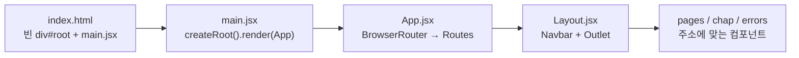
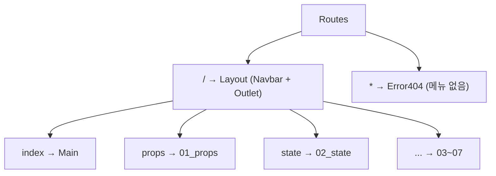
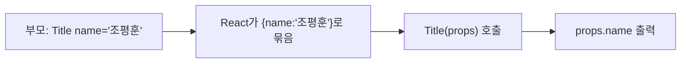
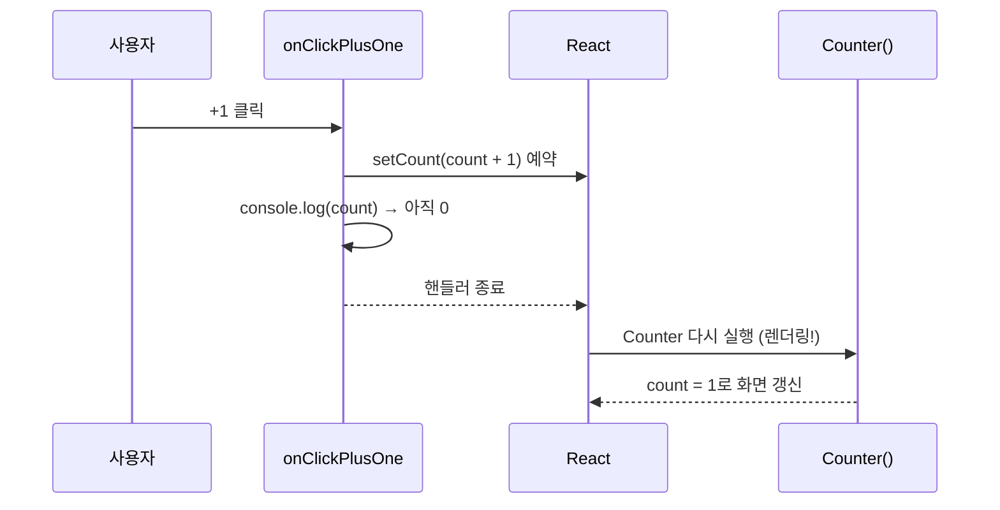
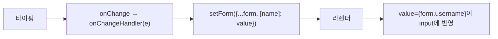
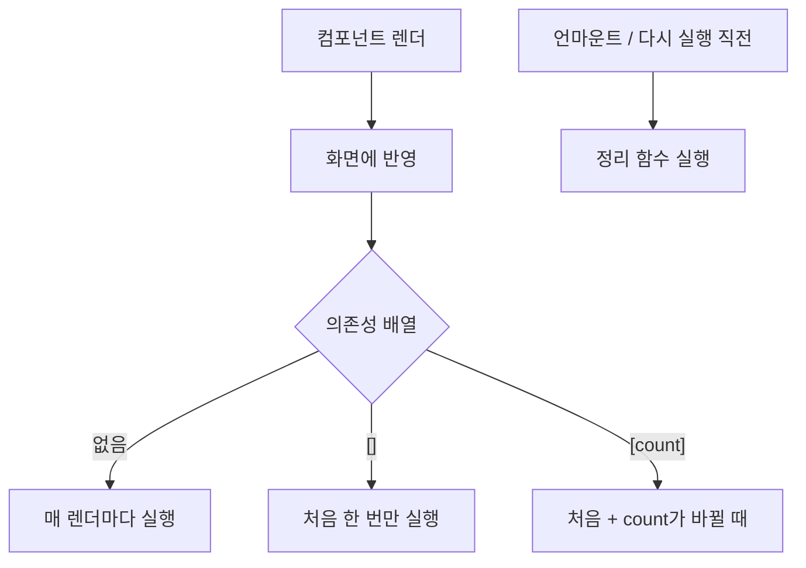
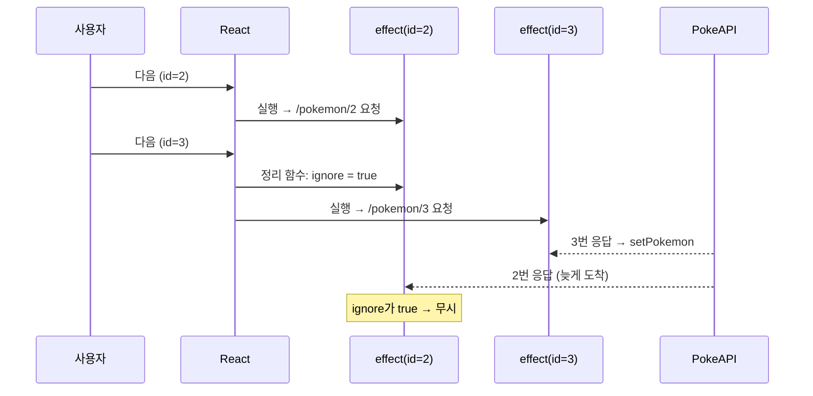
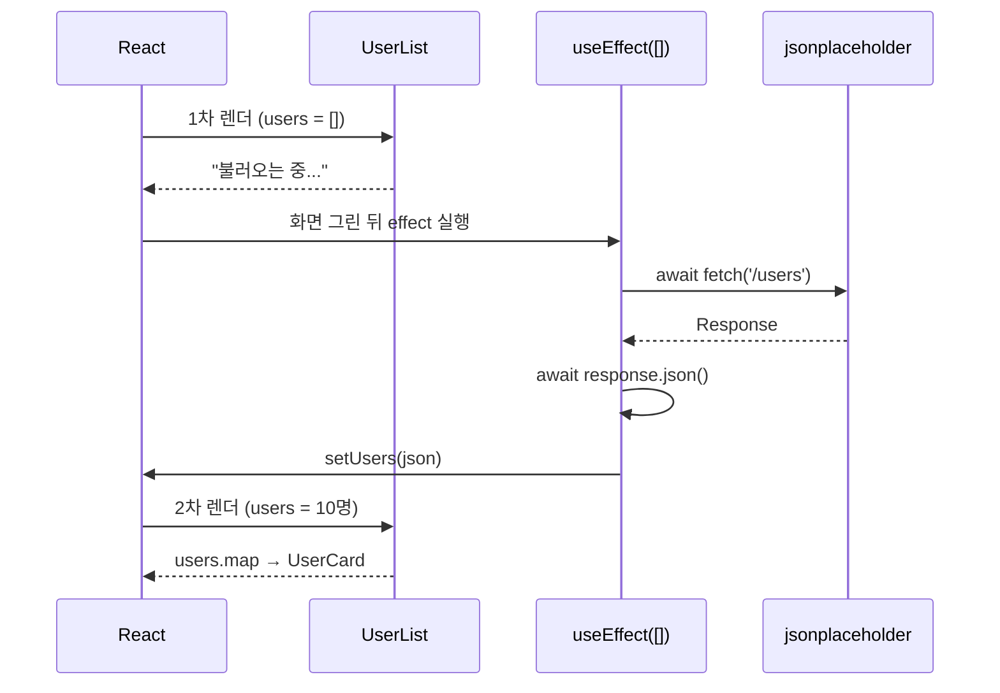

## 들어가며

React 수업 마지막 파트에서는 `data-fetch-app-skeleton`이라는 Vite 프로젝트를 받았습니다. 라우터와 왼쪽 메뉴는 미리 만들어져 있고, 수업에서는 `src/chap` 안의 7개 챕터 파일만 채워 나갑니다.

이번 글은 **"코드가 어떤 순서로 실행되는가"** 하나에 집중해서 정리합니다. 앱이 켜지는 순서, 주소마다 그려지는 파일, 챕터마다 버튼을 눌렀을 때 일어나는 일, 그리고 데이터 요청의 시간 순서입니다.

| 챕터 | 파일 | 배우는 것 | 상태 |
|---|---|---|---|
| 01 | `01_props.jsx` | 부모 → 자식 값 전달, children | 작성 완료 |
| 02 | `02_state.jsx` | useState, 리렌더링, prev 갱신 | 작성 완료 |
| 03 | `03_event.jsx` | onChange, 제어 컴포넌트, 객체 state | 작성 완료 |
| 04 | `04_iteration.jsx` | map, key, 배열 state 추가·삭제 | 작성 완료 |
| 05 | `05_useEffect.jsx` | 의존성 배열, 정리 함수, 타이머 | TODO 남음 |
| 06 | `06_fetch.jsx` | useEffect + async/await fetch | TODO 남음 |
| 07 | `07_pokemon.jsx` | 종합: `[id]` 재요청, ignore로 경쟁 상태 막기 | TODO 남음 |

05~07은 아직 TODO가 비어 있어서, 이 글에서 보여주는 해당 코드는 **TODO를 채운 예시 코드**입니다.

## 1. 앱이 켜지는 순서

`npm run dev`로 띄운 뒤 브라우저가 받는 HTML에는 빈 `<div id="root">` 하나뿐입니다. 그 뒤 화면은 전부 JavaScript가 그립니다(CSR).



| 순서 | 파일 | 하는 일 |
|---|---|---|
| 1 | `index.html` | `#root`와 `<script type="module" src="/src/main.jsx">`만 있음 |
| 2 | `src/main.jsx` | `#root`를 React 루트로 만들고 `<App/>`을 그림 |
| 3 | `src/App.jsx` | `BrowserRouter`가 주소를 읽고 `Routes`가 맞는 `Route`를 고름 |
| 4 | `layouts/Layout.jsx` | 공통 틀. `Navbar`는 고정, `<Outlet/>` 자리만 바뀜 |
| 5 | `pages`·`chap`·`errors` | 주소에 맞는 컴포넌트가 `Outlet`에 들어감 |

수업 예제 코드 (main.jsx, Layout.jsx):

```jsx
createRoot(document.getElementById('root')).render(
    <App />
)

function Layout() {
    return (
        <div className={styles.layout}>
            <Navbar/>
            <main className={styles.content}>
                <Outlet/>
            </main>
        </div>
    );
}
```

`Outlet`은 "현재 주소와 맞는 자식 라우트가 들어갈 빈자리"입니다. 메뉴를 눌러도 `Navbar`는 그대로 있고 `Outlet` 부분만 바뀌는 이유입니다.

## 2. 주소마다 어떤 파일이 그려지나

수업 예제 코드 (App.jsx):

```jsx
<BrowserRouter>
    <Routes>
        <Route path="/" element={<Layout/>}>
            <Route index element={<Main/>}/>
            <Route path="props" element={<Props/>}/>
            <Route path="state" element={<State/>}/>
            ...
            <Route path="pokemon" element={<Pokemon/>}/>
        </Route>
        <Route path="*" element={<Error404/>}/>
    </Routes>
</BrowserRouter>
```

| 주소 | 그려지는 컴포넌트 | 비고 |
|---|---|---|
| `/` | `Layout` + `Main` | `index` 라우트: 부모 주소와 똑같을 때 선택 |
| `/props` ~ `/pokemon` | `Layout` + 각 챕터 | 자식 라우트는 앞에 `/` 없이 씀 |
| 그 외 | `Error404` | `path="*"`, `Layout`의 **형제**라서 메뉴 없이 그려짐 |



메뉴는 `NavLink`로 만들어져 있습니다. 현재 주소와 같은 링크는 `isActive`가 `true`가 되어 주황색 배경이 됩니다.

```jsx
const activeStyle = ({isActive}) => isActive ? {backgroundColor: 'orangered', color: 'white'} : undefined;

<NavLink to="/props" style={activeStyle}>01. props</NavLink>
```

`a` 태그와 달리 새 HTML을 요청하지 않고 주소만 바꾸기 때문에, 페이지 전체가 깜빡이지 않습니다(SPA).

## 3. 챕터별 코드 실행 순서

### 01. props — 부모가 주는 읽기 전용 값




```jsx
// 수업 예제 코드
function Title(props) {
    console.log(props);          // { name: "조평훈" }
    return <h1>안녕하세요 {props.name}님 반갑습니다.</h1>;
}

function Profile({name, age}) {  // 매개변수에서 바로 구조 분해
    return <h3>{name}님은 {age}살입니다.</h3>;
}

function Box ({children}) {      // 태그 사이 내용은 children
    return <div style={{border: '1px solid orangered', padding: 10, margin: 5}}>{children}</div>;
}

<Title name = "조평훈"/>
<Profile name = "조평훈" age = {20}/>   // 숫자는 {}로
<Box><Profile name="강감찬" age={30}/></Box>
```


1. 부모가 속성을 붙이면 React가 그 속성들을 **객체 하나(props)**로 묶습니다.
2. 자식 함수가 그 객체를 매개변수로 받아 화면에 씁니다.
3. 태그 사이에 넣은 내용은 `children`으로 들어옵니다.
4. props는 **읽기 전용**이라 자식이 고치지 않습니다. 바뀌어야 하는 값은 다음 챕터의 state가 맡습니다.

### 02. state — setter를 부르면 함수가 다시 실행된다



```jsx
// 수업 예제 코드
function Counter() {
    console.log('렌더링!');
    const [count, setCount] = useState(0);

    const onClickPlusOne = () => {
        setCount(count + 1);
        console.log(`count: ${count}`);   // 바뀌기 전 값이 찍힘
    };

    const onClickPlusThree = () => {
        setCount(prev => prev + 1);
        setCount(prev => prev + 1);
        setCount(prev => prev + 1);
    };
```

| 코드 | 결과 | 이유 |
|---|---|---|
| `let count = 0; count++` | 화면 그대로 | 일반 변수는 리렌더링을 일으키지 않음 |
| `setCount(count + 1)` 3번 | **1** 증가 | 세 번 모두 같은 `count`(0)를 보고 계산 |
| `setCount(prev => prev + 1)` 3번 | **3** 증가 | 앞 결과(prev)를 이어받아 누적 |

state는 setter를 부른 즉시 바뀌지 않고, **이벤트 핸들러가 끝난 뒤 한 번에** 반영됩니다. 그래서 setter 바로 다음 `console.log`는 항상 이전 값을 찍습니다.

### 03. event — 입력값이 state를 거쳐서만 바뀌는 제어 컴포넌트



```jsx
// 수업 예제 코드
const [form, setForm] = useState({ username: '', email: '' });

const onChangeHandler = e => {
    setForm({
        ...form,                          // 기존 값 복사 (안 하면 다른 칸이 사라짐)
        [e.target.name] : e.target.value  // [ ]로 감싸면 변수 값이 곧 키
    });
};

<input name="username" value={form.username} onChange={onChangeHandler}/>
```

- 이벤트 이름은 카멜 표기(`onChange`, `onClick`)이고, 문자열이 아니라 **함수**를 넘깁니다.
- 이벤트는 DOM 요소에만 붙습니다. 컴포넌트에 `onClick`을 주면 props로 전달될 뿐입니다.
- `value`를 state에 연결해야 초기화 버튼(`setForm({username: '', email: ''})`)을 눌렀을 때 입력칸까지 비워집니다.

### 04. 반복 렌더링 — map과 key, 새 배열 만들기

```jsx
// 수업 예제 코드
const onClickHandler = () => {
    setNames([ ...names, {id : nextId , name : inputText} ]);   // 추가
    setNextId(nextId + 1);
    setInputText('');
};

const onRemove = id => {
    setNames(names.filter(name => name.id !== id));             // 삭제
};

{names.map(name =>
    <li key={name.id} onDoubleClick={() => onRemove(name.id)}>{name.id} 번 {name.name}</li>
)}
```

| 하고 싶은 일 | 쓰면 안 되는 것 | 쓰는 것 |
|---|---|---|
| 항목 추가 | `names.push(...)` | `[...names, 새값]` |
| 항목 삭제 | `names.splice(...)` | `names.filter(...)` |
| 목록 출력 | `for` 문 | `names.map(...)` + `key` |

`key`는 React가 "어느 항목이 추가·삭제됐는지" 구분하는 이름표입니다. 형제 사이에서 고유해야 하고, DB 데이터라면 PK를 씁니다. index는 항목이 추가·삭제되면 바뀌므로 피합니다.

### 05. useEffect — 화면을 그린 "다음에" 할 일



예시 코드 (TODO를 채운 모습):

```jsx
useEffect(() => { console.log('렌더링 될 때마다 실행'); });
useEffect(() => { console.log('마운트 시 한 번만 실행'); }, []);
useEffect(() => { console.log(`count 변경: ${count}`); }, [count]);

// Timer
useEffect(() => {
    const timer = setInterval(() => {
        console.log('tick');
        setTime(new Date().toLocaleTimeString());
    }, 1000);

    return () => {             // 정리 함수: Timer가 사라질 때 실행
        clearInterval(timer);
    };
}, []);
```

- `[count]`로 두면 입력창에 타이핑해서 `text`가 바뀌어도 effect가 실행되지 않습니다.
- `{isShow && <Timer/>}`에서 토글을 켜면 Timer가 **마운트**되고, 끄면 **언마운트**됩니다.
- 정리 함수가 없으면 Timer가 화면에서 사라져도 `tick`이 계속 찍힙니다.
- `useState(() => new Date().toLocaleTimeString())`처럼 함수를 넘기면 초기값 계산을 처음 한 번만 합니다.

### 06. 데이터 요청 — 빈 배열로 먼저 그리고, 응답이 오면 다시 그린다

예시 코드 (TODO를 채운 모습):

```jsx
function UserList() {
    const [users, setUsers] = useState([]);

    useEffect(() => {
        async function loadUsers() {
            const response = await fetch('https://jsonplaceholder.typicode.com/users');
            const json = await response.json();
            setUsers(json);
        }
        loadUsers();
    }, []);

    if (users.length === 0) return <h3>불러오는 중...</h3>;

    return <div>{users.map(user => <UserCard key={user.id} user={user}/>)}</div>;
}
```

1. `users = []`로 첫 렌더 → "불러오는 중..."
2. 화면이 나온 뒤 `useEffect(…, [])`가 한 번 실행되어 `loadUsers()` 호출
3. `await fetch()` → `Response`, `await response.json()` → 사용자 배열
4. `setUsers(json)` → 두 번째 렌더 → `users.map`으로 `UserCard` 출력

`useEffect`의 콜백 자체는 `async`로 만들 수 없습니다(정리 함수만 return 할 수 있기 때문). 그래서 안에 async 함수를 만들어 바로 부릅니다. 의존성 배열을 빼면 `setUsers → 리렌더 → effect → 다시 요청`이 무한 반복됩니다.

### 07. 포켓몬 도감 — 지금까지 배운 것을 모두 사용

| 배운 것 | 포켓몬 도감에서 쓰인 곳 |
|---|---|
| state | 현재 번호 `id`, 받아온 데이터 `pokemon` |
| event | 이전/다음 버튼 `setId(prev => prev ± 1)` |
| useEffect | `[id]`가 바뀔 때마다 다시 요청 |
| props | 받아온 데이터를 `PokemonCard`에 전달 |
| 반복 렌더링 | `pokemon.types.map`으로 타입 목록 |

예시 코드 (TODO를 채운 모습):

```jsx
useEffect(() => {
    let ignore = false;

    async function loadPokemon() {
        const response = await fetch(`https://pokeapi.co/api/v2/pokemon/${id}`);
        const json = await response.json();
        if (!ignore) setPokemon(json);
    }
    loadPokemon();

    return () => {
        ignore = true;   // 다음 effect가 실행되기 직전에 이전 요청을 무효로
    };
}, [id]);

{pokemon?.id === id ? <PokemonCard pokemon={pokemon}/> : <h3>불러오는 중...</h3>}
```



버튼을 빠르게 누르면 이전 요청의 응답이 나중에 도착해서 화면을 덮어쓸 수 있습니다(경쟁 상태, race condition). id가 바뀌면 React가 **새 effect를 실행하기 전에 이전 effect의 정리 함수를 먼저** 부르므로, 거기서 `ignore = true`로 바꿔 늦게 온 응답을 버립니다. `pokemon?.id === id` 조건은 데이터가 아직 이전 번호라면 로딩 문구를 보여주는 역할입니다.

## 4. 데이터 요청 한 번의 시간 순서

가장 헷갈리는 부분은 **"렌더링이 먼저, 요청은 나중"**이라는 점입니다.



컴포넌트 함수 안에서 바로 `fetch`를 부르면 렌더링할 때마다 요청이 나가고, 응답으로 state를 바꾸면 또 렌더링되어 무한 반복됩니다. 그래서 요청은 **렌더링 결과가 화면에 나온 뒤 실행되는 useEffect 안에** 두고, 의존성 배열로 언제 다시 요청할지 정합니다.

## 정리

| 규칙 | 한 줄 요약 |
|---|---|
| setter = 다시 실행 | `setXxx`를 부르면 컴포넌트 함수 전체가 다시 실행되어 화면이 바뀐다 |
| state는 핸들러 뒤에 바뀐다 | setter 직후 값은 이전 값. 누적은 `prev =>` |
| 새 배열·객체로 바꾼다 | `...`, `filter`, `map`으로 새 값을 만들어 넘긴다 |
| useEffect는 그린 다음 | 의존성 배열이 다시 실행 시점, 정리 함수가 뒷정리 |

## 더 학습하면 좋은 개념

- **React Strict Mode의 effect 2번 실행** — 개발 모드에서 effect가 두 번 실행되는 이유를 알면 정리 함수를 왜 꼭 써야 하는지 더 분명해집니다.
- **AbortController** — `ignore` 플래그 대신 이전 fetch 요청 자체를 취소하는 브라우저 표준 방법입니다.
- **커스텀 Hook (useFetch)** — 06·07에서 반복되는 "로딩 → 요청 → 저장" 패턴을 하나의 함수로 묶어 재사용하는 방법입니다.
- **TanStack Query 같은 서버 상태 라이브러리** — 캐싱, 재요청, 로딩·에러 상태를 대신 관리해 줘서 실무에서 useEffect + fetch 조합을 많이 대체합니다.
- **React Router의 loader** — 컴포넌트가 그려지기 전에 라우트 단위로 데이터를 불러오는 방식으로, 렌더링 후 요청하는 지금 방식과 비교해 볼 만합니다.

## 참고 자료

- [React 공식 문서 - Passing Props to a Component](https://react.dev/learn/passing-props-to-a-component)
- [React 공식 문서 - State: A Component's Memory](https://react.dev/learn/state-a-components-memory)
- [React 공식 문서 - Queueing a Series of State Updates](https://react.dev/learn/queueing-a-series-of-state-updates)
- [React 공식 문서 - Rendering Lists](https://react.dev/learn/rendering-lists)
- [React 공식 문서 - Synchronizing with Effects](https://react.dev/learn/synchronizing-with-effects)
- [React 공식 문서 - useEffect](https://react.dev/reference/react/useEffect)
- [MDN - Using the Fetch API](https://developer.mozilla.org/en-US/docs/Web/API/Fetch_API/Using_Fetch)
- [React Router 공식 문서](https://reactrouter.com/)
